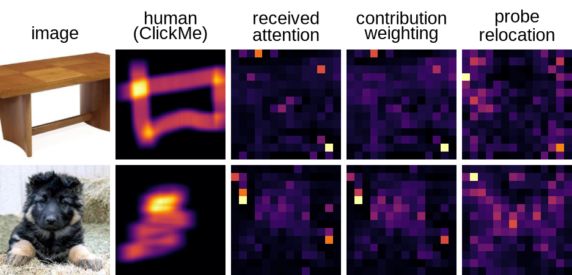

# Is It the Model or the Reading? A Fast-Weight View of ViT Attention Maps

**Hongbo Huang** · DSAA 2012 Deep Learning · paper v8 · software 0.2.0

[Paper](paper/main.pdf) · [Paper-to-code map](docs/reproduce.md) · [Pre-registration](docs/preregistration.md) · [Provenance](docs/provenance/README.md)

The [v9 editorial revision](paper/v9/README.md) revises the manuscript and its figures/tables using the same
experiments and registered rules. The original v8 source/PDF and its reproduction workflow remain preserved.

Deep-layer ViT attention maps often look poor. How much comes from the model, and how much from the rule
used to read its attention? This project uses the established fast-weight view of attention to test three
premises: specificity, location and contribution. The contribution is a diagnostic framework and controlled
evaluation of readings; contribution weighting is the existing value-norm technique, not a new attribution method.

## Findings and registration

Registered R1 negative controls hold. Registered R2, that all corrections together improve the four supervised
centre-blind cells, partly holds: **1/4**, DeiT-B ClickMe. Registered R3 model-side comparisons are not higher
than DeiT-S beyond the practical margin. Prior execution and diagnostic results are registered replications.
The [original registration](docs/preregistration.md) preserves its dates and P1-P7 labels and maps them to R1-R3.

Contribution weighting improves enrichment by **+0.038 / +0.065** and ClickMe alignment by **+0.033 / +0.058**
in DeiT-S / DeiT-B; DINO ViT-S is comparable. Deletion faithfulness stays within the pre-specified improvement
margin. Probe relocation is lower in all nine deep metric/model cells. Declining probe accuracy measures
linear decodability of the original patch index, not the spatial origin of token content. The correspondence
between diagnostics and individual correction outcomes is **post hoc**. MiTA differs in training and preprocessing;
it is not a fully controlled model-side comparison.

## Supplied experiments and methods

Fourteen configs cover execution top-k/random reading sets, layerwise diagnostics, R0 received attention,
C1 mean-map subtraction, C2 probe relocation, C3 output-contribution magnitude weighting, R_all and matched
controls, GAE references, register/MiTA comparisons and post-hoc mechanism checks. Metrics are same-ring
enrichment, image-specific ClickMe alignment and deletion faithfulness. Original per-image outputs are supplied.



`src/` holds implementations, `configs/` protocols, `outputs/` immutable observations, `results/` reference
summaries, `figures/` drawings, `paper/` the supplied v8 PDF/source, and `tests/` CPU checks. Historical experiments
outside v8 stay in `archive/` and are excluded from course ZIPs. Essential historical evidence is active under `docs/`.

## Install and run CPU checks

Use Python **3.12**. No dataset, model download, GPU or ImageNet credential is needed for these commands.

```bash
git clone --branch paperv8 https://github.com/hhuang999/vit-fastweight-lens.git
cd vit-fastweight-lens
python -m venv .venv
source .venv/bin/activate
python -m pip install -r requirements-torch.txt --index-url https://download.pytorch.org/whl/cpu
python -m pip install -r requirements.txt
python -m pip install -e . --no-deps
python -m pip check
python -m pytest -q
python scripts/validate_release.py --strict
```

On Windows activate with `.venv\Scripts\Activate.ps1`; run Bash workflows through WSL or Git Bash.
The `paperv8` branch is the review candidate for `release/v1`. The exported ZIP records its immutable commit
in `.git_archival.txt`. CPU CI uses Ubuntu 24.04 and Python 3.12 with the same pinned dependencies.

## Rebuild from supplied original outputs

```bash
bash reproduce/from_outputs.sh
# Or verify in a temporary directory and save a dated comparison report:
python scripts/validate_release.py --strict --rebuild --archive-check --report build/verification.json
```

The shell command writes to a **fresh `build/rebuilt/`**, preserving original outputs, summaries and author
paper assets. To repeat, give a new destination, e.g. `bash reproduce/from_outputs.sh outputs build/second`.
All 19 generated CSV summaries, all numeric columns, labels, counts, confidence intervals and verdicts are compared.
The two authentic historical register CSVs are preserved and checked by hash. Absolute numeric tolerance is
**1e-12**, relative tolerance zero; verdicts and identifiers match exactly. Generated paper tables match byte for
byte. Figure inputs and example indices match exactly; fonts and rasterisation can differ across systems.
The strict audit checks hashes, schemas, unique observations, methods, model/dataset coverage, original protocols
and scientific implementation fingerprints. Missing, duplicate, changed or corrupt artifacts fail with nonzero exit.

## Optional full GPU pathway

Experiments are complete. GPU reruns are an optional future pathway, **not release acceptance**. This release
preparation does not run experiments or retrain models/probes. For future work, use a separate CUDA environment,
install the PyTorch requirements from `https://download.pytorch.org/whl/cu128`, then the remaining requirements.

```bash
python scripts/prepare_data.py imagenet imagenet_s clickme
python scripts/prepare_data.py --check
python -m pip install -r requirements-download.txt
python scripts/download_models.py
python scripts/run.py --config configs/k_sweep.yaml --output outputs/rerun
bash reproduce/smoke.sh                     # optional GPU smoke, not a CPU check
bash reproduce/full.sh outputs/rerun build/gpu-rerun
```

Keep original batch sizes, method order, image lists, seeds and preprocessing. ClickMe's other-image control pairs
with the **previous image within each batch** (`roll(1)`), so changing batch size changes the protocol.
New runs default to `outputs/rerun/`; the runner refuses writes to original run folders and validates data before
skipping completed new runs. Inference requires committed source. The Colab notebook is an optional GPU workflow.

## Reproducibility limits

Authentic recovered configs, metadata and logs describe historical executions; missing fields remain unknown.
The [2026-11-08 GPU verification records](docs/provenance/README.md#historical-verification) concern earlier code
revisions, not a new full reproduction of this release. No new GPU reproduction is claimed.
The historical register full-validation accuracy/reduction check is not regenerated by the active pipeline;
its [source CSVs and revision](results/register/README.md) are supplied. The preliminary Small/Tiny top-k comparison
has an exact historical link in the reproduction map. Manual interpretation tables are validated against their
numeric evidence rather than represented as inference outputs.

## Map results to paper v8

See [docs/reproduce.md](docs/reproduce.md) and the machine-readable [evidence map](docs/evidence.json).
Figure 1a is the schematic; Figure 1b the first two seeded examples; Figure D.1 the next four. Table 1 is the
premise/diagnostic/control interpretation, **Table 2** the numerical comparison, and Table A.1 registered outcomes.
The exact example indices are recorded in [gallery_selection.json](figures/gallery_selection.json).
The supplied paper is v8 (11 pages); [paper/README.md](paper/README.md) describes its source and build.

## Export the course submission

Commit the verified changes, then:

```bash
python scripts/export_release.py --output dist/course_code.zip
# Equivalent raw Git export (without checksum/inventory sidecars):
git archive --format=zip -o course_code.zip HEAD
```

The full bundle includes source, tests, configs, splits, all required original per-image outputs, reference results,
paper, figures, pre-registration and provenance. It is self-contained for CPU reconstruction. The export helper
validates a real extracted archive and writes a per-file SHA-256 inventory and ZIP checksum. `archive/`, credentials,
external datasets, checkpoints and local writing materials are excluded. A source commit identifies the candidate;
an official tag can be assigned after review and merge.

## Licences, data and models

Code is under the [MIT licence](LICENSE). ImageNet requires accepting its access terms; use `HF_TOKEN` in the
environment or local `.env` for its pinned Hugging Face revision. Data are external: ImageNet-S919 validation masks
and ClickMe validation shards are fetched and checked by `scripts/prepare_data.py`. Dataset/model sources, pinned
revisions and checksums are beside their loaders. Their original permissions and licences apply independently
of this repository's code licence; checkpoint downloads are not included in the bundle.
MiTA uses its authors' released DeiT-S checkpoint; the optional downloader is pinned in `requirements-download.txt`.
The established fast-weight lens and existing value-norm weighting sources are credited in the supplied paper.
ClickMe images likely overlap ImageNet training data; conclusions cover three frozen S/B classifiers and these readings.
An attention map is partial evidence about a model. See the paper's limitations and ethical considerations.
