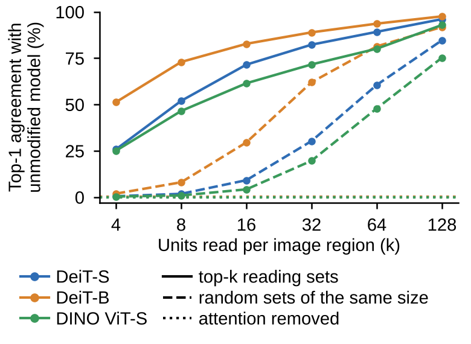
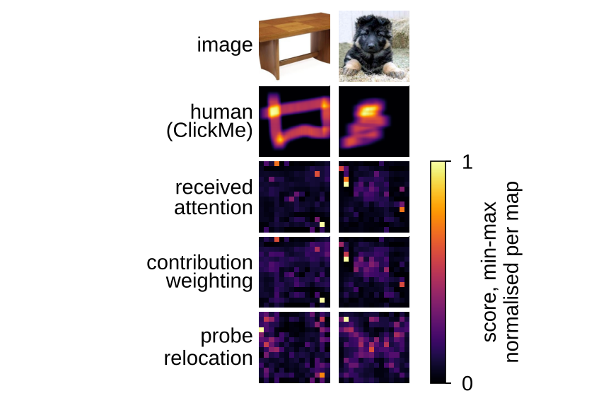

# ViT FastWeight Lens

Tools and experiments for analyzing Vision Transformer attention maps through fast and slow weights.

This README describes [`release/v1`](https://github.com/hhuang999/vit-fastweight-lens/tree/release/v1).
Use that branch for the current code documentation and reproduction instructions.

The analysis treats an attention head as a two-layer network: the learned slow weights produce keys and values
for each image, which serve as the network's fast weights; tokens act as hidden units. The code uses this view to
read attention maps, measure three premises of that reading, and evaluate corrections against matched controls.

## What the code does

- **Read and intervene:** extract received-attention maps and restrict the units read by each query to top-k or
  random sets, then measure agreement with the unmodified model.
- **Diagnose and correct:** measure each premise per layer and compare its correction with a matched control.
- **Evaluate:** compute same-ring object enrichment, image-specific ClickMe alignment and deletion faithfulness
  (SRG), with paired-bootstrap intervals and the registered comparison rules.
- **Reproduce:** rebuild summary tables, figures and LaTeX tables from the committed per-image outputs, or rerun
  the experiments with the released configurations.

| Premise | Diagnostic | Correction |
| --- | --- | --- |
| Specificity (M1): activations are specific to the image | Share of variance explained by the mean map | Mean-map subtraction (C1) |
| Location (M2): token j still represents patch j | Position-probe accuracy | Probe relocation (C2) |
| Contribution (M3): activation size reflects output contribution | Share of received attention on high-norm tokens | Contribution weighting (C3) |

Implemented models are DeiT-S, DeiT-B, DINO ViT-S/16 and the MiTA-DeiT-S variant. The analysis modules are in
[`src/fastweight_vit/`](src/fastweight_vit/); [the experiment names](paper/naming.md) map configuration and output
codes to descriptive labels.




*Left: top-1 agreement with the unmodified model when every image region reads only its top-k units in all layers
(solid), random units of the same number (dashed), or no attention (dotted). Right: two randomly drawn ClickMe
images with the human map and three readings of DeiT-S (layers 9–12).*

## Installation

Python 3.12. Experiments need a CUDA GPU; tests and rebuilding tables and figures run on CPU.

```bash
git clone --branch release/v1 https://github.com/hhuang999/vit-fastweight-lens.git
cd vit-fastweight-lens
pip install -r requirements-torch.txt --index-url https://download.pytorch.org/whl/cu128
pip install -r requirements.txt
pip install -e . --no-deps
pip install gdown  # only for downloading the MiTA-DeiT-S checkpoint
```

`requirements.txt` pins the analysis dependencies, including timm 1.0.30. For ImageNet access, put a Hugging Face
token in `.env` as `HF_TOKEN=...`, or set it in the environment. Credentials, datasets and checkpoints stay out of Git.

## Data and models

```bash
python scripts/prepare_data.py imagenet imagenet_s clickme partimagenet
python scripts/prepare_data.py --check
python scripts/download_models.py
```

Datasets are downloaded separately; `scripts/prepare_data.py` documents their sources, licences and checks.
[`data/splits/`](data/splits/) contains the fixed image lists: 5,000 ImageNet validation images for the execution
checks, 2,000 ImageNet-S images for deletion, and 4,000 held-out images (2,000 for fitting position probes and 2,000
for probe evaluation and mean maps).

DeiT checkpoints use pinned timm revisions; DINO ViT-S/16 uses its official linear head. The MiTA-DeiT-S checkpoint
comes from the [MiTA authors](https://arxiv.org/abs/2602.01219) and is fetched with gdown; it is not redistributed here.
The download script checks checkpoint SHA-256 hashes. The test-time register uses the 8 FFN units listed in
`configs/table1_register.yaml`; `configs/register.yaml` specifies their search.

## Run an experiment

Each YAML file in `configs/` specifies an experiment, its models, data, parameters and dependencies. Its opening
comment describes the outputs. Run a selected model, for example:

```bash
python scripts/run.py --config configs/k_sweep.yaml --model deit --output outputs/rerun
```

Outputs are written to `<output>/<config>/[<dataset>/]<model>/`, including the effective config, source commit,
software versions and per-image results. Completed runs are skipped. `scripts/run.py` requires a committed source
tree so that each run records its source revision. Use `outputs/rerun/` for new runs; the original runs are committed
under `outputs/`.

Experiments that use probes or mean maps need those diagnostic runs first. [`docs/reproduce.md`](docs/reproduce.md)
maps each experiment to its configuration and generated files; `reproduce/full.sh` runs them in dependency order.

## Reproduce and test

| Command | Purpose | Compute |
| --- | --- | --- |
| `bash reproduce/from_outputs.sh` | Rebuild `results/`, `figures/` and `paper/tables/` from the committed `outputs/` | CPU, a few minutes |
| `bash reproduce/full.sh` | Rerun all experiments into `outputs/rerun/`, then rebuild the tables and figures | One L4 GPU, about 12 hours |
| `bash reproduce/smoke.sh` | Run every experiment on 16 images and build summary tables | One GPU, under 10 minutes |
| `python -m pytest -q` | Run the CPU test suite | CPU |

[`reproduce/colab.ipynb`](reproduce/colab.ipynb) provides the same workflow on Colab. A full rerun needs the datasets
and checkpoints above. Both rebuild commands write tracked summary tables, figures and LaTeX tables; inspect any
changes before committing them. Reproduction checks and environment details are recorded in
[`docs/reproduce.md`](docs/reproduce.md). Statistical decision rules and the distinction between registered and
exploratory analyses are in [`docs/preregistration.md`](docs/preregistration.md).

## Layout

| Path | Contents |
| --- | --- |
| `src/fastweight_vit/` | Readings, probes, interventions, metrics, model and data loaders; `experiments/` contains the experiment workflows |
| `configs/` | One YAML file per experiment |
| `scripts/` | Experiment runner, data and checkpoint preparation, summary-table and figure builders |
| `reproduce/` | Rebuild, full-rerun and smoke-test scripts; Colab notebook |
| `data/splits/` | Fixed image lists (IDs only) |
| `outputs/` | Committed per-image outputs of the original runs; see `outputs/README.md` |
| `results/` | Generated summary tables, intervals and verdicts |
| `figures/` | Generated plots and image panels; see `figures/README.md` |
| `paper/tables/` | Generated LaTeX tables; see `paper/README.md` |
| `docs/` | Reproduction map, comparison rules and verification records |
| `tests/` | CPU tests |

The code and results retain internal identifiers: R0 is received attention, C1–C3 are corrections, M1–M3 refer to
specificity, location and contribution, and P1–P7 identify registered predictions. See
[`paper/naming.md`](paper/naming.md) for the complete mapping and [`AGENTS.md`](AGENTS.md) for maintenance guidance.

## Licence and sources

Code is released under the [MIT licence](LICENSE). Model, dataset and reused-method sources are recorded beside
their loaders and implementations. The implementation builds on DeiT, DINO, timm, MiTA, ImageNet-S, ClickMe /
Harmonization and PartImageNet; GAE follows Chefer et al. (2021), and the test-time register follows Jiang et al.
(2025). Please follow the original sources' licences and citation requirements when using their assets.
