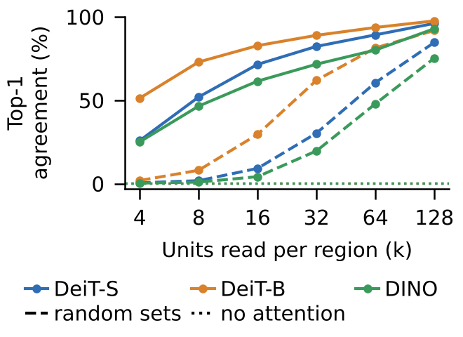
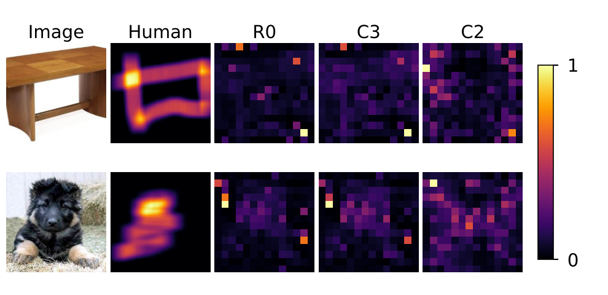

# Attention as Fast Weights: Reading, Diagnosing, and Correcting Attention Maps in Vision Transformers

Code, fixed image lists and result tables for the paper of the same name (course project, see the note at the end).

## Abstract

For each image, an attention head computes a two-layer network: the keys are its first-layer weights, the softmax
is its activation and the values are its second-layer weights; every token is a hidden unit. An attention map
("attention received", R0) therefore reads hidden activations and draws unit *j* at patch *j*. This reading assumes
three premises: the activations are specific to the image (M1), unit *j* still stands for patch *j* (M2), and a large
activation means a large contribution (M3). We run one read → diagnose → correct loop on DeiT-S, DeiT-B and DINO
ViT-S. **Read:** the units that attention selects are the ones the model executes: when every region of every layer
may read only 16 units, the models keep 72% / 83% / 61% of their top-1 predictions, against 9% / 30% / 4% for random
units and 0.1–0.2% with no attention at all. **Diagnose:** two premises fail in deep layers. M2 fails in all three
models (a linear position probe recovers the patch of only 18% / 32% / 36% of layer-12 tokens); M3 fails only in the
supervised models, where high-norm tokens receive much attention but carry short value vectors; M1 largely holds.
**Correct:** each correction is paired with a simpler stand-in it must beat, under metrics that give no credit to a
centre prior. Only weighting each unit by its contribution, ‖W_O v_j‖ (C3; value-norm weighting itself follows
Kobayashi et al. 2020), improves the map beyond its stand-in, and only in the models where M3 fails (DINO: no change).
Removing the image-independent part (C1) does no more than removing the centre bias. Relocating scores with the
position probe (C2) makes the reading worse in every model; its mechanism is not yet determined, and four candidate
causes were ruled out in exploratory analyses (far-away probe errors, a fixed position preference of the probe, probe
capacity, and a link between how global a token is and how uncertain the probe is). Changing the model (a
test-time register, top-k attention training) does not improve the reading more than changing the reading does. All
decision rules were fixed before the main runs; the pre-registered combination of all three corrections partly
holds (1 of 4 cells).

 

*Figure 2. (a) Top-1 agreement when every layer reads only k units per region (solid), random units (dashed), or
no attention (dotted). (b) Two randomly drawn ClickMe images: human map, R0, C3 and C2, layers 9–12.*

## Installation

Python 3.12, one CUDA GPU for the experiments (CPU is enough for the tests and for rebuilding the tables).

```bash
pip install -r requirements-torch.txt --index-url https://download.pytorch.org/whl/cu128
pip install -r requirements.txt
pip install -e . --no-deps
pip install gdown  # only to fetch the MiTA-DeiT-S checkpoint (scripts/download_models.py)
```

`requirements.txt` pins every package (timm 1.0.30). Put a Hugging Face token with access to ImageNet in `.env`
(`HF_TOKEN=...`) or in the environment; it is never printed.

## Data and models

The datasets are not distributed here; `scripts/prepare_data.py` downloads and checks them (sources, licences and
counts are listed in its docstring). The fixed image lists are in `data/splits/`: the 5,000 ImageNet validation
images of the execution checks, the 2,000 ImageNet-S images of the deletion test, and the 4,000 held-out images
(2,000 train the position probes, 2,000 give the mean maps and probe accuracy; none is evaluated).

```bash
python scripts/prepare_data.py imagenet imagenet_s clickme partimagenet
python scripts/prepare_data.py --check
python scripts/download_models.py
```

Models: DeiT-S and DeiT-B (timm, pinned revisions), DINO ViT-S/16 with its official linear head, and MiTA-DeiT-S,
whose checkpoint comes from the MiTA authors (fetched with gdown; every checkpoint is checked against a SHA-256).
The test-time register uses 8 FFN units of DeiT-S, listed in `configs/table1_register.yaml`; `configs/register.yaml`
shows how they were found.

## Reproduce

| command | what it does | time |
| --- | --- | --- |
| `bash reproduce/from_outputs.sh` | rebuild every table (`results/`) and figure (`figures/`) from run outputs in `outputs/` | a few minutes, CPU |
| `bash reproduce/full.sh` | rerun every experiment from scratch, then rebuild the tables and figures | about 18 hours on one L4 GPU |
| `bash reproduce/smoke.sh` | every experiment on 16 images, then the tables | under 10 minutes on one GPU |

`reproduce/colab.ipynb` runs the same steps on a Colab L4. One paper element = one config = one command, e.g.
`python scripts/run.py --config configs/table1.yaml`; outputs go to `outputs/<config>/[<dataset>/]<model>/` with the
effective config, the git commit, versions, GPU and log. The per-image outputs of a full run (about 0.5 GB) are not
in this repository; `full.sh` regenerates them. `results/` holds the summary tables of the original runs.
`docs/reproduce.md` maps every table, figure and number of the paper to its command and output file, and records
the reproduction checks. `docs/preregistration.md` lists the predictions, decision rules and freeze commits.

```bash
python -m pytest -q
```

## Layout

```
src/fastweight_vit/   readings (R0, C1-C3, stand-ins), references (GAE, centre, random), probes, execution
                      (top-k reading sets), instrument, registers, metrics, enrichment, faithfulness, models, data,
                      experiments/
configs/              one YAML per paper element
scripts/              run.py, make_tables.py, make_figures.py, prepare_data.py, download_models.py
reproduce/            from_outputs.sh, full.sh, smoke.sh, colab.ipynb
data/splits/          fixed image lists (IDs only)
results/, figures/    summary tables and paper figures
docs/                 preregistration.md, reproduce.md
tests/
```

## Citation, licence, acknowledgements

Please cite with `CITATION.cff`. Code under the MIT licence (`LICENSE`). We thank the authors of DeiT, DINO, timm,
MiTA, ImageNet-S, ClickMe / Harmonization and PartImageNet for releasing their models and data. GAE follows
Chefer et al. (ICCV 2021); the test-time register follows Jiang et al. (2025).

This is a course project of DSAA 2012 Deep Learning, HKUST(GZ). The code was written with an AI coding assistant
under the author's design; the author checked every conclusion.
