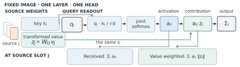

# How Should We Read ViT Attention Maps? A Fast-Weight Perspective

**Hongbo Huang** | DSAA 2012 Deep Learning | HKUST(GZ)

[Read the paper (PDF)](paper/paper.pdf) | [LaTeX source](paper/main.tex) | [Original registration](docs/preregistration.md) | [Experiments](experiments/README.md)

What does a bright patch in a vision transformer's attention map explain? For a fixed image, a head can be read as a two-layer network whose keys and transformed values supply its temporary weights. We use this representation to separate three choices in plotting attention: how much structure recurs across images, where a contextualised token's score is placed, and how its activation contributes to a receiving query. Each proposed change is compared with a matched control on frozen models.

- Redistributing received attention using a position probe lowered all nine deep-layer model-metric scores. A token's decodable grid index gives limited guidance for tracing its input evidence.
- In supervised DeiT-S/B, weighting attention by transformed-value length improved foreground enrichment and ClickMe alignment over received attention. Three of four comparisons also cleared the high-norm control. Top-1 deletion gains fell below the registered margin.
- In exploratory tests on the same 128 Oxford-IIIT Pet images, using only the final CLS query increased agreement with class-margin interventions by **0.041** in DeiT-S and **0.082** in DeiT-B. Mask AUROC fell by **0.091** in S but rose by **0.024** in B. The localisation–classifier reversal in S did not persist across model sizes; see the [separately specified replication](experiments/receiver_review/README.md).



For the spatial control in Table 1, keeping projected lengths at their own patches yields enrichment **0.160**, compared with **0.137** for donor ordering and **0.138** for same-radius shuffling. See the [saved scores](experiments/spatial/summary.json) and [implementation](experiments/spatial/run_spatial.py).

## Set up

Clone the repository. The saved-results workflow uses Python 3.12, CPU PyTorch and no external dataset. Start the following commands at the repository root:

```bash
git clone https://github.com/hhuang999/vit-fastweight-lens.git
cd vit-fastweight-lens
python -m venv .venv
source .venv/bin/activate
python -m pip install -r requirements-torch.txt --index-url https://download.pytorch.org/whl/cpu
python -m pip install -r requirements.txt
python -m pip install -e . --no-deps
```

For a checked-out manuscript alone, install Tectonic and run `tectonic -X compile main.tex` from `paper/`. No Python or image datasets are needed for this route.

On Windows activate with `.venv\Scripts\Activate.ps1`. For GPU inference use a separate environment, installing the compatible CUDA wheels for the torch/torchvision pair before the remaining requirements. Model revisions, transforms and download locations live in [the model loaders](src/fastweight_vit/models/) and [dataset loaders](src/fastweight_vit/data/).

**Minimal example.** Recover the central Table 2 contrast from per-image scores, before bootstrapping or rounding:

```bash
python -c "import pandas as pd; t=pd.read_csv('experiments/cls/three_endpoint_per_image.csv').set_index(['method','image']); print((t.loc['cls_sum_head']-t.loc['all_c3']).mean().round(3))"
```

Expected values are `0.041` for margin Spearman, `-0.033` for same-ring enrichment and `-0.091` for AUROC.

## Rebuild the paper from saved results

```bash
python -m pytest -q
python scripts/validate_research.py --strict
python scripts/rebuild_results.py --destination build/rebuilt
python -m experiments.receiver_review.audit
python scripts/display/build.py
python scripts/build_paper.py
```

On Windows with a long system temp path, set `TEMP` and `TMP` to a short writable directory before running the tests.

The numerical rebuild starts from the preserved per-image and per-layer exports in [outputs](outputs/) and compares regenerated summaries with [results](results/). Use a fresh destination for each numerical rebuild. The display builder uses the released evidence to regenerate the figures and tables included by LaTeX. The final command needs [Tectonic](https://tectonic-typesetting.github.io/en-US/) on PATH. It verifies the bundled NeurIPS style and writes `build/paper/paper.pdf`. To compile the exact release figures, run the typesetting command directly on a fresh checkout. Font availability can affect regenerated plots.

| Paper item | Source evidence or implementation | Rebuilt output |
| --- | --- | --- |
| Fig. 1, one image-conditioned attention head | `scripts/display/build_static_figures.py` (`fast_weight_lens`) and editable `paper/figures/fast_weight_lens.svg` | `paper/figures/fast_weight_lens.pdf` |
| Fig. 2, layer-wise diagnostics and two alignment endpoints for three readout changes | `results/correct_tests.csv`; diagnostics from `results/diagnose.csv`; deletion contrasts in Appendix B | `paper/figures/diagnosis_correction_bridge.pdf` |
| Table 1, spatial assignment | `experiments/spatial/summary.json` | `paper/tables/spatial.tex` |
| Table 2, CLS and masks in two checkpoints | `experiments/{cls,receiver_review/deit_b}/three_endpoint_{summary,contrasts}.csv` | `paper/tables/cls.tex`; complete scores and intervals in `cls_full.tex`, `cls_effects.tex` |
| Table A.1, original registered predictions | P1–P7 in `docs/preregistration.md` and preserved verdicts in `results/`, checked by `validate_research.py` | Interpretation and former-label mapping in `paper/appendix.tex` |
| Fig. B.1, execution agreement | `results/k_sweep.csv` | `paper/figures/execution_k_sweep.pdf` |
| Tables B.1-B.4, scores, diagnostics, contrasts and sanity check | Registered summaries, paired differences and parameter-randomisation results | `paper/tables/{registered_main,diagnostics_per_layer,registered_paired,registered_sanity}.tex` |
| Table C.1, probe-relocation alternatives | `results/c2_analysis/` and `results/supplementary/` | `paper/tables/relocation_explanations.tex` |
| Figs. D.1-D.2, fixed example maps | Gallery tensors in `outputs/table1/clickme/deit/`, [fixed indices](data/splits/gallery_selection.json) | `paper/figures/example_maps{,_more}.pdf` |
| Tables B.5-B.6, endpoint and geometry checks | `experiments/endpoints/`, `experiments/geometry/` | `paper/tables/{endpoint,geometry}.tex`, [budget-wise deletion curves](docs/figures/deletion_curves.pdf) |

Tables E.1-E.3 give the full spatial controls, receiver scores and paired contrasts behind main Tables 1 and 2. In the archived scores, R0 is received attention; C1, C2 and C3 denote mean subtraction, probe relocation and value weighting. R_all combines the three.

Run `python scripts/display/build.py` for the generated items in the table and `python scripts/build_paper.py` to typeset them, including the registration table and key code. The [registered experiment guide](docs/reproduce.md) traces the numerical results to their producing configurations. The [exploratory guide](experiments/README.md) gives the commands for regenerating Oxford readouts, geometry, deletion endpoints and paired uncertainty estimates.

## Run from images and model weights

Use a CUDA environment for the full inference experiments. The [runner](scripts/run.py) dispatches the [registered configurations](configs/) to the [implementations](src/fastweight_vit/experiments/); [readings.py](src/fastweight_vit/readings.py) implements the maps. The original study uses supervised DeiT-S/B and DINO ViT-S/16 (with the authors' linear head). Evaluation uses 224-pixel inputs and 16-pixel patches. DeiT resizes the short side to 248 and takes a centre crop; DINO uses 256. ClickMe follows the released heatmap geometry and resizes the image without cropping. Keep the fixed splits and ClickMe batch size of 64: the other-image control pairs each human map with the preceding image inside its batch.

1. For ImageNet-1k, obtain access to the pinned Hugging Face dataset and make a read token available as `HF_TOKEN`. ImageNet-S masks and ClickMe validation shards are downloaded by the dataset preparation script. Fetch weights with the model downloader; MiTA uses the authors' released checkpoint.
2. From the repository root, run:

   ```bash
   python -m pip install -r requirements-download.txt
   python scripts/prepare_data.py imagenet imagenet_s clickme
   python scripts/prepare_data.py --check
   python scripts/download_models.py
   python scripts/run.py --config configs/k_sweep.yaml --output outputs/rerun
   ```

   For the complete sequence of configurations, including calibration and probe fitting, run `bash reproduce/full.sh outputs/rerun build/gpu-results` (Bash, Git Bash or WSL). Each new run writes separate outputs. The historical run ID `table1` identifies the registered readout comparison in the archive and configurations. Its scores feed Figure 2 and Appendix B. The original numerical thresholds and directional predictions are recorded in [the registration](docs/preregistration.md).
3. For the Oxford cases, follow the [Oxford download and setup commands](experiments/README.md). Use the public pet images and trimaps and pinned DeiT-S weights; the receiver replication also uses DeiT-B. After setup:

   ```bash
   python -m experiments.spatial.run_spatial --output-dir outputs/rerun/spatial
   python -m experiments.spatial.audit_results --input-dir outputs/rerun/spatial --output-dir outputs/rerun/spatial
   python -m experiments.cls.run_cls --output-dir outputs/rerun/cls
   python -m experiments.cls.analyze_endpoints --input-dir outputs/rerun/cls --output-dir outputs/rerun/cls
   ```

For the [DeiT-B replication and paired audit](experiments/receiver_review/README.md), use the same images and the base checkpoint.

The Oxford studies are exploratory. The protocol records which comparisons were specified before scoring and which mask analysis followed inspection of the CLS margin results. Source-image IDs and historical literal hash prefixes are preserved so renaming a study directory cannot change its sample.

Code is distributed under the [MIT license](LICENSE). External images, human maps, pretrained weights and the conference template retain their original terms. Citation information is in [CITATION.cff](CITATION.cff).
