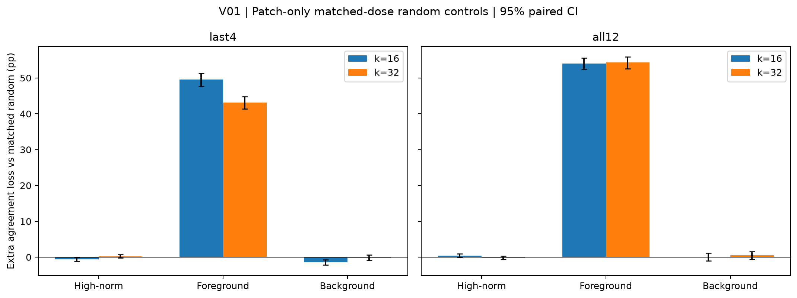
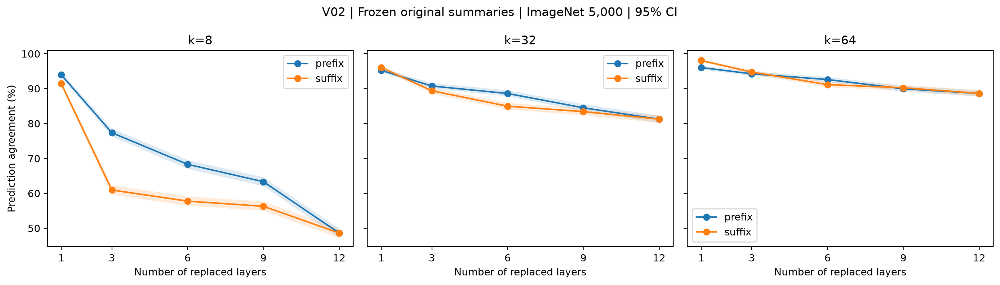
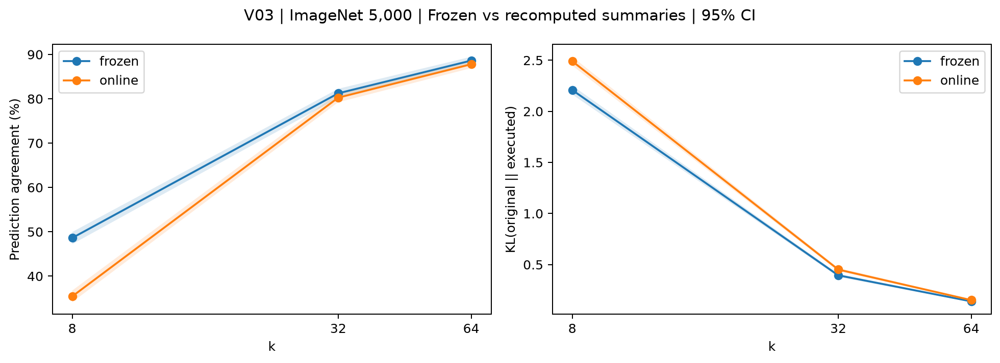

# 夜间补充验证总结：V00–V03

## 1. 结论

**四项已批准验证全部完成。前景读取的重要性经匹配对照后仍然很强，多层损失不能归给某一个差层，现场重新计算说明书没有救回忠实性。** 最重要的三个数字是：前景相对匹配随机删除额外损失 **53.99pp [52.41,55.55]**；k64最敏感单层仍保持 **96.02% [95.50,96.56]**；现场重算在k8相对冻结方式下降 **13.18pp [11.64,14.66]**。

所有区间为图片级95% bootstrap，1000次、seed0。三项正式模型实验均在同一Colab L4、固定数据/模型和FP32上运行，原主实验及报告保留。需要明确记录一次执行疏漏：首次本地完整测试误运行了3个CUDA单测，违反了本轮禁止本地GPU的要求；已修正隔离方式并保留证据，详见第5节。正式V01–V03没有在本地GPU运行。

## 2. 每项状态与结果

| 项目 | 状态与规模 | 关键结果 | 报告 |
| --- | --- | --- | --- |
| V00 最高点并列 | 完成；三模型、两k、四热图，24设置；仅CPU缓存分析 | DeiT k16并列期望−原pointing为+0.014pp [−0.095,0.123]；24个差值区间均含0 | [V00](v00_ties.md) |
| V01 匹配随机干预 | 完成；Pet3669张×76设置，278844条预测 | k16全层共同n3554：前景额外损失53.99pp [52.41,55.55]；汇聚点0.46pp [−0.06,0.95]；普通背景0.07pp [−1.00,1.11] | [V01](v01_validation.md) |
| V02 单层与层组合 | 完成；ImageNet5000张×57设置，285000条预测 | k64单层96.02%–98.38%，全层88.62%；k8前3层−后3层差16.42pp [14.80,17.96] | [V02](v02_validation.md) |
| V03 冻结与现场 | 完成；5000张×3新增设置，15000条预测、180000条模式比较 | 现场−冻结一致率：k8 −13.18pp [−14.66,−11.64]；k32 −0.98pp [−1.92,−0.06]；k64 −0.82pp [−1.46,−0.18] | [V03](v03_validation.md) |

### V01：数量匹配后，前景效应仍很大

随机对照现在只能从已选中的patch删除，保留已有CLS，并逐图/层/head/区域匹配目标类别的删除数量。k32全层共同n3289中，前景的额外损失也达54.30pp [52.55,55.89]。因此原B3的前景效应不能仅由“删得更多”解释。

汇聚点没有稳定的正向额外破坏效应，不能把热图强峰直接当成功能重要性。这里的干预仍包含按排名补选，测的是保持预算的替换效应；不是每个token固有的重要性，也不是对原模型全部注意力直接消融。新旧16个基准/类别干预的一致率差均为0。

### V02：多层作用取决于位置和预算

k64最差单层为第1层96.02% [95.50,96.56]，最好为第5层98.38% [98.02,98.72]；全层88.62% [87.76,89.48]。这直接加强了“全层损失不是一个特别差的层单独造成”的判断。

k8前3层77.36% [76.28,78.56]，后3层60.94% [59.58,62.28]，差距明显；k64的对应差值−0.50pp [−1.26,0.28]，没有清楚分离。后层组合更敏感的现象不能不加条件地推广到所有预算。独立乘积仍夸大损失：k64乘积70.98% [68.82,73.22]，实际全层高17.64pp [15.78,19.52]。

### V03：现场重算使短预算表现更差

k8现场一致率35.44% [34.14,36.76]，冻结为48.62% [47.22,49.96]。三个预算的KL也增加，配对增量分别为0.2820 [0.2355,0.3245]、0.0563 [0.0441,0.0684]、0.0124 [0.0086,0.0161]。这不支持“及时重算就能补回损失”的简单解释，但不能据此断言冻结从不产生状态失配。

单层等价在200张×三预算×12层上严格通过；第一层两模式的读取集合和路由也逐图相同。k8到第12层的集合重合为19.40% [19.21,19.60]，路由改变70.31% [70.08,70.53]，说明现场方式确实适配了改变后的中间状态，而非没有生效。

## 3. 对整体研究叙事的影响

仍最接近研究设计书的**情况C**，但重点应放在预算和多层组合，而不是强行描述成“部分层完全可读、部分层完全不可读”。较大预算可保持较高忠实性，短预算的全层执行损失显著；单层普遍更稳健，组合位置会改变损失。

RQ3的结论更清楚了：读取频率、空间定位与功能重要性需要分别测量。背景高范数强峰确实存在，并列规则不是主要解释；经过剂量及CLS控制后，前景删除仍远比匹配随机删除有破坏性，而汇聚点没有稳定的更强影响。既有DINOv2寄存器对照提供一致性证据，仍不能称为同权重纯寄存器开关的因果实验。

主实验继续使用N01冻结说明书，不按V03得分选择方法；原RQ1/RQ2/RQ3和叙事稿占位符均未改动。

## 4. 运行前决定与执行边界

- 用户已明确批准整套V00–V03及中途不等待确认。E09与配置在d956f42中先提交，再查看新增结果；没有新增待确认的科学设置，也没有调整阈值、样本或层组合。
- 科学运行源码d5f0b45；使用同一L4实例、固定模型revision。ImageNet原分片/抽样/权重哈希匹配，Pet测试7339个图片、trimap及顺序文件哈希匹配。
- 49项远程测试通过，三项各16张完整设置smoke通过；正式每项先通过全部图片的k197/observe验收，误差均0。V01额外检查169067520个随机读取集合的删除剂量、CLS保留和固定k。
- V00/V01/V02/V03分别归档提交并push。全部正式预测共578844条，另有V03模式比较CSV和V00缓存分析。三项正式运行合计约23.25分钟，不含环境、下载、开发及本地分析时间。
- Colab会话 `mita-validation-20261027` 已停止；服务器确认活动实例0、assignments0、费率0.00 CU/小时。余额由24.95变为24.06 CU，显示余额减少约0.89 CU。未购买算力，本轮没有启动HPC。见[资源停止证据](../../experiments/2026-10-27_validation_environment_ready/resource_cleanup.json)。

## 5. 异常、纠正与验证办法

| 事项 | 发生了什么与处理 | 验证证据 |
| --- | --- | --- |
| 本地CUDA隔离未生效 | 空字符串没有在本机Windows禁用CUDA，首次完整pytest误跑3个CUDA单测；原“无本地GPU”记录有误，已如实更正。改为-1并在测试前断言CUDA不可用，重跑46通过、3跳过；分析入口也显式设-1 | [首次更正元数据](../../experiments/2026-10-27_validation_cpu/metadata.json)、[隔离后验收](../../experiments/2026-10-27_validation_cpu_isolated/metadata.json)、scripts/test_cpu.py |
| 初次Colab工作树未检出 | Git bundle只含分支引用，clone未检出源码，pip找不到依赖文件；显式检出后恢复，失败记录保留，未开始正式实验 | [初次部署状态](../../experiments/2026-10-27_validation_environment/status.json)、新环境tests.xml |
| Git推送短暂TLS失败 | 一次push失败，重试成功；不改变实验结果 | 最终本地HEAD与上游一致检查 |
| 同均值的区间端点略有差别 | 单设置按原抽样顺序bootstrap，配对/乘积按ID排序；有限1000次重采样产生Monte Carlo差别 | 脚本和逐图CSV可重算；采样单位、次数、seed及置信水平均保持原约定 |
| V03与“现场会更好”的直觉相反 | 负结果保留，未改预算或算法以追求改善 | 全量恒等、200张单层等价、首层模式相同和KL同向变差 |

## 6. 下一步选项

1. **推荐：收束实验、整合论文图表。** 用V01匹配对照支撑RQ3主结论，V02关键路径与V03边界检查放附录或方法验证。约1–2小时整理，不需GPU；作用是把论证写完整，而不是继续增加指标。
2. **制作主图候选版。** 图4保留“成分—匹配因果—寄存器对照”三面板，V00/V03放附录。约1–2小时排版；用于在4页正文内清楚区分位置与功能。当前独立图均已交付，未自动替换原主图。
3. **若希望提出更强机制主张，先讨论新的受控实验。** 例如分别只更新路由或读取集合，才有可能进一步拆解V03差异。需额外设计与计算，今晚没有运行；当前论文不依赖它，也不建议仅因还有时间就追加。

## 7. 可替换研究叙事的草稿

**RQ1：**“在固定5000张ImageNet图片上，m=16、k=128的冻结说明书保持95.08% [94.50,95.66]的原模型预测；较短预算仍产生明显损失。现场重算并未消除该损失，k=8一致率反而下降13.18pp [11.64,14.66]。”

**RQ2：**“k=64时，各单层替换一致率为96.02%–98.38%，但全部层同时替换降至88.62%。层组合的位置在短预算下很重要：k=8前3层与后3层替换相差16.42pp [14.80,17.96]，而该差异在k=64下不再清楚分离。”

**RQ3：**“在保留CLS并逐读取集合匹配删除数量后，前景删除仍比随机删除多损失53.99pp [52.41,55.55]的一致率（k=16、全层共同样本）；高范数位置的对应差值为0.46pp [−0.06,0.95]。读取热图强峰因此不能直接等同于保持预测所必需的位置。”

以上是供用户审阅的文字，未填写原叙事稿中的【待填】。
