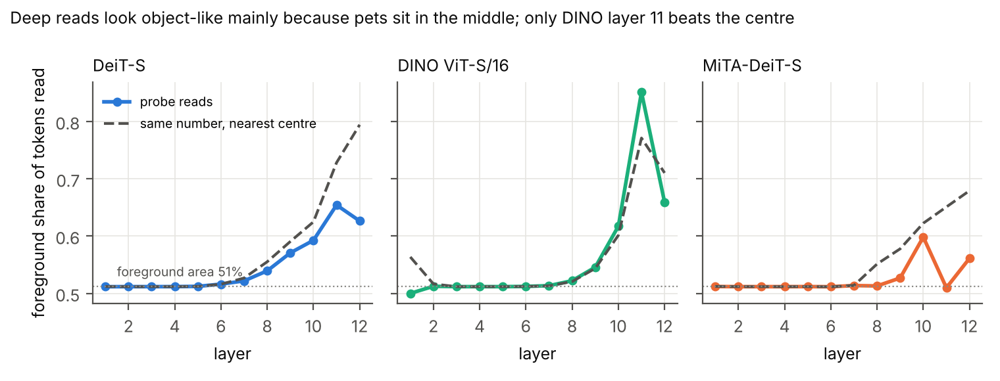

# 用 MiTA 探针读 ViT：三个研究问题的综合结果

2026-10-28 · 原设计见 [研究设计书](../research_design.md) · 细节见 [V2 报告](v2_anatomy.md) · 决策见 [decisions.md](../decisions.md)

## 一句话结论

**把 MiTA 的"区域共享读取 + 区域摘要"当作探针，可以忠实地读出 ViT 每层的注意力：ViT 大部分注意力是"同一区域读同一组 token"，深层只读很少的 token，模型也确实依赖物体位置的信息；但深层读取"看起来像物体"，在有监督的 DeiT-S 上主要是因为宠物在画面中间，只有自监督 DINO 的第 11 层明显超出这个解释。**

下面的区间都是按图片 bootstrap 1,000 次的 95% 区间。ImageNet 用固定的 5,000 张验证图，Pet 用全部 3,669 张测试图。

## 0. 探针是什么、怎么判断它可信

**探针的两个零件**都来自 MiTA，但我们不训练任何模型，只用它们去读已经训练好的 ViT：

- **共享读取（路由）**：把 14×14 的 patch 分成 m 块区域，每块区域找出它最想读的 k 个 token，区域里的 query 共用这份名单。
- **区域摘要（压缩）**：每块区域再提供一份"概要"，是对全部 token 的加权平均。

**读取模式**只是把名单记下来，不改模型。**执行模式**让模型只按名单计算，看最终预测是否和原来一样（一致率）。一致率越高，说明名单越忠实。

**可信度标尺**：

| 检查 | 结果 |
| --- | --- |
| 名单放开到全部 197 个 token | 与原模型逐位一致（最大误差 3.4e-5） |
| 噪声地板：裁剪窗口只移 1 像素 | DeiT-S 一致率 96.48%，DINO 96.42%。高于这条线的差异才值得解读 |
| 复现别人的模型 | MiTA-DeiT-S 79.77%（作者 79.8%）；DINO 线性评估 76.91%（官方 76.98%） |
| 新旧代码 | 新代码在 v1 设置下与 v1 结果完全相同 |

**三个模型的角色**：

- **DeiT-S**（有监督）：主要研究对象。
- **DINO ViT-S/16**（自监督，结构相同）：换一种训练方式，看结论能否推广。
- **MiTA-DeiT-S**（用 MiTA 结构训练）：只作对照。MiTA 论文"深层只留下主体"的图来自这种模型，对照它可以回答"普通 ViT 是否也这样"。

## 1. RQ1：探针读出的说明书忠实吗？

**做法**：所有 12 层同时只按名单计算（m = 16），k 从 4 增加到 128。参照线是随机名单（5 个种子）和按 query 相似度分组的 K-means。

| 每块区域读 k 个 token | 4 | 8 | 16 | 32 | 64 | 128 |
| --- | ---: | ---: | ---: | ---: | ---: | ---: |
| 按区域（探针） | 25.3% | 48.6% | 69.4% | 81.2% | 88.6% | 95.1% |
| K-means 分组 | 19.2% | 46.7% | 71.4% | 83.9% | 90.0% | 96.4% |
| 随机名单 | 0.5% | 2.1% | 9.5% | 30.3% | 60.1% | 84.4% |

**把 k = 16 的损失拆开**（V2）：

| 读法 | 一致率 |
| --- | --- |
| 每个 query 自己挑 16 个 token | 76.5% |
| 同区域共用 16 个 token（探针严格版） | 71.5% |
| 共用 16 个 token + 16 份摘要（完整 MiTA 结构） | 78.4% |
| 只读 16 份摘要 | 8.2% |

**结论**：

1. **选对 token 很重要**：k = 16 时，探针 69.4%，随机只有 9.5%。
2. **全层忠实需要读得多**：一致率首次超过 90% 时，k = 128。
3. **代价主要来自"读得少"，不是"共用名单"**：每个 query 自己挑也只有 76.5%，共用只再少 5 个百分点。按 Shapley 分解，共享 token 贡献 54.2 pp，摘要贡献 15.0 pp。
4. **摘要像补丁**：k 越小越有用。k = 4 时补回 30.5 pp，k = 16 时 6.8 pp，k = 128 时没有作用。
5. **推广到 DINO**：共享方案（L4）73.7%，每 query 自己挑 32 个 75.1%，只差 1.4 pp（DeiT-S 差 8.3 pp）。
6. **单层替换时探针很忠实**：只替换一层，保留 92%–97% 的预测。

**例子**：一张猫的照片，每块区域只能读 16 个 token。按探针挑，100 张里约 70 张预测不变；随机挑，只有约 10 张不变。让每个位置自己挑，也只有约 77 张不变，所以"共用名单"本身损失不大。

**对 ViT 的意义**：ViT 的注意力大部分可以用"同一区域读同一组 token"概括。真正难的是"只读很少的 token"。

## 2. RQ2：ViT 每一层是怎么读的？

**做法**：每次只替换一层，其余 11 层不变。

- **v1（k = 8）**：各层一致率在 88.7%（第 3 层）到 93.9%（第 1 层）之间。12 层同时替换只有 48.6%，所以全层损失不能归到某一层。
- **V2（k = 16，DeiT-S）**：

| 层 | 特点 | 证据 |
| --- | --- | --- |
| 第 1 层 | 最依赖具体 token | 共享 token 贡献 13.8 pp，是各层最大；删掉整层注意力只剩 69.5% |
| 第 2–3 层 | 每个位置各读各的 | "每 query 特有"部分约 5 pp，可共享指数约 0.6 |
| 第 9–12 层 | 几乎完全共用，而且只读很少几个 | 特有部分 ≤ 0.6 pp，可共享指数 ≥ 0.92；所有名单的并集从第 3 层的 75% 降到第 12 层的 12% |

- **DINO 的不同**：第 1 层和第 10–12 层注意力更分散，每个 query 自己的前 16 个 token 只拿到 22%–39% 的注意力（DeiT-S 52%–67%）。这些层里摘要更重要：第 12 层只读 token 剩 80.9%，加上摘要回到 91.2%。

**结论**：ViT 的读取分阶段。浅层（第 2–3 层）各读各的；中深层按区域共用，而且越来越集中在少数 token 上。注意力越分散的层，越需要摘要。

**注意**：单层替换不灵敏。删掉一整层注意力（第 1 层除外）也保留 92.9%–97.3%，所以这张表只回答"哪一层相对难"，不回答"这一层有多重要"。

## 3. RQ3：深层读到的是什么？模型依赖它吗？

这个问题拆成两半：**读取的位置**（名单上的 token 在不在动物身上）和**功能**（把动物 token 去掉，预测会不会变）。

### 3.1 读取的位置：需要和"只看中间"比较

宠物照片里，动物通常在画面中间，占面积约 51%。所以"读的 token 多在动物上"有两种解释：模型真的在找物体，或者模型只是偏爱中间。

**v1 热图**：选中次数热图的前景比例为 59.2%，pointing game 为 18.2%。一张固定的中心高斯图分别是 66.7% 和 92.1%，热图输给了中心先验。

**中心对照（A14，计算前登记）**：每张图、每层，取探针读到的 token 数 U，再换成"离画面中心最近的 U 个 token"，用同样口径算前景比例。

| 第 9–12 层平均（m = k = 25） | 探针 | 中心对照 | 差值 | 判定 |
| --- | ---: | ---: | --- | --- |
| DeiT-S | 61.1% | 68.5% | −7.4 [−7.6, −7.1] pp | **不支持** |
| DINO | 66.8% | 65.7% | +1.2 [+0.9, +1.4] pp | 支持，但幅度很小 |
| MiTA-DeiT-S（补充） | 54.9% | 63.3% | −8.4 [−8.6, −8.1] pp | — |

逐层看：

- **DeiT-S**：第 8–12 层都低于中心对照，第 12 层差 16.8 pp。
- **DINO**：只有第 11 层明显高于中心对照（85.1% 对 77.1%，+8.0 pp）；第 12 层反而低 5.1 pp。

**结论**：深层名单"看起来像物体"，主要是因为名单变窄了，而宠物又在画面中间。对有监督的 DeiT-S，探针读到的位置并不比"只读中间"更偏向动物。只有自监督 DINO 的第 11 层明显超出中心先验。

### 3.2 功能：模型确实依赖动物位置的信息

**做法**：在所有 12 层，把名单里的某一类 token 换掉，和"换掉同样数量的随机 token"比。

| 换掉的类别 | DeiT-S | MiTA-DeiT-S | DINO |
| --- | --- | --- | --- |
| 动物（前景） | −41.7 [−43.3, −40.1] pp | −43.3 [−44.9, −41.8] pp | −31.6 [−33.2, −30.2] pp |
| 背景 | −3.8 pp | −3.8 pp | −4.9 pp |
| 高范数 token | +0.3 pp | −1.3 pp | 0（DINO 没有这类 token） |

v1 的同类实验结果相同：基准 73.0%，去掉高范数 token 73.1%，去掉前景只剩 7.9%。

**结论**：去掉动物 token，预测大多保不住；去掉背景影响很小。

**注意**：这里的随机对照没有按"离中心远近"配对。动物 token 也更靠中间，所以这个效应里可能有一部分是"中间的 token 更重要"。按中心距离配对的删除实验还没有做。

### 3.3 "读得多"不等于"重要"

MiTA-DeiT-S 把约 30% 的读取次数花在高范数 token 上，删掉它们却只少 1.3 pp。DINO 根本没有这类 token。所以注意力热图上很亮的位置，不一定是模型需要的位置。

**对 MiTA 论文那张图的回答**：在 Pet 上，"深层 top-k 只留下主体"的现象，对有监督 DeiT-S 来说主要可以用"主体在中间"解释；自监督 DINO 在第 11 层超出了这个解释。不过，模型在功能上确实依赖主体位置的信息。

## 4. 探针告诉我们 ViT 学到了什么

| 发现 | 证据强度 |
| --- | --- |
| 注意力主要是"同区域读同一组 token"，难点在"只读少数 token" | 强：DeiT-S、DINO、MiTA-DeiT-S 一致 |
| 读取分阶段：浅层各读各的，中深层共用且集中 | 强（DeiT-S）；DINO 在注意力分散的层更依赖摘要 |
| 模型依赖动物位置的信息，背景和高范数 token 不重要 | 强，但删除对照未按中心配对 |
| 深层读取的位置比"只看中间"更偏向物体 | DeiT-S 不成立；DINO 只在第 11 层成立 |
| 读取频率高不等于功能重要 | 中：高范数 token 在 v1 和 V2 中都如此 |

## 5. 运行前预测的对照

- **V2 预测 P1–P10**：成立 3 项（P1、P9、P10），P8 方向相反（原预测 MiTA 训练的模型更聚焦物体）。
- **DINO 预测 D1–D6**：都达到预设门槛。其中 D2 两段都是负值，只是数字上过关，不能当作支持。
- **中心对照 A14**：DeiT-S 不支持，DINO 支持但幅度小。

所有判定都按运行前写下的门槛，没有事后调整。

## 6. 局限

- **数据**：Pet 只有猫狗，主体多在画面中间，中心先验很强。换一个主体位置更分散的数据集，结论可能不同。
- **删除对照**：随机对照没有按中心距离配对。
- **位置与内容**：深层 token 已混入其他位置的信息，"读取位置"不等于"原图上那块的内容"。
- **单层替换不灵敏**：单层结果只能比较层与层，不能说明单层有多重要。
- **"每 query 上限"不含摘要**：在注意力分散的层（DINO），这个上限会低于共享方案。
- **冻结说明书**：全层替换时，后面层的名单来自原模型，而执行时前面的层已被改变。
- **规模**：只测了 3 个 ViT-S/16 模型、224 分辨率。
- **文献**：MiTA 论文正文尚未逐字核对，"推理时直接替换保留 95%"的说法没有引用。

## 7. 对课程论文的建议

- **RQ1、RQ2** 按原设计写，结论清楚。
- **RQ3** 的主证据用删除实验（功能）。读取位置的结论要如实写：中心对照下，DeiT-S 并不比"只看中间"更偏向物体。这也是对"用注意力图解释 ViT"的一个具体提醒，可以作为讨论部分的亮点。
- **MiTA-DeiT-S** 放附录作对照；**DINO** 作推广检验，正文一句话加一张小图。

## 8. 文件

| 内容 | 位置 |
| --- | --- |
| v1 结果 | `experiments/2026-10-27_rq1_colab_combined/`、`docs/analysis/rq1.md`、`rq2.md`、`rq3.md`、`rq3_v2.md` |
| V2 结果 | `experiments/2026-10-28_v2_*`、`docs/analysis/v2_anatomy.md`、图 2–4 |
| DINO 结果 | `experiments/2026-10-28_v2_dino_*`、图 5 |
| 中心对照 | `experiments/2026-10-28_center_control/`、`scripts/run_center_control.py`、图 6 |
