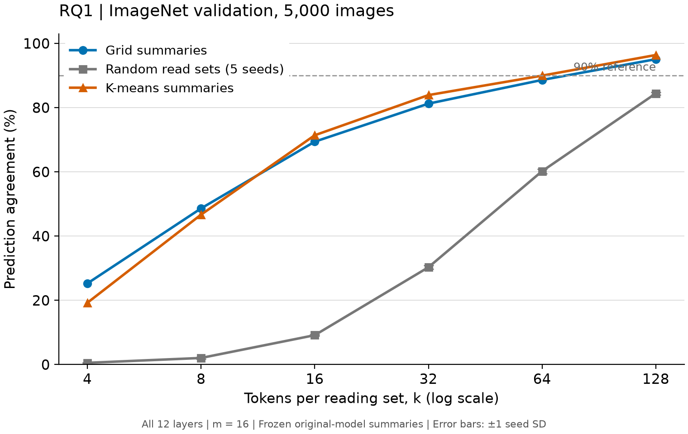
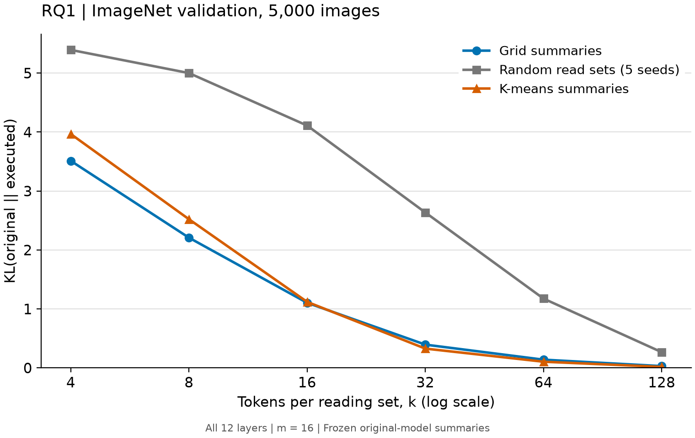

# RQ1：ImageNet 5,000 张完整结果（夜间补充）

## 1. 一句话结论

选对 token 明显提高忠实性，但全层执行需要较大的读取预算：k=16 的网格一致率为 69.40%，随机为 9.15%；增加到 k=128 后，网格为 **95.08%**、K-means 为 **96.38%**。两者在实际测试点中首次达到 90% 的 k 均为 **128 / 128**（网格 / K-means）。

## 2. 这个实验回答什么问题

对应设计书 §6.2：全部 12 层同时只按原模型说明书计算时，是否保留原预测？一致率比较原模型与执行模型的 top-1；原模型答错但执行模型保留同一答案，也算一致。随机对照检验 token 选择，K-means 对照检验分组方式。

## 3. 设置

DeiT-S/16、m=16，严格执行；固定 seed=0 的同一批 ImageNet validation 5,000 张。原五点 k={4,8,16,32,64} 不变，按用户本轮明确要求增加 k=128，合计 42 组、210,000 条逐图执行记录。随机种子仍为 0–4，FP32、batch=32、2 Torch threads、不启用 autocast。

三条线都先从原模型读取各层说明书，再冻结读取集合及 query 路由执行；现场重算不在本实验中。完整说明见 decisions.md 的 N01（待用户确认）。每个 k/seed 使用独立 Generator，跨 batch 连续采样。K-means 沿用网格初始化、10 次欧氏距离迭代，最终路由仍为点积 argmax。

原五点在 A800 上完成；本轮 HPC 双卡、单卡、MIG 均无资源，按夜间决定 N05 改在 RTX 4060 补跑，计算耗时 661.3 秒。两次图片、标签、原预测逐行完全一致。CUDA 随机集合不保证跨 GPU 同种子相同，报告保留硬件来源；没有把本地重跑当成原五点的重复，也没有改种子。k=128 配置为 `configs/rq1_k128.yaml`，源提交在该目录 metadata.json。

所有区间为 1,000 次图片 bootstrap，seed=0，95% 区间。随机主曲线先逐图平均五种子；图中误差条是种子间 ±1 SD。用户指定的随机 seed=0 配对比较单独报告，不与五种子平均混用。

## 4. 结果

| k | 方法 | 一致率 | 95% CI（%） | KL | KL 的 95% CI |
| ---: | --- | ---: | --- | ---: | --- |
| 4 | 网格 | 25.26% | [24.08, 26.40] | 3.5111 | [3.4699, 3.5567] |
| 4 | 随机五种子均值 | 0.54% | [0.44, 0.64] | 5.3929 | [5.3650, 5.4193] |
| 4 | K-means | 19.24% | [18.16, 20.36] | 3.9660 | [3.9261, 4.0036] |
| 8 | 网格 | 48.62% | [47.24, 49.92] | 2.2084 | [2.1678, 2.2493] |
| 8 | 随机五种子均值 | 2.06% | [1.84, 2.27] | 5.0001 | [4.9711, 5.0296] |
| 8 | K-means | 46.68% | [45.28, 48.08] | 2.5213 | [2.4822, 2.5615] |
| 16 | 网格 | 69.40% | [68.06, 70.68] | 1.1044 | [1.0756, 1.1348] |
| 16 | 随机五种子均值 | 9.15% | [8.62, 9.66] | 4.1100 | [4.0758, 4.1457] |
| 16 | K-means | 71.40% | [70.20, 72.62] | 1.1199 | [1.0910, 1.1488] |
| 32 | 网格 | 81.24% | [80.18, 82.38] | 0.3951 | [0.3806, 0.4105] |
| 32 | 随机五种子均值 | 30.30% | [29.34, 31.28] | 2.6361 | [2.5958, 2.6756] |
| 32 | K-means | 83.90% | [82.90, 84.94] | 0.3278 | [0.3147, 0.3407] |
| 64 | 网格 | 88.62% | [87.78, 89.50] | 0.1400 | [0.1326, 0.1466] |
| 64 | 随机五种子均值 | 60.22% | [59.07, 61.20] | 1.1758 | [1.1497, 1.2037] |
| 64 | K-means | 89.96% | [89.10, 90.78] | 0.1054 | [0.0999, 0.1111] |
| 128 | 网格 | 95.08% | [94.50, 95.66] | 0.0308 | [0.0289, 0.0327] |
| 128 | 随机五种子均值 | 84.42% | [83.66, 85.18] | 0.2675 | [0.2579, 0.2769] |
| 128 | K-means | 96.38% | [95.80, 96.88] | 0.0180 | [0.0169, 0.0192] |

**90% 门槛：** 网格最小测试 k=128，K-means 最小测试 k=128。这是离散测试点中的最小值；没有测 k=65–127，不能称为精确阈值。k=64 的 K-means 89.96% 仍未达到样本门槛，但只差 2 张，95% 区间覆盖 90%。

**逐图配对差值：** 以下全部由 `mita_probe.evaluate.compare_runs` 计算，先按图片 ID 对齐，并检查标签与原预测；正值表示网格更高。

| k | 网格 − K-means（百分点，95% CI） | 网格 − 随机 seed=0（百分点，95% CI） |
| ---: | --- | --- |
| 4 | +6.02 [4.66, 7.30] | +24.76 [23.54, 25.90] |
| 8 | +1.94 [0.48, 3.40] | +46.68 [45.36, 48.04] |
| 16 | -2.00 [-3.14, -0.80] | +60.16 [58.68, 61.66] |
| 32 | -2.66 [-3.62, -1.74] | +51.08 [49.62, 52.52] |
| 64 | -1.34 [-2.08, -0.60] | +29.22 [27.92, 30.66] |
| 128 | -1.30 [-1.86, -0.78] | +10.46 [9.36, 11.46] |

随机五种子在 k=4、8、16、32、64、128 的样本标准差（百分点）依次为 0.07, 0.27, 0.18, 0.58, 0.71, 0.43。逐种子一致率、CI、KL 均保存在 results.csv；网格相对五种子均值的对比另存 seed_mean_contrasts.csv。

**K-means 每组 query 数量。** 统计来自这 5,000 张原模型的 Q，每层有 5,000×6×16=480,000 个组。聚类与路由不依赖 k，故在 k=128 的原模型读取过程中记录即可描述 k=4 的分组。欧氏聚类只含 196 个 patch query；最终点积路由含 CLS，共 197 个 query。以下为跨图片、head、组的分布，不是先对每图求均值后再取极值。

| 层 | 欧氏聚类：最小 / 中位数 / 最大 | 点积路由：最小 / 中位数 / 最大 | 点积路由空组比例 |
| ---: | --- | --- | ---: |
| 1 | 0 / 12 / 92 | 0 / 9 / 189 | 5.34% |
| 2 | 0 / 12 / 80 | 0 / 12 / 156 | 0.61% |
| 3 | 0 / 12 / 57 | 0 / 12 / 66 | 0.02% |
| 4 | 0 / 12 / 47 | 0 / 12 / 55 | 0.01% |
| 5 | 0 / 12 / 46 | 0 / 12 / 72 | 0.02% |
| 6 | 0 / 12 / 45 | 0 / 12 / 64 | 0.04% |
| 7 | 0 / 12 / 55 | 0 / 12 / 81 | 0.12% |
| 8 | 0 / 12 / 60 | 0 / 11 / 116 | 0.55% |
| 9 | 0 / 12 / 70 | 0 / 11 / 113 | 0.87% |
| 10 | 0 / 11 / 70 | 0 / 11 / 134 | 1.56% |
| 11 | 0 / 11 / 76 | 0 / 9 / 172 | 7.45% |
| 12 | 0 / 11 / 82 | 0 / 8 / 187 | 13.61% |

这些分布显示组大小是否均衡，并区分“形成 landmark 的聚类”与“实际使用读取集合的路由”。统计来自本轮 RTX 4060；同一设备上的分组不依赖 k，但未声称与此前 A800 的中间分组逐位相同。k=4 时 K-means 比网格低 6.02 个百分点；不均衡组或欧氏聚类与点积路由不一致，可能使部分 query 共享不合适的短读取集合。这是与机制相容的解释，**组大小统计本身不能证明它导致了差距**；没有为了改善结果更换距离、初始化或路由。

## 5. 和预期对照

组大小提供了一个具体线索：第 1 层的单个读取集合最多被 189/197 个 query 使用；第 12 层最多为 187 个，同时 13.61% 的路由组没有 query，中位组仅有 8 个。相较每组约 12 个 query 的均匀参照，最终路由有明显长尾。k=4 时一个极大的 query 组只能共享四个 token，可能造成更强的信息瓶颈；但仅靠极值与分布不能区分这是主因还是伴随现象。

曲线明显高于随机，且随预算增长，支持“选择有用信息”。但 k=4 约 19%–25%、k=16 约 69%–71%，不支持情况 A 的“很短就足够”。它也不属于情况 B 的“一致率普遍很低”；更准确的是读取预算与忠实性的权衡。是否属于情况 C，要结合 RQ2 的层差异。

## 6. 可信度检查

- 正式补跑前完整 pytest 39 项通过；200 张 k=197 一致率 100%，最大读取和执行 logit 误差 0。
- 补跑入口再检查完整 5,000 张 k=197：一致率 **100%**，读取和执行误差 **0**。原模型在同一 5,000 张的准确率为 **79.62%（3,981/5,000）**，与此前 A800 完全一致。
- 原五点保留在 `2026-10-26_rq1_imagenet`；新增七组完整结果保留在 `2026-10-26_rq1_k128_retry`；汇总另存 `2026-10-26_rq1_complete`，未覆盖原始逐图结果。首轮 k128 目录为进程中断后的不完整记录，不参与汇总。
- 审计核对完整样本、无重复、原预测一致、KL 有限、聚类与路由 query 数守恒。Bootstrap 以图片为单位，不把五个种子当作 25,000 张图片；未作多重比较校正。

## 7. 异常与可能原因

1. HPC 无可用资源：平台返回作业槽位和 MIG 资源不足。验证方法：下一次申请时查平台资源状态；本轮已停止所有申请，未在 HPC 运行模型。
2. k=4 的 K-means 低于网格：可能与共享集合的不均衡和聚类/路由目标不同有关。验证方法：以后若获授权，可在固定小样本上仅统一距离定义；今晚未开展该选做变更。
3. 全层与原模型差异可能逐层累积，也可能受少数层影响。验证方法：本轮任务 2 已安排原设计的逐层替换，以相同 k 对照全层结果。
4. 跨 GPU 随机序列差异已在此前诊断确认；本轮原预测完全一致并不等于随机集合逐位一致。验证方法：固定硬件重跑相同 k/seed，或比较保存的随机集合；今晚没有扩展为新的硬件对照实验。

## 8. 下一步选项

| 选项 | 目的与改动 | 耗时估计 | 对论文的作用 |
| --- | --- | --- | --- |
| 按原设计 RQ2（已获本轮授权，推荐） | k=8/32，每次一层，24 组 | 本地约 8–15 分钟 | 区分层差异与全层累积效应 |
| 原设计 RQ3（已获本轮授权） | Pet observe，k=16/32 | 本地数分钟，另加审图 | 补充说明书读取位置的语义内容 |
| 明早审阅冻结说明书与硬件说明 | 不新增模型实验，明确论文中的干预定义 | 15–30 分钟讨论 | 确保主张与测量对象一致 |

今晚按既定优先级继续 RQ2/RQ3，不在检查点等待，也不启动选做实验。

## 9. 可以写进论文的句子

> 在固定的 5,000 张 ImageNet 验证图上，网格说明书在 k=16 时保留 69.40% 的原预测，随机读取集合的五种子均值为 9.15%；k=128 时，网格与 K-means 的一致率分别达到 95.08% 和 96.38%。两者首次跨过 90% 参照线的实际测试预算均为 k=128，表明选择 token 有效，但全部 12 层同时执行时需要较长说明书。

以上为供审阅草稿，未改动研究叙事稿【待填】。
