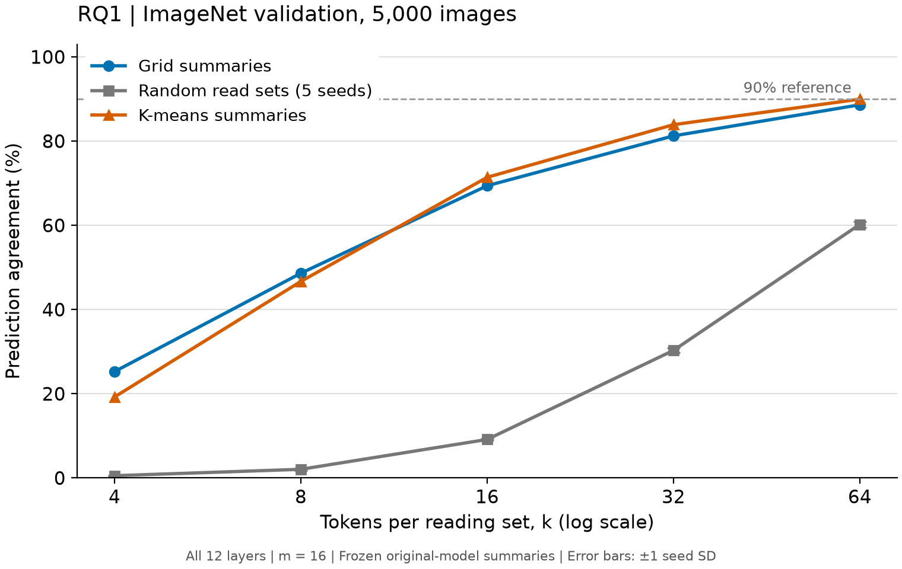
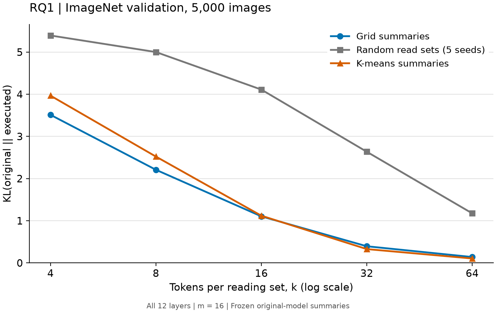

# RQ1：ImageNet 正式实验（检查点 4）

完成日期：2026-10-26。完整 35 组已完成并验收，HPC 环境已停止。当前停在检查点 4，尚未进入 RQ2。

## 1. 一句话结论

在固定的 5,000 张 ImageNet 验证图上，grid 说明书的一致率随 k 从 4 增至 64，由 **25.26% 升至 88.62%**，始终高于同规模随机读取集合；K-means 在 k=64 为 **89.96%**。选对 token 有明显作用，但很短的说明书在全部 12 层同时严格执行时仍会明显改变原预测。

## 2. 这个实验回答什么问题

对应 `research_design.md` §6.2：每层每个 head 用 16 个区域、每个区域读取 k 个 token 的说明书，能否在严格执行时保留原模型的预测？随机读取集合检查“选对 token”是否有作用；K-means 检查按 query 特征分组是否比空间网格更忠实。

主指标是预测一致率（prediction agreement）：执行模型与原模型的 top-1 类别相同的图片比例。它不同于分类准确率；原模型分错时，保留同一个错误预测也计为一致。KL 散度比较完整预测分布，作为辅助指标。

## 3. 设置

- 数据：ImageNet validation 固定 seed=0 的 5,000 张，覆盖 994 类；14 个官方分片已核对 SHA-256。数据 revision 与 P2 保持一致。
- 模型：预训练 DeiT-S/16，固定权重 revision；FP32、batch=32、timm 默认 eval 预处理；无训练或参数更新。
- 说明书：m=16；k={4,8,16,32,64}；全部 12 层同时严格执行。读取集合及 query 路由均从原模型取得，执行时固定。
- 对比：grid 五组、K-means 五组、随机种子 0–4 × 五个 k，共 35 组。K-means 使用网格中心初始化、10 次欧氏距离迭代，最终 query 路由仍为点积 argmax。
- 配置：`configs/rq1.yaml`；运行代码 `8946e29271f227138e2e15ff0f8e72c817686038`；输出 `experiments/2026-10-26_rq1_imagenet/`。
- 硬件：HPC 分配 2×A800 80 GB / CPU 16 核规格，实验使用单 GPU；torch 2.7.0+cu128、timm 1.0.30、驱动 570.86.10。原定 10 GB MIG 持续无资源，用户授权按可用性调整资源，研究参数未改变。
- 置信区间：按图片配对 bootstrap 1,000 次，95% 区间。随机对照先在每张图片上平均五个种子，避免把种子误当作额外图片；图中随机误差条则表示五个种子间的样本标准差。
- 正式运行耗时 1,372.16 秒（22.9 分钟），包含恒等检查与 35 组实验，不含环境启动、模型加载和绘图。结果记录时间为新加坡时间。

## 4. 结果

随机列为五个种子的均值 ± 标准差；标准差单位为百分点。

| k | 每层每 head 的 m×k | Grid 一致率 | 随机一致率 | K-means 一致率 |
| --- | ---: | ---: | ---: | ---: |
| 4 | 64 | 25.26% | 0.54% ± 0.07 | 19.24% |
| 8 | 128 | 48.62% | 2.06% ± 0.27 | 46.68% |
| 16 | 256 | 69.40% | 9.15% ± 0.18 | 71.40% |
| 32 | 512 | 81.24% | 30.30% ± 0.58 | 83.90% |
| 64 | 1,024 | 88.62% | 60.22% ± 0.71 | 89.96% |

m×k 只计算读取集合中的 token 编号；完整说明书还包含 197 个 query 的路由，不能将它解释为总存储量或运行加速比。

**选对 token 的作用。** k=16 时，grid 比随机对照高 60.25 个百分点；即使 k=64，优势仍为 28.40 个百分点。五个 k 的配对区间均大于 0。这支持“从原模型读出的集合比同样大小的随机集合更能保留预测”。

| k | Grid − 随机（百分点） | 95% 配对区间（百分点） |
| --- | ---: | ---: |
| 4 | 24.72 | [23.52, 25.89] |
| 8 | 46.56 | [45.21, 47.90] |
| 16 | 60.25 | [58.98, 61.60] |
| 32 | 50.94 | [49.72, 52.18] |
| 64 | 28.40 | [27.38, 29.45] |

**分组方式的作用。** K-means 在 k=4、8 时低于 grid，在 k=16、32、64 时分别高 2.00、2.66、1.34 个百分点。它并非在所有读取预算下都更好。补充的逐图配对 bootstrap 如下；这是对既有预测的探索性分析，未新增模型运行，也未作多重比较校正。

| k | K-means − Grid（百分点） | 95% 配对区间（百分点） |
| --- | ---: | ---: |
| 4 | −6.02 | [−7.30, −4.66] |
| 8 | −1.94 | [−3.40, −0.48] |
| 16 | +2.00 | [+0.80, +3.14] |
| 32 | +2.66 | [+1.74, +3.62] |
| 64 | +1.34 | [+0.60, +2.08] |

**90% 参照线。** 在预设五个测试点中，grid 和 K-means 都没有达到 90% 的样本一致率，因此“达到参照线的最小 k”均为未找到。k=64 时，grid 为 4,431/5,000，95% 区间为 [87.78%, 89.50%]；K-means 为 4,498/5,000，区间为 [89.10%, 90.78%]。后者只差 2 张达到样本门槛，且区间覆盖 90%，不能将 89.96% 描述为明显低于 90%。没有追加更大的 k 或外推曲线来跨过门槛。

辅助指标也随 k 改善。k=64 时，平均 KL 分别为 grid **0.140**、K-means **0.105**、随机 **1.176**；执行后的分类准确率分别为 **77.42%、77.64%、55.27%**，原模型为 **79.62%**。一致率衡量是否保留原预测，KL 衡量整个分布，分类准确率衡量是否答对；三者回答不同问题。

## 5. 和预期对照

设计预期较小的 k 就能保留大部分预测，并以随机对照检验选择的作用。正式结果支持后半点；对“很短就足够”的支持有限：k=4 时一致率仅 19%–25%，k=16 时约 69%–71%，到 k=64 才接近 90%。

因此它处在设计书 §7.2 的 A 与 B 之间：不符合 A 的“k 很小就很高”，也不能概括为 B 的“一致率普遍很低”。目前得到的是清楚的读取预算与忠实性权衡。C 的“某些层易概括、某些层难概括”仍需 RQ2 逐层实验检验；RQ1 同时限制全部 12 层，无法定位差异来自哪层。

与 Imagenette 500 张试跑相比，grid k=64 的 88.2% 与本次 88.62% 接近；K-means 则由 86.8% 变为 89.96%。两次数据集、样本量及 GPU 随机序列不同，这些差异不能单独归因于某一个因素。正式结论以本次 ImageNet 结果为准。

## 6. 可信度检查

- 首次 GPU 验收 29 项测试全部通过；正式入口再次运行 29 项测试并通过。
- 正式 5,000 张 k=197 的预测一致率为 100%，读取与恒等最大 logit 误差均为 0；原模型准确率为 79.62%（3,981/5,000）。
- 每个稀疏设置逐批检查读取 logits 与原模型相同，全部成功且输出有限。
- 完整结果包含 175,000 条逐图执行记录、5,000 条恒等记录、35 行设置结果。下载压缩包的本地/远程 SHA-256 一致；121 项完整性与表格审计全部通过，包括固定索引、所有种子、无重复、标签/原预测一致及从逐图结果重算汇总与置信区间。
- 随机种子标准差随 k 分别为 0.07、0.27、0.18、0.58、0.71 个百分点，均远小于 grid 相对随机的优势。配对区间反映固定模型、固定五个随机种子下的图片抽样不确定性；未作多重比较校正。
- 跨 GPU 复现：50 张验收中，grid/K-means 共 500 条执行预测与本地一致，KL 并非逐位相同。随机对照受 GPU 随机数实现影响：相同形状与种子的 CUDA multinomial，在同一 GPU 上重复哈希一致，但 4060 与 A800 不同。正式结果使用 A800 的五个固定种子，不混入本地随机结果。诊断代码和输出见 `experiments/2026-10-26_hpc_first/`。

## 7. 异常与可能原因

本轮模型实验无运行失败。原 10 GB MIG 申请因资源不足排队，改用获用户授权的可用 A800 规格后，首次验收及正式实验均成功；结果已取回，环境已停止。

尚需区分的两种解释如下，均属于假设：

- **低 k 的损失可能部分来自多层误差累积。** RQ1 同时限制 12 层，后层接收的输入已变化。验证方法是按原设计运行 RQ2：固定 k=8、32，每次只替换一层。如果多数单层一致率较高而全层较低，就支持累积效应；若少数层单独替换就显著下降，则可定位敏感层。
- **K-means 小 k 较差可能与分组目标和最终路由目标不同有关。** 当前用欧氏距离形成组，最终路由按点积；这并不保证很短的 top-k 集合对每个 query 都充分。一个可区分的后续小实验是在同一批 50 张上只改变 K-means 的距离定义，保留其余设置，再检查小 k 的差距是否缩小。这会改变方法设置，需另行决定；当前结果本身不能证明原因。

跨 GPU 的随机采样差异已有直接诊断；grid/K-means 的 KL 差异还可能包含离散 top-k/路由对浮点边界的敏感性。若需要逐位跨硬件复现，可在相同 50 张上导出并比较读取集合和路由；本轮只确认各设备内恒等成立与跨设备预测对照，不将其描述为跨 GPU 逐位一致。

## 8. 下一步选项

| 选项 | 目的与改动 | 预计计算量 | 对论文的作用 |
| --- | --- | --- | --- |
| **按原设计进入 RQ2（推荐）** | 同一批 5,000 张，k=8、32，每次只替换一层，共 24 组；实现并验收逐层入口 | 参照本轮吞吐量，A800 约 15–30 分钟；另需实现和测试 | 区分敏感层与多层累积效应，解释当前曲线，并为 RQ3 选层提供依据 |
| 补充更大的 k | 只将扫描范围增加 k=96、128，仍保留 grid、五个随机种子与 K-means；先记录设计变更 | 14 组，A800 粗估 10–15 分钟 | 更精确定位超过 90% 的样本门槛，但不能解释哪些层难以概括 |

推荐 RQ2，因为当前 RQ1 已经完成“读取 → 严格执行 → 随机对照 → 定量结论”的闭环，逐层定位能提供比继续加长说明书更多的新信息。上述耗时为估计，均未启动；当前停在检查点 4，等待用户选择。

## 9. 可以写进论文的句子

以下为供审阅的草稿，未填入研究叙事的【待填】：

> On a fixed 5,000-image subset of ImageNet validation, grid-based summaries achieved 69.40% prediction agreement at k=16, compared with 9.15% for random reading sets averaged over five seeds. At k=64, agreement increased to 88.62% for grid summaries and 89.96% for K-means summaries, while random reading sets reached 60.22%. These results show that the selected tokens preserve substantially more of the original predictions than equally sized random sets, but very short summaries remain insufficient under strict execution across all 12 layers. K-means grouping performed worse at k=4 and k=8 and better at k≥16, indicating that its benefit depends on the reading budget.

完整结果及复算入口：[结果目录](../../experiments/2026-10-26_rq1_imagenet/)、[审计](../../experiments/2026-10-26_rq1_imagenet/audit.json)、[补充分组对比](../../experiments/2026-10-26_rq1_imagenet/kmeans_vs_grid.csv)。
