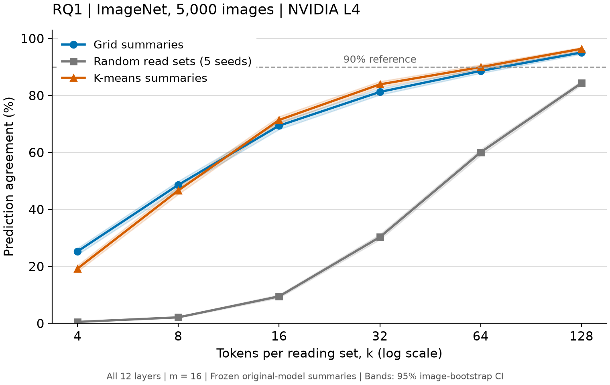

# RQ1 补充：Colab 统一硬件核对

## 1. 一句话结论

同一张 NVIDIA L4 上完成全部42设置；k=128 时网格一致率 95.08%、K-means 96.38%、随机五种子均值 84.36%。

六个预算点中，与原结果相比网格的最大绝对变化为 0.00 个百分点，K-means为 0.02 个百分点；逐点配对区间和随机五种子均值的变化见下表。

## 2. 回答的问题

核对研究设计 §6.2 的六点 RQ1 曲线是否依赖此前混用 A800 与 RTX 4060 的计算来源。原数据和报告保留，本报告是完整统一硬件复算；同时以新 RQ1 全层结果复核既有 RQ2 独立累积参照。

## 3. 设置

Colab NVIDIA L4；PyTorch 2.7.0+cu128、timm 1.0.30。ImageNet固定5000张、m=16、k=4/8/16/32/64/128、随机种子0–4、FP32、batch32与冻结原模型说明书均不变。先跑原35组，再跑k128七组，两次各做5000张恒等验收。源Parquet、抽样文件和模型SHA-256与原实验一致，使用同一软件和硬件。

区间为1000次图片bootstrap、seed0、95%。随机主曲线先逐图平均五种子；种子标准差单列，不等同于置信区间。同seed跨GPU不保证生成同一随机集合，因此跨硬件随机结果差异不能全部叫作浮点误差。

## 4. 结果

| k | 方法 | 一致率 % [95% CI] | KL [95% CI] | 随机种子SD pp |
| --- | --- | --- | --- | --- |
| 4 | grid | 25.26 [24.08, 26.40] | 3.5111 [3.4699, 3.5567] | 0.000 |
| 4 | random | 0.53 [0.44, 0.63] | 5.3841 [5.3550, 5.4131] | 0.165 |
| 4 | kmeans | 19.24 [18.16, 20.36] | 3.9660 [3.9261, 4.0036] | 0.000 |
| 8 | grid | 48.62 [47.24, 49.92] | 2.2084 [2.1679, 2.2493] | 0.000 |
| 8 | random | 2.13 [1.92, 2.37] | 4.9977 [4.9685, 5.0278] | 0.119 |
| 8 | kmeans | 46.66 [45.28, 48.06] | 2.5214 [2.4822, 2.5616] | 0.000 |
| 16 | grid | 69.40 [68.06, 70.68] | 1.1044 [1.0756, 1.1348] | 0.000 |
| 16 | random | 9.48 [8.94, 10.04] | 4.0978 [4.0634, 4.1320] | 0.196 |
| 16 | kmeans | 71.40 [70.20, 72.62] | 1.1199 [1.0910, 1.1488] | 0.000 |
| 32 | grid | 81.24 [80.18, 82.38] | 0.3951 [0.3806, 0.4105] | 0.000 |
| 32 | random | 30.29 [29.37, 31.22] | 2.6307 [2.5923, 2.6720] | 0.514 |
| 32 | kmeans | 83.90 [82.90, 84.94] | 0.3279 [0.3147, 0.3408] | 0.000 |
| 64 | grid | 88.62 [87.78, 89.50] | 0.1399 [0.1326, 0.1466] | 0.000 |
| 64 | random | 60.06 [58.99, 61.04] | 1.1765 [1.1510, 1.2021] | 0.659 |
| 64 | kmeans | 89.96 [89.10, 90.78] | 0.1054 [0.0999, 0.1111] | 0.000 |
| 128 | grid | 95.08 [94.50, 95.66] | 0.0308 [0.0289, 0.0327] | 0.000 |
| 128 | random | 84.36 [83.61, 85.08] | 0.2694 [0.2606, 0.2787] | 0.318 |
| 128 | kmeans | 96.38 [95.80, 96.88] | 0.0180 [0.0169, 0.0192] | 0.000 |

测试点中达到90%所需最小k：网格 128；K-means 128。这不是未测试预算上的精确阈值。

kmeans k=64 的95%区间跨过90%。上述最小k按样本均值定义；门槛附近少数预测变化即可改变该离散统计，不代表总体门槛已被精确确定。

### 方法配对差值

差值=网格−对照，随机取seed0；使用 `evaluate.compare_runs`。

| k | 对比 | 差值 pp [95% CI] |
| --- | --- | --- |
| 4 | grid_minus_kmeans_seed0 | 6.02 [4.66, 7.30] |
| 4 | grid_minus_random_seed0 | 24.78 [23.60, 25.92] |
| 8 | grid_minus_kmeans_seed0 | 1.96 [0.50, 3.44] |
| 8 | grid_minus_random_seed0 | 46.44 [45.06, 47.78] |
| 16 | grid_minus_kmeans_seed0 | -2.00 [-3.14, -0.80] |
| 16 | grid_minus_random_seed0 | 59.88 [58.46, 61.30] |
| 32 | grid_minus_kmeans_seed0 | -2.66 [-3.62, -1.74] |
| 32 | grid_minus_random_seed0 | 51.46 [49.86, 52.92] |
| 64 | grid_minus_kmeans_seed0 | -1.34 [-2.08, -0.60] |
| 64 | grid_minus_random_seed0 | 28.92 [27.46, 30.36] |
| 128 | grid_minus_kmeans_seed0 | -1.30 [-1.86, -0.78] |
| 128 | grid_minus_random_seed0 | 10.34 [9.28, 11.30] |

### K-means每组query数量

组大小从原模型Q统计，与k无关；本次在k128运行中收集。欧氏聚类的patch分配与最终点积路由（含CLS）分别列出。

| 层 | 分配方式 | 最小 | 中位数 | 最大 | 空组比例 % |
| --- | --- | --- | --- | --- | --- |
| 1 | 点积路由（含CLS） | 0 | 9.0 | 189 | 5.34 |
| 1 | 欧氏patch聚类 | 0 | 12.0 | 92 | 0.11 |
| 2 | 点积路由（含CLS） | 0 | 12.0 | 156 | 0.61 |
| 2 | 欧氏patch聚类 | 0 | 12.0 | 80 | 0.08 |
| 3 | 点积路由（含CLS） | 0 | 12.0 | 66 | 0.02 |
| 3 | 欧氏patch聚类 | 0 | 12.0 | 57 | 0.00 |
| 4 | 点积路由（含CLS） | 0 | 12.0 | 55 | 0.01 |
| 4 | 欧氏patch聚类 | 0 | 12.0 | 47 | 0.00 |
| 5 | 点积路由（含CLS） | 0 | 12.0 | 72 | 0.02 |
| 5 | 欧氏patch聚类 | 0 | 12.0 | 46 | 0.00 |
| 6 | 点积路由（含CLS） | 0 | 12.0 | 64 | 0.04 |
| 6 | 欧氏patch聚类 | 0 | 12.0 | 45 | 0.01 |
| 7 | 点积路由（含CLS） | 0 | 12.0 | 81 | 0.12 |
| 7 | 欧氏patch聚类 | 0 | 12.0 | 55 | 0.05 |
| 8 | 点积路由（含CLS） | 0 | 11.0 | 116 | 0.55 |
| 8 | 欧氏patch聚类 | 0 | 12.0 | 60 | 0.18 |
| 9 | 点积路由（含CLS） | 0 | 11.0 | 113 | 0.87 |
| 9 | 欧氏patch聚类 | 0 | 12.0 | 70 | 0.37 |
| 10 | 点积路由（含CLS） | 0 | 11.0 | 134 | 1.56 |
| 10 | 欧氏patch聚类 | 0 | 11.0 | 70 | 0.72 |
| 11 | 点积路由（含CLS） | 0 | 9.0 | 172 | 7.45 |
| 11 | 欧氏patch聚类 | 0 | 11.0 | 76 | 1.51 |
| 12 | 点积路由（含CLS） | 0 | 8.0 | 187 | 13.61 |
| 12 | 欧氏patch聚类 | 0 | 11.0 | 82 | 0.89 |

较大的组必须共享同一读取集合；在k=4时这可能限制对不同query的表达。欧氏聚类与点积路由目标不一致也可能产生不均衡；这些是与组大小相容的解释，并非本实验已经分离证明的原因。表中是全体组的描述性分布。

### 跨硬件复核

差值=新NVIDIA L4−旧结果；k≤64旧结果来自A800，k128来自4060。

| k | 方法 | seed | 旧硬件 | 差值 pp [95% CI] |
| --- | --- | --- | --- | --- |
| 4 | grid | 0 | A800-SXM4-80GB | 0.00 [0.00, 0.00] |
| 8 | grid | 0 | A800-SXM4-80GB | 0.00 [0.00, 0.00] |
| 16 | grid | 0 | A800-SXM4-80GB | 0.00 [0.00, 0.00] |
| 32 | grid | 0 | A800-SXM4-80GB | 0.00 [0.00, 0.00] |
| 64 | grid | 0 | A800-SXM4-80GB | 0.00 [0.00, 0.00] |
| 128 | grid | 0 | RTX 4060 | 0.00 [0.00, 0.00] |
| 4 | kmeans | 0 | A800-SXM4-80GB | 0.00 [0.00, 0.00] |
| 8 | kmeans | 0 | A800-SXM4-80GB | -0.02 [-0.06, 0.00] |
| 16 | kmeans | 0 | A800-SXM4-80GB | 0.00 [0.00, 0.00] |
| 32 | kmeans | 0 | A800-SXM4-80GB | 0.00 [0.00, 0.00] |
| 64 | kmeans | 0 | A800-SXM4-80GB | 0.00 [0.00, 0.00] |
| 128 | kmeans | 0 | RTX 4060 | 0.00 [0.00, 0.00] |
| 4 | random | 0 | A800-SXM4-80GB | -0.02 [-0.30, 0.24] |
| 4 | random | 1 | A800-SXM4-80GB | -0.02 [-0.28, 0.24] |
| 4 | random | 2 | A800-SXM4-80GB | -0.02 [-0.30, 0.24] |
| 4 | random | 3 | A800-SXM4-80GB | 0.28 [-0.04, 0.58] |
| 4 | random | 4 | A800-SXM4-80GB | -0.26 [-0.54, 0.04] |
| 8 | random | 0 | A800-SXM4-80GB | 0.24 [-0.28, 0.74] |
| 8 | random | 1 | A800-SXM4-80GB | -0.16 [-0.66, 0.36] |
| 8 | random | 2 | A800-SXM4-80GB | -0.40 [-0.94, 0.12] |
| 8 | random | 3 | A800-SXM4-80GB | 0.50 [-0.02, 1.02] |
| 8 | random | 4 | A800-SXM4-80GB | 0.20 [-0.34, 0.68] |
| 16 | random | 0 | A800-SXM4-80GB | 0.28 [-0.68, 1.24] |
| 16 | random | 1 | A800-SXM4-80GB | 0.14 [-0.82, 1.08] |
| 16 | random | 2 | A800-SXM4-80GB | 0.44 [-0.56, 1.46] |
| 16 | random | 3 | A800-SXM4-80GB | 0.60 [-0.36, 1.56] |
| 16 | random | 4 | A800-SXM4-80GB | 0.22 [-0.72, 1.12] |
| 32 | random | 0 | A800-SXM4-80GB | -0.38 [-1.68, 1.04] |
| 32 | random | 1 | A800-SXM4-80GB | -0.82 [-2.22, 0.64] |
| 32 | random | 2 | A800-SXM4-80GB | 0.30 [-1.10, 1.70] |
| 32 | random | 3 | A800-SXM4-80GB | 0.74 [-0.58, 2.12] |
| 32 | random | 4 | A800-SXM4-80GB | 0.12 [-1.18, 1.54] |
| 64 | random | 0 | A800-SXM4-80GB | 0.30 [-1.02, 1.72] |
| 64 | random | 1 | A800-SXM4-80GB | 0.28 [-1.04, 1.64] |
| 64 | random | 2 | A800-SXM4-80GB | -1.52 [-2.86, -0.24] |
| 64 | random | 3 | A800-SXM4-80GB | 0.88 [-0.40, 2.22] |
| 64 | random | 4 | A800-SXM4-80GB | -0.74 [-2.10, 0.58] |
| 128 | random | 0 | RTX 4060 | 0.12 [-0.90, 1.16] |
| 128 | random | 1 | RTX 4060 | 0.34 [-0.74, 1.38] |
| 128 | random | 2 | RTX 4060 | 0.22 [-0.82, 1.26] |
| 128 | random | 3 | RTX 4060 | -1.00 [-1.98, 0.08] |
| 128 | random | 4 | RTX 4060 | 0.02 [-0.96, 1.04] |

随机五种子先逐图取均值，再做跨硬件配对bootstrap：

| k | 均值差 pp [95% CI] |
| --- | --- |
| 4 | -0.01 [-0.13, 0.11] |
| 8 | 0.08 [-0.15, 0.31] |
| 16 | 0.34 [-0.08, 0.74] |
| 32 | -0.01 [-0.65, 0.60] |
| 64 | -0.16 [-0.80, 0.44] |
| 128 | -0.06 [-0.53, 0.40] |

### RQ2 独立累积参照

| k | 数量 | 估计 %（差值为pp）[95% CI] |
| --- | --- | --- |
| 8 | independent_product | 33.86 [31.72, 35.99] |
| 8 | observed_all_layers | 48.62 [47.24, 49.92] |
| 8 | observed_minus_product | 14.76 [12.54, 16.83] |
| 32 | independent_product | 57.03 [54.70, 59.52] |
| 32 | observed_all_layers | 81.24 [80.18, 82.38] |
| 32 | observed_minus_product | 24.21 [21.92, 26.32] |

RQ2十二层的单层结果仍使用原RTX4060结果，没有重跑或改设置；本表仅更新用于比较的RQ1全层观测点。乘积在每次图片配对重采样后重算，它是独立性假设参照，不是实测联合干预或误差的因果分解。

## 5. 和预期对照

同硬件复算用于核对RQ1忠实性结论，不改变RQ3空间定位的独立证据。短预算的全层忠实性有限、单层差异温和，因此结合既有RQ2，仍最接近预案C，但不是“部分层可读、部分层完全不可读”的强分化。应结合RQ3 v2中前景干预的重要性、汇聚点干预的负结果和寄存器对照讨论整体研究叙事，不能用RQ1高一致率直接推导热图是物体解释。

## 6. 可信度检查

两次k=197在5000张上均为100%；原模型准确率为 79.62%。两次与此前结果的图片ID、标签、原预测均逐项一致；42组各5000条，无重复/缺失，重算一致率/CI/KL通过。远程pytest与环境记录见 `2026-10-27_colab_environment_retry`；此前A100只完成环境验收和部分传输，未进入正式推理。

## 7. 异常与可能原因

跨GPU若出现随机结果变化，首先考虑CUDA随机采样实现与算术路径差异；验证方法是事先固定并导出读取集合，再跨GPU执行同一集合，此项未运行。独立乘积与真实全层结果的差距可能来自图片难度相关、错误重叠和层间补偿；若要区分，需要另行设计联合干预，当前乘积不能唯一识别机制。

## 8. 下一步选项

1. 推荐审阅后将本次完整同硬件曲线作为论文图2；只更新图与来源说明，约30分钟，减少计算来源对读者判断的干扰。
2. 沿用原图，在附录放本次复核；约20分钟，保留原叙事结构并提供稳健性证据。
3. 讨论RQ3图4的“成分—因果—寄存器”布局；约30–60分钟，突出空间峰值与功能重要性并不等价。

## 9. 可写进论文的句子

“在同一张NVIDIA L4上使用固定5000张ImageNet图片复算全部读取预算后，k=128时网格与K-means说明书分别保持 95.08% 和 96.38% 的原模型预测；随机读取集合为 84.36%。”

“十二个单层一致率的独立乘积低于实际全层一致率，表明简单的独立失败累积模型不足以解释多层替换损失；该参照不构成误差来源的因果分解。”
