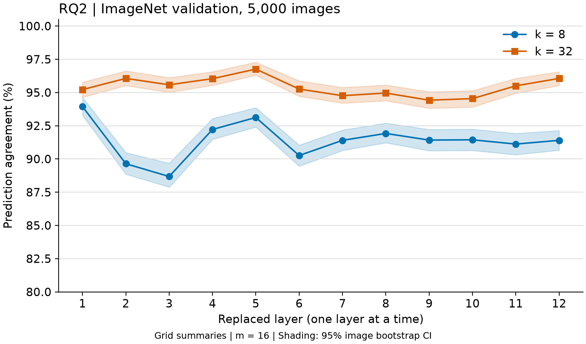

# RQ2：哪些层能被概括？

## 1. 一句话结论

单层可概括性有差异：k=8 时最低为第 3 层的 **88.68%**，最高为第 1 层的 **93.94%**；全层同时替换则只有 **48.62%**。这表明全层损失不能简单归给一个层，层间累积或相互作用有重要影响。

## 2. 这个实验回答什么问题

对应设计书 §6.3。每次只替换一层，其余 11 层保持原模型计算，定位哪层对短读取集合更敏感。它测的是最终预测对该层限制的敏感程度，不等于独立评估该层所有内部表示的信息量。

## 3. 设置

严格按原设计：DeiT-S/16、网格 m=16、k={8,32}、固定相同 ImageNet 5,000 张、seed=0。24 组，每组只替换一层。结果层号为 1–12；代码访问 `model.blocks[layer-1]`，同时保存 layer_index=0–11。调用探针的 API 本身使用一基层号，已用作用域测试确认仅该层注入 mask。

每张图从原模型读取说明书后只执行目标层；此前层没有干预，所以冻结说明书与在该层现场计算等价。FP32、batch=32、2 Torch threads。HPC 无资源，按 N05 使用本地 RTX 4060，正式运行 600.6 秒。完整元数据与配置保存在结果目录。

预测一致率与 KL(original || executed) 的 95% 区间均为 1,000 次图片 bootstrap，seed=0；不把不同层当成独立图片。与全层 RQ1 的比较用 evaluate.compare_runs，逐图配对。

## 4. 结果

| 层 | k=8 一致率 [95% CI] | k=8 KL [95% CI] | k=32 一致率 [95% CI] | k=32 KL [95% CI] |
| ---: | --- | --- | --- | --- |
| 1 | 93.94% [93.28, 94.62] | 0.0455 [0.0426, 0.0483] | 95.22% [94.64, 95.78] | 0.0281 [0.0261, 0.0301] |
| 2 | 89.64% [88.86, 90.48] | 0.1220 [0.1154, 0.1281] | 96.06% [95.52, 96.62] | 0.0237 [0.0221, 0.0253] |
| 3 | 88.68% [87.88, 89.68] | 0.1527 [0.1445, 0.1599] | 95.58% [95.02, 96.12] | 0.0247 [0.0231, 0.0265] |
| 4 | 92.22% [91.48, 93.04] | 0.0727 [0.0686, 0.0772] | 96.04% [95.54, 96.56] | 0.0219 [0.0206, 0.0233] |
| 5 | 93.12% [92.40, 93.86] | 0.0655 [0.0618, 0.0693] | 96.76% [96.30, 97.28] | 0.0145 [0.0136, 0.0155] |
| 6 | 90.26% [89.46, 91.04] | 0.0935 [0.0884, 0.0986] | 95.26% [94.72, 95.88] | 0.0245 [0.0232, 0.0258] |
| 7 | 91.40% [90.64, 92.18] | 0.0808 [0.0768, 0.0850] | 94.76% [94.20, 95.38] | 0.0280 [0.0265, 0.0294] |
| 8 | 91.92% [91.22, 92.70] | 0.0679 [0.0645, 0.0712] | 94.96% [94.38, 95.56] | 0.0279 [0.0264, 0.0293] |
| 9 | 91.42% [90.62, 92.22] | 0.0794 [0.0753, 0.0834] | 94.42% [93.82, 95.06] | 0.0351 [0.0333, 0.0369] |
| 10 | 91.44% [90.64, 92.24] | 0.0886 [0.0845, 0.0929] | 94.54% [93.90, 95.14] | 0.0325 [0.0304, 0.0345] |
| 11 | 91.12% [90.32, 91.92] | 0.1118 [0.1065, 0.1172] | 95.50% [94.94, 96.06] | 0.0339 [0.0318, 0.0361] |
| 12 | 91.40% [90.66, 92.14] | 0.7281 [0.7119, 0.7440] | 96.06% [95.52, 96.56] | 0.0553 [0.0524, 0.0583] |

**最难概括的层：** k=8 的最低三层为 3、2、6；k=32 为 9、10、7。这是描述性排序，区间重叠的邻近层不解释为确定名次。

**几乎不受影响的层：** 本轮没有达到 99% 一致率的单层设置。相对最不敏感的是 k=8 的第 1 层和 k=32 的第 5 层，但仍分别有 6.06% 和 3.24% 的预测改变，不能称为输出几乎完全不变。完整置信区间见表。

| k | 全部 12 层同时替换 | 最低单层一致率（层号） | 最高单层一致率（层号） |
| ---: | --- | --- | --- |
| 8 | 48.62% [47.24, 49.92] | 88.68% [87.88, 89.68]（3） | 93.94% [93.28, 94.62]（1） |
| 32 | 81.24% [80.18, 82.38] | 94.42% [93.82, 95.06]（9） | 96.76% [96.30, 97.28]（5） |

24 个单层结果相对于相同 k 的全层结果，配对差值区间下界最小为 12.16 个百分点。逐层完整差值及 CI 见 `all_layer_comparison.csv`。

**如何解释 RQ1 的 k=64 约 89%？** 同 k 的受控比较显示，即使最敏感的单层，其损失也小于全部层同时限制的损失；因此“仅某一层特别难，其他层没有影响”不足以解释全层结果，累积或层间相互作用更符合现有证据。与此同时，单层曲线有起伏，说明层敏感性也真实存在。RQ2 按设计只测 k=8、32，没有逐层 k=64；不能把这一结果升级为对 k=64 损失的精确因果分解，也不能区分一般误差累积与冻结后层说明书在改变的中间状态上的失配。

## 5. 和预期对照

三种预案中更接近 **C**，但层差异是温和的：k=8 最好与最差层相差 5.26 个百分点，k=32 相差 2.34 个百分点，并没有出现“一部分层几乎完美、另一部分层很差”的强分化。**更突出的发现是全层约束的累积或相互作用。** 单层普遍保留较多原预测，不能用 B 的“普遍不可概括”描述；全层短说明书仍损失较大，也不支持 A。

## 6. 可信度检查

- 39 项完整 pytest 已通过，包括单层 mask 作用域、手算、原模型读取不变、完整 token 恒等、随机对照与 K-means；50 张 ×24 组试跑成功。
- 正式 5,000 张再次检查 k=197：一致率 **100%**，读取和执行最大误差 **0**；原模型准确率 **79.62%**。
- 148 项结果审计通过：120,000 条逐图结果，24 组各 5,000 张，无重复遗漏；图片、标签、原预测与 RQ1 全部一致，层号映射正确，CI 从逐图结果重算一致。
- 每个批次每个 k 的读取 logits 均与原模型逐位相同；执行输出全部有限。区间未进行多重比较校正。

## 7. 异常与可能原因

第 12 层在 k=8 时的一致率为 91.40%，并非最差，但 KL 达 0.7281，远高于其他层（最大为第 3 层的 0.1527）。这说明 top-1 相同不代表概率分布接近，末层可能显著改变置信度。验证方法：在已有逐图结果上检查末层 KL 的分布；若需进一步定位概率变化，可在固定小样本上保存原始 logits 后比较，今晚未新增模型实验。

模型运行无报错。层间差异可能来自注意力分布、共享读取集合的适配程度以及残差路径对扰动的缓冲。验证方法：未来在固定图片上比较层内读取覆盖与执行 logit 变化；今晚未新增此实验。

全层损失大于任一单层，可能包含逐层累积及冻结后层说明书的状态失配。验证方法：若后续获授权，固定同一预算比较多层组合与现场重算；这是另一个干预设计，今晚没有执行。

## 8. 下一步选项

| 选项 | 目的与改动 | 耗时估计 | 对论文的作用 |
| --- | --- | --- | --- |
| 完成原设计 RQ3（推荐，已授权） | observe 模式检查读取位置是否落在物体上 | 本地数分钟，另加绘图审计 | 从“哪些层可读”推进到“读了什么” |
| 整理三张主图与方法说明 | 不增加模型实验，精简到 4 页叙事 | 1–2 小时 | 明确层差异与全层损失的关系，避免过度因果主张 |
| 明早讨论后续因果拆分是否必要 | 仅制定对照，不执行选做 | 20–30 分钟讨论 | 判断是否值得增加冻结/组合层实验 |

## 9. 可以写进论文的句子

> 每次仅替换一层时，k=8 的预测一致率在 88.68% 至 93.94% 之间，而同时替换全部层时为 48.62%。这一结果显示层间可概括性存在差异，同时支持多层约束的累积或相互作用是全层忠实性下降的重要来源。

以上为供用户审阅的草稿，未填写研究叙事稿【待填】。
