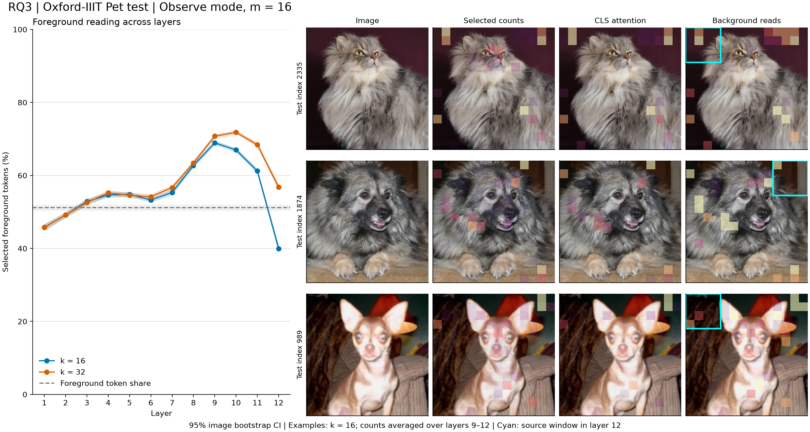

# RQ3：说明书看到了什么？

## 1. 一句话结论

在 Oxford-IIIT Pet 全部 3,669 张测试图上，k=16 选中次数热图的前景质量比例为 **59.24%**，pointing game 为 **18.21%**；对应中心高斯为 **66.71% / 92.10%**。读取位置与物体的对应必须结合这条中心参照判断，不能仅凭热图像物体就认定解释更好。

## 2. 这个实验回答什么问题

对应设计书 §6.4 与 HANDOFF §5.4：原模型说明书选择的 token 位置，是否更常落在物体上；背景区域是否读取前景信息。这里是空间对应检验，忠实性仍由 RQ1/RQ2 的执行实验衡量。

## 3. 设置

模型仍为 DeiT-S/16，observe 模式，不改变输出；网格 m=16，主 k=16，k=32 为用户指定的稳健性检查（N04，待用户确认）。Pet test 全集 3,669 张，不进行新的数据抽样。图 4 的三张例子为预先 seed=0 随机对齐样本的前三张（2335、1874、989），不按结果选图。

已核对下载数据中的官方 `annotations/README`：1=前景，2=背景，3=未分类边界。图片按 timm eval 短边 Resize(248)、CenterCrop(224)，mask 使用完全相同的尺寸与裁剪位置，最近邻插值。每个 16×16 patch 中，非边界像素前景占比 ≥0.5 标为前景；全边界 patch 排除，CLS 无空间位置也排除。5 张检查图已人工检查，见 [alignment.png](../../experiments/2026-10-26_pet_alignment/alignment.png)。

读取比例调用 `metrics.foreground_ratio`，统计所有 head/区域中的选中次数（重复选择保留），以有效选中 token 为分母。对照是每张图有效 token 的前景占比，先算逐图比例再跨图片平均。

选中次数热图对每层 16 区域、6 head 求和，再平均第 9–12 层。CLS 热图取最后一层 CLS query 对 patch 的注意力，平均六个 head。中心高斯在 14×14 token 网格中心采样，σ=3.5 token，即图像边长的 1/4。热图前景质量以有效 token 上的总质量归一化；pointing game 检查有效 token 中最大值，出现并列时取行优先第一个（N06）。

背景区域按原 adaptive pooling 窗口定义，其中有效 token 的前景数量少于一半才纳入。每图先汇总这些区域在六个 head 的读取集合，计算前景比例；9–12 汇总行再平均四层。无背景区域或有效读取的图片记缺失而非 0，表中列出有效样本数。所有区间均按图片 bootstrap 1,000 次、seed=0、95%；没有把区域或 head 当作独立图片。

HPC 无资源，按 N05 在本地 RTX 4060 运行，FP32、batch=32，耗时 85.6 秒。配置、逐图统计和软件版本均已保存。

## 4. 结果

前景 token 占比参照为 **51.18% [50.51, 51.83]**。

| 层 | k=16 前景比例 [95% CI] | k=32 前景比例 [95% CI] |
| ---: | --- | --- |
| 1 | 45.78% [45.03, 46.49] | 45.81% [45.04, 46.55] |
| 2 | 49.15% [48.49, 49.78] | 49.17% [48.51, 49.81] |
| 3 | 52.85% [52.17, 53.51] | 52.58% [51.90, 53.24] |
| 4 | 54.65% [54.03, 55.25] | 55.24% [54.62, 55.86] |
| 5 | 54.82% [54.25, 55.41] | 54.55% [53.96, 55.16] |
| 6 | 53.26% [52.70, 53.82] | 54.16% [53.58, 54.74] |
| 7 | 55.33% [54.75, 55.88] | 56.66% [56.07, 57.23] |
| 8 | 62.72% [62.22, 63.23] | 63.41% [62.92, 63.92] |
| 9 | 68.93% [68.45, 69.41] | 70.74% [70.25, 71.23] |
| 10 | 66.98% [66.50, 67.44] | 71.82% [71.38, 72.28] |
| 11 | 61.22% [60.69, 61.74] | 68.41% [67.93, 68.91] |
| 12 | 39.95% [39.18, 40.70] | 56.77% [56.13, 57.43] |

| k | 方法 | 前景质量比例 [95% CI] | Pointing game [95% CI] | 图片数 |
| ---: | --- | --- | --- | ---: |
| 16 | 中心高斯 σ=边长/4 | 66.71% [66.05, 67.36] | 92.10% [91.25, 93.02] | 3669 |
| 16 | 最后一层 CLS 注意力 | 39.64% [38.97, 40.29] | 21.67% [20.33, 22.95] | 3669 |
| 16 | 选中次数（9–12 层） | 59.24% [58.69, 59.75] | 18.21% [16.95, 19.38] | 3669 |
| 32 | 中心高斯 σ=边长/4 | 66.71% [66.05, 67.36] | 92.10% [91.25, 93.02] | 3669 |
| 32 | 最后一层 CLS 注意力 | 39.64% [38.97, 40.29] | 21.67% [20.33, 22.95] | 3669 |
| 32 | 选中次数（9–12 层） | 66.93% [66.45, 67.42] | 19.71% [18.45, 20.90] | 3669 |

k=16 的选中次数热图前景质量低于中心高斯，pointing game 低于中心高斯。配对比较用同一图片索引，避免把两个方法当独立样本：

- selection_minus_cls_attention，fg_mass：+19.59 个百分点，95% CI [19.34, 19.85]。
- selection_minus_cls_attention，pointing：-3.46 个百分点，95% CI [-4.50, -2.48]。
- selection_minus_center_gaussian，fg_mass：-7.47 个百分点，95% CI [-7.84, -7.07]。
- selection_minus_center_gaussian，pointing：-73.89 个百分点，95% CI [-75.31, -72.55]。

CLS 与高斯不依赖 k，因此两次结果完全相同；只有读取集合大小和相应选中次数图改变。k=32 的结果用于检查上述观察是否依赖较短集合，不据此改选主设置。

**区域交流：背景为主的窗口在读哪里？**

| k | 层 | 背景区域读取的前景比例 [95% CI] | 有效图片数 |
| ---: | --- | --- | ---: |
| 16 | 9 | 55.21% [54.72, 55.64] | 3509 |
| 16 | 10 | 58.18% [57.72, 58.61] | 3509 |
| 16 | 11 | 51.52% [50.98, 52.05] | 3509 |
| 16 | 12 | 36.92% [36.21, 37.67] | 3509 |
| 16 | 9-12 | 50.46% [49.95, 50.95] | 3509 |
| 32 | 9 | 59.20% [58.72, 59.66] | 3509 |
| 32 | 10 | 64.25% [63.80, 64.68] | 3509 |
| 32 | 11 | 60.99% [60.49, 61.49] | 3509 |
| 32 | 12 | 53.73% [53.10, 54.37] | 3509 |
| 32 | 9-12 | 59.55% [59.07, 60.01] | 3509 |

图中青色框是第一个符合背景条件的源窗口，叠加热度为该窗口在第 12 层六个 head 的读取次数。它显示“这个窗口的说明书选了哪些位置”；最终 query 路由可把其他位置的 query 分到该 landmark，因此不等于该窗口内所有 query 都沿几何位置使用它。

## 5. 和预期对照

**“深层普遍聚焦物体、并优于中心参照”的预期没有得到支持。** k=16 在第 9 层达到 68.93% 前景比例，高于 51.18% 的前景 token 参照；但到第 12 层降为 39.95%，低于参照。热图主设置的前景质量比中心高斯低 7.47 个百分点，配对 95% CI 为 [−7.84, −7.07]；pointing game 更低 73.89 个百分点，区间 [−75.31, −72.55]。

k=32 的热图前景质量为 66.93%，与高斯 66.71% 接近，配对差值为 +0.22 个百分点 [−0.11, +0.58]，没有明确优于高斯；pointing game 仍只有 19.71%。因此扩大集合改善了整体前景覆盖，却没有解决最亮 token 常在背景的问题。这两种指标测量对象不同，不能用整体质量较高来替代定位峰值失败。

三张预先固定的示例也显示背景位置的强峰，CLS 热图同样存在这一现象。已使用保存的 token 标签和热图，以独立 NumPy 计算重新核对这三张图的前景质量及 argmax 命中，与正式 GPU 指标一致；未发现索引或公式不一致。今晚保留原来的最后四层、k 与并列处理规则，不因负结果改图或改设置。

RQ3 本身不决定设计书 A/B/C 的忠实性分型；它补充 RQ2 的情况 C，说明不同层读取内容的空间对应。无论热图参照输赢，都不改变 RQ1/RQ2 的执行结果。

## 6. 可信度检查

- 39 项单元与集成测试通过，涵盖前景阈值、全边界 patch、CLS 排除、重复读取、背景区域窗口、热图有效质量和 CLS hook 不改变输出；50 张试跑成功。
- 正式 3,669 张、两个 k 共 7,338 次 observe 输出与原模型逐位相同：一致率 **100%**，最大 logit 误差 **0**。
- 前置 ImageNet k=197 验收在 200 张及全部 5,000 张均为 100%，原模型 ImageNet 准确率 79.62%。RQ3 不执行 mask，所以恒等核验与观察不变性分别报告，不把 Pet 品种标签当成 ImageNet 分类标签评估。
- 保存 88,056 条逐层记录、22,014 条热图记录及 29,352 条背景交流记录。51 项审计通过，包括样本覆盖、无重复、参照跨 k 一致和 CI 复算。
- 背景交流有 1,280 条层级记录缺失（按定义排除），热图指标缺失 0 条。区间未作多重比较校正。

## 7. 异常与可能原因

1. 部分图没有以背景为主的窗口，因此背景交流无定义。验证方法：查看该图 foreground token mask 与窗口前景数；程序按定义排除并报告 n，没有把这类图当作 0 分。
2. 若中心高斯在某指标较强，可能反映 Pet 的中心构图偏置以及指标只看一个峰值。验证方法：未来获授权后分层比较物体质心距中心的远近，并检查热图并列最大值；今晚不增加额外数据或实验。
3. 深层 token 会混合其他位置的信息，前景位置读取不等于只读取物体信息。验证方法：需额外的内容干预对照，超出今晚核心范围；当前报告仅作空间对应解释。

4. 最后层的背景强峰可能承担跨位置的信息汇聚，也可能只是对当前定位指标无用的高响应；目前无法区分。验证方法：未来经授权后，在固定图片上比较这些峰值 token 的特征与内容干预响应。现有结果只能确定峰值位置常在背景，不能据此命名其功能，也不能当作代码错误后调整设置。

## 8. 下一步选项

| 选项 | 目的与改动 | 耗时估计 | 对论文的作用 |
| --- | --- | --- | --- |
| 审阅三 RQ 的综合故事（推荐） | 结合忠实性、层差异和空间对应，确认主张 | 30–45 分钟讨论 | 确定 4 页正文重点，避免只挑支持预期的指标 |
| 整理 NeurIPS 四页草稿 | 用现有主图、表和定义组织文章，不新增实验 | 2–4 小时初稿 | 形成可逐段审阅的完整报告 |
| 核对方法定义与图例措辞 | 重点审阅冻结说明书、重叠窗口、热图指标 | 30–60 分钟 | 消除实现与文字描述的歧义 |

## 9. 可以写进论文的句子

> 在 Oxford-IIIT Pet 测试集上，k=16 的第 9–12 层选中次数热图取得 59.24% 的前景质量比例和 18.21% 的 pointing game 命中率，均低于中心高斯的 66.71% 和 92.10%。虽然部分层的读取集合偏向前景，最强峰值却常在背景，因此这些热图不支持可靠物体定位的主张，空间对应也不能替代执行忠实性检验。

以上是审阅草稿，未填写研究叙事稿【待填】。
