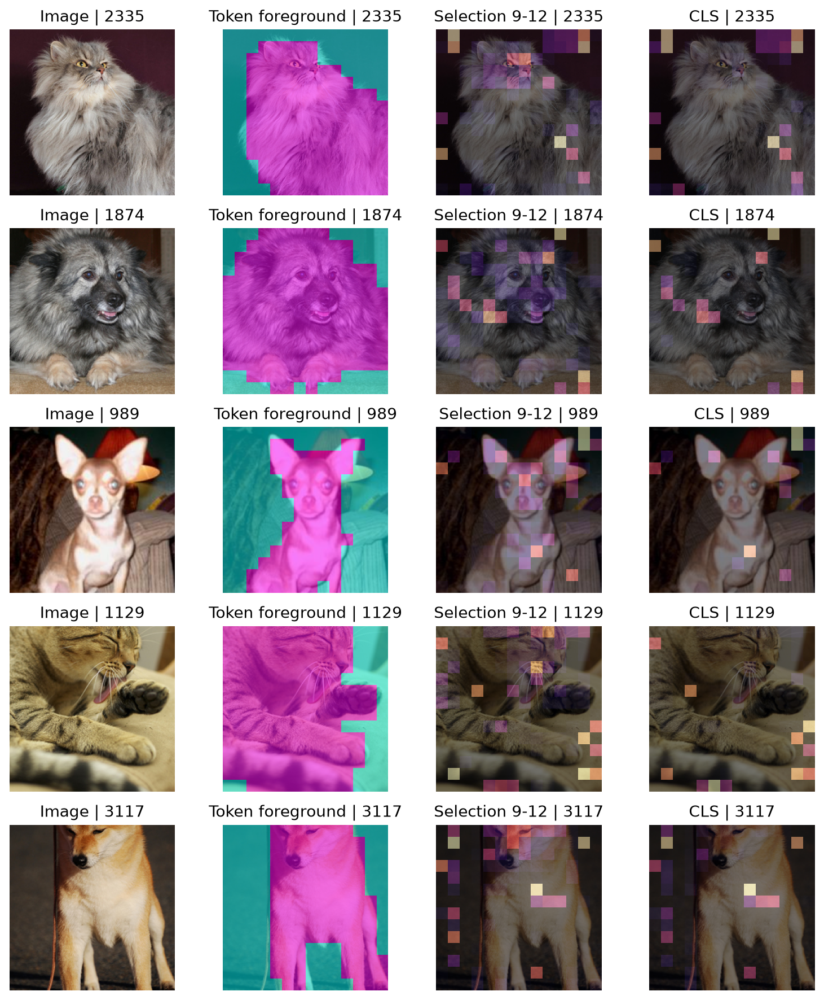
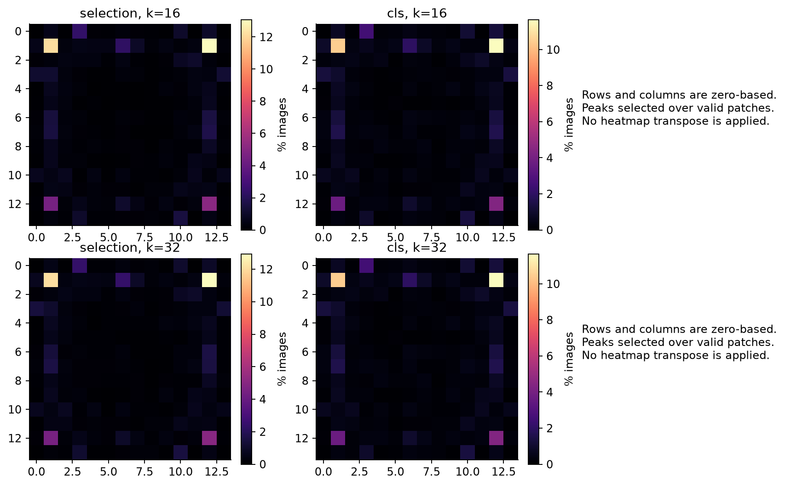
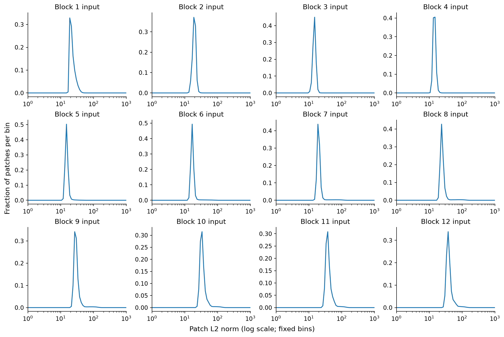

# RQ3 诊断：背景峰值是 bug 还是高范数 token？

## 结论

**现有证据支持高范数 token 现象，没有发现方向、空间对齐或指标实现 bug。** 主 k=16 的第 9–12 层选中次数图，最高点属于这四层高范数 token 并集的比例为 **98.66% [98.31, 99.02]**。这个结果确认了事先定义的“汇聚点”与热图强峰重合，但其是否承担重要计算，要由 B3 检验，不能由范数命名直接推出。

全部区间为图片 bootstrap 1,000 次、seed=0、95%；全量 Pet test 3,669 张。定义在提交 a03c99c 中事先登记，主阈值严格大于每图每层 patch 范数中位数的 3 倍；2 倍和 5 倍为完整敏感性检查。范数取 block 输入、norm1 之前。模型/预处理/图像顺序均沿用原 RQ3，网格 m=16，k16/32；本地 RTX4060，FP32。

## A1 方向与叠图

重新采集的原方向指标与原 RQ3 逐图对比，最大绝对差异 1.84×10⁻⁷，差异来自 CPU/GPU 浮点归约；pointing 完全一致。Observe 与原模型输出的最大误差为 0。检查五张预先 seed=0 固定图像（2335、1874、989、1129、3117），image/mask/token grid 的几何和行优先方向一致。

转置只是诊断，不修改原标签。转置后 selection 的 pointing 增加，但仍远低于机会水平；selection 的前景质量反而下降。转置提高一个分数并不证明转置正确，尤其是四角/边缘热点与 Pet 形状存在系统性位置关系时。

| k | 方法 | 转置标签 | 指标 | 估计 [95% CI] |
| --- | --- | --- | --- | --- |
| 16 | selection | False | fg_mass | 59.24% [58.69, 59.75] |
| 16 | selection | False | pointing | 18.21% [16.95, 19.38] |
| 16 | selection | True | fg_mass | 53.33% [52.64, 54.03] |
| 16 | selection | True | pointing | 35.40% [33.82, 36.93] |
| 16 | cls | False | fg_mass | 39.64% [38.97, 40.29] |
| 16 | cls | False | pointing | 21.67% [20.33, 22.95] |
| 16 | cls | True | fg_mass | 46.66% [45.99, 47.39] |
| 16 | cls | True | pointing | 37.78% [36.22, 39.36] |
| 32 | selection | False | fg_mass | 66.93% [66.45, 67.42] |
| 32 | selection | False | pointing | 19.71% [18.45, 20.90] |
| 32 | selection | True | fg_mass | 56.14% [55.48, 56.81] |
| 32 | selection | True | pointing | 35.73% [34.18, 37.20] |
| 32 | cls | False | fg_mass | 39.64% [38.97, 40.29] |
| 32 | cls | False | pointing | 21.67% [20.33, 22.95] |
| 32 | cls | True | fg_mass | 46.66% [45.99, 47.39] |
| 32 | cls | True | pointing | 37.78% [36.22, 39.36] |

## A2 最高点位置

最高点并非均匀分布，两个方法都常落在靠近四角的位置。坐标从 0 开始，token = row×14+col；并列最大值按原规则取首个有效位置。

### selection, k=16 的前十位置

| 排名 | (row,col) | token | 频率 [95% CI] |
| --- | --- | --- | --- |
| 1 | (1,12) | 26 | 13.08% [12.05, 14.20] |
| 2 | (1,1) | 15 | 12.18% [11.20, 13.25] |
| 3 | (12,12) | 180 | 5.12% [4.44, 5.81] |
| 4 | (12,1) | 169 | 4.52% [3.84, 5.23] |
| 5 | (0,3) | 3 | 2.37% [1.88, 2.86] |
| 6 | (1,6) | 20 | 2.29% [1.85, 2.75] |
| 7 | (7,12) | 110 | 1.72% [1.31, 2.15] |
| 8 | (6,12) | 96 | 1.55% [1.14, 1.96] |
| 9 | (13,10) | 192 | 1.53% [1.14, 1.96] |
| 10 | (7,1) | 99 | 1.50% [1.14, 1.91] |

### cls, k=16 的前十位置

| 排名 | (row,col) | token | 频率 [95% CI] |
| --- | --- | --- | --- |
| 1 | (1,12) | 26 | 11.67% [10.66, 12.67] |
| 2 | (1,1) | 15 | 10.47% [9.54, 11.47] |
| 3 | (12,12) | 180 | 4.36% [3.76, 4.99] |
| 4 | (12,1) | 169 | 3.73% [3.16, 4.39] |
| 5 | (0,3) | 3 | 2.51% [1.99, 3.00] |
| 6 | (1,6) | 20 | 1.99% [1.58, 2.45] |
| 7 | (7,12) | 110 | 1.64% [1.25, 2.04] |
| 8 | (7,1) | 99 | 1.55% [1.20, 1.96] |
| 9 | (6,12) | 96 | 1.36% [0.98, 1.80] |
| 10 | (13,10) | 192 | 1.36% [1.01, 1.74] |

### selection, k=32 的前十位置

| 排名 | (row,col) | token | 频率 [95% CI] |
| --- | --- | --- | --- |
| 1 | (1,12) | 26 | 12.95% [11.88, 13.98] |
| 2 | (1,1) | 15 | 12.13% [11.15, 13.22] |
| 3 | (12,12) | 180 | 5.01% [4.36, 5.72] |
| 4 | (12,1) | 169 | 4.52% [3.87, 5.21] |
| 5 | (0,3) | 3 | 2.40% [1.91, 2.86] |
| 6 | (1,6) | 20 | 2.40% [1.94, 2.86] |
| 7 | (6,12) | 96 | 1.58% [1.17, 1.99] |
| 8 | (7,1) | 99 | 1.58% [1.20, 2.02] |
| 9 | (7,12) | 110 | 1.55% [1.17, 1.99] |
| 10 | (13,10) | 192 | 1.47% [1.09, 1.88] |

### cls, k=32 的前十位置

| 排名 | (row,col) | token | 频率 [95% CI] |
| --- | --- | --- | --- |
| 1 | (1,12) | 26 | 11.67% [10.66, 12.67] |
| 2 | (1,1) | 15 | 10.47% [9.54, 11.47] |
| 3 | (12,12) | 180 | 4.36% [3.76, 4.99] |
| 4 | (12,1) | 169 | 3.73% [3.16, 4.39] |
| 5 | (0,3) | 3 | 2.51% [1.99, 3.00] |
| 6 | (1,6) | 20 | 1.99% [1.58, 2.45] |
| 7 | (7,12) | 110 | 1.64% [1.25, 2.04] |
| 8 | (7,1) | 99 | 1.55% [1.20, 1.96] |
| 9 | (6,12) | 96 | 1.36% [0.98, 1.80] |
| 10 | (13,10) | 192 | 1.36% [1.01, 1.74] |

## A3 范数分布

主峰之外，中后层出现稀疏的高范数尾部/小峰；不能把图描述为两个规模相当的明显峰。这里没有进行形式化双峰检验。固定对数分箱覆盖所有观测值（无超界 token），图按层展示每图 patch 比例的均值与区间，完整分箱见 norm_histogram.csv。是否满足汇聚点定义用预注册阈值判断，不依直方图形状改阈值。

## A4 汇聚点出现的层与峰值对应

下面的峰值对应使用各层自己的选中次数图和同层汇聚点定义。最后四层平均图单独用四层并集；它和“最后一层是否为汇聚点”是不同问题。

### 阈值 3 倍中位数

| 层 | 每图数量 [95% CI] | 有汇聚点的图片比例 [95% CI] | 最高点属于汇聚点 [95% CI] |
| --- | --- | --- | --- |
| 1 | 0.00 [0.00, 0.00] | 0.00% [0.00, 0.00] | 0.00% [0.00, 0.00] |
| 2 | 0.00 [0.00, 0.00] | 0.00% [0.00, 0.00] | 0.00% [0.00, 0.00] |
| 3 | 0.00 [0.00, 0.00] | 0.00% [0.00, 0.00] | 0.00% [0.00, 0.00] |
| 4 | 0.00 [0.00, 0.00] | 0.00% [0.00, 0.00] | 0.00% [0.00, 0.00] |
| 5 | 0.10 [0.09, 0.11] | 10.36% [9.38, 11.28] | 1.80% [1.34, 2.21] |
| 6 | 1.43 [1.40, 1.46] | 88.03% [87.00, 89.04] | 82.64% [81.44, 83.81] |
| 7 | 2.95 [2.91, 2.98] | 99.86% [99.73, 99.97] | 99.59% [99.37, 99.78] |
| 8 | 3.10 [3.06, 3.13] | 99.95% [99.86, 100.00] | 98.86% [98.47, 99.21] |
| 9 | 2.71 [2.67, 2.74] | 99.84% [99.70, 99.95] | 94.85% [94.14, 95.50] |
| 10 | 1.89 [1.87, 1.92] | 96.24% [95.64, 96.81] | 83.24% [82.12, 84.44] |
| 11 | 1.19 [1.17, 1.22] | 81.36% [80.13, 82.56] | 64.81% [63.34, 66.29] |
| 12 | 1.07 [1.04, 1.09] | 77.19% [75.85, 78.50] | 5.26% [4.55, 5.94] |
| 9-12 | 2.71 [2.67, 2.74] | 99.84% [99.70, 99.95] | 98.66% [98.31, 99.02] |

### 阈值 2 倍中位数

| 层 | 每图数量 [95% CI] | 有汇聚点的图片比例 [95% CI] | 最高点属于汇聚点 [95% CI] |
| --- | --- | --- | --- |
| 1 | 0.33 [0.29, 0.38] | 14.47% [13.36, 15.70] | 0.00% [0.00, 0.00] |
| 2 | 0.00 [0.00, 0.00] | 0.05% [0.00, 0.14] | 0.00% [0.00, 0.00] |
| 3 | 0.00 [0.00, 0.00] | 0.03% [0.00, 0.08] | 0.00% [0.00, 0.00] |
| 4 | 0.00 [0.00, 0.00] | 0.00% [0.00, 0.00] | 0.00% [0.00, 0.00] |
| 5 | 0.74 [0.71, 0.76] | 56.47% [54.89, 58.03] | 4.82% [4.14, 5.53] |
| 6 | 2.97 [2.93, 3.00] | 99.40% [99.16, 99.65] | 98.17% [97.74, 98.56] |
| 7 | 4.77 [4.71, 4.82] | 100.00% [100.00, 100.00] | 100.00% [100.00, 100.00] |
| 8 | 5.06 [5.01, 5.11] | 100.00% [100.00, 100.00] | 98.91% [98.53, 99.24] |
| 9 | 5.07 [5.02, 5.12] | 100.00% [100.00, 100.00] | 95.23% [94.55, 95.86] |
| 10 | 4.67 [4.62, 4.72] | 100.00% [100.00, 100.00] | 88.28% [87.27, 89.29] |
| 11 | 4.05 [4.01, 4.10] | 100.00% [100.00, 100.00] | 90.92% [89.94, 91.88] |
| 12 | 4.16 [4.11, 4.20] | 100.00% [100.00, 100.00] | 17.36% [16.19, 18.56] |
| 9-12 | 5.10 [5.05, 5.15] | 100.00% [100.00, 100.00] | 99.45% [99.21, 99.67] |

### 阈值 5 倍中位数

| 层 | 每图数量 [95% CI] | 有汇聚点的图片比例 [95% CI] | 最高点属于汇聚点 [95% CI] |
| --- | --- | --- | --- |
| 1 | 0.00 [0.00, 0.00] | 0.00% [0.00, 0.00] | 0.00% [0.00, 0.00] |
| 2 | 0.00 [0.00, 0.00] | 0.00% [0.00, 0.00] | 0.00% [0.00, 0.00] |
| 3 | 0.00 [0.00, 0.00] | 0.00% [0.00, 0.00] | 0.00% [0.00, 0.00] |
| 4 | 0.00 [0.00, 0.00] | 0.00% [0.00, 0.00] | 0.00% [0.00, 0.00] |
| 5 | 0.00 [0.00, 0.00] | 0.00% [0.00, 0.00] | 0.00% [0.00, 0.00] |
| 6 | 0.12 [0.11, 0.13] | 12.29% [11.26, 13.38] | 11.39% [10.44, 12.43] |
| 7 | 0.66 [0.64, 0.68] | 56.80% [55.27, 58.33] | 53.56% [51.98, 55.08] |
| 8 | 0.53 [0.51, 0.54] | 47.89% [46.31, 49.47] | 46.09% [44.51, 47.70] |
| 9 | 0.19 [0.18, 0.21] | 19.00% [17.74, 20.31] | 18.26% [16.95, 19.54] |
| 10 | 0.01 [0.01, 0.01] | 0.84% [0.55, 1.14] | 0.84% [0.55, 1.14] |
| 11 | 0.00 [0.00, 0.00] | 0.00% [0.00, 0.00] | 0.00% [0.00, 0.00] |
| 12 | 0.00 [0.00, 0.00] | 0.00% [0.00, 0.00] | 0.00% [0.00, 0.00] |
| 9-12 | 0.19 [0.18, 0.21] | 19.00% [17.74, 20.31] | 18.32% [17.09, 19.60] |

主阈值在第 1–4 层没有检出，第 5 层开始出现，第 6 层迅速普及。最后四层任一层有汇聚点的图片比例为 **99.84% [99.70,99.95]**，超过预定 10% 门槛，因此执行 B2。最后层 CLS 峰值属于同层汇聚点的比例为 **58.38% [56.77,59.88]**，低于跨层 selection 的并集对应比例；不可混用这两种定义。

k=32 的全部逐层峰值对应及三阈值结果保存在 [sink_summary.csv](../../experiments/2026-10-26_rq3_diagnosis/A/sink_summary.csv)，数量/有无汇聚点不依 k，峰值对应依 k。

## A5 随机机会水平

每图每 token 独立 Uniform(0,1)，NumPy seed=0，两个 k 共用；不是所有分数相同的平坦图。理论期望为有效前景面积占比 **51.18% [50.51,51.83]**。随机实现与理论接近，原热图的 pointing 明显更低。

| k | 方法 | 指标 | 估计 [95% CI] |
| --- | --- | --- | --- |
| 16 | selection | fg_mass | 59.24% [58.69, 59.75] |
| 16 | selection | pointing | 18.21% [16.95, 19.38] |
| 16 | cls | fg_mass | 39.64% [38.97, 40.29] |
| 16 | cls | pointing | 21.67% [20.33, 22.95] |
| 16 | gaussian | fg_mass | 66.71% [66.05, 67.36] |
| 16 | gaussian | pointing | 92.10% [91.25, 93.02] |
| 16 | random | fg_mass | 51.16% [50.50, 51.81] |
| 16 | random | pointing | 50.94% [49.30, 52.58] |
| 32 | selection | fg_mass | 66.93% [66.45, 67.42] |
| 32 | selection | pointing | 19.71% [18.45, 20.90] |
| 32 | cls | fg_mass | 39.64% [38.97, 40.29] |
| 32 | cls | pointing | 21.67% [20.33, 22.95] |
| 32 | gaussian | fg_mass | 66.71% [66.05, 67.36] |
| 32 | gaussian | pointing | 92.10% [91.25, 93.02] |
| 32 | random | fg_mass | 51.16% [50.50, 51.81] |
| 32 | random | pointing | 50.94% [49.30, 52.58] |

## 可信度与下一步

44 项测试通过，包括 pre-norm 取值、寄存器/CLS 排除池化、observe 不变、固定 k 补选、随机删除剂量。原实现的几何对齐、指标和 observe 输出均复验。没有证据需要修复并重跑原 RQ3，因此原 rq3.md 与原结果不改写。

本诊断回答的是“高范数强峰存在”，还没有证明“高范数位置保存了什么信息”。按已授权流程继续 B1–B5，尤其用 B3 的类别删除与等数量随机删除区分读取频繁与预测重要性。
