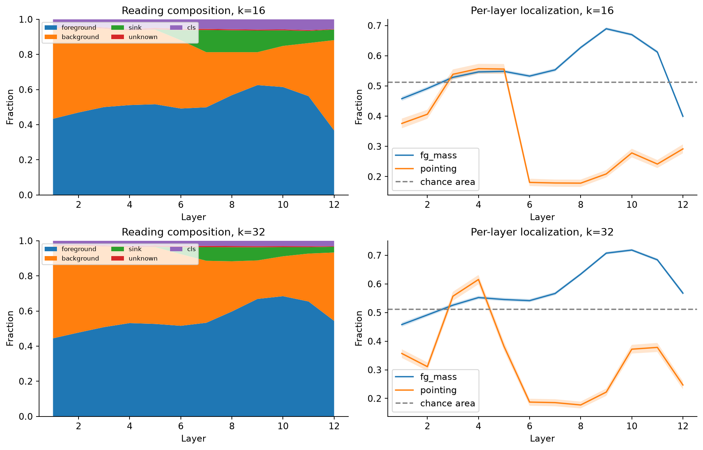
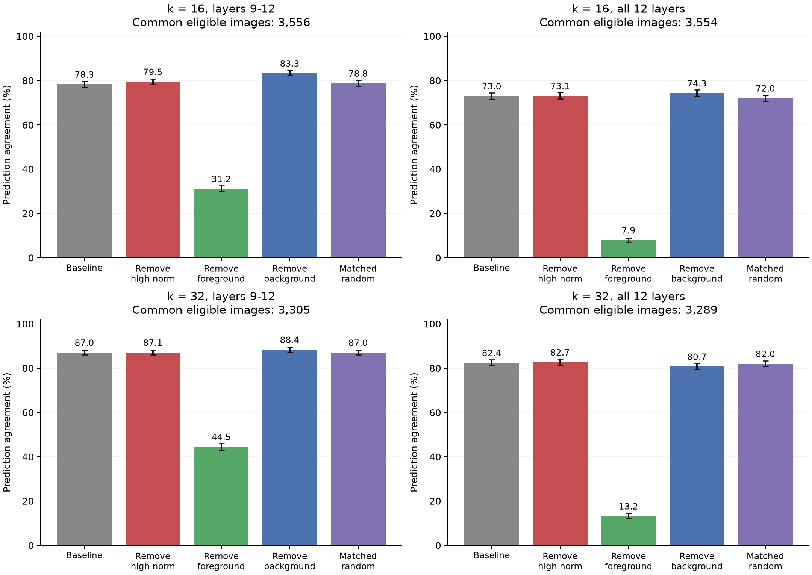
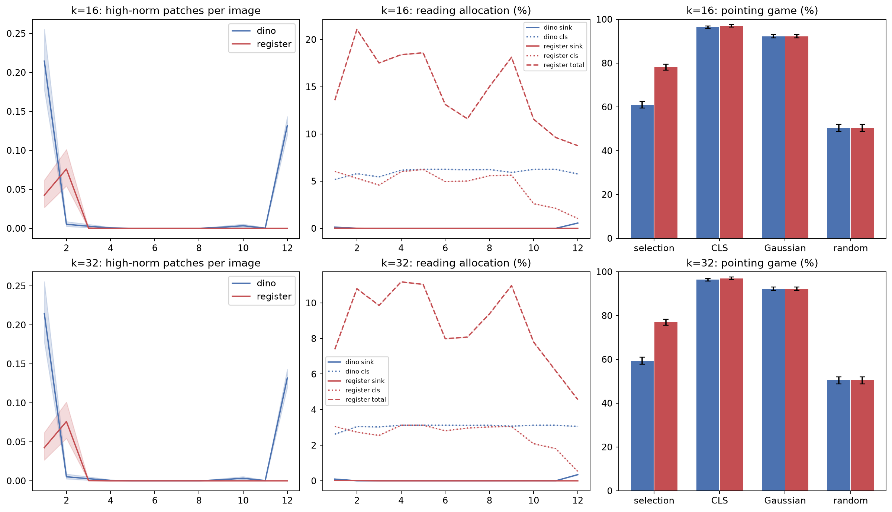

# RQ3 v2：读取位置、预测作用与寄存器对照

## 1. 一句话结论

原 RQ3 的背景峰值与预注册高范数 token 高度重合，但这些位置未显示出更强的预测重要性：k16全层共同样本中，基准一致率73.02% [71.52,74.48]，去汇聚点73.07% [71.69,74.59]，去前景仅7.93% [7.03,8.84]。读取频繁、空间定位与保持预测是不同的性质。

## 2. 这个实验回答什么问题

本轮是在设计书 §6.4 之上、用户明确授权的 A1–A5/B1–B5 扩展：说明书看到了什么、是否真的使用、是否符合寄存器缓解高范数 patch 的机制假设。原 RQ1/RQ2 与原 RQ3 的 CSV、设置和结论原文保留；诊断没有发现需要改写原 RQ3 的方向/对齐 bug，见 [诊断报告](rq3_diagnosis.md)。

## 3. 设置

Pet test 全部 3,669 张；网格 m=16，主 k=16、稳健性 k=32。DeiT-S 的 resize248/center crop224、mask 最近邻、patch 非边界前景像素比例≥0.5保持原样。汇聚点为每图每层 block 输入（norm1前）patch L2 范数严格大于中位数3倍；2/5倍敏感性结果均保留。规则在 a03c99c 的 E01–E07 中运行前固定。

B1 三类空间 token 互斥（汇聚点优先），unknown/CLS/register 单列，以全部读取次数为分母。空间热图排除 prefix 和 unknown。B2 主 selection 排除最后四层汇聚点并集，CLS 排除最后层汇聚点；这改变了空间评价的候选位置，不改变模型输出，也不使改造后的热图自动拥有执行忠实性。

B3 从原模型固定区域打分、读取集合和路由，只在9–12层或全部12层执行。删除目标后依原始排名补入非目标、不重复的 token，保持 k。前景干预包括前景汇聚点，背景干预不含汇聚点；随机对照在每个集合随机删除相同数量（seed0–4），补选原集合外最高分位置。某类非目标位置不足 k 时按预注册记不可执行，绝不改变 k。报告完整基准、各自可执行样本及跨类别共同样本；五个随机种子先逐图平均。这里的因果效应是相对固定预算执行基准的额外变化，不等同于直接消融原模型全部注意力。

B4 使用变换后前景像素质心，距中心除以224，三分位阈值0.073663/0.129310，样本数1221/1220/1221；7张裁剪后无前景，不分组。分组不依模型或热图。

B5 使用 timm DINOv2-S/14 与 reg4，224输入、16×16 patch、相同 resize248/crop224/归一化，observe-only。CLS与4个register不参与区域池化，但可以被选为key并分别计数。checkpoint revision固定在配置与metadata。两个模型是分别训练的权重，因此对照检验一致性，不能表述为在同一模型权重上只开关寄存器。[无寄存器模型](https://huggingface.co/timm/vit_small_patch14_dinov2.lvd142m)、[reg4模型](https://huggingface.co/timm/vit_small_patch14_reg4_dinov2.lvd142m)、[寄存器原论文](https://arxiv.org/abs/2309.16588)。

所有区间均为图片 bootstrap 1,000次、seed0、95%，差值同步配对图片；不把层/head/区域/随机种子当独立图片。各图独立运行于本地RTX4060、FP32、batch32；HPC未重启。

## 4. 结果

### B1 哪些层开始改变读取成分？

第5层开始检出高范数 patch，第6层开始普遍出现；k16 的 pointing 同时明显下降。第9层总体前景质量较高，但峰值被少数高范数位置主导；第12层普通背景读取重新增加。以下成分表分母包含CLS，因而与排除CLS后的前景质量不同。

需区分时间定义：最后四层平均图峰值有98.66% [98.31,99.02]落入四层汇聚点并集，但第12层单独图只有5.26% [4.55,5.94]的峰值是同层汇聚点。部分位置在更早层高范数、到最后层不再超过阈值；不能把所有背景峰值都统称为同层汇聚点。

#### k=16，主阈值逐层表（均为 % [95% CI]）

| 层 | 前景非汇聚 | 普通背景 | 汇聚点 | CLS | unknown | 前景质量 | pointing |
| --- | --- | --- | --- | --- | --- | --- | --- |
| 1 | 43.35% [42.64, 44.02] | 51.45% [50.78, 52.17] | 0.00% [0.00, 0.00] | 4.84% [4.83, 4.86] | 0.36% [0.32, 0.40] | 45.78% [45.03, 46.49] | 37.59% [35.98, 39.19] |
| 2 | 46.95% [46.33, 47.56] | 48.68% [48.07, 49.32] | 0.00% [0.00, 0.00] | 3.79% [3.78, 3.80] | 0.59% [0.53, 0.64] | 49.15% [48.49, 49.78] | 40.64% [39.11, 42.14] |
| 3 | 50.03% [49.40, 50.65] | 44.70% [44.08, 45.34] | 0.00% [0.00, 0.00] | 4.61% [4.61, 4.62] | 0.66% [0.60, 0.71] | 52.85% [52.17, 53.51] | 53.86% [52.25, 55.47] |
| 4 | 51.16% [50.59, 51.72] | 42.52% [41.95, 43.11] | 0.00% [0.00, 0.00] | 5.52% [5.51, 5.53] | 0.80% [0.74, 0.87] | 54.65% [54.03, 55.25] | 55.71% [54.10, 57.32] |
| 5 | 51.62% [51.08, 52.17] | 42.47% [41.93, 43.02] | 0.17% [0.15, 0.18] | 4.88% [4.88, 4.89] | 0.86% [0.79, 0.93] | 54.82% [54.25, 55.41] | 55.60% [53.94, 57.26] |
| 6 | 49.20% [48.69, 49.71] | 38.88% [38.39, 39.40] | 5.77% [5.66, 5.88] | 5.41% [5.39, 5.42] | 0.74% [0.68, 0.80] | 53.26% [52.70, 53.82] | 18.07% [16.87, 19.30] |
| 7 | 49.89% [49.40, 50.37] | 31.39% [30.93, 31.84] | 12.63% [12.49, 12.77] | 5.44% [5.43, 5.45] | 0.65% [0.60, 0.71] | 55.33% [54.75, 55.88] | 17.88% [16.63, 19.02] |
| 8 | 56.81% [56.39, 57.23] | 24.49% [24.10, 24.87] | 12.42% [12.28, 12.55] | 5.66% [5.65, 5.68] | 0.62% [0.56, 0.67] | 62.72% [62.22, 63.23] | 17.83% [16.57, 19.00] |
| 9 | 62.53% [62.11, 62.94] | 18.74% [18.40, 19.10] | 12.33% [12.17, 12.47] | 5.83% [5.82, 5.84] | 0.57% [0.51, 0.63] | 68.93% [68.45, 69.41] | 20.88% [19.70, 22.16] |
| 10 | 61.43% [61.05, 61.83] | 23.41% [23.06, 23.79] | 8.87% [8.74, 9.00] | 5.73% [5.71, 5.74] | 0.56% [0.51, 0.61] | 66.98% [66.50, 67.44] | 27.83% [26.36, 29.22] |
| 11 | 56.24% [55.79, 56.70] | 30.23% [29.80, 30.69] | 6.90% [6.75, 7.05] | 6.13% [6.12, 6.13] | 0.50% [0.44, 0.55] | 61.22% [60.69, 61.74] | 24.15% [22.84, 25.48] |
| 12 | 36.71% [36.02, 37.38] | 51.43% [50.74, 52.09] | 6.02% [5.88, 6.16] | 5.59% [5.58, 5.61] | 0.25% [0.20, 0.29] | 39.95% [39.18, 40.70] | 29.16% [27.69, 30.66] |

#### k=32，主阈值逐层表（均为 % [95% CI]）

| 层 | 前景非汇聚 | 普通背景 | 汇聚点 | CLS | unknown | 前景质量 | pointing |
| --- | --- | --- | --- | --- | --- | --- | --- |
| 1 | 44.46% [43.72, 45.18] | 52.69% [51.97, 53.44] | 0.00% [0.00, 0.00] | 2.46% [2.45, 2.46] | 0.39% [0.35, 0.43] | 45.81% [45.04, 46.55] | 35.70% [34.15, 37.18] |
| 2 | 47.74% [47.11, 48.35] | 49.45% [48.82, 50.10] | 0.00% [0.00, 0.00] | 2.21% [2.21, 2.22] | 0.61% [0.55, 0.66] | 49.17% [48.51, 49.81] | 31.10% [29.60, 32.60] |
| 3 | 50.84% [50.21, 51.48] | 45.92% [45.28, 46.58] | 0.00% [0.00, 0.00] | 2.57% [2.57, 2.57] | 0.67% [0.61, 0.73] | 52.58% [51.90, 53.24] | 55.71% [54.10, 57.26] |
| 4 | 53.13% [52.53, 53.72] | 43.13% [42.53, 43.73] | 0.00% [0.00, 0.00] | 2.96% [2.96, 2.96] | 0.79% [0.72, 0.85] | 55.24% [54.62, 55.86] | 61.54% [59.85, 63.12] |
| 5 | 52.64% [52.08, 53.22] | 43.76% [43.20, 44.35] | 0.18% [0.17, 0.20] | 2.60% [2.59, 2.60] | 0.82% [0.75, 0.88] | 54.55% [53.96, 55.16] | 38.16% [36.66, 39.82] |
| 6 | 51.59% [51.04, 52.13] | 40.81% [40.28, 41.37] | 3.87% [3.80, 3.94] | 2.97% [2.97, 2.97] | 0.76% [0.70, 0.82] | 54.16% [53.58, 54.74] | 18.72% [17.44, 19.90] |
| 7 | 53.30% [52.75, 53.82] | 35.30% [34.80, 35.82] | 7.76% [7.67, 7.84] | 2.94% [2.93, 2.94] | 0.70% [0.64, 0.76] | 56.66% [56.07, 57.23] | 18.53% [17.25, 19.73] |
| 8 | 59.72% [59.30, 60.16] | 28.59% [28.15, 29.01] | 7.99% [7.91, 8.07] | 3.02% [3.02, 3.02] | 0.67% [0.62, 0.73] | 63.41% [62.92, 63.92] | 17.72% [16.52, 18.89] |
| 9 | 66.88% [66.44, 67.31] | 21.93% [21.53, 22.35] | 7.47% [7.38, 7.55] | 3.08% [3.07, 3.08] | 0.65% [0.59, 0.71] | 70.74% [70.25, 71.23] | 22.21% [20.88, 23.47] |
| 10 | 68.43% [68.01, 68.85] | 22.73% [22.34, 23.12] | 5.20% [5.13, 5.28] | 3.04% [3.03, 3.04] | 0.60% [0.55, 0.66] | 71.82% [71.38, 72.28] | 37.20% [35.68, 38.73] |
| 11 | 65.42% [64.98, 65.88] | 27.28% [26.84, 27.72] | 3.64% [3.56, 3.72] | 3.10% [3.10, 3.10] | 0.56% [0.50, 0.60] | 68.41% [67.93, 68.91] | 37.83% [36.22, 39.38] |
| 12 | 54.37% [53.78, 54.99] | 38.95% [38.36, 39.55] | 3.27% [3.20, 3.35] | 3.07% [3.06, 3.07] | 0.34% [0.30, 0.37] | 56.77% [56.13, 57.43] | 24.69% [23.19, 26.03] |

2/5倍阈值完整结果见 [composition.csv](../../experiments/2026-10-26_rq3_diagnosis/B1/composition.csv)。它们只影响汇聚点分类，不改变原始读取集合。

### B2 汇聚点是否遮住了物体？

主设置去汇聚点后的 selection pointing 为42.71% [41.13,44.26]，高于原图18.21% [16.95,19.38]，但仍低于随机50.94% [49.30,52.58]。k32达到61.22% [59.61,62.61]，说明读取预算会影响去除强峰后留下的空间信息。不能据此将主设置换成k32。

#### 阈值 3 倍；% [95% CI]

| k | 方法 | 前景质量 | pointing | n |
| --- | --- | --- | --- | --- |
| 16 | selection | 59.24% [58.69, 59.75] | 18.21% [16.95, 19.38] | 3669 |
| 16 | selection_no_sink | 66.27% [65.77, 66.76] | 42.71% [41.13, 44.26] | 3669 |
| 16 | cls | 39.64% [38.97, 40.29] | 21.67% [20.33, 22.95] | 3669 |
| 16 | cls_no_sink | 42.43% [41.77, 43.07] | 27.15% [25.78, 28.56] | 3669 |
| 16 | gaussian | 66.71% [66.05, 67.36] | 92.10% [91.25, 93.02] | 3669 |
| 16 | random | 51.16% [50.50, 51.81] | 50.94% [49.30, 52.58] | 3669 |
| 32 | selection | 66.93% [66.45, 67.42] | 19.71% [18.45, 20.90] | 3669 |
| 32 | selection_no_sink | 71.25% [70.78, 71.71] | 61.22% [59.61, 62.61] | 3669 |
| 32 | cls | 39.64% [38.97, 40.29] | 21.67% [20.33, 22.95] | 3669 |
| 32 | cls_no_sink | 42.43% [41.77, 43.07] | 27.15% [25.78, 28.56] | 3669 |
| 32 | gaussian | 66.71% [66.05, 67.36] | 92.10% [91.25, 93.02] | 3669 |
| 32 | random | 51.16% [50.50, 51.81] | 50.94% [49.30, 52.58] | 3669 |

#### 阈值 2 倍；% [95% CI]

| k | 方法 | 前景质量 | pointing | n |
| --- | --- | --- | --- | --- |
| 16 | selection | 59.24% [58.69, 59.75] | 18.21% [16.95, 19.38] | 3669 |
| 16 | selection_no_sink | 71.53% [71.09, 72.00] | 73.07% [71.49, 74.43] | 3669 |
| 16 | cls | 39.64% [38.97, 40.29] | 21.67% [20.33, 22.95] | 3669 |
| 16 | cls_no_sink | 49.10% [48.46, 49.73] | 37.20% [35.62, 38.81] | 3669 |
| 16 | gaussian | 66.71% [66.05, 67.36] | 92.10% [91.25, 93.02] | 3669 |
| 16 | random | 51.16% [50.50, 51.81] | 50.94% [49.30, 52.58] | 3669 |
| 32 | selection | 66.93% [66.45, 67.42] | 19.71% [18.45, 20.90] | 3669 |
| 32 | selection_no_sink | 74.57% [74.12, 75.01] | 93.98% [93.21, 94.69] | 3669 |
| 32 | cls | 39.64% [38.97, 40.29] | 21.67% [20.33, 22.95] | 3669 |
| 32 | cls_no_sink | 49.10% [48.46, 49.73] | 37.20% [35.62, 38.81] | 3669 |
| 32 | gaussian | 66.71% [66.05, 67.36] | 92.10% [91.25, 93.02] | 3669 |
| 32 | random | 51.16% [50.50, 51.81] | 50.94% [49.30, 52.58] | 3669 |

#### 阈值 5 倍；% [95% CI]

| k | 方法 | 前景质量 | pointing | n |
| --- | --- | --- | --- | --- |
| 16 | selection | 59.24% [58.69, 59.75] | 18.21% [16.95, 19.38] | 3669 |
| 16 | selection_no_sink | 59.82% [59.28, 60.33] | 20.47% [19.11, 21.72] | 3669 |
| 16 | cls | 39.64% [38.97, 40.29] | 21.67% [20.33, 22.95] | 3669 |
| 16 | cls_no_sink | 39.64% [38.97, 40.29] | 21.67% [20.33, 22.95] | 3669 |
| 16 | gaussian | 66.71% [66.05, 67.36] | 92.10% [91.25, 93.02] | 3669 |
| 16 | random | 51.16% [50.50, 51.81] | 50.94% [49.30, 52.58] | 3669 |
| 32 | selection | 66.93% [66.45, 67.42] | 19.71% [18.45, 20.90] | 3669 |
| 32 | selection_no_sink | 67.28% [66.80, 67.78] | 22.51% [21.15, 23.82] | 3669 |
| 32 | cls | 39.64% [38.97, 40.29] | 21.67% [20.33, 22.95] | 3669 |
| 32 | cls_no_sink | 39.64% [38.97, 40.29] | 21.67% [20.33, 22.95] | 3669 |
| 32 | gaussian | 66.71% [66.05, 67.36] | 92.10% [91.25, 93.02] | 3669 |
| 32 | random | 51.16% [50.50, 51.81] | 50.94% [49.30, 52.58] | 3669 |

### B3 哪类读取对保持预测最重要？

柱图使用跨干预共同可执行图片。下面同时列“各自可执行”与“共同样本”，一致率参照为原模型在同一Pet图片上的ImageNet类别预测，不把Pet品种标签当1000类准确率。

#### available 样本

| k | 范围 | 设置 | n | 一致率 % [95% CI] | 相对基准下降 pp [95% CI] | 每集合删除数 [95% CI] |
| --- | --- | --- | --- | --- | --- | --- |
| 16 | last4 | baseline | 3669 | 78.22% [76.78, 79.48] | 0.00% [0.00, 0.00] | 0.00 [0.00, 0.00] |
| 16 | last4 | sink | 3669 | 79.45% [78.00, 80.76] | -1.23% [-1.88, -0.55] | 1.36 [1.35, 1.38] |
| 16 | last4 | foreground | 3583 | 31.34% [29.72, 32.88] | 46.94% [45.10, 48.82] | 8.75 [8.67, 8.82] |
| 16 | last4 | background | 3642 | 83.14% [81.85, 84.38] | -4.91% [-5.93, -3.84] | 4.91 [4.85, 4.98] |
| 16 | last4 | random | 3669 | 78.72% [77.44, 79.85] | -0.50% [-1.10, 0.05] | 1.36 [1.35, 1.38] |
| 16 | all12 | baseline | 3669 | 72.99% [71.54, 74.35] | 0.00% [0.00, 0.00] | 0.00 [0.00, 0.00] |
| 16 | all12 | sink | 3669 | 73.04% [71.60, 74.41] | -0.05% [-0.68, 0.57] | 0.87 [0.86, 0.88] |
| 16 | all12 | foreground | 3583 | 8.12% [7.28, 9.07] | 64.83% [63.19, 66.57] | 8.20 [8.11, 8.28] |
| 16 | all12 | background | 3640 | 74.37% [72.97, 75.74] | -1.32% [-2.58, 0.05] | 5.93 [5.85, 6.00] |
| 16 | all12 | random | 3669 | 72.01% [70.61, 73.24] | 0.98% [0.29, 1.68] | 0.87 [0.86, 0.88] |
| 32 | last4 | baseline | 3669 | 86.92% [85.80, 88.01] | 0.00% [0.00, 0.00] | 0.00 [0.00, 0.00] |
| 32 | last4 | sink | 3669 | 87.00% [85.91, 88.09] | -0.08% [-0.60, 0.44] | 1.57 [1.55, 1.59] |
| 32 | last4 | foreground | 3438 | 44.47% [42.90, 46.04] | 42.32% [40.52, 44.13] | 20.08 [19.95, 20.22] |
| 32 | last4 | background | 3536 | 88.43% [87.36, 89.56] | -1.27% [-2.15, -0.45] | 8.52 [8.39, 8.65] |
| 32 | last4 | random | 3669 | 86.86% [85.79, 87.92] | 0.06% [-0.41, 0.48] | 1.57 [1.55, 1.59] |
| 32 | all12 | baseline | 3669 | 81.93% [80.57, 83.10] | 0.00% [0.00, 0.00] | 0.00 [0.00, 0.00] |
| 32 | all12 | sink | 3669 | 82.28% [80.95, 83.40] | -0.35% [-0.93, 0.27] | 1.05 [1.04, 1.06] |
| 32 | all12 | foreground | 3438 | 13.58% [12.54, 14.83] | 68.12% [66.55, 69.81] | 17.29 [17.14, 17.45] |
| 32 | all12 | background | 3520 | 81.05% [79.80, 82.33] | 1.56% [0.51, 2.70] | 11.56 [11.39, 11.72] |
| 32 | all12 | random | 3669 | 81.45% [80.24, 82.53] | 0.48% [-0.02, 0.97] | 1.05 [1.04, 1.06] |

#### common 样本

| k | 范围 | 设置 | n | 一致率 % [95% CI] | 相对基准下降 pp [95% CI] | 每集合删除数 [95% CI] |
| --- | --- | --- | --- | --- | --- | --- |
| 16 | last4 | baseline | 3556 | 78.29% [77.00, 79.67] | 0.00% [0.00, 0.00] | 0.00 [0.00, 0.00] |
| 16 | last4 | sink | 3556 | 79.50% [78.21, 80.79] | -1.21% [-1.94, -0.48] | 1.37 [1.35, 1.39] |
| 16 | last4 | foreground | 3556 | 31.19% [29.75, 32.82] | 47.10% [45.13, 48.99] | 8.79 [8.72, 8.87] |
| 16 | last4 | background | 3556 | 83.32% [82.20, 84.59] | -5.03% [-6.05, -3.96] | 5.02 [4.95, 5.08] |
| 16 | last4 | random | 3556 | 78.78% [77.54, 79.99] | -0.49% [-1.09, 0.15] | 1.37 [1.35, 1.39] |
| 16 | all12 | baseline | 3554 | 73.02% [71.52, 74.48] | 0.00% [0.00, 0.00] | 0.00 [0.00, 0.00] |
| 16 | all12 | sink | 3554 | 73.07% [71.69, 74.59] | -0.06% [-0.70, 0.59] | 0.87 [0.86, 0.88] |
| 16 | all12 | foreground | 3554 | 7.93% [7.03, 8.84] | 65.08% [63.31, 66.71] | 8.25 [8.17, 8.33] |
| 16 | all12 | background | 3554 | 74.31% [72.93, 75.80] | -1.29% [-2.59, 0.03] | 6.06 [5.98, 6.13] |
| 16 | all12 | random | 3554 | 72.03% [70.69, 73.34] | 0.98% [0.26, 1.76] | 0.87 [0.86, 0.88] |
| 32 | last4 | baseline | 3305 | 87.05% [85.99, 88.11] | 0.00% [0.00, 0.00] | 0.00 [0.00, 0.00] |
| 32 | last4 | sink | 3305 | 87.08% [85.96, 88.20] | -0.03% [-0.57, 0.54] | 1.58 [1.56, 1.60] |
| 32 | last4 | foreground | 3305 | 44.54% [42.87, 46.14] | 42.51% [40.64, 44.36] | 20.46 [20.32, 20.60] |
| 32 | last4 | background | 3305 | 88.35% [87.26, 89.44] | -1.30% [-2.21, -0.42] | 8.99 [8.86, 9.12] |
| 32 | last4 | random | 3305 | 87.02% [86.01, 88.08] | 0.03% [-0.44, 0.50] | 1.58 [1.56, 1.60] |
| 32 | all12 | baseline | 3289 | 82.43% [81.06, 83.79] | 0.00% [0.00, 0.00] | 0.00 [0.00, 0.00] |
| 32 | all12 | sink | 3289 | 82.70% [81.39, 84.10] | -0.27% [-0.85, 0.36] | 1.05 [1.04, 1.07] |
| 32 | all12 | foreground | 3289 | 13.17% [12.01, 14.47] | 69.26% [67.59, 70.99] | 17.76 [17.62, 17.91] |
| 32 | all12 | background | 3289 | 80.72% [79.42, 82.09] | 1.70% [0.36, 2.92] | 12.20 [12.04, 12.34] |
| 32 | all12 | random | 3289 | 82.02% [80.85, 83.23] | 0.41% [-0.12, 0.94] | 1.05 [1.04, 1.07] |

在四个 (k,范围) 设置的共同可执行样本上，删除前景造成最大下降：k16最后四层下降47.10pp [45.13,48.99]，全层下降65.08pp [63.31,66.71]；k32分别下降42.51pp [40.64,44.36]和69.26pp [67.59,70.99]。汇聚点删除没有降低一致率的明确证据；k16最后四层反而提高1.21pp [0.48,1.94]。这不等于原模型从不使用高范数信息，只说明在当前冻结读取集合和补选规则下，它们不是不可替代的读取位置。

普通背景删除在k16最后四层提高5.03pp [3.96,6.05]，而k32全层下降1.70pp [0.36,2.92]，因此不能笼统宣称“背景完全无用”。

随机一致率 − 去汇聚点一致率，正数表示去汇聚点比等数量随机删除更有破坏性：

| k | 范围 | 配对差值 pp [95% CI] |
| --- | --- | --- |
| 16 | all12 | -1.04% [-1.65, -0.45] |
| 16 | last4 | -0.73% [-1.28, -0.15] |
| 32 | all12 | -0.83% [-1.28, -0.35] |
| 32 | last4 | -0.14% [-0.58, 0.33] |

随机五种子逐一结果（% [95% CI]）：

| k | 范围 | 种子 | 一致率 |
| --- | --- | --- | --- |
| 16 | all12 | random_seed0 | 71.95% [70.43, 73.35] |
| 16 | all12 | random_seed1 | 71.44% [69.91, 72.88] |
| 16 | all12 | random_seed2 | 72.64% [71.14, 74.03] |
| 16 | all12 | random_seed3 | 72.12% [70.56, 73.48] |
| 16 | all12 | random_seed4 | 71.90% [70.40, 73.26] |
| 16 | last4 | random_seed0 | 78.55% [77.11, 79.86] |
| 16 | last4 | random_seed1 | 78.69% [77.35, 79.99] |
| 16 | last4 | random_seed2 | 78.77% [77.38, 80.05] |
| 16 | last4 | random_seed3 | 79.29% [77.92, 80.57] |
| 16 | last4 | random_seed4 | 78.30% [76.91, 79.59] |
| 32 | all12 | random_seed0 | 81.82% [80.49, 82.97] |
| 32 | all12 | random_seed1 | 81.08% [79.75, 82.28] |
| 32 | all12 | random_seed2 | 81.30% [79.99, 82.53] |
| 32 | all12 | random_seed3 | 81.25% [79.86, 82.45] |
| 32 | all12 | random_seed4 | 81.79% [80.51, 82.97] |
| 32 | last4 | random_seed0 | 87.00% [85.88, 88.06] |
| 32 | last4 | random_seed1 | 87.14% [85.99, 88.23] |
| 32 | last4 | random_seed2 | 86.86% [85.80, 87.95] |
| 32 | last4 | random_seed3 | 86.70% [85.58, 87.79] |
| 32 | last4 | random_seed4 | 86.59% [85.42, 87.82] |

以上“下降”允许为负：某种替换也可能比执行基准更接近原模型。前景、背景和汇聚点删除剂量不同，因此跨类别比较是该操作的总体影响，不能直接换算成每个token的固有重要性；只有汇聚点与随机对照明确匹配删除数量。

### B4 中心偏置控制

最偏心三分之一中，高斯的 pointing 仍领先；因此不能仅用“Pet 都在中心”解释原热图低于机会水平。质心偏心不保证物体避开中心，大物体可能质心偏移但仍覆盖中央token。

#### centered

| k | 方法 | n | 前景质量 % [95% CI] | pointing % [95% CI] |
| --- | --- | --- | --- | --- |
| 16 | selection | 1221 | 65.32% [64.35, 66.41] | 28.50% [26.04, 31.04] |
| 16 | selection_no_sink | 1221 | 71.45% [70.57, 72.36] | 49.88% [47.17, 52.50] |
| 16 | cls | 1221 | 46.96% [45.61, 48.42] | 29.48% [26.95, 32.11] |
| 16 | cls_no_sink | 1221 | 49.48% [48.18, 50.91] | 35.63% [33.09, 38.49] |
| 16 | gaussian | 1221 | 75.70% [74.70, 76.76] | 99.59% [99.18, 99.92] |
| 16 | random | 1221 | 58.82% [57.53, 60.15] | 60.44% [57.66, 63.31] |
| 32 | selection | 1221 | 72.26% [71.42, 73.20] | 29.65% [27.11, 32.35] |
| 32 | selection_no_sink | 1221 | 76.04% [75.26, 76.90] | 66.26% [63.55, 68.71] |
| 32 | cls | 1221 | 46.96% [45.61, 48.42] | 29.48% [26.95, 32.11] |
| 32 | cls_no_sink | 1221 | 49.48% [48.18, 50.91] | 35.63% [33.09, 38.49] |
| 32 | gaussian | 1221 | 75.70% [74.70, 76.76] | 99.59% [99.18, 99.92] |
| 32 | random | 1221 | 58.82% [57.53, 60.15] | 60.44% [57.66, 63.31] |

#### middle

| k | 方法 | n | 前景质量 % [95% CI] | pointing % [95% CI] |
| --- | --- | --- | --- | --- |
| 16 | selection | 1220 | 60.88% [60.03, 61.73] | 16.64% [14.59, 18.69] |
| 16 | selection_no_sink | 1220 | 68.31% [67.51, 69.06] | 42.79% [40.08, 45.57] |
| 16 | cls | 1220 | 40.87% [39.78, 41.89] | 22.54% [20.16, 24.76] |
| 16 | cls_no_sink | 1220 | 43.98% [42.88, 45.00] | 29.26% [26.56, 31.64] |
| 16 | gaussian | 1220 | 71.43% [70.40, 72.34] | 98.61% [97.95, 99.26] |
| 16 | random | 1220 | 54.28% [53.10, 55.29] | 54.84% [52.05, 57.70] |
| 32 | selection | 1220 | 69.08% [68.29, 69.87] | 18.28% [16.06, 20.57] |
| 32 | selection_no_sink | 1220 | 73.62% [72.85, 74.36] | 61.07% [57.95, 63.85] |
| 32 | cls | 1220 | 40.87% [39.78, 41.89] | 22.54% [20.16, 24.76] |
| 32 | cls_no_sink | 1220 | 43.98% [42.88, 45.00] | 29.26% [26.56, 31.64] |
| 32 | gaussian | 1220 | 71.43% [70.40, 72.34] | 98.61% [97.95, 99.26] |
| 32 | random | 1220 | 54.28% [53.10, 55.29] | 54.84% [52.05, 57.70] |

#### offcenter

| k | 方法 | n | 前景质量 % [95% CI] | pointing % [95% CI] |
| --- | --- | --- | --- | --- |
| 16 | selection | 1221 | 51.85% [51.14, 52.56] | 9.58% [7.94, 11.30] |
| 16 | selection_no_sink | 1221 | 59.43% [58.70, 60.16] | 35.71% [33.01, 38.17] |
| 16 | cls | 1221 | 31.33% [30.49, 32.15] | 13.10% [11.38, 15.07] |
| 16 | cls_no_sink | 1221 | 34.07% [33.23, 34.92] | 16.71% [14.50, 19.00] |
| 16 | gaussian | 1221 | 53.39% [52.31, 54.59] | 78.62% [76.17, 80.84] |
| 16 | random | 1221 | 40.69% [39.75, 41.68] | 37.84% [34.97, 40.71] |
| 32 | selection | 1221 | 59.84% [59.07, 60.60] | 11.30% [9.50, 13.10] |
| 32 | selection_no_sink | 1221 | 64.51% [63.75, 65.29] | 56.67% [53.97, 59.30] |
| 32 | cls | 1221 | 31.33% [30.49, 32.15] | 13.10% [11.38, 15.07] |
| 32 | cls_no_sink | 1221 | 34.07% [33.23, 34.92] | 16.71% [14.50, 19.00] |
| 32 | gaussian | 1221 | 53.39% [52.31, 54.59] | 78.62% [76.17, 80.84] |
| 32 | random | 1221 | 40.69% [39.75, 41.68] | 37.84% [34.97, 40.71] |

### B5 有无寄存器的模型对照

在主阈值下，无寄存器模型最后四层任一层出现高范数patch的图片比例为12.46% [11.36,13.55]，reg4为0% [0,0]。这里的零是本测试集上的经验值，普通bootstrap在零事件时也给零宽区间，不能据此断言总体发生率严格为零。reg4的浅层仍可能检出高范数patch，不能称整个模型没有高范数token。

k16选中次数图pointing从60.94% [59.42,62.55]升至78.11% [76.75,79.39]，配对增加17.17pp [15.64,18.81]；前景质量增加3.12pp [3.06,3.19]。k32的pointing也提高17.61pp [16.00,19.24]。这些观察与寄存器缓解背景patch强峰的假设一致，但不能把分别训练的checkpoint差异全部归因为寄存器本身。

第9层k16四个寄存器合计占读取次数18.12% [18.08,18.16]，第12层8.76% [8.75,8.76]；它们确实占据读取预算。但预算k包含prefix，因此相同k并不意味着两模型具有相同的有效patch读取数量，这也是该架构对照的一部分。主selection的pointing仍低于中心高斯92.23% [91.44,93.10]；CLS的pointing接近97%，与读取集合热图的含义不同。

| 模型 | k | 方法 | 前景质量 % [95% CI] | pointing % [95% CI] |
| --- | --- | --- | --- | --- |
| dino | 16 | selection | 58.83% [58.25, 59.40] | 60.94% [59.42, 62.55] |
| dino | 16 | cls | 84.37% [84.07, 84.66] | 96.35% [95.78, 96.97] |
| dino | 16 | gaussian | 66.76% [66.10, 67.39] | 92.23% [91.44, 93.10] |
| dino | 16 | random | 51.23% [50.57, 51.90] | 50.48% [48.87, 52.06] |
| dino | 32 | selection | 58.38% [57.78, 58.97] | 59.36% [57.73, 61.00] |
| dino | 32 | cls | 84.37% [84.07, 84.66] | 96.35% [95.78, 96.97] |
| dino | 32 | gaussian | 66.76% [66.10, 67.39] | 92.23% [91.44, 93.10] |
| dino | 32 | random | 51.23% [50.57, 51.90] | 50.48% [48.87, 52.06] |
| register | 16 | selection | 61.95% [61.37, 62.52] | 78.11% [76.75, 79.39] |
| register | 16 | cls | 88.38% [88.09, 88.67] | 97.00% [96.43, 97.55] |
| register | 16 | gaussian | 66.76% [66.10, 67.39] | 92.23% [91.44, 93.10] |
| register | 16 | random | 51.23% [50.57, 51.90] | 50.48% [48.87, 52.06] |
| register | 32 | selection | 61.21% [60.62, 61.80] | 76.97% [75.58, 78.30] |
| register | 32 | cls | 88.38% [88.09, 88.67] | 97.00% [96.43, 97.55] |
| register | 32 | gaussian | 66.76% [66.10, 67.39] | 92.23% [91.44, 93.10] |
| register | 32 | random | 51.23% [50.57, 51.90] | 50.48% [48.87, 52.06] |

寄存器模型 − 无寄存器模型的配对差值：

| k | 方法 | 指标 | 差值 pp [95% CI] |
| --- | --- | --- | --- |
| 16 | cls | fg_mass | 4.01% [3.93, 4.09] |
| 16 | cls | pointing | 0.65% [-0.03, 1.34] |
| 16 | gaussian | fg_mass | 0.00% [0.00, 0.00] |
| 16 | gaussian | pointing | 0.00% [0.00, 0.00] |
| 16 | random | fg_mass | 0.00% [0.00, 0.00] |
| 16 | random | pointing | 0.00% [0.00, 0.00] |
| 16 | selection | fg_mass | 3.12% [3.06, 3.19] |
| 16 | selection | pointing | 17.17% [15.64, 18.81] |
| 32 | cls | fg_mass | 4.01% [3.93, 4.09] |
| 32 | cls | pointing | 0.65% [-0.03, 1.34] |
| 32 | gaussian | fg_mass | 0.00% [0.00, 0.00] |
| 32 | gaussian | pointing | 0.00% [0.00, 0.00] |
| 32 | random | fg_mass | 0.00% [0.00, 0.00] |
| 32 | random | pointing | 0.00% [0.00, 0.00] |
| 32 | selection | fg_mass | 2.83% [2.78, 2.89] |
| 32 | selection | pointing | 17.61% [16.00, 19.24] |

每个模型的A2位置前十/频率、A3逐层范数、A4三阈值和B1逐层成分分别保存在 [DINOv2](../../experiments/2026-10-26_rq3_dino/) 与 [reg4](../../experiments/2026-10-26_rq3_register/)。寄存器按1–4分别计数，总寄存器读取比例也用逐图之和重新bootstrap。224分辨率为用户指定，checkpoint默认518的绝对位置嵌入由timm插值；不得把此处与DeiT不同patch网格的空间指标差异全归因于训练方式。

## 5. 和预期对照

“最强位置等于物体位置”的预期被否定；高范数位置可以频繁被读取，同时空间定位较差。B2只恢复一部分前景峰值，B3/B5的解释必须依据实际对照。RQ3扩展本身不重新定义设计书A/B/C，它深化空间与功能的区分，原RQ1/RQ2分型保留。不能为了更完整的故事把所有高范数位置都称为已经证实的全局信息汇聚器。

## 6. 可信度检查

44项测试通过；DeiT采集observe误差0，32张B3前置k197恒等误差0；ImageNet此前200/5000张恒等结果保留。正式B3每批输出有限，并检查全量样本数、相同参照预测、缺失与可执行规则一致、随机删除数量匹配。DINOv2只报告observe特征不变，不把384维特征argmax解释成类别。

A的逐图指标与原RQ3最大差异1.84×10⁻⁷；五张叠图视觉核对通过。抽样CI用图片为单位，随机种子均值的CI反映图片抽样不确定性，不包括训练种子或checkpoint选择不确定性。未作多重比较校正。大矩阵缓存与权重留本地ignored目录，CSV/配置/日志/图已提交；源commit、checkpoint revision与缓存SHA256记录在各目录。

## 7. 异常与可能原因

| 观察/限制 | 可能原因 | 如何验证 |
| --- | --- | --- |
| 转置提高pointing但降低selection质量 | 热点位置与物体构图不均匀，单一分数不足以判断方向 | 对照已保存的五张原图/标签/热图及patch行优先索引；本轮未发现方向bug |
| 去汇聚点后主设置仍低于随机pointing | 普通背景强峰仍存在；k16覆盖不足 | 比较B1最后层普通背景、B2两k与B3类别干预；下一步可按层看干预，不在本轮追加 |
| 少数B3干预不可执行 | 非目标token不足k，固定预算约束无法同时满足 | 查看coverage.csv与逐图reason，复算对应mask剩余token数量 |
| B4有7张无质心 | 原eval裁剪后前景全部消失 | 查看groups.csv中group=-1的原始trimap与224裁剪；不补造质心 |
| 不同模型对照不等于纯register开关 | checkpoint训练权重不同，224位置插值与原始训练分辨率不同 | 若需严格训练因果结论，应做相同训练设置的受控模型实验，超出本轮 |

前置代码测试发现stable argsort参数调用错误，正式实验前已修复并通过测试。一次分析过早启动，等待采集结束后重试；没有丢弃负结果、改阈值或重选示例。

## 8. 下一步选项与图4版面

1. **推荐：图4采用“机制证据”三面板。** 左：逐层前景/普通背景/汇聚点成分；中：主k16的B3两执行范围及等数量随机对照；右：DINOv2两模型的空间指标与prefix读取分配。完整k32、敏感性、位置/范数图放附录。目的：在4页内把“看到了什么→是否有用→跨模型一致性”连起来；排版约1–2小时，不新增实验。
2. **图4采用“图像案例”版。** 上：固定三例的原图、原热图、去汇聚点图；下：B3主结果和偏心组三方法小表。DINOv2放附录。目的：优先让读者直观看懂定位与功能不同；约1–2小时，代价是主文的寄存器证据较少。

需要用户决定的是采用哪种主文叙事和版面，以及是否将上述干预约束作为正式方法定义。未改研究叙事稿的【待填】。

## 9. 可以写进论文的句子与三个问题

> 在Oxford-IIIT Pet上，原读取热图的背景强峰与高范数patch显著重合：98.66% [98.31,99.02]的峰值属于最后四层高范数位置的并集。移除这些位置使k16的pointing从18.21% [16.95,19.38]升至42.71% [41.13,44.26]，但仍不足以恢复可靠的物体定位。

> 在保持读取预算不变的执行检验中，移除前景导致k16全层一致率下降65.08pp [63.31,66.71]，而移除高范数位置未带来明确下降；等数量随机对照也未显示这些位置更重要。DINOv2寄存器模型的读取热图pointing比无寄存器模型提高17.17pp [15.64,18.81]，与高范数patch现象减弱相伴。这些结果说明，读取热图可以暴露模型内部的选择偏好，但强峰不是功能重要性的直接度量。

**说明书看到了什么？** 中间层逐渐更多读取前景；少量高范数patch从第5–6层开始突出，并主导跨层平均热图峰值；最后层普通背景读取又增加。读取集合的整体前景覆盖和最高点定位因此可以给出不同结论。

**看到的东西真的被用到了吗？** 在本轮冻结说明书、保持k并按排名补选的检验里，删除前景的影响最大，主k16全层从73.02%降到7.93%（完整CI见B3）；删除高范数位置后的73.07%与基准接近，也不比匹配数量的随机删除更有破坏性。这支持前景读取的重要性，反对把读取频率直接当作不可替代性；结论限于该干预，不否定原模型存在信息混合或冗余。

**为什么会这样？** 空间位置是token的地址，深层内容已经混合，区域平均打分/重复选择也不等于实际query对V的贡献。寄存器模型出现更少的深层高范数patch及更好的空间定位，提供与“非空间计算可由额外token承载”一致的证据；但B3没有证明DeiT的高范数patch是预测必需的草稿纸，B5也不是同权重的纯开关实验。当前能支持的是位置、读取频率与执行作用需要分开测量。
