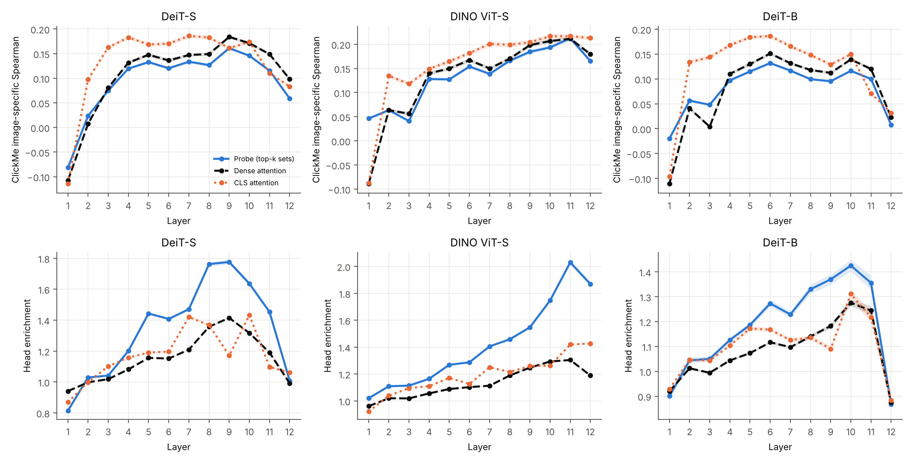
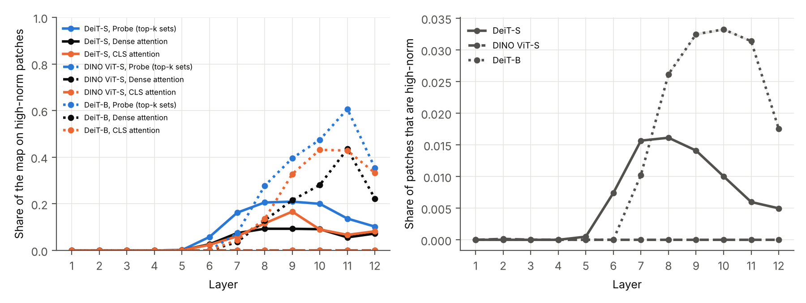

# 补充实验 S1–S3：top-k 到底贡献了什么？

2026-10-31 · 设计、预测和判定标准在写代码前登记（[决策日志](../decisions.md) B21–B25，提交 a96a7aa）· 代码 490f05a（E7、E8）和 0269534（其余）· Colab L4 · 21 个正式运行

## 一句话结论

**探针的解释图几乎就是"每个图块收到的注意力之和"（两张图逐图相关的中位数 0.90）。不加 top-k 的完整注意力图在忠实性、扣除中心后的物体聚焦和人类一致上都和探针相当或略好，只有对动物头部的偏爱是 top-k 放大出来的。逐层规律（中后层最像人、有监督模型最后一层离开物体）在完整注意力和 CLS 注意力上同样出现，是模型本身的性质。高范数 token 在有监督模型的中后层吸走大量读取，DINO 没有这类 token，但它们不能解释最后一层的下降。**

所有区间都是按图片配对 bootstrap 1,000 次（seed 0）的 95% 区间。"完整注意力"（`attention_mass`）指第 9–12 层每个图块从全部 query、全部头收到的注意力之和，不加 top-k。"探针"（`probe_mass`）是登记的主定义。

---

## 0. 为什么做这三项

研究定位确定为 C（分析型研究，B21）后，文献核查和自查发现三个缺口：

| 实验 | 问题 | 登记 |
| --- | --- | --- |
| S1 | top-k 读取名单有没有让解释图本身更好？不加 top-k 的完整注意力就是 token 剪枝中"收到的注意力"（PoWER-BERT、LTP） | B22 |
| S2 | 逐层规律是不是只有探针才看得到？ | B23 |
| S3 | 有监督模型最后一层"离开物体"，是不是因为读取集中到了高范数 token？ | B24 |

---

## 1. 运行情况

- 21 个正式运行（E4 全部 10 个组合、E7 ×3、E8 ×3、`layer_reading` ×3），Colab L4，约 7.7 小时，用去约 18.6 计算单元；实例已停止。
- **跨硬件复现**：探针在同一运行中重算。它在 L4 上的 SRG 与 v3（A100）的差在 10 个组合中都不超过 0.001（登记界限 0.01）；逐图有 96%–100% 完全相同。逐层 ClickMe 和头部富集曲线与 v3 的最大差小于 0.0001。
- 运行中的问题（详见[实验日志](../experiment_log.md)）：
  - Pet 数据从实例无法下载，改为上传本地原始压缩包，MD5 与 torchvision 固定值一致。
  - `layer_reading` 冒烟运行发现中位数实现与登记定义不一致（取较小的中间值而不是中点），在正式运行前改正。

---

## 2. S1：完整注意力 vs 探针

### 2.1 两张图有多像？

ImageNet-S 上逐图的 Spearman 相关，中位数 [四分位]：

| DeiT-S | DINO | DeiT-B |
| ---: | ---: | ---: |
| 0.90 [0.87, 0.92] | 0.90 [0.88, 0.92] | 0.91 [0.89, 0.93] |

两张图非常接近，探针图基本就是"收到的注意力"在名单内重新分配后的结果。

### 2.2 各项指标（完整注意力 − 探针）

**SRG（忠实性，越大越好）**：

| 数据集 | 模型 | 探针 | 完整注意力 | 差 [95% 区间] |
| --- | --- | ---: | ---: | --- |
| ImageNet-S | DeiT-S | 0.202 | 0.242 | +0.040 [+0.037, +0.043] |
| | DINO | 0.235 | 0.285 | +0.050 [+0.047, +0.053] |
| | DeiT-B | 0.150 | 0.169 | +0.019 [+0.014, +0.025] |
| Hard ImageNet | DeiT-S | 0.178 | 0.198 | +0.020 [+0.010, +0.030] |
| | DINO | 0.193 | 0.233 | +0.041 [+0.030, +0.052] |
| | DeiT-B | 0.136 | 0.142 | +0.006 [−0.004, +0.017] |
| Pet | DeiT-S | 0.251 | 0.278 | +0.027 [+0.021, +0.034] |
| | DINO | 0.328 | 0.375 | +0.047 [+0.041, +0.053] |
| ImageNet 子集 | DeiT-S | 0.205 | 0.241 | +0.036 [+0.030, +0.043] |
| | DINO | 0.234 | 0.277 | +0.043 [+0.037, +0.049] |

**其他指标**：

| 指标 | DeiT-S | DINO | DeiT-B |
| --- | --- | --- | --- |
| 同距离富集（ImageNet-S） | 0.114 → 0.140（+0.026） | 0.158 → 0.199（+0.041） | 0.067 → 0.080（+0.013） |
| ClickMe 图片特异 Spearman | 0.135 → 0.156（+0.022） | 0.199 → 0.208（+0.009） | 0.092 → 0.107（+0.015） |
| 动物头部富集 | 1.54 → 1.25（−0.30） | 1.82 → 1.26（−0.56） | 1.30 → 1.17（−0.13） |
| 部件"对得上"比例 | 46.7% → 46.4% | 52.2% → 52.4% | 44.4% → 44.0% |

箭头前是探针，箭头后是完整注意力。同距离富集在 Hard ImageNet 和 Pet 上的方向相同：8 个组合中 7 个完整注意力更高。

**怎么理解**：

1. **忠实性**：10 个组合中 9 个完整注意力更高（区间不含 0）。差都没有超过登记的"相当"界限 0.05，但 DINO ImageNet-S 正好在界限上（0.050）。方向与预测一致：探针给没被读的图块打 0 分，它们只能随机排序，所以"先删最不重要的"那条曲线变差。
2. **物体聚焦和人类一致**：完整注意力也更高，一部分超出了"相当"的界限。top-k 截断丢掉了有用的弱信号。
3. **头部偏爱**：探针明显更高。也就是说，v3 报告的"探针的头部富集在所有方法中最高"，很大程度上是 top-k 把注意力集中到少数 token 上造成的。完整注意力的头部富集（1.25 / 1.26 / 1.17）与 GAE（1.28 / 1.35 / 1.17）相近。
4. **但更偏爱头并没有让部件判断更准**："解释图最偏爱的部件就是模型最依赖的部件"的比例两者相同。

**和其他方法放在一起看**（ImageNet-S 的 SRG）：

| 方法 | DeiT-S | DINO | DeiT-B |
| --- | ---: | ---: | ---: |
| 完整注意力（不加 top-k） | 0.242 | 0.285 | 0.169 |
| 探针（top-k） | 0.202 | 0.235 | 0.150 |
| CLS 注意力 | 0.182 | 0.309 | 0.110 |
| Rollout | 0.146 | 0.172 | 0.030 |
| GAE | 0.343 | 0.418 | 0.308 |

在只看注意力的方法中，最忠实的是完整注意力，不是探针。DINO 上 CLS 注意力仍然最好。所有注意力类方法都低于 GAE。

### 2.3 按事先约定的解读

预测 (1) 成立（10 个组合都在"相当"界限内），(2)(3) 部分成立，(4) 成立。完整注意力在人类一致上有一个模型（DeiT-S）超出了界限，在物体聚焦上有 4 个组合超出界限。

按 B22 事先约定：**如实报告；论文用完整注意力画解释图，用 top-k 读取名单做执行检验；部件和逐层发现对两种图都报告。**

---

## 3. S2：逐层规律是不是探针特有的？

**与探针逐层曲线的 Pearson 相关**（12 层均值）：

| 读取方式 | ClickMe DeiT-S | ClickMe DINO | ClickMe DeiT-B | 头部富集 DeiT-S | 头部富集 DINO | 头部富集 DeiT-B |
| --- | ---: | ---: | ---: | ---: | ---: | ---: |
| 完整注意力 | 0.99 | 0.90 | 0.96 | 0.98 | 0.92 | 0.98 |
| CLS 注意力 | 0.92 | 0.77 | 0.85 | 0.78 | 0.94 | 0.89 |

**最后一层的下降**（第 12 层 − 第 8–11 层中最高的一层）：

| 读取方式 | ClickMe DeiT-S | ClickMe DINO | ClickMe DeiT-B | 头部富集 DeiT-S | 头部富集 DINO | 头部富集 DeiT-B |
| --- | ---: | ---: | ---: | ---: | ---: | ---: |
| 探针 | −0.102 | −0.047 | −0.109 | −0.77 | −0.16 | −0.56 |
| 完整注意力 | −0.086 | −0.032 | −0.116 | −0.42 | −0.12 | −0.40 |
| CLS 注意力 | −0.100 | −0.004 | −0.118 | −0.37 | +0.007 | −0.43 |

（区间都很窄，都不含 0；DINO 的 CLS 注意力变化极小：−0.004 和 +0.007。）

**怎么理解**：

- 预测 (1)(2) 都成立。完整注意力的逐层曲线与探针几乎一样；有监督模型最后一层的下降在三种读取方式中都出现，而且幅度相近。
- DINO 的下降小得多。用 CLS 注意力看，DINO 的最后一层完全没有下降。
- 所以 v3 的逐层发现是**模型注意力本身的性质**，不依赖于探针。这让发现更可靠，但"只有探针能看到"的说法必须删去。

---

## 4. S3：高范数 token 能解释最后一层的下降吗？

高范数图块：第 l 块输入的范数大于该图该层中位数的 3 倍（RQ3 诊断事先登记的定义）。

| 指标 | 模型 | 第 6 层 | 第 8 层 | 第 9 层 | 第 10 层 | 第 11 层 | 第 12 层 |
| --- | --- | ---: | ---: | ---: | ---: | ---: | ---: |
| 高范数图块的比例 | DeiT-S | 0.7% | 1.6% | 1.4% | 1.0% | 0.6% | 0.5% |
| | DeiT-B | 0.0% | 2.6% | 3.2% | 3.3% | 3.1% | 1.8% |
| | DINO | 0 | 0 | 0 | 0 | 0 | 0 |
| 探针读取量落在其上的比例 | DeiT-S | 6% | 21% | 21% | 20% | 14% | 10% |
| | DeiT-B | 0% | 28% | 40% | 48% | **61%** | 35% |
| 完整注意力落在其上的比例 | DeiT-S | 3% | 9% | 9% | 9% | 6% | 7% |
| | DeiT-B | 0% | 13% | 22% | 28% | 44% | 22% |

**预测对账**：

- (1) DeiT-B 成立：第 12 层的高范数占比比第 6 层高 0.35。DeiT-S **不成立**：第 12 层比第 9 层**低** 0.11。
- (2) 成立：DINO 第 12 层比 DeiT-S 低 0.10。DINO 根本没有高范数图块，这与 Darcet 等（ICLR 2024）的报告一致：原始 DINO 没有这类伪影。

**怎么理解**：

1. 有监督模型的中后层确实把大量读取给了极少数高范数图块。例如 DeiT-B 第 11 层，3% 的图块拿走了探针 61% 的读取量。
2. top-k 名单比完整注意力更偏向这些 token，大约是 1.4–2.3 倍。这与 RQ3 诊断的发现一致：探针热图的峰值几乎都在高范数 token 上。
3. 但这**不能**解释最后一层的下降：两个有监督模型在第 12 层的高范数占比都比第 10–11 层低，而与人一致和头部偏爱恰恰在第 12 层下降。最后一层为什么离开物体，仍然是开放问题。

---

## 5. 预测对账

| 编号 | 预测 | 结果 |
| --- | --- | --- |
| B22 (1) | SRG"相当"（10 个组合） | **成立**；但 9/10 完整注意力明显更高，DINO ImageNet-S 正好在界限上 |
| B22 (2) | 同距离富集"相当"（8 个） | **部分成立**（4/8）；7/8 完整注意力更高 |
| B22 (3) | ClickMe"相当"（3 个） | **部分成立**（2/3）；3/3 完整注意力更高 |
| B22 (4) | 头部富集探针更高 | **成立**（3/3） |
| B22 (5) | 部件"对得上"：不预测方向 | 两者相同 |
| B22 (6) | 两张图逐图相关中位数 > 0.5 | **成立**（0.90–0.91） |
| B22 (7) | 跨硬件复现差 < 0.01 | **成立**（≤ 0.001） |
| B23 (1) | 完整注意力逐层曲线与探针相同（r ≥ 0.8） | **成立**（6/6，r = 0.90–0.99） |
| B23 (2) | 有监督模型最后一层的下降也出现在完整注意力中 | **成立**（4/4） |
| B23 (3) | CLS 注意力：不预测 | r = 0.77–0.94；DINO 无下降 |
| B24 (1) | 第 12 层的高范数占比高于 ClickMe 峰值层 | **部分成立**：DeiT-B 是，DeiT-S 否 |
| B24 (2) | DINO 第 12 层的高范数占比低于 DeiT-S | **成立** |

完整表格：`experiments/2026-10-31_s_analysis/predictions.csv`（由 `scripts/analyze_supplement.py` 自动判定）。

---

## 6. 对研究故事的影响

**需要改的说法**（v3 报告和 README 已据此加注）：

| v3 的说法 | 现在应该怎么说 |
| --- | --- |
| 探针在只看注意力的方法中忠实性最好或持平 | 不加 top-k 的完整注意力比探针更忠实；在只看注意力的方法中，完整注意力在 DeiT-S、DeiT-B 上最好，DINO 上 CLS 注意力最好 |
| 探针对头部的偏爱在所有方法中最高 | 这主要是 top-k 截断的放大效果；完整注意力的头部偏爱与 GAE 相近；逐图部件判断的准确度两者相同 |
| 逐层变化只有探针能看到 | 逐层规律在完整注意力和 CLS 注意力上同样出现，是模型本身的性质 |

**不变的结论**：

- 模型依赖物体本身而不只是画面中间（E6）；
- 模型依赖动物的头（E8 因果删除）；
- 读取名单可以执行：少数 token 就能复现单层计算（RQ1）；
- 中后层最像人，有监督模型最后一层离开物体，DINO 不明显。

**对定位 C 的建议写法**：

1. **解释图**用"每个图块收到的注意力"（完整注意力，引用 token 剪枝文献）。它更简单，也略好。
2. **top-k 读取名单**的作用是检验：只按少数 token 计算就能复现模型，说明这些"读取"是模型真正在用的计算，而不是事后画的图。
3. **发现**用三种读取方式（探针、完整注意力、CLS 注意力）同时支持，比单一方法更有说服力。
4. **新增发现**：有监督 ViT 的中后层把大量读取给了极少数高范数 token，DINO 没有这种 token；但最后一层的下降不能由它解释。

**一句话总结：** top-k 没有让解释图更好，但这次对照让 ViT 的逐层发现更可靠：它们不依赖任何一种读取方式。

---

## 7. 局限

1. 完整注意力 SRG 更高的一个原因是探针给未读图块打 0 分，删除顺序只能随机。如果给探针加一个打破平局的次级分数，差距可能缩小；这一点没有检验。
2. PartImageNet 的部件依赖结果来自 v3 运行（同样的图片和模型），这次只重算了解释图。
3. 高范数阈值只用了登记的 3 倍；RQ3 诊断中的 2 倍和 5 倍敏感性检查这次没有重做。
4. 每项只运行一次；区间只反映图片抽样的不确定性。

## 8. 文件

| 内容 | 位置 |
| --- | --- |
| 分析表和预测判定 | `experiments/2026-10-31_s_analysis/` |
| 各运行 | `experiments/2026-10-31_s_*`（大表在被忽略的 `raw/`） |
| 实例日志 | `experiments/2026-10-31_s_colab_env/` |
| 图 | `figures/figure15_dense_vs_probe`、`figure16_layer_families`、`figure17_high_norm` |
| 重做分析和图 | `python scripts/analyze_supplement.py`，`python scripts/plot_supplement.py` |
