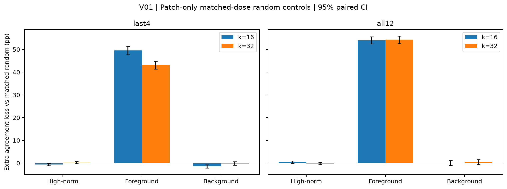

# V01：夜间补充验证

## 1. 一句话结论

k16全层共同样本中，目标删除相对匹配随机删除的额外一致率下降：sink 0.46 [-0.06, 0.95] pp；foreground 53.99 [52.41, 55.55] pp；background 0.07 [-1.00, 1.11] pp。正值代表目标删除更有破坏性。

## 2. 回答的问题

按已批准的[方案](../overnight_validation_plan_2026-10-27.md)与E09执行，检验现有结论的边界，原实验不覆盖。

## 3. 设置

同一Colab GPU、原固定模型和预处理、m16、FP32、batch32。V01用Pet3669张，V02/V03用原ImageNet5000张。设置和源码提交见对应config.yaml与metadata.json。置信区间为图片bootstrap1000次、seed0、95%；随机先逐图平均五种子。未作多重比较校正。

## 4. 结果

| k | scope | category | population | target_drop | random_drop | extra_drop_vs_random | dose |
| --- | --- | --- | --- | --- | --- | --- | --- |
| 16 | last4 | sink | available | -1.23 [-1.88, -0.55] | -0.69 [-1.23, -0.17] | -0.54 [-1.06, -0.02] | 1.3645 [1.3460, 1.3822] |
| 16 | last4 | sink | common | -1.21 [-1.94, -0.48] | -0.64 [-1.20, -0.04] | -0.57 [-1.10, -0.07] | 1.3694 [1.3493, 1.3875] |
| 16 | last4 | foreground | available | 46.94 [45.10, 48.82] | -2.36 [-3.47, -1.30] | 49.31 [47.70, 51.16] | 8.7450 [8.6697, 8.8207] |
| 16 | last4 | foreground | common | 47.10 [45.13, 48.99] | -2.41 [-3.52, -1.32] | 49.52 [47.73, 51.28] | 8.7874 [8.7154, 8.8683] |
| 16 | last4 | background | available | -4.91 [-5.93, -3.84] | -3.52 [-4.42, -2.60] | -1.39 [-2.16, -0.69] | 4.9126 [4.8494, 4.9765] |
| 16 | last4 | background | common | -5.03 [-6.05, -3.96] | -3.57 [-4.52, -2.58] | -1.47 [-2.20, -0.74] | 5.0195 [4.9522, 5.0797] |
| 16 | all12 | sink | available | -0.05 [-0.68, 0.57] | -0.50 [-1.10, 0.13] | 0.44 [-0.09, 0.93] | 0.8681 [0.8584, 0.8778] |
| 16 | all12 | sink | common | -0.06 [-0.70, 0.59] | -0.51 [-1.15, 0.18] | 0.46 [-0.06, 0.95] | 0.8709 [0.8610, 0.8805] |
| 16 | all12 | foreground | available | 64.83 [63.19, 66.57] | 11.09 [9.58, 12.48] | 53.75 [52.27, 55.17] | 8.1978 [8.1138, 8.2807] |
| 16 | all12 | foreground | common | 65.08 [63.31, 66.71] | 11.09 [9.62, 12.51] | 53.99 [52.41, 55.55] | 8.2488 [8.1693, 8.3309] |
| 16 | all12 | background | available | -1.32 [-2.58, 0.05] | -1.35 [-2.38, -0.18] | 0.03 [-0.96, 1.03] | 5.9290 [5.8549, 6.0034] |
| 16 | all12 | background | common | -1.29 [-2.59, 0.03] | -1.37 [-2.44, -0.35] | 0.07 [-1.00, 1.11] | 6.0574 [5.9834, 6.1332] |
| 32 | last4 | sink | available | -0.08 [-0.60, 0.44] | -0.32 [-0.72, 0.07] | 0.23 [-0.14, 0.64] | 1.5663 [1.5461, 1.5862] |
| 32 | last4 | sink | common | -0.03 [-0.57, 0.54] | -0.28 [-0.71, 0.11] | 0.25 [-0.15, 0.72] | 1.5769 [1.5566, 1.5988] |
| 32 | last4 | foreground | available | 42.32 [40.52, 44.13] | -0.47 [-1.42, 0.56] | 42.79 [41.14, 44.43] | 20.0832 [19.9491, 20.2210] |
| 32 | last4 | foreground | common | 42.51 [40.64, 44.36] | -0.58 [-1.63, 0.41] | 43.09 [41.39, 44.83] | 20.4553 [20.3184, 20.5964] |
| 32 | last4 | background | available | -1.27 [-2.15, -0.45] | -1.07 [-1.74, -0.40] | -0.20 [-0.92, 0.48] | 8.5195 [8.3914, 8.6505] |
| 32 | last4 | background | common | -1.30 [-2.21, -0.42] | -1.11 [-1.82, -0.43] | -0.19 [-0.92, 0.61] | 8.9938 [8.8643, 9.1227] |
| 32 | all12 | sink | available | -0.35 [-0.93, 0.27] | -0.19 [-0.60, 0.27] | -0.17 [-0.61, 0.29] | 1.0503 [1.0389, 1.0620] |
| 32 | all12 | sink | common | -0.27 [-0.85, 0.36] | -0.12 [-0.61, 0.35] | -0.16 [-0.60, 0.30] | 1.0547 [1.0421, 1.0670] |
| 32 | all12 | foreground | available | 68.12 [66.55, 69.81] | 14.60 [13.26, 16.02] | 53.53 [51.86, 55.10] | 17.2929 [17.1379, 17.4530] |
| 32 | all12 | foreground | common | 69.26 [67.59, 70.99] | 14.96 [13.59, 16.39] | 54.30 [52.55, 55.89] | 17.7602 [17.6170, 17.9121] |
| 32 | all12 | background | available | 1.56 [0.51, 2.70] | 1.12 [0.24, 2.00] | 0.44 [-0.63, 1.38] | 11.5583 [11.3947, 11.7160] |
| 32 | all12 | background | common | 1.70 [0.36, 2.92] | 1.19 [0.26, 2.18] | 0.52 [-0.56, 1.54] | 12.1986 [12.0433, 12.3385] |

完整基准、目标、随机的绝对一致率与KL区间见summary.csv；逐种子见seed_results.csv，种子标准差见seed_dispersion.csv，覆盖见coverage.csv。新旧基准/类别干预在共同可执行图片上的配对核对见anchor_differences.csv。

## 5. 与预期对照

前景效应在匹配删除数量、保留CLS后仍然很大：k16全层共同样本n=3554，额外下降53.99pp [52.41,55.55]；k32全层n=3289，额外下降54.30pp [52.55,55.89]。因此此前前景删除的影响不能仅由删除数量较多来解释。

汇聚点没有稳定的正向额外破坏效应：主k16全层区间含0，k32全层也含0；k16最后四层反而比匹配随机少损失0.57pp [0.07,1.10]。这仍不支持把高范数热图强峰等同于本干预下的高功能重要性。新旧16个基准/类别干预在共同可执行图片上的一致率差均为0，空间定义和目标干预得到复现。

结果以实际对照差值及区间为准；区间包含0不能单独证明等价，强度和方向均保留，不按显著性删组。

## 6. 可信度检查

每设置完整固定样本、无重复图片、相同原模型预测；由预测复算agree，KL有限，缺失与可执行性规则一致。远程先完成完整样本k197验收，observe输出不变。V01运行时逐集合检查删除剂量和CLS保留；V03先通过200张×三k×12单层严格等价，再运行正式设置。完整审计见analysis/checks.json。

## 7. 异常与解释边界

一致率参照原模型在Pet图片上的ImageNet类别预测，不是Pet品种分类准确率。主k16全层的跨类别共同样本排除115张；k32全层排除380张，原因是至少一种目标类别删除无法在不补回目标类别的前提下保持k。每类可执行样本及共同样本均报告，不能把排除后的效应无条件推广到全部图片。

CLS只禁止删除；原集合外的CLS仍可依排名补入。随机与类别补选的候选规则不同，结果是本次固定预算替换干预的效应，不能当作单token固有重要性或原模型直接消融效应。

## 8. 下一步

与原RQ报告合并讨论，优先把直接支持结论的对照放主文，其余放附录；本报告不授权新的实验。

## 9. 叙事草稿

k16全层共同样本中，目标删除相对匹配随机删除的额外一致率下降：sink 0.46 [-0.06, 0.95] pp；foreground 53.99 [52.41, 55.55] pp；background 0.07 [-1.00, 1.11] pp。正值代表目标删除更有破坏性。 CLS只禁止删除；原集合外的CLS仍可依排名补入。随机与类别补选的候选规则不同，结果是本次固定预算替换干预的效应，不能当作单token固有重要性或原模型直接消融效应。
