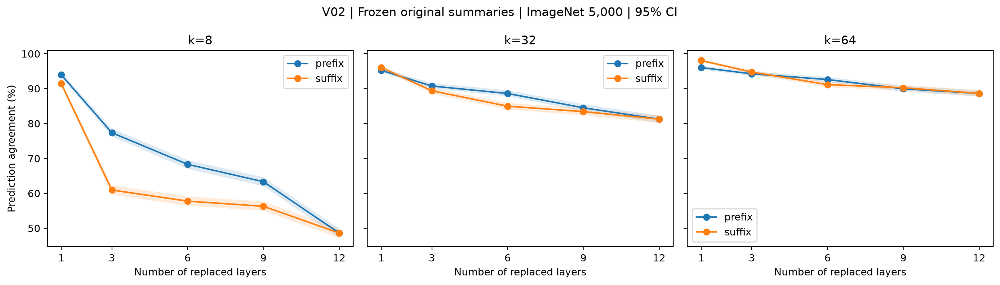

# V02：夜间补充验证

## 1. 一句话结论

k64单层一致率均值范围为96.02%–98.38%；逐层及多层组合的区间见完整表。

## 2. 回答的问题

按已批准的[方案](../overnight_validation_plan_2026-10-27.md)与E09执行，检验现有结论的边界，原实验不覆盖。

## 3. 设置

同一Colab GPU、原固定模型和预处理、m16、FP32、batch32。V01用Pet3669张，V02/V03用原ImageNet5000张。设置和源码提交见对应config.yaml与metadata.json。置信区间为图片bootstrap1000次、seed0、95%；随机先逐图平均五种子。未作多重比较校正。

## 4. 结果

| k | setting | agree | kl |
| --- | --- | --- | --- |
| 8 | all12 | 48.62 [47.22, 49.96] | 2.2084 [2.1648, 2.2524] |
| 8 | layer_01 | 93.94 [93.28, 94.62] | 0.0455 [0.0426, 0.0483] |
| 8 | layer_02 | 89.64 [88.86, 90.48] | 0.1220 [0.1154, 0.1281] |
| 8 | layer_03 | 88.68 [87.88, 89.68] | 0.1527 [0.1445, 0.1599] |
| 8 | layer_04 | 92.22 [91.48, 93.04] | 0.0727 [0.0686, 0.0772] |
| 8 | layer_05 | 93.12 [92.40, 93.86] | 0.0655 [0.0618, 0.0693] |
| 8 | layer_06 | 90.26 [89.46, 91.04] | 0.0935 [0.0884, 0.0986] |
| 8 | layer_07 | 91.40 [90.64, 92.18] | 0.0808 [0.0768, 0.0850] |
| 8 | layer_08 | 91.92 [91.22, 92.70] | 0.0679 [0.0645, 0.0712] |
| 8 | layer_09 | 91.42 [90.62, 92.22] | 0.0794 [0.0753, 0.0834] |
| 8 | layer_10 | 91.44 [90.64, 92.24] | 0.0886 [0.0845, 0.0929] |
| 8 | layer_11 | 91.12 [90.32, 91.92] | 0.1118 [0.1065, 0.1172] |
| 8 | layer_12 | 91.40 [90.66, 92.14] | 0.7281 [0.7119, 0.7440] |
| 8 | prefix_3 | 77.36 [76.28, 78.56] | 0.4900 [0.4719, 0.5074] |
| 8 | prefix_6 | 68.30 [67.00, 69.54] | 0.7656 [0.7402, 0.7916] |
| 8 | prefix_9 | 63.32 [62.06, 64.60] | 0.9894 [0.9607, 1.0173] |
| 8 | suffix_3 | 60.94 [59.58, 62.28] | 2.3003 [2.2497, 2.3468] |
| 8 | suffix_6 | 57.76 [56.46, 59.10] | 2.4138 [2.3675, 2.4568] |
| 8 | suffix_9 | 56.28 [54.98, 57.66] | 2.3608 [2.3199, 2.4020] |
| 32 | all12 | 81.24 [80.18, 82.26] | 0.3951 [0.3802, 0.4096] |
| 32 | layer_01 | 95.22 [94.64, 95.78] | 0.0281 [0.0261, 0.0301] |
| 32 | layer_02 | 96.06 [95.52, 96.62] | 0.0237 [0.0221, 0.0253] |
| 32 | layer_03 | 95.58 [95.02, 96.12] | 0.0247 [0.0231, 0.0265] |
| 32 | layer_04 | 96.04 [95.54, 96.56] | 0.0219 [0.0206, 0.0233] |
| 32 | layer_05 | 96.76 [96.30, 97.28] | 0.0145 [0.0136, 0.0155] |
| 32 | layer_06 | 95.26 [94.72, 95.88] | 0.0245 [0.0232, 0.0258] |
| 32 | layer_07 | 94.76 [94.20, 95.38] | 0.0280 [0.0265, 0.0294] |
| 32 | layer_08 | 94.96 [94.38, 95.56] | 0.0279 [0.0264, 0.0293] |
| 32 | layer_09 | 94.42 [93.82, 95.06] | 0.0351 [0.0333, 0.0369] |
| 32 | layer_10 | 94.54 [93.90, 95.14] | 0.0325 [0.0304, 0.0345] |
| 32 | layer_11 | 95.50 [94.94, 96.06] | 0.0339 [0.0318, 0.0361] |
| 32 | layer_12 | 96.06 [95.52, 96.56] | 0.0553 [0.0524, 0.0583] |
| 32 | prefix_3 | 90.74 [90.00, 91.58] | 0.1113 [0.1056, 0.1175] |
| 32 | prefix_6 | 88.60 [87.78, 89.52] | 0.1484 [0.1405, 0.1558] |
| 32 | prefix_9 | 84.50 [83.52, 85.54] | 0.2537 [0.2435, 0.2638] |
| 32 | suffix_3 | 89.38 [88.52, 90.20] | 0.1698 [0.1608, 0.1794] |
| 32 | suffix_6 | 84.96 [83.98, 85.90] | 0.2753 [0.2628, 0.2870] |
| 32 | suffix_9 | 83.40 [82.36, 84.36] | 0.3117 [0.2988, 0.3240] |
| 64 | all12 | 88.62 [87.76, 89.48] | 0.1399 [0.1328, 0.1468] |
| 64 | layer_01 | 96.02 [95.50, 96.56] | 0.0197 [0.0182, 0.0212] |
| 64 | layer_02 | 97.86 [97.44, 98.22] | 0.0075 [0.0069, 0.0082] |
| 64 | layer_03 | 97.70 [97.28, 98.12] | 0.0073 [0.0068, 0.0080] |
| 64 | layer_04 | 97.46 [97.04, 97.92] | 0.0095 [0.0089, 0.0101] |
| 64 | layer_05 | 98.38 [98.02, 98.72] | 0.0047 [0.0044, 0.0050] |
| 64 | layer_06 | 96.94 [96.52, 97.44] | 0.0097 [0.0091, 0.0102] |
| 64 | layer_07 | 96.72 [96.26, 97.20] | 0.0145 [0.0136, 0.0153] |
| 64 | layer_08 | 96.62 [96.12, 97.14] | 0.0144 [0.0135, 0.0152] |
| 64 | layer_09 | 96.08 [95.54, 96.62] | 0.0179 [0.0169, 0.0189] |
| 64 | layer_10 | 96.88 [96.42, 97.32] | 0.0133 [0.0123, 0.0144] |
| 64 | layer_11 | 97.54 [97.10, 97.96] | 0.0107 [0.0099, 0.0115] |
| 64 | layer_12 | 98.04 [97.66, 98.42] | 0.0086 [0.0081, 0.0092] |
| 64 | prefix_3 | 94.24 [93.64, 94.86] | 0.0426 [0.0396, 0.0458] |
| 64 | prefix_6 | 92.60 [91.92, 93.32] | 0.0612 [0.0574, 0.0646] |
| 64 | prefix_9 | 89.94 [89.12, 90.76] | 0.1116 [0.1058, 0.1173] |
| 64 | suffix_3 | 94.74 [94.14, 95.34] | 0.0358 [0.0335, 0.0380] |
| 64 | suffix_6 | 91.14 [90.38, 91.92] | 0.0853 [0.0807, 0.0897] |
| 64 | suffix_9 | 90.24 [89.44, 91.08] | 0.1063 [0.1004, 0.1118] |

### 独立乘积参照

| k | independent_product | observed_all12 | observed_minus_product |
| --- | --- | --- | --- |
| 8 | 33.86 [31.72, 35.99] | 48.62 [47.24, 49.92] | 14.76 [12.54, 16.83] |
| 32 | 57.03 [54.70, 59.52] | 81.24 [80.18, 82.38] | 24.21 [21.92, 26.32] |
| 64 | 70.98 [68.82, 73.22] | 88.62 [87.78, 89.50] | 17.64 [15.78, 19.52] |

## 5. 与预期对照

k64最敏感的单层为第1层，96.02% [95.50,96.56]；最高为第5层，98.38% [98.02,98.72]。全部12层同时替换仍为88.62% [87.76,89.48]，直接排除了“只有一层特别差就解释全部损失”的简单解释。

影响还取决于被替换层的位置。k8替换前3层的一致率77.36% [76.28,78.56]，替换后3层为60.94% [59.58,62.28]，配对差16.42pp [14.80,17.96]；后3层组合明显更敏感。这个方向在k32仍存在，但差距仅1.36pp [0.32,2.32]；k64前后3层差−0.50pp [−1.26,0.28]，没有清楚分离。因此不能把“后层更敏感”推广到所有预算。

所有已测路径的样本均值随替换层数增加而下降，支持多层约束带来组合损失；它不是十二个单层失败概率独立相乘。k64独立乘积70.98% [68.82,73.22]，实测高出17.64pp [15.78,19.52]。原24个单层锚点和此前L4的三个全层锚点一致率差均为0。

结果以实际对照差值及区间为准；区间包含0不能单独证明等价，强度和方向均保留，不按显著性删组。

## 6. 可信度检查

每设置完整固定样本、无重复图片、相同原模型预测；由预测复算agree，KL有限，缺失与可执行性规则一致。远程先完成完整样本k197验收，observe输出不变。V01运行时逐集合检查删除剂量和CLS保留；V03先通过200张×三k×12单层严格等价，再运行正式设置。完整审计见analysis/checks.json。

## 7. 异常与解释边界

单设置表按固定抽样顺序bootstrap，配对比较及乘积按图片ID排序后同步重采样。两者都使用1000次、seed0；有限重采样的Monte Carlo误差会使同一个观测均值的区间端点出现小幅差别，不代表重跑了模型或改变了样本。

前缀/后缀是替换层的集合，不改变网络执行顺序；路径差不是各层固定因果贡献。独立乘积仅为参照，不能识别误差机制。

## 8. 下一步

与原RQ报告合并讨论，优先把直接支持结论的对照放主文，其余放附录；本报告不授权新的实验。

## 9. 叙事草稿

k64单层一致率均值范围为96.02%–98.38%；逐层及多层组合的区间见完整表。 前缀/后缀是替换层的集合，不改变网络执行顺序；路径差不是各层固定因果贡献。独立乘积仅为参照，不能识别误差机制。
