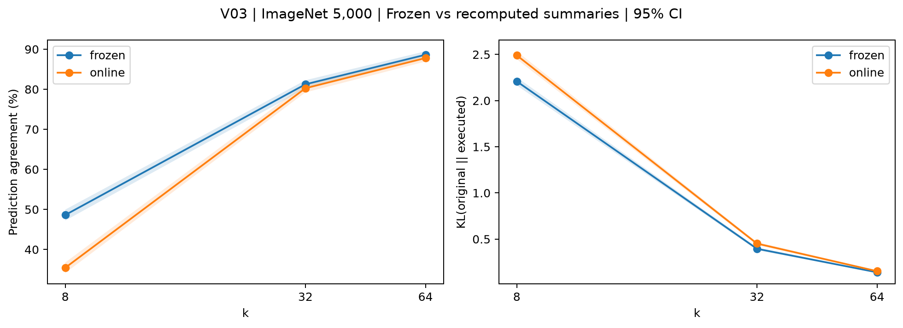

# V03：夜间补充验证

## 1. 一句话结论

现场−冻结一致率差：k=8 -13.18 pp [-14.66, -11.64]；k=32 -0.98 pp [-1.92, -0.06]；k=64 -0.82 pp [-1.46, -0.18]。

## 2. 回答的问题

按已批准的[方案](../overnight_validation_plan_2026-10-27.md)与E09执行，检验现有结论的边界，原实验不覆盖。

## 3. 设置

同一Colab GPU、原固定模型和预处理、m16、FP32、batch32。V01用Pet3669张，V02/V03用原ImageNet5000张。设置和源码提交见对应config.yaml与metadata.json。置信区间为图片bootstrap1000次、seed0、95%；随机先逐图平均五种子。未作多重比较校正。

## 4. 结果

| k | method | agree | kl |
| --- | --- | --- | --- |
| 8 | frozen | 48.62 [47.22, 49.96] | 2.2084 [2.1648, 2.2524] |
| 8 | online | 35.44 [34.14, 36.76] | 2.4904 [2.4479, 2.5343] |
| 32 | frozen | 81.24 [80.18, 82.26] | 0.3951 [0.3802, 0.4096] |
| 32 | online | 80.26 [79.22, 81.34] | 0.4515 [0.4352, 0.4673] |
| 64 | frozen | 88.62 [87.76, 89.48] | 0.1399 [0.1328, 0.1468] |
| 64 | online | 87.80 [86.92, 88.78] | 0.1523 [0.1446, 0.1598] |

### 逐层集合重合与路由变化（% [95% CI]）

| k | layer | readset_overlap | route_changed |
| --- | --- | --- | --- |
| 8 | 1 | 100.00 [100.00, 100.00] | 0.00 [0.00, 0.00] |
| 8 | 2 | 75.83 [75.72, 75.94] | 14.61 [14.51, 14.71] |
| 8 | 3 | 69.66 [69.57, 69.74] | 14.64 [14.58, 14.69] |
| 8 | 4 | 51.70 [51.60, 51.81] | 21.59 [21.49, 21.68] |
| 8 | 5 | 46.56 [46.47, 46.66] | 24.96 [24.84, 25.07] |
| 8 | 6 | 41.91 [41.79, 42.02] | 29.50 [29.35, 29.63] |
| 8 | 7 | 40.89 [40.73, 41.03] | 35.75 [35.55, 35.94] |
| 8 | 8 | 32.43 [32.26, 32.57] | 46.29 [46.05, 46.51] |
| 8 | 9 | 31.32 [31.14, 31.51] | 51.84 [51.60, 52.06] |
| 8 | 10 | 32.27 [32.03, 32.51] | 58.01 [57.79, 58.23] |
| 8 | 11 | 29.81 [29.54, 30.08] | 68.65 [68.40, 68.86] |
| 8 | 12 | 19.40 [19.21, 19.60] | 70.31 [70.08, 70.53] |
| 32 | 1 | 100.00 [100.00, 100.00] | 0.00 [0.00, 0.00] |
| 32 | 2 | 87.33 [87.26, 87.39] | 10.88 [10.81, 10.95] |
| 32 | 3 | 87.24 [87.18, 87.28] | 8.80 [8.76, 8.84] |
| 32 | 4 | 79.69 [79.63, 79.76] | 13.38 [13.31, 13.45] |
| 32 | 5 | 78.12 [78.05, 78.19] | 16.54 [16.44, 16.62] |
| 32 | 6 | 74.36 [74.27, 74.44] | 19.87 [19.73, 20.00] |
| 32 | 7 | 74.00 [73.88, 74.11] | 24.81 [24.62, 24.98] |
| 32 | 8 | 67.52 [67.39, 67.64] | 33.54 [33.29, 33.77] |
| 32 | 9 | 65.96 [65.81, 66.12] | 38.23 [37.95, 38.48] |
| 32 | 10 | 65.93 [65.76, 66.11] | 44.24 [43.94, 44.50] |
| 32 | 11 | 64.61 [64.40, 64.81] | 54.10 [53.75, 54.43] |
| 32 | 12 | 59.57 [59.26, 59.89] | 54.55 [54.20, 54.86] |
| 64 | 1 | 100.00 [100.00, 100.00] | 0.00 [0.00, 0.00] |
| 64 | 2 | 92.15 [92.10, 92.21] | 8.28 [8.22, 8.33] |
| 64 | 3 | 93.28 [93.26, 93.31] | 5.78 [5.74, 5.81] |
| 64 | 4 | 90.53 [90.49, 90.57] | 8.77 [8.72, 8.82] |
| 64 | 5 | 89.81 [89.77, 89.85] | 11.34 [11.27, 11.40] |
| 64 | 6 | 87.96 [87.91, 88.01] | 13.18 [13.08, 13.29] |
| 64 | 7 | 87.72 [87.65, 87.78] | 16.59 [16.44, 16.74] |
| 64 | 8 | 84.57 [84.49, 84.65] | 23.02 [22.82, 23.21] |
| 64 | 9 | 83.63 [83.54, 83.72] | 26.72 [26.47, 26.95] |
| 64 | 10 | 83.48 [83.38, 83.58] | 31.70 [31.42, 31.95] |
| 64 | 11 | 83.22 [83.10, 83.34] | 39.68 [39.29, 40.04] |
| 64 | 12 | 81.82 [81.65, 81.98] | 39.94 [39.60, 40.26] |

## 5. 与预期对照

现场重算没有救回一致率。k8从冻结的48.62% [47.22,49.96]降至35.44% [34.14,36.76]；k32从81.24%降至80.26%，k64从88.62%降至87.80%（完整区间见表）。三个预算的KL也增加，配对增量分别为0.2820 [0.2355,0.3245]、0.0563 [0.0441,0.0684]、0.0124 [0.0086,0.0161]。

因此“全层损失主要是因为没有及时重算说明书，重算就能恢复”的简单预期不受这组实验支持。这个结论不等于冻结完全没有状态失配，也不证明冻结方式对所有模型都更好；现场模式同时改变集合和路由，效应不能唯一分解。

第1层没有先前干预，两模式读取集合与路由逐图完全相同。到第12层，k8集合重合仅19.40% [19.21,19.60]、路由改变70.31% [70.08,70.53]；k64则为81.82% [81.65,81.98]和39.94% [39.60,40.26]。这表明现场适配确实改变了后层说明书，尤其在短预算下；不能单凭相关变化证明具体的损失机制。

结果以实际对照差值及区间为准；区间包含0不能单独证明等价，强度和方向均保留，不按显著性删组。

## 6. 可信度检查

每设置完整固定样本、无重复图片、相同原模型预测；由预测复算agree，KL有限，缺失与可执行性规则一致。远程先完成完整样本k197验收，observe输出不变。V01运行时逐集合检查删除剂量和CLS保留；V03先通过200张×三k×12单层严格等价，再运行正式设置。完整审计见analysis/checks.json。

## 7. 异常与解释边界

正式模型执行没有异常；200张×三预算×12单层的输出、集合与路由严格等价，全5000张k197输出误差0。负结果在主指标和KL上方向一致，不因不符合最初预期而改实现或换预算。单设置区间与按ID排序的配对区间可能有有限bootstrap顺序造成的微小端点差异。

现场同时适配集合和路由，回答另一种干预问题；差值不能唯一归因于冻结状态失配，也不据此替换冻结主实验。

## 8. 下一步

与原RQ报告合并讨论，优先把直接支持结论的对照放主文，其余放附录；本报告不授权新的实验。

## 9. 叙事草稿

现场−冻结一致率差：k=8 -13.18 pp [-14.66, -11.64]；k=32 -0.98 pp [-1.92, -0.06]；k=64 -0.82 pp [-1.46, -0.18]。 现场同时适配集合和路由，回答另一种干预问题；差值不能唯一归因于冻结状态失配，也不据此替换冻结主实验。
