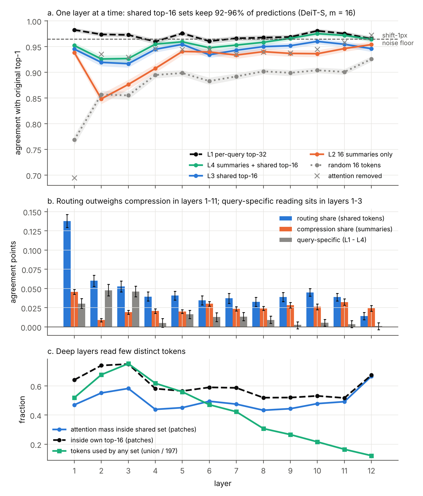
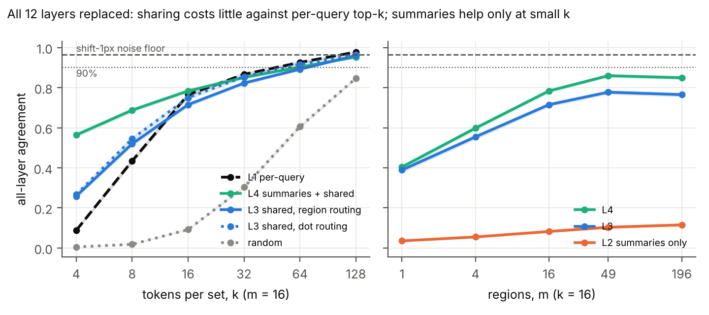
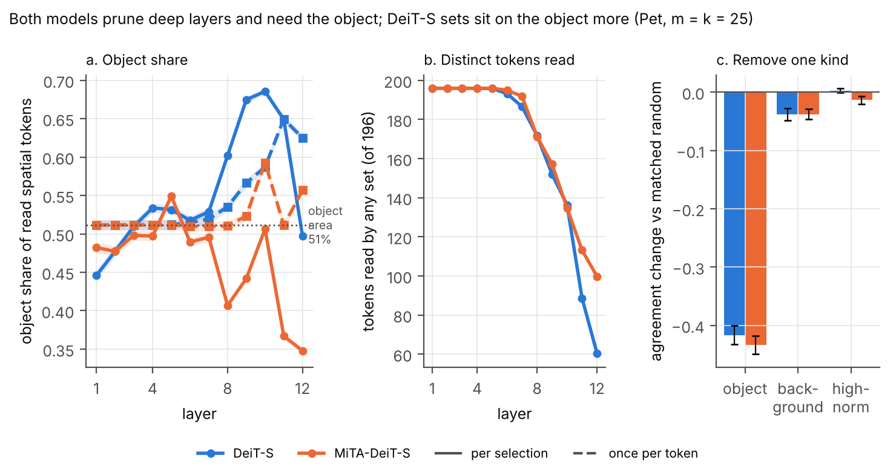
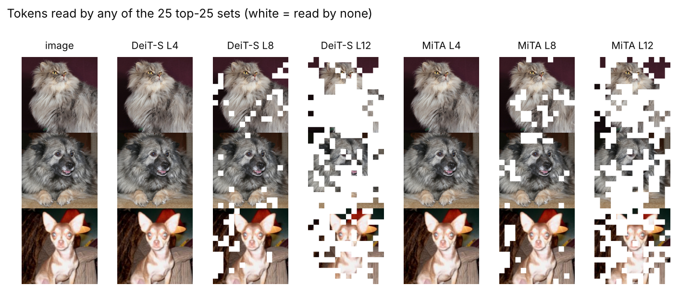

# V2 结果：用 MiTA 的压缩与路由解剖 DeiT-S 的注意力

2026-10-28 · 设计见 [研究设计书 v2](../archive/research_design_v2.md) · 决策 A01–A12 见 [decisions.md](../decisions.md)

## 1. 一句话结论

> **2026-10-28 更正**：三个 RQ 的综合结论以 [探针综合报告](probe_report.md) 为准。本报告第 1、5、7 节中"深层读取偏向物体"的说法，经中心对照（决策 A14）修正：对 DeiT-S，探针读取的前景比例低于"读同样多的中心 token"（第 9–12 层 −7.4 pp），只有 DINO 第 11 层明显超出中心先验。删除实验的功能结论不受影响。

**DeiT-S 的注意力大部分可以用"每块区域共享一组 token"来代替，摘要只在 token 很少时有用；深层注意力只读很少的 token，模型在功能上依赖其中的物体 token。这些 token 的前景比例高于面积占比，但不高于"只读中间"的中心对照（见第 5 节更正）。**

下面所有区间都是按图片 bootstrap 1,000 次的 95% 区间。ImageNet 用固定的 5,000 张验证图，Pet 用全部 3,669 张测试图。

## 2. 运行与可信度检查

| 检查 | 结果 |
| --- | --- |
| 硬件与环境 | Colab NVIDIA L4；Python 3.12.3、torch 2.7.0+cu128、timm 1.0.30；FP32 |
| 数据 | ImageNet 14 个分片 SHA-256、5,000 张索引、Pet 3,669 张与 v1 完全一致 |
| 测试 | 本地 CPU 70 项通过；Colab GPU 73 项通过 |
| 恒等检验 | 所有 ImageNet 批次：稠密实现在全部 key 下与原模型最大误差 3.4e-5，top-1 全部相同 |
| **复现 v1** | 新代码在 v1 设置下，全层 6 个 k 的一致率与 v1 差值全部为 0；第 12 层单层 k = 8 一致率差 0、KL 差 4e-7 |
| **复现 MiTA** | 稠密 fp32 实现在 50,000 张验证图上 top-1 = **79.77%**（作者报告 79.8%，日志最佳 79.78%） |
| MiTA 冻结执行 | 冻结的读取集合与原生计算逐位相同（误差 0），ImageNet 和 Pet 都检查过 |
| 官方模块对比 | fp16 同精度一致；预设的 fp32 标准未通过，原因是离散 top-k 对舍入敏感，见决策 A11 |
| **噪声地板** | 只把裁剪窗口右移 1 像素：DeiT-S 一致率 **96.48%**，MiTA-DeiT-S **95.72%** |

运行中的两个问题（第一次 smoke 中止、P4 无法检验）都在看到结果前修正，见实验日志。

## 3. RQ1：每一层由什么组成？（一次只替换一层，m = 16、k = 16）

**先看标尺。**单层替换的一致率普遍很高。即使把某一层的注意力整个删掉，除第 1 层（69.5%）外其余各层仍保留 92.9–97.3%。所以单层的差异都在几个百分点之内，要和噪声地板 96.5% 一起看。

| 层 | 随机 | 只摘要 L2 | 只共享 L3 | 两者 L4 | 自选 32 个 L1 | 路由贡献 φ_R | 压缩贡献 φ_C | query 独有 | 可共享指数 |
| ---: | ---: | ---: | ---: | ---: | ---: | --- | --- | --- | --- |
| 1 | 76.9 | 93.9 | 94.5 | 95.2 | 98.3 | 13.8 [12.9, 14.6] | 4.6 [4.2, 4.9] | 3.0 [2.4, 3.7] | 0.86 [0.83, 0.89] |
| 2 | 85.7 | 84.8 | 91.9 | 92.6 | 97.4 | 6.0 [5.3, 6.7] | 0.9 [0.7, 1.1] | 4.8 [4.0, 5.5] | 0.59 [0.53, 0.65] |
| 3 | 85.5 | 87.6 | 91.7 | 92.7 | 97.3 | 5.3 [4.6, 6.0] | 1.9 [1.7, 2.2] | 4.6 [3.9, 5.3] | 0.61 [0.56, 0.66] |
| 6 | 88.3 | 94.0 | 93.4 | 94.8 | 96.1 | 3.5 [2.9, 4.1] | 3.0 [2.7, 3.3] | 1.3 [0.7, 1.9] | 0.84 [0.77, 0.91] |
| 9 | 89.9 | 93.7 | 95.2 | 96.6 | 96.9 | 3.9 [3.3, 4.5] | 2.8 [2.5, 3.2] | 0.3 [−0.2, 0.7] | 0.96 [0.90, 1.03] |
| 12 | 92.6 | 95.4 | 94.6 | 96.4 | 96.5 | 1.4 [0.9, 1.9] | 2.4 [2.1, 2.8] | 0.1 [−0.4, 0.5] | 0.98 [0.87, 1.09] |

一致率单位是 %，贡献单位是百分点。完整 12 层见 `experiments/2026-10-28_v2_analysis/rq1_anatomy.csv`。

发现：

1. **路由比压缩重要。**第 1–11 层，"共享具体 token"的贡献都大于"摘要"的贡献；只有第 12 层反过来。第 1 层最依赖具体 token（13.8 pp）。
2. **"各读各的"只出现在浅层。**query 独有部分在第 2–3 层最大（约 5 pp），第 9–12 层都不超过 0.6 pp。可共享指数第 2–3 层最低（约 0.6），第 9–12 层 ≥ 0.92。
3. **深层只读很少的 token。**所有区域集合的并集，从第 3 层的 75% 降到第 12 层的 12%（图 2c）。

**例子：**第 2 层里，每个 query 自选 32 个 token 能保住 97.4% 的预测，但同一区域共享 16 个 token 加 16 份摘要只有 92.6%，差的 4.8 个百分点就是"必须各读各的"部分。到第 9 层，这个差几乎为 0：同一区域的 query 读同一组 token 就够了。

## 4. RQ2：说明书要多长？（全部 12 层同时替换）

主预算 m = 16、k = 16 下的全层解剖：

| 方式 | 一致率 % |
| --- | --- |
| 随机 16 个 token | 9.2 [8.7, 9.7] |
| 只用 16 份摘要 L2 | 8.2 [7.5, 9.0] |
| 只用共享集合 L3 | 71.5 [70.3, 72.7] |
| 两者都用 L4 | 78.4 [77.3, 79.5] |
| 每 query 自选 16 个 L1 | 76.5 [75.3, 77.7] |
| 每 query 自选 32 个 L1 | 86.7 [85.7, 87.5] |

路由贡献 φ_R = 54.2 [53.2, 55.3] pp，压缩贡献 φ_C = 15.0 [14.4, 15.6] pp，query 独有 8.3 [7.2, 9.5] pp，可共享指数 0.89 [0.88, 0.91]。

关键配对差值（`rq2_contrasts.csv`）：

| 比较（k = 16） | 差值 pp |
| --- | --- |
| **共享的代价**：L3 按区域 − L1 每 query 自选 | −5.0 [−6.3, −3.7] |
| **可读的代价**：按区域路由 − 点积路由（L3） | −3.5 [−4.6, −2.6] |
| CLS 独立集合 − CLS 借用区域集合（L3） | +6.7 [+5.4, +8.0] |
| 注意力平均打分 − query 平均打分（L3） | +4.5 [+3.4, +5.6] |
| 摘要用标准缩放 − MiTA 缩放（只用摘要 L2） | +30.0 [+28.7, +31.3] |
| 加摘要 L4 − L3：k = 4 / 16 / 128 | +30.5 / +6.8 / −0.8 |

发现：

1. **v1 的损失大部分是"稀疏"的代价，不是"共享"的代价。**v1 在 k = 16 时丢掉 30% 的预测。但每个 query 自选 16 个也只有 76.5%；按区域共享只再少 5 个百分点。k ≤ 8 时，共享反而比自选更好（k = 4：25.8% 对 8.8%）。
2. **摘要像一个"补丁"：token 越少越有用。**k = 4 时补回 30.5 pp，k = 16 时 6.8 pp，k = 128 时略有负作用。只用摘要完全不够（8.2%，和随机一样差）。
3. **MiTA 的"调淡摘要"对没经过 MiTA 训练的模型很伤。**只用摘要时，标准缩放比 MiTA 缩放高 30 pp；摘要和 token 一起用时两种缩放没有差别（−0.7 pp，区间含 0）。
4. **说明书可以更好。**给 CLS 单独一个集合、用区域内注意力概率的平均来选 token，都各带来约 5–7 pp。
5. **要达到噪声地板，L1 需要 k ≈ 128，共享方式也是。**k = 128 时 L3 为 96.1%，接近噪声地板 96.5%。

## 5. RQ3：说明书里的 token 是不是照片的主体？模型是否真的靠它们？

两个模型用完全相同的读取工具（m = 25、k = 25、干净网格）。Pet 上前景占面积 51%。

| 第 9–12 层平均 | DeiT-S | MiTA-DeiT-S |
| --- | --- | --- |
| 按选中次数，物体占比 | 62.7% | 41.6% |
| 按选中次数，高范数 token 占比 | 约 6% | 30.0% |
| 按并集（每个 token 只算一次，事后分析 A12），物体占比 | 57–65% | 51–59% |
| 第 12 层被任何集合读到的 token 数（共 196） | 60 | 100 |

删除实验（全部 12 层，在 MiTA 默认方案上，和数量匹配的随机删除比）：

| 删掉的类别 | DeiT-S | MiTA-DeiT-S |
| --- | --- | --- |
| 物体 | −41.7 [−43.3, −40.1] pp | −43.3 [−44.9, −41.8] pp |
| 背景 | −3.8 [−4.8, −2.7] pp | −3.8 [−4.6, −2.9] pp |
| 高范数 | +0.3 [−0.1, +0.7] pp | −1.3 [−2.0, −0.7] pp |

MiTA-DeiT-S 自己的解剖（ImageNet 5,000 张，全层，m = k = 25）：只用共享集合 85.3%，只用摘要 22.0%，每 query 自选 25 个 79.9%，随机 46.3%；路由贡献 34.7 pp，压缩贡献 19.1 pp。**对 MiTA 训练的模型，共享集合比每 query 自选还好**（可共享指数 1.60），说明它确实学会了"按组读取"。

发现：

1. **"深层只剩主体"不是 MiTA 训练的产物。**（更正：中心对照显示，DeiT-S 和 MiTA-DeiT-S 深层读取的前景比例都低于同数量的中心 token，所以"偏向主体"大部分可由"主体在中间"解释，见 [探针综合报告](probe_report.md) 第 3.1 节。）两个模型都在第 8 层后大量"剪掉" token，DeiT-S 剪得更狠（第 12 层只剩 60 个）。剩下的 token 里，DeiT-S 的物体占比更高。示例图里 DeiT-S 第 12 层留下的基本是动物头部。
2. **两个模型都真的依赖物体 token。**删掉物体 token 都比随机多掉 42–43 个百分点；删背景只掉 4 个百分点。
3. **MiTA 训练的模型把大量读取花在高范数 token 上**（按次数约 30%），但删掉它们几乎没有影响（−1.3 pp）。这和 v1 在 DeiT-S 上的发现一致：被大量读取 ≠ 功能上需要。

## 6. 运行前预测对照（第 8 节，冻结）

| 预测 | 结果 | 数字 |
| --- | --- | --- |
| P1 浅层可共享指数最低、并集最大 | **成立** | 指数 0.69 对 0.89；并集 0.65 对 0.35 |
| P2 深层压缩贡献 > 路由贡献 | 不成立 | 第 9–12 层 φ_C 2.8 对 φ_R 3.4；只有第 12 层成立 |
| P3 按区域路由的代价 ≤ 3 pp | 不成立（刚超出） | −3.5 [−4.6, −2.6] pp |
| P4 CLS 独立使第 12 层 KL < 0.15 | 不成立 | KL 从 0.73 降到 0.31（减半），一致率 91.4% → 92.6% |
| P5 摘要在 k = 16 补回 ≥ 10 pp、k = 128 < 2 pp | 不成立 | k = 16 为 6.8 pp；k = 128 部分成立 |
| P6 每 query 自选 16 个 > 90% | 不成立 | 76.5%：稀疏本身代价很大 |
| P7 第 1 层覆盖率低、一致率高 | 不成立 | 覆盖率排第 5，一致率排第 7 |
| P8 MiTA 深层物体占比比 DeiT-S 高 ≥ 15 pp | **方向相反** | 41.6% 对 62.7% |
| P9 MiTA 模型上 L3 > L2 | **成立** | +63.2 [61.8, 64.7] pp |
| P10 注意力平均打分好 ≥ 2 pp | **成立** | +4.5 [3.4, 5.6] pp |

10 项中 3 项成立。不成立的项都按预先写下的"若不成立"一栏解读，没有调整阈值。

## 7. 对研究叙事的影响

建议的论文主线变为三句话：

1. **用 MiTA 的两个零件解剖注意力，能把"丢了多少"拆成"丢的是什么"。**v1 以为"说明书必须很长"，实际上主要是"只读少数 token"本身的代价；按区域共享只多花 5 个百分点。
2. **ViT 注意力的可读性随层变化。**浅层（2–3 层）有一部分"各读各的"；中深层几乎完全可以共享，而且只读很少的 token。
3. **模型在功能上依赖物体位置的信息，但读取位置本身不比"只看中间"更偏向物体。**删除物体 token 的伤害远大于随机删除；而中心对照（A14）显示，DeiT-S 深层读取的前景比例低于同数量的中心 token。（原写法"聚焦主体是普通 ViT 本来就有的性质"已按中心对照更正。）

这比 v1 设计书的结果预案 C（"有的层可读、有的层不可读"）更具体，可以直接写进引言的发现部分。

## 8. 局限

- 单层替换的灵敏度低：删掉一整层注意力（第 1 层除外）仍保留 92.9–97.3%，单层贡献都只有几个百分点。论文主图建议用全层结果，单层作为"在哪一层"的补充。
- 主模型是 DeiT-S，对照是 MiTA-DeiT-S；第二个主模型 DINO ViT-S/16 已补做 RQ1、RQ2 主预算和 Pet（见第 10 节），未做 k、m 扫描。
- Pet 是猫狗数据集，物体占画面 51%，前景比例的空间不大。
- 并集口径（A12）是看到结果后提出的，只作为补充证据。
- 深层 token 已混入其他位置的信息，"读取位置"不等于"原图位置"。
- MiTA 论文正文仍未核对（本会话之前无法访问 arxiv.org）；"推理时直接替换保留 95%"的说法仍不引用。

## 9. 产出文件

| 内容 | 位置 |
| --- | --- |
| 分析表 | `experiments/2026-10-28_v2_analysis/`（rq1_anatomy、rq1_coverage、rq2_frontier、rq2_contrasts、rq2_anatomy_all_layers、mita_anatomy、pet_composition、pet_union_composition_post_hoc、pet_deletion、noise_floor、predictions_check、checks） |
| 主图 | `figures/figure2_anatomy`、`figure3_frontier`、`figure4_object_focus`、`figure4_examples`（PNG 与 PDF） |
| 逐图结果 | `experiments/2026-10-28_v2_*/`（大文件为 .csv.gz） |
| 环境与日志 | `experiments/2026-10-28_v2_colab_environment/` |
| DINO 补充 | `experiments/2026-10-28_v2_dino_*/`、分析表 `experiments/2026-10-28_v2_dino_analysis/`、图 `figures/figure5_dino` |

## 10. 补充：DINO ViT-S/16（决策 A13，运行前登记预测）

**一句话**：换成自监督的 DINO 后，"共享读取为主"和"深层读取物体"两条结论都成立，而且 DINO 的深层更集中在动物身上；但 DINO 的注意力更分散，只读 token 不读摘要时损失更大。

### 10.1 做了什么

- **模型**：timm 的 DINO ViT-S/16 主干，加官方线性分类头（最后 4 层 CLS 拼接）。
- **流程**：与 DeiT-S 完全相同，包括同一批 5,000 张 ImageNet 图、同样的随机种子 0–4、同样的主预算（m = 16、k = 16、按区域路由、CLS 独立）。
- **范围**：RQ1 全部单层设置；RQ2 只做主预算（18 个全层设置）；Pet 做读取成分、并集口径和匹配删除。
- **运行**：Colab L4，07:09–07:51 UTC，代码提交 5699c62。

### 10.2 可信度检查

| 检查 | 结果 |
| --- | --- |
| 50,000 张 top-1 复现 | 76.91%（官方 76.98%，差 0.07 pp，限度 0.5 pp） |
| 稠密重放与原模型的最大误差 | 2.7e-5（RQ1、RQ2） |
| 噪声地板（裁剪右移 1 像素） | 96.42% [95.88, 96.90]（DeiT-S 96.48%） |
| GPU 测试 | 78 项通过 |
| 数据 | 14 个分片哈希、5,000 张索引与 v1 完全一致 |

### 10.3 预测对照（D1–D6）

| 预测 | 结果 | 判定 |
| --- | --- | --- |
| D1 共享主导：φ_R − φ_C > 0，SI 下限 ≥ 0.8 | φ_R − φ_C = 0.441 [0.426, 0.457]；SI = 0.98 [0.96, 1.00] | 支持 |
| D2 特异性在浅层：第 1–3 层 − 第 9–12 层 > 0 | 0.010 [0.005, 0.015]；但两段都是负值（−0.009、−0.019） | 形式上支持，实质见 10.4 |
| D3 深层前景占比 DINO > DeiT-S | 66.8% 对 61.1%，差 5.7 pp [5.5, 5.9] | 支持 |
| D4 第 12 层并集 ≤ 100 个 token | 95.8 [95.3, 96.3] | 支持（离门槛近） |
| D5 前景删除差 < −0.20，背景影响更小 | 前景 −0.316 [−0.332, −0.302]；背景 −0.049 | 支持 |
| D6 高范数 token 占比低于 DeiT-S | DINO 在三种方案下都是 0；DeiT-S 6–9% | 支持 |

### 10.4 主要发现

1. **全层替换时，共享读取仍是主力。** 主预算下 L4（共享 16 个 token + 16 个摘要）保留 73.7% 的预测（DeiT-S 78.4%）。贡献拆分：路由 φ_R = 0.568，压缩 φ_C = 0.127。共享指数 0.98，比 DeiT-S（0.89）还高。
   - **例子**：每个 query 各自挑 32 个 token（L1_k32）得到 75.1%，所有 query 共用一份 16 + 16 的说明书得到 73.7%，只差 1.4 pp。DeiT-S 差 8.3 pp。
2. **DINO 的注意力更分散，所以更依赖摘要。** 单层替换时，DINO 第 1 层和第 10–12 层只读 token（L3）的一致率明显下降（第 12 层 80.9%，DeiT-S 94.6%），加上摘要（L4）后，第 10–12 层回到 91–92%，第 1 层从 76.7% 升到 84.8%。原因见图 5b：在这些层，每个 query 自己的前 16 个 token 只拿到 22–39% 的注意力（DeiT-S 52–67%）。
   - **对 D2 的影响**：在 DINO 中，每 query top-32 这条"上限"没有摘要槽，在注意力分散的层反而低于 L4，所以"特异部分"是负值。D2 的数字虽然满足方向，但不能读成"浅层有更多 query 特异的读取"。这说明这个上限只适合注意力集中的模型。
3. **深层读取更集中在动物上。** 并集口径下，DINO 第 11 层读取的 token 中 85.1% [84.7, 85.5] 是前景，而画面中前景只占 51.2%。DeiT-S 是 65.4%，MiTA-DeiT-S 是 51.0%。去掉高范数 token 后再算，DINO 仍比 DeiT-S 高 4.7 pp [4.5, 4.9]。
4. **DINO 没有高范数 token。** 所有层都没有 token 超过中位数的 3 倍，所以"删除高范数 token"对 DINO 没有任何改变（差值正好为 0）。这与 Darcet et al. (2024) 的观察一致：原版 DINO 几乎没有这类伪影。
5. **删除动物 token 对三个模型都伤害最大。** 前景"目标 − 随机"：DeiT-S −0.417、MiTA-DeiT-S −0.433、DINO −0.316。背景只有 −0.04 到 −0.05。

### 10.5 探索性观察（未预登记）

- **点积路由比按区域路由好。** L3 差 2.9 pp [2.0, 3.8]，L4 差 2.8 pp [2.1, 3.6]，方向和大小与 DeiT-S（3.5 pp）一样。
- **MiTA 默认方案在 DINO 上明显变差。** m = 25、k = 25 的 MiTA 默认方案（点积路由、CLS 也走路由、官方网格）只有 65.8%，比预算更小的 L4 点积方案低 10.7 pp [9.4, 12.0]。在 DeiT-S 上两者几乎相同（82.5% 对 81.9%）。最可能的原因是 CLS 走路由：DINO 的分类头读最后 4 层的 CLS，CLS 读不全会直接影响分类。这一点没有单独做消融，只作为后续检验的线索。

### 10.6 对研究叙事的影响

- "注意力主要按共享说明书读取"不是 DeiT-S 独有的，在自监督训练的 DINO 上同样成立，而且更强。
- "深层读取集中在物体上"在 DINO 上更明显。这支持 MiTA 论文图中"top-k 保留主体"的观察，并说明它与训练方式有关：自监督模型更集中。
- 新的限定条件：注意力越分散，摘要越重要。论文中"每 query 上限"的定义需要说明它不含摘要。

