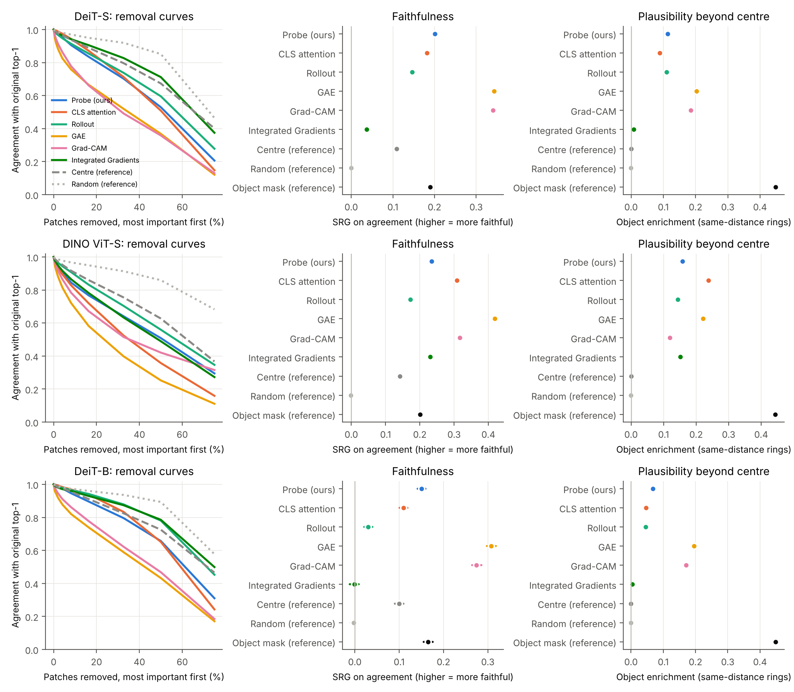
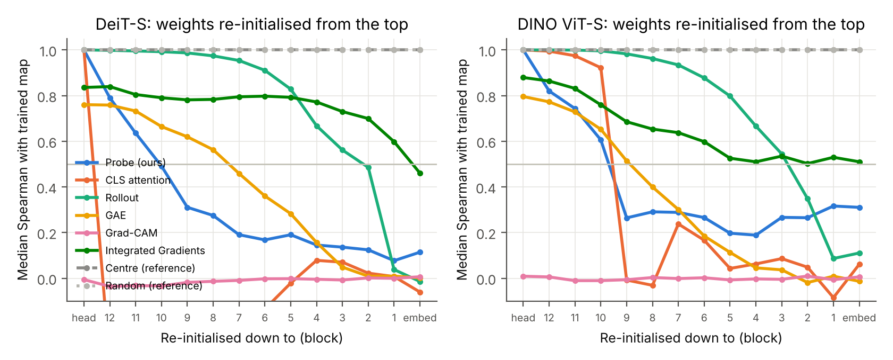
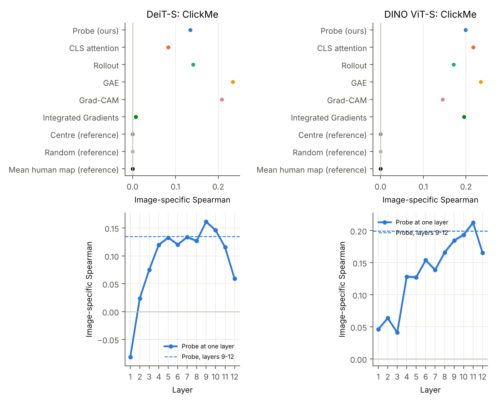
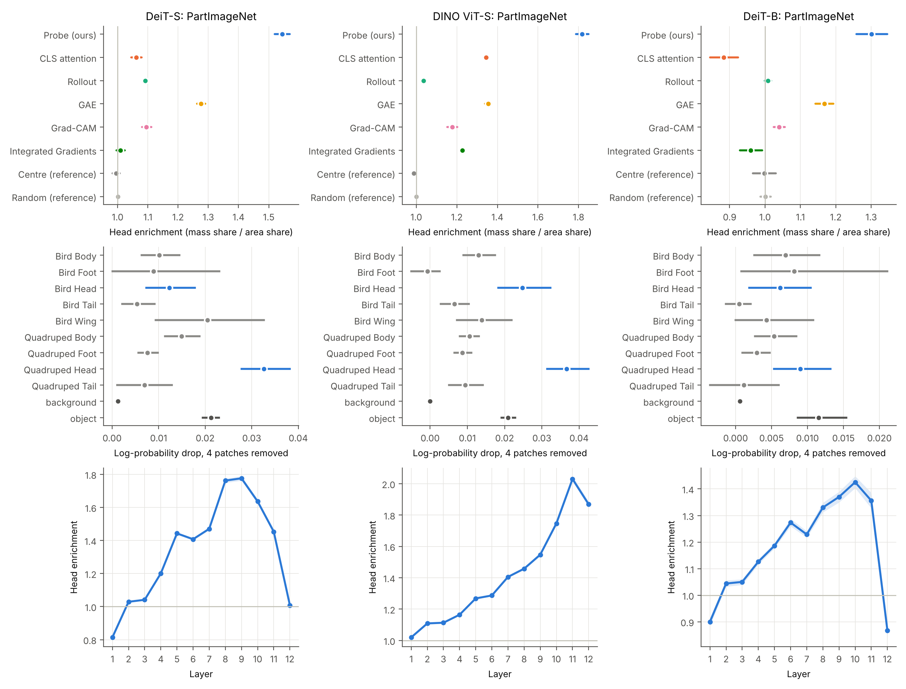
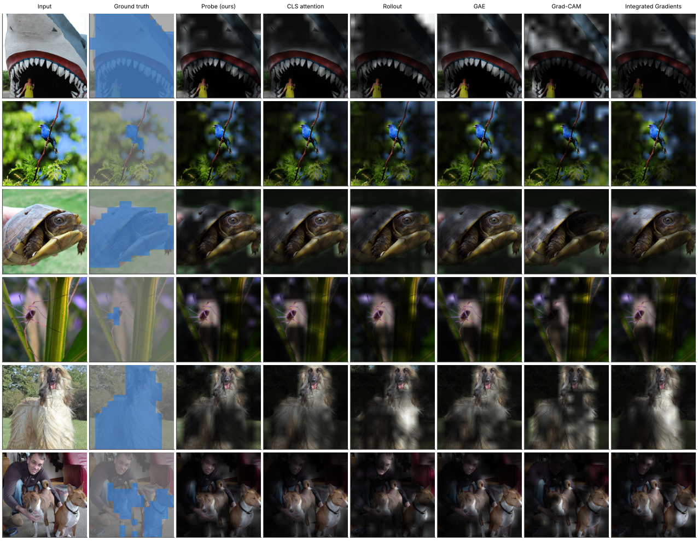
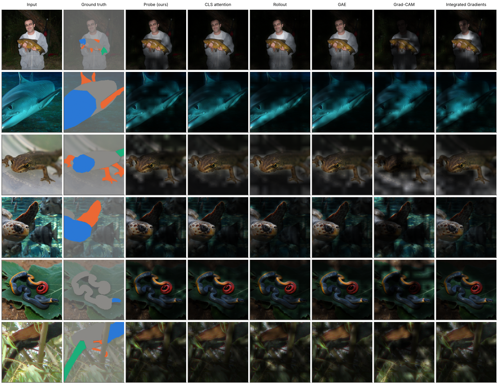
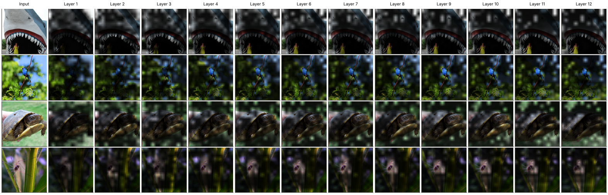

# 用 MiTA 的 top-k 读取解释 ViT：完整实验报告（实验计划 v3）

2026-10-29 · 设计与预测见 [决策日志](../decisions.md) B01–B18（全部在正式运行前登记）· 计划见 [实验计划 v3](../experiment_plan_v3.md) · 相关工作见 [综述](../related_work.md) · 运行记录见 [实验日志](../experiment_log.md)

## 一句话结论

**把 MiTA 的 top-k 读取当作事后测量工具，只要一次前向计算就能得到一张"模型读了哪些图块"的解释图：在 3 个模型、4 个数据集上，它在只看注意力的方法中总体最好或持平，在部件层面比所有方法（包括用梯度的 GAE）都更集中在动物的头上，而模型自己也确实更依赖头；不足是在"删图块"的忠实性检验中，用梯度、针对类别的方法（GAE、Grad-CAM）明显更好。**

本报告的数字都来自 `experiments/2026-10-29_v3_*` 的分析表。区间都是按图片配对 bootstrap 1,000 次（seed 0）的 95% 区间。除特别说明外，"探针"指登记的主定义 `probe_mass`：第 9–12 层、m = 16 块区域、每块读 k = 16 个 token 时，每个图块得到的注意力之和。

---

## 0. 读报告前要知道的词

| 词 | 意思 | 例子 |
| --- | --- | --- |
| 图块（patch、token） | ViT 把 224×224 的图切成 14×14 = 196 个 16×16 的小方块，每块是一个 token | 一只狗大约占 50–80 个图块 |
| 神经元 | 把注意力看成快权重 MLP 时，每个 token 是一个隐藏神经元 | "第 10 层读了图块 37"＝第 10 层用了神经元 37 |
| 读取名单 | 探针让每块区域只读 k 个最想读的 token | k = 16：每块区域只读 16 个图块 |
| 解释图 | 给 196 个图块各打一个"重要性"分数 | 画在图上就是一张热图 |
| 忠实性 | 解释图说重要的图块，模型是否真的依赖它们 | 删掉"重要"的图块，模型改了答案，说明解释忠实 |
| 合理性（常识） | 解释图是否落在人认为重要的地方 | 狗的图，重要区域应在狗身上、尤其是头 |
| 中心偏差 | 照片里的物体常在画面中间，所以"只看中间"也能拿高分 | VOC07 上"永远指中心"的定位分数是 69.5% |
| 参照 | 不看模型、固定不变的图，用来判断一个分数算不算高 | 中心高斯（只看中间）、随机分数、真实物体掩码 |

---

## 1. 研究问题与方法

### 1.1 研究问题（决策 B02）

| RQ | 问题 |
| --- | --- |
| RQ1 忠实 | 少数共享神经元能否复现一层注意力？ |
| RQ2 结构 | 各层、各模型如何使用神经元？ |
| RQ3 常识 | 模型依赖的神经元是否就是人认为重要的物体和部件，而不只是画面中间？ |
| RQ4 对比 | 在同一套检验下，探针和现有解释方法相比如何？ |

### 1.2 探针

1. 把注意力看成快权重 MLP：query 是输入，token 的 key 是第一层权重，value 是第二层权重。所以每个 token 是一个"神经元"，而且它对应图上一个固定位置。
2. 借用 MiTA 的读法：14×14 的图块分成 16 块区域，每块区域找出最想读的 16 个 token，区域内的 query 共用这份名单。
3. 解释图 = 按名单计算注意力时，每个 token 收到的注意力之和（第 9–12 层，所有头、所有 query）。
4. 不训练任何东西，只需一次前向计算，不用梯度，也不需要知道类别。

MiTA 论文已经提出快权重 MLP 视角、读取名单的可视化和"深层集中在少数 token"的现象（见[综述](../related_work.md) §1.1），这些不是本研究的新意。本研究的新意在于：把它变成一个**可检验的解释方法**，并在同一套检验下与常用方法比较。

### 1.3 比较的方法

| 方法 | 用梯度 | 与类别有关 | 说明 |
| --- | --- | --- | --- |
| **探针（我们）** | 否 | 否 | 见上 |
| CLS 注意力 | 否 | 否 | 分类头读取的 CLS 对各图块的注意力（DINO 取最后 4 层平均，因为 DINO 的线性头读这 4 层） |
| Rollout | 否 | 否 | 把各层注意力连乘（Abnar & Zuidema 2020） |
| GAE | 是 | 是 | Chefer 等 2021，注意力 × 梯度逐层传递 |
| Grad-CAM | 是 | 是 | 最后一层 token 的梯度加权 |
| Integrated Gradients（IG） | 是 | 是 | 20 步积分梯度 |
| 中心、随机、物体掩码 | — | — | 参照 |

### 1.4 模型和数据

- **模型**：DeiT-S/16（有监督）、DINO ViT-S/16（自监督 + 官方线性头）、DeiT-B/16（更大，同一训练方案）；MiTA-DeiT-S 只在删除实验中作对照。
- **数据**：

| 数据集 | 图片 | 有什么标注 | 用途 |
| --- | --- | --- | --- |
| ImageNet-S919 验证集 | 12,419 | 像素级物体掩码 | 主数据集：忠实性、合理性、移位、删除 |
| Hard ImageNet 验证集 | 750 | 物体掩码；物体小、不在中间、背景干扰强 | 难例 |
| Oxford-IIIT Pet 测试集 | 3,669 | 猫狗掩码 | 与之前结果衔接 |
| ImageNet 验证子集 | 5,000（忠实性 2,000） | 无掩码 | 只测忠实性 |
| ClickMe 验证集 | 17,408 | 人类重要性图（人点出认物体最有用的地方） | 与人比较 |
| PartImageNet_Seg | 24,080（DeiT-B 只用 val + test 的 3,614 张，决策 B19） | 部件掩码（头、身体、脚、尾巴……） | 部件层面；**图片来自 ImageNet 训练集** |

### 1.5 检验与统计

- **去掉图块**：被去掉的图块在所有层都不能被读取（等价于从序列中删除这些 token；单元测试证明两种做法 logits 差 < 2e-5）。CLS 永远保留。
- **主忠实性指标 SRG**：按解释图排序，分别"先删最不重要的"和"先删最重要的"，记录模型与原 top-1 一致的比例；两条曲线下面积之差就是 SRG。越大越忠实。
- **主合理性指标"同距离富集"**：只在离画面中心距离相同的一圈图块之间比较物体比例，所以"物体在中间"的好处被扣掉。0 表示和中心先验一样，越大越好。
- 所有判定标准和预测都在运行前写入决策日志；结果出来后照原标准对账（第 4 节），不改标准。

---

## 2. 结果

### 2.1 RQ1 和 RQ2 回顾：探针读出的名单能复现模型（此前结果，见 [探针综合报告](probe_report.md)）

| 每块区域读 k 个 token（12 层同时按名单计算，DeiT-S） | 4 | 8 | 16 | 32 | 64 | 128 |
| --- | ---: | ---: | ---: | ---: | ---: | ---: |
| 探针名单 | 25.3% | 48.6% | 69.4% | 81.2% | 88.6% | 95.1% |
| 随机名单 | 0.5% | 2.1% | 9.5% | 30.3% | 60.1% | 84.4% |

- 只替换一层时，探针名单保留 92%–97% 的预测。
- **更大的模型 DeiT-B**（同样的 m = 16、k = 16，12 层同时按名单计算）：探针严格版 82.8%（DeiT-S 71.5%，DINO 61.5%），加区域摘要 85.2%（DeiT-S 78.4%），每个 query 自己挑 16 个 88.1%，随机名单 29.5%。只替换一层时保留 95.8%–97.3%。也就是说，**模型越大，探针名单越能复现它**。
- 浅层（第 2–3 层）每个位置各读各的；中深层按区域共用名单，而且越来越集中在少数 token 上（名单并集从第 3 层的 75% 降到第 12 层的 12%）。
- 这说明探针名单是"模型真正在用的读取"，而不只是一张事后画的图。这是探针区别于其他解释方法的地方：**它的解释可以直接拿来执行，并且执行结果接近原模型。**

### 2.2 RQ4：和解释方法比忠实性（E4，图 8 与补充图）

**SRG（越大越忠实）**：

| 方法 | ImageNet-S DeiT-S | ImageNet-S DINO | ImageNet-S DeiT-B | Hard ImageNet DeiT-S | Hard ImageNet DINO | Hard ImageNet DeiT-B | Pet DeiT-S | Pet DINO | ImageNet DeiT-S | ImageNet DINO |
| --- | ---: | ---: | ---: | ---: | ---: | ---: | ---: | ---: | ---: | ---: |
| **探针** | **0.201** | **0.235** | **0.150** | **0.177** | **0.192** | **0.136** | **0.252** | **0.328** | **0.205** | **0.235** |
| CLS 注意力 | 0.182 | 0.309 | 0.110 | 0.135 | 0.242 | 0.100 | 0.179 | 0.387 | 0.179 | 0.301 |
| Rollout | 0.146 | 0.172 | 0.030 | 0.134 | 0.126 | 0.025 | 0.210 | 0.271 | 0.149 | 0.170 |
| GAE | 0.343 | 0.418 | 0.308 | 0.325 | 0.397 | 0.316 | 0.416 | 0.480 | 0.361 | 0.425 |
| Grad-CAM | 0.341 | 0.316 | 0.274 | 0.315 | 0.328 | 0.279 | 0.360 | 0.351 | 0.345 | 0.335 |
| IG | 0.037 | 0.230 | 0.00 | 0.034 | 0.183 | 0.012 | 0.060 | 0.298 | 0.047 | 0.221 |
| 中心（参照） | 0.109 | 0.142 | 0.100 | 0.064 | 0.115 | 0.061 | 0.160 | 0.202 | 0.114 | 0.143 |
| 随机（参照） | 0.00 | 0.00 | 0.00 | 0.00 | −0.01 | 0.00 | 0.01 | 0.00 | 0.00 | 0.00 |

图片数：ImageNet-S 12,419（DeiT-B 的忠实性用固定随机 2,000 张，决策 B09）；Hard ImageNet 750；Pet 和 ImageNet 子集各 2,000（决策 B18）。

**登记的主比较**（探针 − 对手，SRG）：

| 对手 | DeiT-S（4 个数据集） | DINO（4 个数据集） | DeiT-B（2 个数据集） |
| --- | --- | --- | --- |
| CLS 注意力 | 4 个都更高（+0.02 到 +0.07，区间都不含 0） | 4 个都更低（−0.05 到 −0.07） | 2 个都更高（+0.04） |
| Rollout | 4 个都更高（+0.04 到 +0.06） | 4 个都更高（+0.06 到 +0.07） | 2 个都更高（+0.11 到 +0.12） |
| GAE | 4 个都更低（−0.14 到 −0.17） | 4 个都更低（−0.15 到 −0.21） | 2 个都更低（−0.16 到 −0.18） |

**怎么理解**：

1. 在不用梯度的方法里，探针在 DeiT-S 和 DeiT-B 上最忠实（DeiT-B 上比 Rollout 高得多）；在 DINO 上排第二，输给 CLS 注意力。DINO 的分类头直接读最后 4 层的 CLS，所以 CLS 注意力对 DINO 特别"对口"。
2. GAE 在所有 8 个组合里都明显更忠实。可能的原因是：GAE 和 Grad-CAM 用"这一个类别"的梯度，而删图块检验正是看"这一个类别"是否保持。探针与类别无关，它回答的是"模型读了什么"。这个解释本轮**没有专门检验**，只是推测。
3. 这个排序在 4 个数据集、3 个模型上一致，不是某个数据集或某个模型的偶然。

**固定预算**（每种方法都只保留它排在前面的 K 个图块，K 等于探针第 9–12 层名单涉及的图块数）：这个 K 平均为 135 个（DeiT-S）和 162 个（DINO），占全部 196 个的 69% 和 83%，所以这个检验比较宽松。ImageNet-S 上的一致率：探针 95.8% / 97.6%，随机保留同样数量 91.8% / 94.5%，GAE 98.1% / 98.6%（DeiT-S / DINO）。结论与 SRG 相同。

**SaCo**（另一种忠实性指标，越大越好）：DeiT-S 上探针 0.08、CLS 注意力 −0.09、Rollout 0.13、GAE 0.48；DINO 上探针 0.35、CLS 注意力 0.30、Rollout 0.17、GAE 0.55、Grad-CAM 0.66。结论与 SRG 相同：探针在注意力类方法中居中或靠前，梯度方法更好。

### 2.3 成本

每张图的 GPU 时间（A100，DeiT-S，批量 128，中位数）：

| 方法 | 毫秒/张 | 相对一次前向 |
| --- | ---: | ---: |
| 一次前向（参照） | 0.58 | 1.0× |
| CLS 注意力 | 0.58 | 1.0× |
| **探针** | **0.65** | **1.1×** |
| Grad-CAM | 0.65 | 1.1× |
| Rollout | 0.70 | 1.2× |
| GAE | 1.49 | 2.6× |
| IG（20 步） | 26.7 | 46× |

DINO 的数字几乎相同。DeiT-B（批量 64）：一次前向 2.01 毫秒，探针 2.16，GAE 4.69，IG 89.0。预测（B15）成立：探针与 CLS 注意力、Rollout 同一数量级，比 GAE 少一半多，比 IG 少一个数量级以上。

### 2.4 健全性检验：解释图是否依赖训练好的权重（图 11）

**做法**：从输出端往输入端逐级把权重重新随机初始化（分类头 → 第 12 块 → … → 第 1 块 → 嵌入层），看解释图和原来的相似度（Spearman）。一个真正反映模型的解释，应该随着权重被破坏而变得不同。

| 方法 | 全部 12 块随机化后，相似度中位数（DeiT-S） | DINO | DeiT-B | 判定（< 0.5 为通过） |
| --- | ---: | ---: | ---: | --- |
| **探针** | **0.08** | **0.32** | **0.10** | 三个模型都通过 |
| CLS 注意力 | 0.01 | −0.08 | 0.05 | 通过 |
| Rollout | 0.04 | 0.09 | 0.17 | 通过 |
| GAE | 0.01 | 0.01 | 0.00 | 通过 |
| Grad-CAM | 0.00 | −0.01 | 0.00 | 通过 |
| IG | 0.60 | 0.53 | 0.61 | **不通过**（三个模型） |
| 中心、随机（参照） | 1.00 | 1.00 | 1.00 | 不依赖模型 |

- 只随机化分类头时，探针、CLS 注意力、Rollout 完全不变（相似度 1.0），因为它们与类别无关；GAE 降到 0.76–0.80；Grad-CAM 立刻变得完全不同。这是登记过的性质，不是失败。
- IG 的图在模型权重全被打乱后仍与原图相似，与 Adebayo 等（2018）对梯度 × 输入类方法的发现一致：它更多反映图片本身。
- DINO 上探针在权重全乱后仍保留 0.31 的相似度，比 DeiT-S（0.08–0.11）高。说明 DINO 上探针图有一部分来自图片本身的结构（例如亮度、纹理），这一点需要在论文中说明。

### 2.5 RQ3：超出中心的物体聚焦（E4 合理性，ImageNet-S、Hard ImageNet、Pet）

**同距离富集**（0 = 与中心先验一样；越大越偏向物体）：

| 方法 | ImageNet-S DeiT-S | ImageNet-S DINO | ImageNet-S DeiT-B | Hard ImageNet DeiT-S | Hard ImageNet DINO | Hard ImageNet DeiT-B | Pet DeiT-S | Pet DINO |
| --- | ---: | ---: | ---: | ---: | ---: | ---: | ---: | ---: |
| **探针** | **0.114** | **0.158** | **0.067** | **0.061** | **0.094** | **0.029** | **0.107** | **0.151** |
| CLS 注意力 | 0.089 | 0.238 | 0.047 | 0.036 | 0.144 | 0.015 | 0.083 | 0.235 |
| Rollout | 0.110 | 0.144 | 0.045 | 0.061 | 0.061 | 0.017 | 0.119 | 0.163 |
| GAE | 0.204 | 0.221 | 0.196 | 0.176 | 0.178 | 0.162 | 0.154 | 0.203 |
| Grad-CAM | 0.186 | 0.120 | 0.170 | 0.147 | 0.154 | 0.106 | 0.147 | 0.083 |
| IG | 0.008 | 0.152 | 0.004 | −0.008 | 0.116 | −0.007 | 0.022 | 0.154 |
| 物体掩码（上限参照） | 0.448 | 0.444 | 0.448 | 0.653 | 0.651 | 0.653 | 0.320 | 0.320 |

- 探针在 8 个组合中都明显大于 0（与中心比较的区间都不含 0）。DeiT-B 上的数值较小，但仍高于 CLS 注意力和 Rollout。所以探针对物体的偏向**不只是因为物体在中间**。
- 这修正了我们此前在 Pet 上的结论（决策 A14："DeiT-S 深层读取不比只看中间更偏向物体"）。差别在于口径：A14 比较的是"读取名单的并集里有多少是物体"；这里比较的是"注意力权重分布"，并且只在同距离的图块之间比。按权重算，探针确实偏向物体。
- 在 DeiT-S 上，探针与 Rollout 相当、高于 CLS 注意力；在 DINO 上低于 CLS 注意力。GAE 在多数组合中最高。

### 2.6 RQ3：把物体移到画面一角（E5，ImageNet-S 1,515 张，图 12b）

同一张图先居中裁剪，再把裁剪窗口往四角各移 48 像素（物体离中心的平均距离从 1.9 个图块变为 2.6 个图块），比较解释图落在物体上的比例下降多少。下降越少，越说明解释图跟着物体走、而不是盯着画面中间。

| 方法 | 下降（DeiT-S） | 下降（DINO） | 下降（DeiT-B） |
| --- | ---: | ---: | ---: |
| **探针** | **0.035** | **0.003** | **0.045** |
| CLS 注意力 | 0.039 | 0.006 | 0.046 |
| Rollout | 0.030 | 0.030 | 0.034 |
| GAE | 0.014 | 0.011 | 0.015 |
| 中心（参照） | 0.056 | 0.056 | 0.056 |

- 预测成立（三个模型）：探针下降比中心参照少（DeiT-S −0.021 [−0.027, −0.015]；DINO −0.053 [−0.058, −0.047]；DeiT-B −0.010 [−0.017, −0.004]）。
- DINO 上探针下降最少，几乎完全跟着物体走（比所有方法都好，包括 GAE）；DeiT-S 和 DeiT-B 上 GAE 最好，DeiT-B 上探针与 CLS 注意力相当。

### 2.7 RQ3：模型是否依赖物体本身（E6，中心配对删除，图 12c）

从读取名单中去掉物体 token，与去掉同样数量、离中心距离相同的非物体 token 比较。

| 数据集 | 模型 | 一致率：删物体 | 删同距离的其他 token | 差 | 剩余比例 |
| --- | --- | ---: | ---: | ---: | ---: |
| ImageNet-S（约 11,700 张） | DeiT-S | 49.0% | 73.1% | −24.1 pp [−24.9, −23.2] | 79% |
| | DINO | 36.1% | 55.0% | −18.9 pp [−19.6, −18.1] | 78% |
| | MiTA-DeiT-S | 65.2% | 87.9% | −22.7 pp | 84% |
| Hard ImageNet（约 740 张） | DeiT-S | 65.7% | 72.3% | −6.6 pp [−8.8, −4.5] | 68% |
| | DINO | 51.5% | 57.5% | −6.0 pp [−8.3, −3.8] | 63% |

"剩余比例" = 排除中心位置后，物体效应还剩多少。所有组合都判定为"前景效应不能由中心位置解释"，与此前 Pet 上的结果（73%、81%）一致。模型确实依赖物体本身。

### 2.8 RQ3：与人的判断比较（E7，ClickMe，每个模型 17,408 张，图 9）

- **原始 Spearman**：人类图本身偏向中间。中心高斯与人类图的相关是 0.414，平均人类图是 0.419。
- **图片特异部分**：本图人类图的相关 − 换成另一张图的人类图的相关。只反映"这张图独有的一致"，中心高斯为 0。

| 方法 | 原始（DeiT-S） | 图片特异（DeiT-S） | 原始（DINO） | 图片特异（DINO） | 原始（DeiT-B） | 图片特异（DeiT-B） |
| --- | ---: | ---: | ---: | ---: | ---: | ---: |
| **探针** | 0.205 | **0.135** | 0.364 | **0.199** | 0.129 | **0.092** |
| CLS 注意力 | 0.135 | 0.083 | 0.449 | 0.217 | 0.069 | 0.032 |
| Rollout | 0.140 | 0.141 | 0.239 | 0.171 | −0.056 | 0.050 |
| GAE | 0.359 | 0.234 | 0.425 | 0.234 | 0.346 | 0.213 |
| Grad-CAM | 0.351 | 0.208 | 0.213 | 0.145 | 0.306 | 0.172 |
| IG | −0.048 | 0.008 | 0.333 | 0.195 | −0.073 | −0.010 |
| 中心、平均人类图（参照） | 0.414、0.419 | 0 | 0.414、0.419 | 0 | 0.414、0.419 | 0 |

- 登记的 4 个预测：(1) 平均人类图和中心的原始相关高于所有探针变体：**成立**（三个模型）。(2) 所有方法的图片特异部分都 > 0：DeiT-S、DINO **成立**；DeiT-B 上 IG 为 −0.010 [−0.014, −0.006]，**不成立**，其余方法成立。(3) DINO 的探针比 DeiT-S 更像人（0.20 对 0.13）：**成立**。(4) 探针与 GAE 不预测方向，结果是 GAE 更高（三个模型）。
- 在不用梯度的方法里，探针在 DeiT-S（与 Rollout 相近）和 DeiT-B 上最高，在 DINO 上略低于 CLS 注意力。
- 按 Harmonization 的口径（原始 Spearman ÷ 人类之间的一致程度 0.658），DINO 探针为 55%，DINO 的 CLS 注意力 68%、GAE 65%。Fel 等报告用梯度显著图时最好的 CNN 只有 38%。但两者用的解释方法不同，不能直接比。

**逐层看（只有探针能做）**：

| 层 | 1 | 3 | 5 | 7 | 8 | 9 | 10 | 11 | 12 |
| --- | ---: | ---: | ---: | ---: | ---: | ---: | ---: | ---: | ---: |
| DeiT-S | −0.08 | 0.08 | 0.13 | 0.13 | 0.13 | **0.16** | 0.15 | 0.12 | 0.06 |
| DINO | 0.05 | 0.04 | 0.13 | 0.14 | 0.17 | 0.19 | 0.19 | **0.21** | 0.17 |
| DeiT-B | −0.02 | 0.05 | 0.12 | 0.12 | 0.10 | 0.10 | 0.12 | 0.10 | 0.01 |

和人最一致的读取出现在中层或中后层（DeiT-S 第 9 层，DINO 第 11 层，DeiT-B 第 6 层为 0.13、第 5–11 层大致持平），最后一层反而下降，两个有监督模型（DeiT-S、DeiT-B）下降明显，DeiT-B 降到接近 0。

### 2.9 RQ3：部件层面（E8，PartImageNet，每个模型约 24,000 张，图 10）

这些图片来自 ImageNet **训练集**，模型训练时见过，所以模型对它们很有把握；下面的结论要打一些折扣。

**(a) 解释图是否偏爱头**。头部富集 = 解释图分给头的比例 ÷ 头占物体面积的比例。1 表示不偏不倚。

| 方法 | DeiT-S（6 类动物合计，约 19,200 张） | DINO（约 19,200 张） | DeiT-B（val + test，约 2,900 张） |
| --- | ---: | ---: | ---: |
| **探针** | **1.55** | **1.82** | **1.30** |
| GAE | 1.28 | 1.35 | 1.17 |
| CLS 注意力 | 1.06 | 1.34 | 0.88 |
| IG | 1.00 | 1.23 | 0.96 |
| Grad-CAM | 1.10 | 1.18 | 1.04 |
| Rollout | 1.09 | 1.04 | 1.01 |
| 中心（参照） | 1.00 | 0.99 | 1.00 |
| 随机（参照） | 1.00 | 1.00 | 1.00 |

- 探针在三个模型上都是**所有方法中最高**，比中心参照高 0.55 [0.54, 0.56]（DeiT-S）、0.83 [0.82, 0.85]（DINO）、0.30 [0.28, 0.33]（DeiT-B），也比 GAE 高 0.27、0.46、0.13（区间都不含 0）。
- 分动物看（DeiT-S 探针）：鸟 1.99、两足动物 1.79、四足动物 1.64、爬行动物 1.29、蛇 1.23、鱼 1.08。
- 不看比例、只看排序的头部 AUROC（"头部图块的分数高于同一物体其他部件图块"的概率）：DeiT-S 上探针 0.69 最高（Rollout 0.67、GAE 0.67）；DINO 上 CLS 注意力 0.75、探针 0.74、GAE 0.71；DeiT-B 上探针 0.68 最高（GAE 0.64）。

**(b) 模型自己是否依赖头**。从一个部件随机删 4 个图块（所有层都不读），看模型对原答案的把握下降多少（对数概率下降，种子 0–4 平均）。

| 部件（删 4 个图块） | 四足 DeiT-S | 四足 DINO | 两足 DeiT-S | 两足 DINO | 鸟 DeiT-S | 鸟 DINO |
| --- | ---: | ---: | ---: | ---: | ---: | ---: |
| 头 | **0.033** | **0.037** | **0.037** | **0.033** | 0.012 | **0.025** |
| 身体 | 0.015 | 0.011 | 0.012 | 0.012 | 0.010 | 0.013 |
| 脚 | 0.008 | 0.009 | 0.006 | 0.009 | 0.009 | −0.001 |
| 尾巴 | 0.007 | 0.009 | 0.003 | 0.008 | 0.005 | 0.007 |
| 翅膀 | — | — | — | — | **0.021** | 0.014 |
| 对照：随机物体图块 | 0.021 | 0.021 | | | | |
| 对照：纯背景图块 | 0.001 | 0.000 | | | | |

- 同一张图上"删头 − 删身体"：DeiT-S +0.017 [0.014, 0.020]，DINO +0.021 [0.019, 0.024]，DeiT-B +0.008 [0.004, 0.011]。模型更依赖头，四足、两足动物大约是身体的 2–3 倍（DeiT-B：四足 0.009 对 0.005，两足 0.014 对 0.003；DeiT-B 更有把握，所有删除效应都更小）。
- 例外：DeiT-S 对鸟最依赖翅膀；蛇、爬行动物、鱼的头和身体差不多。
- 这和人看动物主要看脸的发现（Fel 等 2022）一致，也说明探针"偏爱头"是对的方向：被偏爱的部件正是模型依赖的部件。

**(c) 解释图最偏爱的部件，是不是模型最依赖的部件**（每张至少有 2 个可删部件的图，约 19,000 张）：

| 方法 | DeiT-S | DINO | DeiT-B |
| --- | ---: | ---: | ---: |
| GAE | 51.4% | 56.4% | 50.3% |
| **探针** | **46.6%** | **52.2%** | **44.4%** |
| CLS 注意力 | 41.1% | 52.2% | 38.1% |
| Rollout | 45.9% | 45.1% | 42.8% |
| Grad-CAM | 45.8% | 49.2% | 45.5% |
| IG | 42.4% | 50.1% | 40.4% |
| 中心 / 随机 / 瞎猜 | 40.1% / 40.7% / 39.9% | 40.2% / 40.3% / 39.8% | 39.3% / 40.3% / 39.8% |

探针明显高于瞎猜（高 5–12 个百分点），低于 GAE。

**逐层看头部偏爱**（探针单层）：DeiT-S 在第 8–9 层最高（1.77），第 12 层回到 1.01；DINO 一直上升到第 11 层（2.03），第 12 层 1.87；DeiT-B 在第 10 层最高（1.43），第 12 层降到 0.87。峰值位置与 ClickMe 的逐层峰值接近（DeiT-S 第 9 层附近，DINO 第 11 层）。

### 2.10 前提检验："神经元就是图块"成立吗？（E3，图 12a）

逐层训练一个线性分类器，看能否从 token 读出它原来的位置（196 选 1，瞎猜 0.5%）。

| 层 | 1 | 3 | 5 | 7 | 9 | 11 | 12 |
| --- | ---: | ---: | ---: | ---: | ---: | ---: | ---: |
| 精确位置正确率 DeiT-S | 99.9% | 98.3% | 81.1% | 45.3% | 23.3% | 15.3% | 14.6% |
| 精确位置正确率 DINO | 99.5% | 97.4% | 93.6% | 71.5% | 44.7% | 27.3% | 25.4% |
| 精确位置正确率 DeiT-B | 100% | 100% | 99.5% | 88.1% | 61.7% | 33.5% | 22.1% |
| 平均位置误差（图块）DeiT-S | 0.0 | 0.0 | 0.2 | 0.8 | 1.6 | 2.4 | 2.5 |
| 平均位置误差（图块）DINO | 0.0 | 0.0 | 0.1 | 0.4 | 0.8 | 1.2 | 1.3 |
| 平均位置误差（图块）DeiT-B | 0.0 | 0.0 | 0.0 | 0.2 | 0.7 | 1.5 | 2.3 |

- 预测成立：随层数下降，第 12 层仍远高于瞎猜；DINO 下降得比 DeiT-S 少。DeiT-B 保持位置的层数更多，但最后两层也下降得很快。
- 含义：浅中层的 token 基本就是原来的图块；深层 token 只"大致"代表原来的位置，DeiT-S 第 12 层平均偏差约 2.5 个图块。所以深层探针图应理解为"这附近的区域"，而不是精确到某一个图块。这也可能是 DeiT-S 最后一层人类一致性和头部偏爱都下降的原因之一。

### 2.11 定性图（随机抽取，不挑图，决策 B16）

每个数据集用 seed 0 随机抽 24 张，下面只按索引顺序展示前几张。

其余见 `figures/figure13_gallery_*` 和 `figures/figure14_layers_*`。逐层图里能直接看到：浅层（第 1–3 层）的读取是一片片的局部纹理；中层开始集中到物体上；DeiT-S 的最后两层又散到背景上的少数几个图块。

### 2.12 更大的模型 DeiT-B/16

DeiT-B 与 DeiT-S 用同一训练方案，参数约为 4 倍。所有检验都按与 DeiT-S 相同的预测判定（决策 B11）。

- **准确率核对**：本项目流程下 top-1 为 81.98%（论文 81.8%），在 0.5 个百分点容差内。
- **RQ1/RQ2**：探针名单复现得更好（12 层同时：82.8% 对 DeiT-S 71.5%；单层 95.8%–97.3%）。
- **忠实性（E4）**：探针高于 CLS 注意力（+0.04）和 Rollout（+0.11 到 +0.12），低于 GAE（−0.16 到 −0.18）。与 DeiT-S 相同的排序；Rollout 在 DeiT-B 上几乎失效（SRG 0.03）。
- **超出中心的物体聚焦（E4、E5）**：同距离富集 +0.067（ImageNet-S）、+0.029（Hard ImageNet），都大于 0；物体移到角落时下降少于中心参照。
- **人类一致性（E7）**：图片特异部分 0.092，高于 CLS 注意力和 Rollout，低于 GAE、Grad-CAM。
- **部件（E8，val + test）**：头部富集 1.30，仍是所有方法中最高；模型更依赖头。
- **健全性**：探针通过（0.10），IG 不通过。

**结论：主要结论在更大的模型上都成立。**DeiT-B 上各种解释图对物体的偏向都比 DeiT-S 弱（GAE 只略弱：同距离富集 0.196 对 0.204），而且最后一层更明显地离开物体（人类一致性降到 0.01，头部富集降到 0.87）。

---

## 3. 逐层得到的一致故事

三组独立的测量指向同一个结论：

| 测量 | DeiT-S 峰值层 | DINO 峰值层 | DeiT-B 峰值层 | 最后一层 |
| --- | --- | --- | --- | --- |
| 与人类重要性图的一致（ClickMe） | 9 | 11 | 6（5–11 层持平） | 下降（DeiT-S 降到峰值的约 1/3，DeiT-B 接近 0） |
| 对动物头部的偏爱（PartImageNet） | 8–9 | 11 | 10 | 下降（DeiT-S 回到 1.0，DeiT-B 0.87） |
| token 仍代表原位置（E3） | 逐层下降 | 逐层下降，但更慢 | 前 6 层几乎不降 | DeiT-S 平均偏 2.5 个图块，DeiT-B 2.3 |

也就是说：**ViT 最"像人"的读取发生在中后层；两个有监督模型（DeiT-S、DeiT-B）的最后一层读取离开了物体，同时 token 也不再精确代表原来的位置；自监督的 DINO 在最后一层保持得更好。** 这与此前发现的"DeiT-S 最后几层把注意力集中在背景上的少数 token（高范数 token）"一致。整张热图式的方法（GAE、Grad-CAM 等）看不到这种逐层变化，这是探针能提供的独特信息。

---

## 4. 预测对账（运行前登记 vs 实际）

| 实验 | 登记的预测 | 结果 |
| --- | --- | --- |
| E3 | 位置正确率随层下降，第 12 层仍明显高于瞎猜；DINO 下降更少 | **成立** |
| E4 | 探针 SRG 高于 CLS 注意力和 Rollout | DeiT-S **成立**（4/4 数据集），DeiT-B **成立**（2/2）；DINO 只高于 Rollout，**低于 CLS 注意力**（4/4） |
| E4 | 探针 SRG 与 GAE 相当 | **不成立**：GAE 在全部 10 个组合中更高 |
| E4 | 所有方法 SRG 高于随机 | DeiT-S、DINO **成立**；DeiT-B 上 IG 与随机相同（0.00），**不成立** |
| E4 | DeiT-S 探针在 ImageNet-S 上扣除中心后接近 0（DeiT-B 同） | **不成立，方向比预期好**：DeiT-S +0.114，DeiT-B +0.067，都明显大于 0 |
| E4 | DINO 探针扣除中心后为正 | **成立**（+0.158） |
| E5 | 物体移到角落时，探针下降小于中心参照 | **成立**（三个模型） |
| E6 | 删物体的效应排除中心后保留一半以上 | **成立**（63%–79%） |
| E7 | 平均人类图和中心的原始相关高于所有探针变体 | **成立**（三个模型） |
| E7 | 所有方法的图片特异部分 > 0 | DeiT-S、DINO **成立**；DeiT-B 上 IG 略小于 0，**不成立** |
| E7 | DINO 探针比 DeiT-S 探针更像人 | **成立** |
| E7 | 探针对 GAE：不预测方向 | GAE 更高 |
| E8 | 模型更依赖头而不是身体 | **成立**（三个模型；鸟、爬行动物、鱼例外见 2.9） |
| E8 | 中心参照的头部富集 < 1 | **不成立**：约等于 1.00 |
| E8 | 探针头部富集高于中心参照 | **成立**，而且在三个模型上都高于所有方法 |
| E8 | 探针和 GAE 的"对得上"比例都高于随机 | **成立**（三个模型） |
| 健全性 | 所有非参照方法通过 | **大部分成立**：IG 不通过（三个模型） |
| 健全性 | 与类别无关的方法在只随机化分类头时不变 | **成立** |
| 成本 | 探针与 CLS、Rollout 同数量级，少于 GAE，比 IG 少一个数量级以上 | **成立** |

---

## 5. 局限

1. **删图块的忠实性落后于梯度方法。** 这是本研究最重要的负面结果。"按类别的梯度方法更适合这个检验"只是推测，没有专门检验。
2. **PartImageNet 的图片来自训练集。** 模型见过这些图，预测非常有把握，删除效应较小（对数概率下降 0.01–0.04）。部件结论需要在验证集图片上再确认。DeiT-B 的部件实验只用了 val + test 两部分（3,614 张，B19）。
3. **深层 token 只大致代表原位置**（E3）。深层探针图的精度大约是 1–3 个图块。
4. **DINO 上的健全性残余。** 权重全乱后探针图仍有 0.31 的相似度，说明 DINO 上探针图有一部分反映图片本身。
5. **探针参数是事先固定的**（第 9–12 层、m = 16、k = 16）。探针的变体 `probe_value`（注意力 × value 长度）在多数指标上略好，但它不是登记的主定义，不能事后换。
6. **类别无关**：探针不能回答"为什么是这个类别而不是那个"，GAE、Grad-CAM 可以。
7. **计算和流程上的调整**：去掉图块改为直接删 token（B17，数值等价）；Pet 和 ImageNet 子集的忠实性用 2,000 张（B18）；DeiT-B 的部件实验只用 val + test（B19）；6 张 PartImageNet 图片带 EXIF 旋转，已按旋转后处理。都在相关结果产生前决定并记录。
8. **更大的模型上效应变弱。** DeiT-B 上所有方法的物体偏向都比 DeiT-S 小，探针在 DeiT-B 上物体移位时也不比 CLS 注意力好。
9. 每项只运行一次（同一 GPU、float32）。随机对照用 5 个种子，区间只反映图片抽样的不确定性。

---

## 6. 结论：这项研究的贡献

1. **方法**：把"注意力 = 快权重 MLP、token = 神经元"和 MiTA 的 top-k 共享读取，变成一个事后、无需训练、无需梯度的解释方法。它的解释可以直接执行：只按探针名单计算，k = 128 时保留 95% 的预测，单层替换时保留 92%–97%；在更大的 DeiT-B 上，同样预算下复现得更好（82.8% 对 71.5%）。
2. **在统一检验下的定位**（4 个数据集、3 个模型）：
   - 成本约等于一次前向；
   - 在只看注意力的方法中，忠实性总体最好或持平；
   - 物体聚焦在扣除中心偏差后仍明显为正，物体移动时跟着物体走；
   - 通过权重随机化健全性检验；
   - 但忠实性低于用梯度的 GAE、Grad-CAM。
3. **符合常识的证据**：
   - 部件层面，探针对动物头部的偏爱在三个模型上都是所有方法中最高的；
   - 模型自己确实最依赖头（四足、两足动物约为身体的 2–3 倍）；
   - 与人类重要性图的一致明显超出中心偏差。
4. **对 ViT 的新发现**（只有逐层探针能给出）：最像人的读取出现在中层到中后层（DeiT-S 第 9 层，DINO 第 11 层，DeiT-B 第 6–10 层）；有监督的 DeiT-S、DeiT-B 在最后一层离开物体，自监督的 DINO 保持得更好。

**论文写法建议**：不把探针写成"在所有指标上最好"，而写成"最便宜、可执行、能逐层看、在部件常识上最好的注意力类解释方法"，并如实报告它与梯度方法的差距。

---

## 7. 文件

| 内容 | 位置 |
| --- | --- |
| 每个运行的结果和分析表 | `experiments/2026-10-29_v3_<实验>_<模型>/`（`analysis_*.csv`、`analysis.txt`；大文件在被忽略的 `raw/` 中） |
| 图 | `figures/figure8`–`figure14`、`figures/figureS_explanations_*` |
| 重跑全部分析和图 | `bash scripts/analyze_v3.sh experiments/2026-10-29_v3_` |
| 设计、预测、调整 | `docs/decisions.md` B05–B18 |
| 运行中的问题 | `docs/experiment_log.md` |
