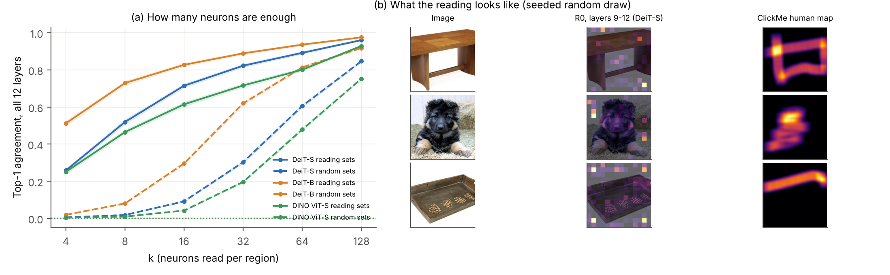
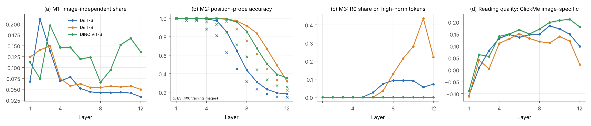

# v5 结果汇报：快慢权重视角下的“读 → 诊断 → 修正”

2026-11-05 · 判定参数在正式运行前冻结（[决策日志](../decisions.md) B33–B43，规格 [experiment_plan_v5.md](../experiment_plan_v5.md)）· 分析：`scripts/analyze_v5.py`、`scripts/plot_v5.py` · 汇总表：`experiments/2026-11-05_v5_analysis/`（下文简写为 `A/`）· Colab L4

> **读法说明。**
> - 每个结果先给一句话结论，再给数字。
> - 数字都写成“均值 [95% 区间]”。区间来自按图片配对的 bootstrap（1,000 次，种子 0）。
> - “更高 / 相当 / 更低”按 B22 的规则判定：区间含 0，或差小于界限（SRG 0.05，富集和 ClickMe 0.02），记为“相当”。
> - **R0** = 完整注意力的“收到的注意力”。三种修正：**C1** 扣掉模型平均图，**C2** 用位置探针重新定位，**C3** 乘以值向量经输出投影后的长度（按贡献计分）。**R_all** = 三者按 C3 → C2 → C1 合用。
> - 没有特别说明时，用的是第 9–12 层合并的读取。

## 1. 总览

**一句话：** 读出的神经元确实被模型使用（RQ1）。三个前提在深层都会失效（RQ2）。但三种修正里只有“按贡献计分（C3）”稳定地改进了读法；“重新定位（C2）”反而让读法变差，三者合用的效果也因此随修正顺序大幅变化（RQ3）。

| 研究问题 | 一句话答案 |
| --- | --- |
| RQ1 读 | 只让每个区域读 k 个神经元，12 层同时执行，k = 16 时保留 72% / 83% / 62% 的预测（DeiT-S / DeiT-B / DINO），同样大小的随机名单只有 9% / 30% / 4%。k 越大保留越多，每个 k 上读取名单都远高于随机。 |
| RQ2 诊断 | 三个前提都在深层失效，但程度和模型不同：M2（位置）在三个模型的深层都失效；M3（高范数 token）只在有监督模型中出现，DeiT-B 第 11 层有 43% 的读取落在高范数 token 上；M1（与图片无关的部分）一直很小（3%–21%）。没有哪一个前提单独对应“最后一层读取变差”。 |
| RQ3 修正 | **P3 部分成立（4 格中 1 格“更高”）**，属于事先约定的第 2 种情况。C3 在两个有监督模型的富集和 ClickMe 上都“更高”，而且超过“只去掉高范数 token”的对照；C2 在所有模型、所有指标上都更差；C1 基本不起作用，或只相当于扣掉一个中心高斯。改模型的两行都不比改读法好：测试时 register 只“相当”，top-k 训练“更低”。 |

**最重要的三个数字：**
1. **执行检验**：k = 16 时读取名单保留 71.5% [70.3, 72.8]（DeiT-S），随机名单 9.2%，完全没有注意力 0.1%（`A/fig2a_ksweep.csv`）。
2. **C3 − R0（DeiT-B）**：富集 +0.065 [0.063, 0.067]，ClickMe 图片特异 Spearman +0.058 [0.056, 0.059]。作为对比，测试时 register（改模型）在 DeiT-S 上只有 +0.012、+0.013（`A/correct_tests.csv`、`A/variants.csv`）。
3. **C2 − R0（DeiT-S）**：SRG −0.161 [−0.171, −0.150]，富集 −0.099 [−0.101, −0.097]。用线性位置探针重新定位，读法反而变差。

**P3 落在哪种情况：** 第 2 种（部分成立）。按事先约定，论文只能写“修正在部分模型和指标上有效”，并写清楚在哪里有效（C3）、在哪里无效（C2、合用），不能概括为“修正有效”。

## 2. RQ1 读

### 2.1 图 2

`figures/figure_v5_2_read.{png,pdf}`。
- (a) 来自 `A/fig2a_ksweep.csv`。
- (b) 来自 `experiments/2026-11-05_correct_ablation_clickme_deit/gallery_*.npz`：按 B16 规则，用种子 0 随机抽 24 张，取索引最小的前 3 张，不挑图。

### 2.2 执行检验与 k 扫描（P1 成立，3/3）

**结论：** 每个区域只需读很少的神经元。k = 16（196 个图块中约 8%）就保留了大部分预测，而且每个 k 上都远高于随机名单。

12 层同时限制后的 top-1 一致率（ImageNet 固定 5,000 张；随机名单为种子 0–4 的平均）：

| k | 4 | 8 | 16 | 32 | 64 | 128 |
| --- | --- | --- | --- | --- | --- | --- |
| DeiT-S 读取名单 | 25.8% | 52.0% | **71.5%** | 82.3% | 89.2% | 96.1% |
| DeiT-S 随机名单 | 0.5% | 1.8% | 9.2% | 30.3% | 60.6% | 84.7% |
| DeiT-B 读取名单 | 51.3% | 73.0% | **82.8%** | 88.9% | 93.6% | 97.6% |
| DeiT-B 随机名单 | 1.9% | 8.1% | 29.6% | 62.0% | 81.4% | 91.8% |
| DINO 读取名单 | 25.1% | 46.5% | **61.5%** | 71.6% | 80.1% | 92.9% |
| DINO 随机名单 | 0.4% | 1.0% | 4.2% | 19.7% | 47.9% | 75.3% |

- 完全没有注意力（T7）时只剩 0.1% / 0.2% / 0.1%（DeiT-S / DeiT-B / DINO）。
- 判定（`A/p1_tests.csv`）：每个模型 11 项检验全部成立（相邻 k 的差、每个 k 上“读取 − 随机”，区间下限都 > 0）。
- 复现：k = 16 的新结果与旧执行检验一致（DeiT-S 0.7152，与 V2 完全相同；DINO 0.615、DeiT-B 0.828，旧值 62%、83%）。
- 来源：`experiments/2026-11-05_read_ksweep_{deit,dino,deit_b}/predictions.csv.gz`。

### 2.3 表 1 中参照行与 R0 行的解读

**结论：** 扣除中心偏差后，R0 仍指向物体、仍与人一致，但作为热图明显不如 GAE。

完整的表 1 见第 4.1 节。
- **R0 是正的。** 同距离富集 0.140 / 0.080 / 0.199，ClickMe 图片特异 Spearman 0.157 / 0.107 / 0.208（DeiT-S / DeiT-B / DINO）。
- **与图片无关的参照，按构造在这两个指标上接近 0。** 中心高斯是 0.000 / 0.000，模型平均图在 −0.003 到 0.003 之间，随机也接近 0。所以 R0 的分数不是中心偏差带来的。
- **GAE 在所有 9 格都更高**（例如 SRG 0.345 对 0.236），与 v3 的结论一致。GAE 是参照上限。
- **复现检查通过**（`A/reproduction.csv`）：新运行的 R0 与 S1/S2 在同一批图片上的均值差，9 格中最大为 0.0003（界限 0.01）。

### 2.4 扩展 B、C、D（各一句话；都按原登记的判定）

**扩展 B（单层可替换，全部去掉就崩溃）**：DeiT-S、DeiT-B 只有第 1 层不能删注意力。DINO 也只有第 1 层不可替代，但它的深层更难替换。

逐层表（同一批 ImageNet 5,000 张；`A/a2_single_layer.csv`）：

| 层 | DeiT-S 限制 / 删除 | DeiT-B 限制 / 删除 | DINO 限制 / 删除 |
| --- | --- | --- | --- |
| 1 | 94.5% / 68.8% | 97.1% / 87.8% | 76.7% / **0.2%** |
| 2–8 | 91.7–95.4% / 92.8–94.5% | 95.5–96.6% / 95.4–97.8% | 89.1–94.9% / 92.0–95.0% |
| 9–12 | 94.6–96.0% / 93.9–97.2% | 95.1–96.5% / 93.7–94.4% | 80.9–88.9% / 85.7–91.7% |
| 全部 12 层 | 71.5%（k = 16） / 0.1% | 82.8% / 0.2% | 61.5% / 0.1% |

- 回答 Q5：DINO 只有第 1 层不能删注意力（只剩 0.2%）。第 2–12 层单独删掉都还保留 85.7%–95.0%，但第 9–12 层明显低于 DeiT（DeiT 第 9–12 层删注意力后保留 93.7%–97.2%）。
- 来源：单层限制来自 `experiments/2026-10-28_v2_analysis/rq1_anatomy.csv`、`2026-10-28_v2_dino_analysis/rq1_anatomy.csv`、`2026-10-29_v3_deit_b_analysis/rq1_anatomy.csv`；单层删除来自 `experiments/2026-11-03_ab_t7_*/attention_off.csv`。

**扩展 C（读的是头）**：三个模型删 4 个头部图块都比删 4 个身体图块更伤预测，但绝对效应很小。
- 差值（log 概率下降）：DeiT-S +0.017 [0.014, 0.020]，DINO +0.021 [0.019, 0.024]，DeiT-B +0.007 [0.004, 0.011] nats。
- 倍数：
  - DeiT-S：两足 3.2 倍、四足 2.2 倍；
  - DINO：两足 2.7 倍、四足 3.5 倍；
  - DeiT-B：两足 5.5 倍（0.014 对 0.0025 nats，绝对值很小）、四足 1.7 倍。
- 旧文档中“2–3.4 倍”的说法没有包括 DeiT-B，建议按模型分别写。
- 来源：`experiments/2026-10-29_v3_e8_parts_*/analysis_comparisons.csv`、`analysis_reliance.csv`。图片来自 ImageNet 训练集。

**扩展 D（物体移到角落，读取跟着走）**：物体平移 48 像素后，读取的物体占比比中心参照少降 0.021 / 0.010 / 0.053（DeiT-S / DeiT-B / DINO，区间都不含 0）。
- 注意：这一项在 v3 中用的是 top-k 探针图，不是 R0。
- 来源：`experiments/2026-10-29_v3_e5_shifted_*/analysis_comparisons.csv`。

**扩展 A（每个区域只用很少的神经元）**：见 2.2。另外，S1 中 top-k 图与完整注意力图的逐图 Spearman 中位数为 0.90 / 0.91 / 0.90（`experiments/2026-10-31_s_analysis/s1_similarity.csv`）。

## 3. RQ2 诊断

### 3.1 图 3

`figures/figure_v5_3_diagnose.{png,pdf}`，数据 `A/fig3_diagnose.csv`。
- (a) M1：新算，ImageNet-S 全部图片；平均图来自 2,000 张留出图片。
- (b) M2：新探针，2,000 张留出图片训练、另 2,000 张测试；叉号是 E3（400 张训练）。
- (c) M3：S3。
- (d) R0 的 ClickMe 图片特异 Spearman：S2。

### 3.2 三个前提各在哪里失效

**M2 位置（三个模型都在深层失效；P2 成立）：** 第 1–5 层 token 几乎都还代表原图块，第 6 层之后正确率快速下降，最后一层大部分 token 已不在原位置。

| 第 ℓ 层位置探针正确率 | 1 | 6 | 8 | 10 | 12 |
| --- | --- | --- | --- | --- | --- |
| DeiT-S | 100% | 85.3% | 43.9% | 23.1% | 18.1% |
| DeiT-B | 100% | 99.5% | 91.8% | 66.8% | 31.8% |
| DINO | 99.9% | 98.9% | 85.6% | 50.5% | 35.7% |

- 新探针比 E3 的正确率更高（训练图片多 5 倍），趋势相同。
- 来源：`experiments/2026-11-05_diagnose_probe_*/identity.csv`、`identity_images.csv`。

**M3 激活 ≠ 贡献（只在有监督模型中失效；P2 成立）：** R0 落在高范数 token 上的比例。
- DeiT-S：第 8–10 层约 9%。
- DeiT-B：第 11 层 43.5%，第 12 层 22.2%。
- DINO：每一层都是 0（区间上限 < 0.01）。

这些 token 的值向量只有普通图块的 0.2–0.3 倍，换成固定均值几乎没有影响（注意力预算研究 T3、T4，`docs/budget/report.md`）。

**M1 与图片无关的部分（一直很小；只描述）：** 每层读取的空间变化中，能被模型平均图解释的比例。
- 有监督模型第 6–12 层只有 3%–6%：DeiT-S 第 12 层 0.033 [0.032, 0.034]，DeiT-B 第 12 层 0.050 [0.048, 0.051]。
- DINO 较高，第 10–11 层 15%–17%。全部层中最高的是浅层（DeiT-S 第 2 层 21%，DINO 第 3 层 20%）。
- 平均图大多接近“同心圆”：第 9–12 层，有监督模型 82%–86%、DINO 92%–98% 的空间方差能被“离中心的距离”解释（`experiments/2026-11-05_diagnose_m1_*/radial.csv`）。
- 一张固定的中心高斯与 ClickMe 的相关是 0.41。但对模型自己的读取来说，与图片无关的部分并不大。
- 来源：`experiments/2026-11-05_diagnose_m1_*/m1.csv.gz`。

### 3.3 与面板 (d) 的对应

**结论：** 三个前提都在深层变差，但没有一个能单独解释“有监督模型最后一层读取变差”。
- 读取质量（图 3d）在 DeiT-S 第 9 层最好（0.184），第 12 层降到 0.098；DeiT-B 第 10 层 0.139 → 第 12 层 0.023；DINO 第 11 层 0.211 → 第 12 层 0.179，降得少。
- **M2** 平滑地随深度下降，第 12 层没有突然变化。DINO 的 M2 失效程度与 DeiT 相近，却没有同样大的下降。
- **M3** 在 DeiT-B 的高峰在第 11 层（43.5%），不在第 12 层（22.2%）。DeiT-S 第 12 层只有 7.2%。
- **M1** 在第 12 层反而最小。

## 4. RQ3 修正

### 4.1 表 1（第 9–12 层合并）

CSV：`A/table1.csv`（长格式 `A/table1_long.csv`）；Markdown：`A/table1.md`。均值 [95% 区间]。SRG 用 ImageNet-S 固定 2,000 张；同距离富集用 ImageNet-S 全部 12,419 张（有物体掩码的 12,144–12,150 张）；ClickMe 用全部 17,408 张。

| 组 | 读法 | DeiT-S SRG | DeiT-S 富集 | DeiT-S ClickMe | DeiT-B SRG | DeiT-B 富集 | DeiT-B ClickMe | DINO SRG | DINO 富集 | DINO ClickMe |
| --- | --- | --- | --- | --- | --- | --- | --- | --- | --- | --- |
| 参照 | 随机 | −0.002 | 0.000 | 0.000 | −0.003 | 0.000 | 0.000 | −0.002 | 0.000 | 0.000 |
| 参照 | 中心高斯 | 0.110 | 0.000 | 0.000 | 0.099 | 0.000 | 0.000 | 0.140 | 0.000 | 0.000 |
| 参照 | 模型平均图 | 0.058 | −0.003 | 0.000 | 0.011 | −0.002 | 0.000 | 0.139 | 0.003 | 0.000 |
| 参照 | GAE | 0.345 | 0.204 | 0.234 | 0.308 | 0.196 | 0.213 | 0.418 | 0.221 | 0.234 |
| 原始 | **R0** | **0.236** | **0.140** | **0.157** | **0.169** | **0.080** | **0.107** | **0.285** | **0.199** | **0.208** |
| 修正 | C1 | 0.208 | 0.138 | 0.165 | 0.144 | 0.077 | 0.087 | 0.233 | 0.201 | 0.252 |
| 修正 | C2 | 0.076 | 0.041 | 0.084 | 0.051 | 0.027 | 0.050 | 0.141 | 0.084 | 0.143 |
| 修正 | C3 | 0.253 | **0.178** | **0.190** | 0.198 | **0.146** | **0.165** | 0.285 | 0.196 | 0.207 |
| 修正 | R_all | 0.076 | 0.059 | 0.123 | 0.085 | 0.079 | 0.137 | 0.090 | 0.088 | 0.177 |
| 对照 | 扣中心高斯（对 C1） | 0.167 | 0.133 | 0.168 | 0.024 | 0.056 | 0.062 | 0.232 | 0.200 | 0.253 |
| 对照 | 同等模糊（对 C2） | 0.181 | 0.095 | 0.152 | 0.097 | −0.008 | 0.068 | 0.287 | 0.189 | 0.226 |
| 对照 | 去掉高范数（对 C3） | 0.241 | 0.152 | 0.168 | 0.186 | 0.121 | 0.148 | 0.285 | 0.199 | 0.208 |
| 改模型 | +register（DeiT-S） | 0.236 | 0.152 | 0.169 | — | — | — | — | — | — |
| 改模型 | top-k 训练（MiTA-DeiT-S） | 不适用¹ | 0.100 | 0.115 | — | — | — | — | — | — |

¹ MiTA 的压缩槽按完整 14 × 14 网格的固定区域汇聚 token，删掉图块后区域没有定义，所以不能做删除检验（B41）。register 版本可以做：register 在删除图块之前插入，删除时和 CLS 一起保留。

区间宽度：SRG 约 ±0.010，富集约 ±0.002，ClickMe 约 ±0.003。各格区间见 `A/table1.md`。

### 4.2 每种修正与 R0、与其对照的比较（预先指定的主比较，B41）

“修正 − R0”和“修正 − 对照”（`A/correct_tests.csv`）：

| 模型 | 指标 | C1 − R0 | C2 − R0 | C3 − R0 | **R_all − R0** | C1 − 扣中心 | C2 − 模糊 | C3 − 去掉高范数 |
| --- | --- | --- | --- | --- | --- | --- | --- | --- |
| DeiT-S | 富集 | −0.002 相当 | −0.099 更低 | **+0.038 更高** | **−0.081 更低** | +0.005 相当 | −0.054 更低 | **+0.026 更高** |
| DeiT-S | ClickMe | +0.009 相当 | −0.073 更低 | **+0.033 更高** | **−0.034 更低** | −0.003 相当 | −0.068 更低 | **+0.022 更高** |
| DeiT-S | SRG | −0.028 相当 | −0.161 更低 | +0.017 相当 | −0.160 更低 | +0.040 相当 | −0.105 更低 | +0.012 相当 |
| DeiT-B | 富集 | −0.003 相当 | −0.054 更低 | **+0.065 更高** | **−0.001 相当** | +0.022 更高 | +0.035 更高 | **+0.025 更高** |
| DeiT-B | ClickMe | −0.020 更低 | −0.057 更低 | **+0.058 更高** | **+0.030 更高** | +0.025 更高 | −0.018 相当 | +0.017 相当 |
| DeiT-B | SRG | −0.025 相当 | −0.118 更低 | +0.029 相当 | −0.084 更低 | +0.120 更高 | −0.047 相当 | +0.013 相当 |
| DINO | 富集 | +0.002 相当 | −0.115 更低 | −0.004 相当 | −0.111 更低 | +0.001 相当 | −0.105 更低 | −0.004 相当 |
| DINO | ClickMe | +0.044 更高 | −0.064 更低 | −0.001 相当 | −0.031 更低 | −0.001 相当 | −0.083 更低 | −0.001 相当 |
| DINO | SRG | −0.052 更低 | −0.144 更低 | 0.000 相当 | −0.195 更低 | +0.001 相当 | −0.146 更低 | 0.000 相当 |

逐项解读：
- **C3 按贡献计分：唯一稳定有效的修正。**
  - 在两个有监督模型的富集和 ClickMe 上都“更高”（+0.033 到 +0.065），SRG 上“相当”。
  - 它的作用不只是压低高范数 token：在 DeiT-S 的两个指标和 DeiT-B 的富集上，C3 都比“直接把高范数 token 设为 0”更好（+0.022 到 +0.026）。DeiT-B 的 ClickMe 上差 +0.017，小于界限。
  - 在没有高范数 token 的 DINO 上，C3 几乎不改变任何结果，这正是阴性对照 P4a 预期的。
- **C2 重新定位：在全部 9 格都更差，而且多数格比同等程度的模糊更差。**
  - 例子：DINO 富集 0.199 → 0.084，同等模糊只降到 0.189。
  - 也就是说，探针把分数搬到的位置比“随便抹开同样远”还要差。
  - 一个可能的原因：深层探针的 softmax 很分散（DeiT-S 第 12 层最大概率平均只有 0.27），分数被分到许多错误位置。这是推测，没有单独检验。
  - 唯一的例外是 DeiT-B 富集：C2 比模糊高 0.035，但两者都远低于 R0（DeiT-B 的模糊把富集降到 −0.008）。
- **C1 扣平均图：基本不起作用，或只相当于扣掉一个中心高斯。**
  - 有监督模型上，富集“相当”（平均图接近同心圆，事先已说明这时 C1 对富集影响很小）；DeiT-B 的 ClickMe 还“更低”（−0.020）。
  - DINO 的 ClickMe 提高 +0.044，但扣中心高斯也一样（0.253 对 0.252）。所以提高来自“扣掉中心偏差”，不是来自模型自己的平均图。
- **R_all 合用（固定顺序）：被 C2 拖累。** 只有 DeiT-B 的 ClickMe 更高（+0.030 [0.027, 0.032]）；DeiT-B 富集“相当”，其余都“更低”。

### 4.3 改模型两行（扩展 E；P6 成立）

**结论：** 按表 1 的协议重算，改模型不比改读法好：测试时 register 只带来小于界限的变化，top-k 训练反而更差。

| 行 | 富集（与 DeiT-S R0 之差） | ClickMe（之差） | SRG（之差） |
| --- | --- | --- | --- |
| +register（DeiT-S，T2 的 8 个神经元） | +0.012 [0.011, 0.013] 相当 | +0.013 [0.012, 0.013] 相当 | −0.000 [−0.005, 0.004] 相当 |
| top-k 训练（MiTA-DeiT-S） | −0.040 [−0.042, −0.039] 更低 | −0.042 [−0.044, −0.040] 更低 | 不适用¹ |
| 对比：只改读法（DeiT-S 的 C3） | +0.038 更高 | +0.033 更高 | +0.017 相当 |

- 原登记的判定（B32）不变：H6 成立（register 物体聚焦只 +0.006），H2 不成立（Small −0.011，Tiny +0.037，方向依赖规模）。
- DeiT-B 的 register 未通过 H3 关卡（32 个神经元只减少 45%）。
- 来源：`experiments/2026-11-05_correct_{register,mita}_{imagenet_s,clickme}_*`、`A/variants.csv`。
- 注意：MiTA 用自己的预处理（裁剪 0.875），与 DeiT-S（0.9）不同，所以逐图配对的是同一张图、不完全相同的裁剪。

### 4.4 最后一层下降找回多少（附录 A6；P5 只描述）

**结论：** 只有 C3 能找回一部分；其余修正让第 12 层更差。

找回比例 =（修正后第 12 层 − R0 第 12 层）÷（R0 第 8–11 层最好的一层 − R0 第 12 层），按图片配对 bootstrap（`A/a6_last_layer.csv`）：

| 模型 | 指标 | 下降（R0） | C3 找回 | C1 | C2 | R_all |
| --- | --- | --- | --- | --- | --- | --- |
| DeiT-S | ClickMe | 0.086（第 9 层 → 第 12 层） | **31% [29, 32]** | −12% | −98% | −67% |
| DeiT-S | 富集 | 0.038（第 11 层 → 第 12 层） | **62% [59, 65]** | −37% | −276% | −231% |
| DeiT-B | ClickMe | 0.116（第 10 层 → 第 12 层） | **45% [44, 46]** | −36% | −79% | −35% |
| DeiT-B | 富集 | 0.088（第 11 层 → 第 12 层） | **33% [31, 34]** | −27% | −72% | −40% |

### 4.5 修正顺序（附录 A7）：不稳健

**结论：** 合用的结果强烈依赖顺序。另一种顺序（C3 → C1 → C2）在全部 9 格都比固定顺序好（+0.043 到 +0.133）。

| 模型 | 指标 | R_all − R0（固定顺序） | R_all_alt − R0（另一种顺序） |
| --- | --- | --- | --- |
| DeiT-S | 富集 | −0.081 更低 | −0.032 更低 |
| DeiT-S | ClickMe | −0.034 更低 | **+0.065 更高** |
| DeiT-B | 富集 | −0.001 相当 | **+0.042 更高** |
| DeiT-B | ClickMe | +0.030 更高 | **+0.092 更高** |

- 来源：`A/a7_order.csv`。
- P3 按事先约定只用固定顺序判定，**不因这个结果改判**。但写作时必须说明：合用读法的结论不稳健，主要差别在于“扣平均图”是在重新定位之前还是之后做。
- 一个可能的解释（未检验）：先在 token 层面扣掉与图片无关的部分，再重新定位，就不会把这部分也一起抹开。

### 4.6 新读法的随机化健全性检验（附录）

**结论：** R0 和四种新读法都通过随机化健全性检验（v3 B14 的流程和门槛）：从输出端往输入端逐级重新初始化，全部块随机化后，与原图的 Spearman 中位数都远低于 0.5。

| 全部随机化后（`embed` 级）的 Spearman 中位数 | DeiT-S | DeiT-B | DINO |
| --- | --- | --- | --- |
| R0 | −0.033 | 0.055 | 0.071 |
| C1 | 0.187 | 0.366 | 0.100 |
| C2 | 0.063 | 0.004 | −0.002 |
| C3 | −0.064 | 0.070 | 0.114 |
| R_all | 0.069 | 0.078 | 0.025 |
| 中心高斯（“不通过”的样子） | 1.000 | 1.000 | 1.000 |

- 只随机化分类头时，所有读法都不变（Spearman = 1）。这是构造决定的：这些读法不依赖类别（B14 已说明），不算失败。
- C1 的值最高（DeiT-B 0.366）。原因是它减去的平均图来自训练好的模型，在随机化后仍然不变（B39）。即便如此，它也低于门槛。
- 来源：`A/sanity.csv`、`experiments/2026-11-05_correct_sanity_*/sanity.csv.gz`（ImageNet-S 固定 1,000 张）。

## 5. 预测对账

| 编号 | 判定 | 依据 |
| --- | --- | --- |
| P1 | **成立**（3/3 个模型） | 每个模型 11 项检验全部成立（`A/p1_tests.csv`） |
| P2 | **成立** | M2：三个模型第 12 层正确率的区间上限都低于第 1 层的区间下限，层号与正确率的 Spearman ≤ −0.8。M3：DINO 每层上限 < 0.01；DeiT-S 最大在第 8 层，DeiT-B 在第 11 层（都在第 6–12 层）。M1 只描述 |
| P3 | **部分成立**（1/4 格“更高”） | DeiT-B ClickMe +0.030 更高；DeiT-B 富集相当；DeiT-S 两格都更低。事先约定的第 2 种情况 |
| P4a | **成立** | DINO C3 − R0：富集 −0.004，ClickMe −0.001，SRG 0.000，都“相当” |
| P4b | **成立**（6/6 格） | 第 1–4 层 C2 − R0 的绝对值都 ≤ 0.004（`experiments/2026-11-05_p4_*.csv`） |
| P5 | 描述 | 见 4.4：只有 C3 找回 31%–62% |
| P6 | **成立**（4/4 格不“更高”） | register +0.012、+0.013 相当；MiTA −0.040、−0.042 更低。原判定 H6 成立、H2 不成立不变 |
| 主比较 P7（不预测方向） | — | 见 4.2：C3 − 对照在 3/6 个有监督格“更高”；C2 − 对照 5/6 格“更低”或“相当”；C1 − 对照在 DeiT-B 上“更高”（因为扣中心高斯在 DeiT-B 上特别差），在其余模型上“相当” |
| 复现 | **成立** | 新 R0 与 S1/S2 的差最大 0.0003 |
| 健全性 | **通过**（15/15） | 全部随机化后 Spearman 中位数都 < 0.5（最大 0.366，DeiT-B 的 C1） |

## 6. 意外与问题

1. **ClickMe 的图片几乎都不在 ImageNet 验证集中（B43）。**
   - Harmonization 论文说他们的评估用“ImageNet 验证集上的 ClickMe 图”，但发布的 17 个验证分片（17,408 张）只被称为“ClickMe 验证集”。这个数量接近 ClickMe 原论文随机分出的“验证折”（17,841 张）。
   - 我们用两种比对方法都几乎找不到对应：留出集检查的 4,002 张验证集图片中只有 2 张重复；如果它们来自验证集，预计约 530–1,850 张。
   - 结论：这些图片很可能来自 ImageNet 训练集，模型训练时见过。ClickMe 上的数字应像 PartImageNet 一样打折扣。v3、S1、S2 的 ClickMe 结果同样受影响。
2. **C2 让读法变差。** 原本预期“修正位置”会改善深层读取，结果在全部模型和指标上都更差，并且多数比同等程度的模糊还差。线性探针在深层很不确定，可能是主要原因（局限中提到“线性探针可能低估深层位置信息”）。附录可以加两层 MLP 探针，但不进主判定。
3. **合用读法对顺序很敏感**（4.5）。
4. **C1 的效果与“扣中心高斯”几乎一样。** 模型平均图 82%–98% 是同心圆形状，所以“扣与图片无关的部分”在这些模型上基本等于“扣中心偏差”。
5. **DeiT-B 的 k 扫描第一次运行失败**：自检误差 1.4e-4 超过 1e-4（float32 舍入）。按 B42 把这个实现检查的容差改为 5e-4，从头重跑。失败文件夹保留为 `experiments/2026-11-05_read_ksweep_deit_b_failed_tolerance`（只在实例上，未取回）。
6. **代码版本**：前 8 个运行（diagnose ×6、DeiT-S 和 DINO 的 k 扫描）用 94bf426，其余用 5faa503。两者只差 B42 的容差，不影响任何结果。
7. **扩展 C 的倍数**：旧的“2–3.4 倍”只对 DeiT-S、DINO 成立，DeiT-B 两足为 5.5 倍、四足 1.7 倍（绝对值很小）。
8. **扩展 D 用的是 top-k 探针图，不是 R0**（v3 运行时还没有 R0）。

## 7. 论文可用数字清单

| 位置 | 数字 | 来源文件（行或列） |
| --- | --- | --- |
| 摘要：读取名单保留 | 72% / 83% / 62%（DeiT-S / DeiT-B / DINO） | `A/fig2a_ksweep.csv`，sets = reading，k = 16 |
| 摘要：随机名单 | 9% / 30% / 4% | 同上，sets = random，k = 16 |
| 摘要：完全没有注意力 | 0.1% / 0.2% / 0.1% | 同上，sets = no attention |
| 摘要：三个前提失效的层与模型 | M2：三个模型第 6 层以后；M3：DeiT-B 第 11 层 43.5%，DeiT-S 第 8–10 层约 9%，DINO 0 | `A/fig3_diagnose.csv`，panel = M2 / M3 |
| 摘要：修正改变指标 | C3：富集 +0.038 / +0.065，ClickMe +0.033 / +0.058（DeiT-S / DeiT-B）；C2：SRG −0.161 / −0.118 | `A/correct_tests.csv`，test = correction - R0 |
| 摘要：对照 | C3 超过“去掉高范数”：+0.026 / +0.025（富集） | 同上，test = correction - control |
| 摘要：改模型 | register +0.012 / +0.013（相当）；top-k 训练 −0.040 / −0.042 | `A/variants.csv` |
| 5.1：k 扫描 | 第 2.2 节的表 | `A/fig2a_ksweep.csv` |
| 5.1：参照与 R0 | 表 1 的前 5 行 | `A/table1.md` |
| 5.1：扩展 B / C / D | 第 2.4 节 | `A/a2_single_layer.csv`；v3 E8、E5 的 `analysis_comparisons.csv` |
| 5.2：M1 | 有监督模型第 6–12 层 3%–6%，DINO 第 6–12 层 7%–17% | `A/fig3_diagnose.csv`，panel = M1 |
| 5.2：M2 | 第 12 层 18.1% / 31.8% / 35.7% | 同上，panel = M2 |
| 5.2：读取质量下降 | DeiT-S 0.184 → 0.098；DeiT-B 0.139 → 0.023；DINO 0.211 → 0.179 | 同上，panel = quality |
| 5.3：表 1 | 第 4.1 节 | `A/table1.csv` |
| 5.3：P3 | 1/4 格更高；DeiT-B ClickMe R_all − R0 = +0.030 [0.027, 0.032] | `A/predictions.csv`、`A/correct_tests.csv` |
| 5.3：最后一层找回 | C3 找回 31% / 45%（ClickMe），62% / 33%（富集） | `A/a6_last_layer.csv` |
| 5.3：修正顺序 | 另一种顺序在 9/9 格更好 | `A/a7_order.csv` |
| 附录：健全性 | 全部随机化后中位数 −0.064 到 0.366，都通过 | `A/sanity.csv`，level = embed |

## 8. 复现信息

- **代码**：分支 `study/v5`。94bf426（B41 冻结）用于 `diagnose_*` 和 DeiT-S、DINO 的 `read_ksweep`；5faa503（B42）用于其余运行。每个运行的 `metadata.json` 记录了提交号。
- **硬件**：Colab L4（float32，不用 autocast，确定性算法），PyTorch 2.7.0 + CUDA 12.8，timm 1.0.30。
- **运行文件夹**（`experiments/`）：
  - `2026-11-05_read_ksweep_{deit,dino,deit_b}`
  - `2026-11-05_diagnose_probe_{deit,dino,deit_b}`、`2026-11-05_diagnose_m1_{deit,dino,deit_b}`
  - `2026-11-05_correct_ablation_{imagenet_s,clickme}_{deit,dino,deit_b}`，P4 检查 `2026-11-05_p4_{dino,deit,deit_b}.csv`
  - `2026-11-05_correct_register_{imagenet_s,clickme}_deit`、`2026-11-05_correct_mita_{imagenet_s,clickme}_mita`
  - `2026-11-05_correct_order_{imagenet_s,clickme}_{deit,dino,deit_b}`
  - `2026-11-05_correct_sanity_{deit,dino,deit_b}`
- **重算**：
  - `python scripts/analyze_v5.py experiments/2026-11-05 experiments/2026-11-05_v5_analysis`
  - `python scripts/plot_v5.py experiments/2026-11-05_v5_analysis experiments/2026-11-05`
