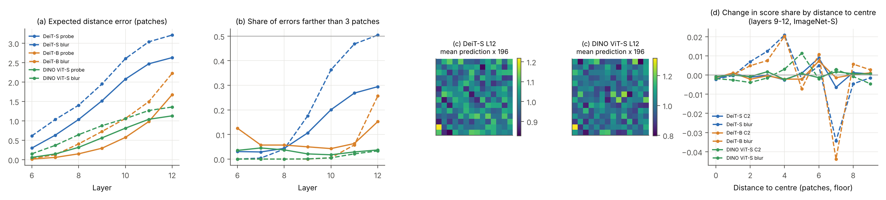

# v5 结果汇报：快慢权重视角下的“读 → 诊断 → 修正”

2026-11-05 · 判定参数在正式运行前冻结（[决策日志](../decisions.md) B33–B43，规格 [experiment_plan_v5.md](../experiment_plan_v5.md)）· 分析：`scripts/analyze_v5.py`、`scripts/plot_v5.py` · 汇总表：`experiments/2026-11-05_v5_analysis/`（下文简写为 `A/`）· Colab L4

> **读法说明。**
> - 每个结果先给一句话结论，再给数字。
> - 数字都写成“均值 [95% 区间]”。区间来自按图片配对的 bootstrap（1,000 次，种子 0）。
> - “更高 / 相当 / 更低”按 B22 的规则判定：区间含 0，或差小于界限（SRG 0.05，富集和 ClickMe 0.02），记为“相当”。
> - **R0** = 完整注意力的“收到的注意力”。三种修正：**C1** 扣掉模型平均图，**C2** 用位置探针重新定位，**C3** 乘以值向量经输出投影后的长度（按贡献计分）。**R_all** = 三者按 C3 → C2 → C1 合用。
> - 没有特别说明时，用的是第 9–12 层合并的读取。

## 1. 总览

**一句话：** 读出的神经元确实被模型使用（RQ1）。M2、M3 在深层失效，M1 基本成立（RQ2）。但三种修正里只有“按贡献计分（C3）”稳定地改进了读法；“重新定位（C2）”反而让读法变差，三者合用的效果也因此随修正顺序大幅变化（RQ3）。

| 研究问题 | 一句话答案 |
| --- | --- |
| RQ1 读 | 只让每个区域读 k 个神经元，12 层同时执行，k = 16 时保留 72% / 83% / 62% 的预测（DeiT-S / DeiT-B / DINO），同样大小的随机名单只有 9% / 30% / 4%。k 越大保留越多，每个 k 上读取名单都远高于随机。 |
| RQ2 诊断 | M2、M3 在深层失效，M1 基本成立，程度因模型而异：M2（位置）在三个模型的深层都失效；M3（高范数 token）只在有监督模型中出现，DeiT-B 第 11 层有 43% 的读取落在高范数 token 上；M1（与图片无关的部分）一直很小（3%–21%）。没有哪一个前提单独对应“最后一层读取变差”。 |
| RQ3 修正 | **P3 部分成立（4 格中 1 格“更高”）**，属于事先约定的第 2 种情况。C3 在两个有监督模型的富集和 ClickMe 上都“更高”，而且超过“只去掉高范数 token”的对照；C2 在所有模型、所有指标上都更差；C1 基本不起作用，或只相当于扣掉一个中心高斯。改模型的两行都不比改读法好：测试时 register 只“相当”，top-k 训练“更低”。 |

**最重要的三个数字：**
1. **执行检验**：k = 16 时读取名单保留 71.5% [70.3, 72.8]（DeiT-S），随机名单 9.2%，完全没有注意力 0.1%（`A/fig2a_ksweep.csv`）。
2. **C3 − R0（DeiT-B）**：富集 +0.065 [0.063, 0.067]，ClickMe 图片特异 Spearman +0.058 [0.056, 0.059]。作为对比，测试时 register（改模型）在 DeiT-S 上只有 +0.012、+0.013（`A/correct_tests.csv`、`A/variants.csv`）。
3. **C2 − R0（DeiT-S）**：SRG −0.161 [−0.171, −0.150]，富集 −0.099 [−0.101, −0.097]。用线性位置探针重新定位，读法反而变差。

**P3 落在哪种情况：** 第 2 种（部分成立）。按事先约定，论文只能写“修正在部分模型和指标上有效”，并写清楚在哪里有效（C3）、在哪里无效（C2、合用），不能概括为“修正有效”。

## 2. RQ1 读

### 2.1 图 2

`figures/figure_v5_2_read.{png,pdf}`。
- (a) 来自 `A/fig2a_ksweep.csv`。
- (b) 来自 `experiments/2026-11-05_correct_ablation_clickme_deit/gallery_*.npz`：按 B16 规则，用种子 0 随机抽 24 张，取索引最小的前 3 张，不挑图。

### 2.2 执行检验与 k 扫描（P1 成立，3/3）

**结论：** 每个区域只需读很少的神经元。k = 16（196 个图块中约 8%）就保留了大部分预测，而且每个 k 上都远高于随机名单。

12 层同时限制后的 top-1 一致率（ImageNet 固定 5,000 张；随机名单为种子 0–4 的平均）：

| k | 4 | 8 | 16 | 32 | 64 | 128 |
| --- | --- | --- | --- | --- | --- | --- |
| DeiT-S 读取名单 | 25.8% | 52.0% | **71.5%** | 82.3% | 89.2% | 96.1% |
| DeiT-S 随机名单 | 0.5% | 1.8% | 9.2% | 30.3% | 60.6% | 84.7% |
| DeiT-B 读取名单 | 51.3% | 73.0% | **82.8%** | 88.9% | 93.6% | 97.6% |
| DeiT-B 随机名单 | 1.9% | 8.1% | 29.6% | 62.0% | 81.4% | 91.8% |
| DINO 读取名单 | 25.1% | 46.5% | **61.5%** | 71.6% | 80.1% | 92.9% |
| DINO 随机名单 | 0.4% | 1.0% | 4.2% | 19.7% | 47.9% | 75.3% |

- 完全没有注意力（T7）时只剩 0.1% / 0.2% / 0.1%（DeiT-S / DeiT-B / DINO）。
- 判定（`A/p1_tests.csv`）：每个模型 11 项检验全部成立（相邻 k 的差、每个 k 上“读取 − 随机”，区间下限都 > 0）。
- 复现：k = 16 的新结果与旧执行检验一致（DeiT-S 0.7152，与 V2 完全相同；DINO 0.615、DeiT-B 0.828，旧值 62%、83%）。
- 来源：`experiments/2026-11-05_read_ksweep_{deit,dino,deit_b}/predictions.csv.gz`。

### 2.3 表 1 中参照行与 R0 行的解读

**结论：** 扣除中心偏差后，R0 仍指向物体、仍与人一致，但作为热图明显不如 GAE。

完整的表 1 见第 4.1 节。
- **R0 是正的。** 同距离富集 0.140 / 0.080 / 0.199，ClickMe 图片特异 Spearman 0.157 / 0.107 / 0.208（DeiT-S / DeiT-B / DINO）。
- **与图片无关的参照，按构造在这两个指标上接近 0。** 中心高斯是 0.000 / 0.000，模型平均图在 −0.003 到 0.003 之间，随机也接近 0。所以 R0 的分数不是中心偏差带来的。
- **GAE 在所有 9 格都更高**（例如 SRG 0.345 对 0.236），与 v3 的结论一致。GAE 是参照上限。
- **复现检查通过**（`A/reproduction.csv`）：新运行的 R0 与 S1/S2 在同一批图片上的均值差，9 格中最大为 0.0003（界限 0.01）。

### 2.4 扩展 B、C、D（各一句话；都按原登记的判定）

**扩展 B（单层可替换，全部去掉就崩溃）**：DeiT-S、DeiT-B 只有第 1 层不能删注意力。DINO 也只有第 1 层不可替代，但它的深层更难替换。

逐层表（同一批 ImageNet 5,000 张；`A/a2_single_layer.csv`）：

| 层 | DeiT-S 限制 / 删除 | DeiT-B 限制 / 删除 | DINO 限制 / 删除 |
| --- | --- | --- | --- |
| 1 | 94.5% / 68.8% | 97.1% / 87.8% | 76.7% / **0.2%** |
| 2–8 | 91.7–95.4% / 92.8–94.5% | 95.5–96.6% / 95.4–97.8% | 89.1–94.9% / 92.0–95.0% |
| 9–12 | 94.6–96.0% / 93.9–97.2% | 95.1–96.5% / 93.7–94.4% | 80.9–88.9% / 85.7–91.7% |
| 全部 12 层 | 71.5%（k = 16） / 0.1% | 82.8% / 0.2% | 61.5% / 0.1% |

- 回答 Q5：DINO 只有第 1 层不能删注意力（只剩 0.2%）。第 2–12 层单独删掉都还保留 85.7%–95.0%，但第 9–12 层明显低于 DeiT（DeiT 第 9–12 层删注意力后保留 93.7%–97.2%）。
- 来源：单层限制来自 `experiments/2026-10-28_v2_analysis/rq1_anatomy.csv`、`2026-10-28_v2_dino_analysis/rq1_anatomy.csv`、`2026-10-29_v3_deit_b_analysis/rq1_anatomy.csv`；单层删除来自 `experiments/2026-11-03_ab_t7_*/attention_off.csv`。

**扩展 C（读的是头）**：三个模型删 4 个头部图块都比删 4 个身体图块更伤预测，但绝对效应很小。
- 差值（log 概率下降）：DeiT-S +0.017 [0.014, 0.020]，DINO +0.021 [0.019, 0.024]，DeiT-B +0.007 [0.004, 0.011] nats。
- 倍数：
  - DeiT-S：两足 3.2 倍、四足 2.2 倍；
  - DINO：两足 2.7 倍、四足 3.5 倍；
  - DeiT-B：两足 5.5 倍（0.014 对 0.0025 nats，绝对值很小）、四足 1.7 倍。
- 旧文档中“2–3.4 倍”的说法没有包括 DeiT-B，建议按模型分别写。
- 来源：`experiments/2026-10-29_v3_e8_parts_*/analysis_comparisons.csv`、`analysis_reliance.csv`。图片来自 ImageNet 训练集。

**扩展 D（物体移到角落，读取跟着走）**：物体平移 48 像素后，读取的物体占比比中心参照少降 0.021 / 0.010 / 0.053（DeiT-S / DeiT-B / DINO，区间都不含 0）。
- 注意：这一项在 v3 中用的是 top-k 探针图，不是 R0。
- 来源：`experiments/2026-10-29_v3_e5_shifted_*/analysis_comparisons.csv`。

**扩展 A（每个区域只用很少的神经元）**：见 2.2。另外，S1 中 top-k 图与完整注意力图的逐图 Spearman 中位数为 0.90 / 0.91 / 0.90（`experiments/2026-10-31_s_analysis/s1_similarity.csv`）。

## 3. RQ2 诊断

### 3.1 图 3

`figures/figure_v5_3_diagnose.{png,pdf}`，数据 `A/fig3_diagnose.csv`。
- (a) M1：新算，ImageNet-S 全部图片；平均图来自 2,000 张留出图片。
- (b) M2：新探针，2,000 张留出图片训练、另 2,000 张测试；叉号是 E3（400 张训练）。
- (c) M3：S3。
- (d) R0 的 ClickMe 图片特异 Spearman：S2。

### 3.2 三个前提各在哪里失效

**M2 位置（三个模型都在深层失效；P2 成立）：** 第 1–5 层 token 几乎都还代表原图块，第 6 层之后正确率快速下降，最后一层大部分 token 已不在原位置。

| 第 ℓ 层位置探针正确率 | 1 | 6 | 8 | 10 | 12 |
| --- | --- | --- | --- | --- | --- |
| DeiT-S | 100% | 85.3% | 43.9% | 23.1% | 18.1% |
| DeiT-B | 100% | 99.5% | 91.8% | 66.8% | 31.8% |
| DINO | 99.9% | 98.9% | 85.6% | 50.5% | 35.7% |

- 新探针比 E3 的正确率更高（训练图片多 5 倍），趋势相同。
- 来源：`experiments/2026-11-05_diagnose_probe_*/identity.csv`、`identity_images.csv`。

**M3 激活 ≠ 贡献（只在有监督模型中失效；P2 成立）：** R0 落在高范数 token 上的比例。
- DeiT-S：第 8–10 层约 9%。
- DeiT-B：第 11 层 43.5%，第 12 层 22.2%。
- DINO：每一层都是 0（区间上限 < 0.01）。

这些 token 的值向量只有普通图块的 0.2–0.3 倍，换成固定均值几乎没有影响（注意力预算研究 T3、T4，`docs/budget/report.md`）。

**M1 与图片无关的部分（一直很小；只描述）：** 每层读取的空间变化中，能被模型平均图解释的比例。
- 有监督模型第 6–12 层只有 3%–6%：DeiT-S 第 12 层 0.033 [0.032, 0.034]，DeiT-B 第 12 层 0.050 [0.048, 0.051]。
- DINO 较高，第 10–11 层 15%–17%。全部层中最高的是浅层（DeiT-S 第 2 层 21%，DINO 第 3 层 20%）。
- 平均图大多接近“同心圆”：第 9–12 层，有监督模型 82%–86%、DINO 92%–98% 的空间方差能被“离中心的距离”解释（`experiments/2026-11-05_diagnose_m1_*/radial.csv`）。
- 一张固定的中心高斯与 ClickMe 的相关是 0.41。但对模型自己的读取来说，与图片无关的部分并不大。
- 来源：`experiments/2026-11-05_diagnose_m1_*/m1.csv.gz`。

### 3.3 与面板 (d) 的对应

**结论：** 三个前提都在深层变差，但没有一个能单独解释“有监督模型最后一层读取变差”。
- 读取质量（图 3d）在 DeiT-S 第 9 层最好（0.184），第 12 层降到 0.098；DeiT-B 第 10 层 0.139 → 第 12 层 0.023；DINO 第 11 层 0.211 → 第 12 层 0.179，降得少。
- **M2** 平滑地随深度下降，第 12 层没有突然变化。DINO 的 M2 失效程度与 DeiT 相近，却没有同样大的下降。
- **M3** 在 DeiT-B 的高峰在第 11 层（43.5%），不在第 12 层（22.2%）。DeiT-S 第 12 层只有 7.2%。
- **M1** 在第 12 层反而最小。

## 4. RQ3 修正

### 4.1 表 1（第 9–12 层合并）

CSV：`A/table1.csv`（长格式 `A/table1_long.csv`）；Markdown：`A/table1.md`。均值 [95% 区间]。SRG 用 ImageNet-S 固定 2,000 张；同距离富集用 ImageNet-S 全部 12,419 张（有物体掩码的 12,144–12,150 张）；ClickMe 用全部 17,408 张。

| 组 | 读法 | DeiT-S SRG | DeiT-S 富集 | DeiT-S ClickMe | DeiT-B SRG | DeiT-B 富集 | DeiT-B ClickMe | DINO SRG | DINO 富集 | DINO ClickMe |
| --- | --- | --- | --- | --- | --- | --- | --- | --- | --- | --- |
| 参照 | 随机 | −0.002 | 0.000 | 0.000 | −0.003 | 0.000 | 0.000 | −0.002 | 0.000 | 0.000 |
| 参照 | 中心高斯 | 0.110 | 0.000 | 0.000 | 0.099 | 0.000 | 0.000 | 0.140 | 0.000 | 0.000 |
| 参照 | 模型平均图 | 0.058 | −0.003 | 0.000 | 0.011 | −0.002 | 0.000 | 0.139 | 0.003 | 0.000 |
| 参照 | GAE | 0.345 | 0.204 | 0.234 | 0.308 | 0.196 | 0.213 | 0.418 | 0.221 | 0.234 |
| 原始 | **R0** | **0.236** | **0.140** | **0.157** | **0.169** | **0.080** | **0.107** | **0.285** | **0.199** | **0.208** |
| 修正 | C1 | 0.208 | 0.138 | 0.165 | 0.144 | 0.077 | 0.087 | 0.233 | 0.201 | 0.252 |
| 修正 | C2 | 0.076 | 0.041 | 0.084 | 0.051 | 0.027 | 0.050 | 0.141 | 0.084 | 0.143 |
| 修正 | C3 | 0.253 | **0.178** | **0.190** | 0.198 | **0.146** | **0.165** | 0.285 | 0.196 | 0.207 |
| 修正 | R_all | 0.076 | 0.059 | 0.123 | 0.085 | 0.079 | 0.137 | 0.090 | 0.088 | 0.177 |
| 对照 | 扣中心高斯（对 C1） | 0.167 | 0.133 | 0.168 | 0.024 | 0.056 | 0.062 | 0.232 | 0.200 | 0.253 |
| 对照 | 同等模糊（对 C2） | 0.181 | 0.095 | 0.152 | 0.097 | −0.008 | 0.068 | 0.287 | 0.189 | 0.226 |
| 对照 | 去掉高范数（对 C3） | 0.241 | 0.152 | 0.168 | 0.186 | 0.121 | 0.148 | 0.285 | 0.199 | 0.208 |
| 改模型 | +register（DeiT-S） | 0.236 | 0.152 | 0.169 | — | — | — | — | — | — |
| 改模型 | top-k 训练（MiTA-DeiT-S） | 不适用¹ | 0.100 | 0.115 | — | — | — | — | — | — |

¹ MiTA 的压缩槽按完整 14 × 14 网格的固定区域汇聚 token，删掉图块后区域没有定义，所以不能做删除检验（B41）。register 版本可以做：register 在删除图块之前插入，删除时和 CLS 一起保留。

区间宽度：SRG 约 ±0.010，富集约 ±0.002，ClickMe 约 ±0.003。各格区间见 `A/table1.md`。

### 4.2 每种修正与 R0、与其对照的比较（预先指定的主比较，B41）

“修正 − R0”和“修正 − 对照”（`A/correct_tests.csv`）：

| 模型 | 指标 | C1 − R0 | C2 − R0 | C3 − R0 | **R_all − R0** | C1 − 扣中心 | C2 − 模糊 | C3 − 去掉高范数 |
| --- | --- | --- | --- | --- | --- | --- | --- | --- |
| DeiT-S | 富集 | −0.002 相当 | −0.099 更低 | **+0.038 更高** | **−0.081 更低** | +0.005 相当 | −0.054 更低 | **+0.026 更高** |
| DeiT-S | ClickMe | +0.009 相当 | −0.073 更低 | **+0.033 更高** | **−0.034 更低** | −0.003 相当 | −0.068 更低 | **+0.022 更高** |
| DeiT-S | SRG | −0.028 相当 | −0.161 更低 | +0.017 相当 | −0.160 更低 | +0.040 相当 | −0.105 更低 | +0.012 相当 |
| DeiT-B | 富集 | −0.003 相当 | −0.054 更低 | **+0.065 更高** | **−0.001 相当** | +0.022 更高 | +0.035 更高 | **+0.025 更高** |
| DeiT-B | ClickMe | −0.020 更低 | −0.057 更低 | **+0.058 更高** | **+0.030 更高** | +0.025 更高 | −0.018 相当 | +0.017 相当 |
| DeiT-B | SRG | −0.025 相当 | −0.118 更低 | +0.029 相当 | −0.084 更低 | +0.120 更高 | −0.047 相当 | +0.013 相当 |
| DINO | 富集 | +0.002 相当 | −0.115 更低 | −0.004 相当 | −0.111 更低 | +0.001 相当 | −0.105 更低 | −0.004 相当 |
| DINO | ClickMe | +0.044 更高 | −0.064 更低 | −0.001 相当 | −0.031 更低 | −0.001 相当 | −0.083 更低 | −0.001 相当 |
| DINO | SRG | −0.052 更低 | −0.144 更低 | 0.000 相当 | −0.195 更低 | +0.001 相当 | −0.146 更低 | 0.000 相当 |

逐项解读：
- **C3 按贡献计分：唯一稳定有效的修正。**
  - 在两个有监督模型的富集和 ClickMe 上都“更高”（+0.033 到 +0.065），SRG 上“相当”。
  - 它的作用不只是压低高范数 token：在 DeiT-S 的两个指标和 DeiT-B 的富集上，C3 都比“直接把高范数 token 设为 0”更好（+0.022 到 +0.026）。DeiT-B 的 ClickMe 上差 +0.017，小于界限。
  - 在没有高范数 token 的 DINO 上，C3 几乎不改变任何结果，这正是阴性对照 P4a 预期的。
- **C2 重新定位：在全部 9 格都更差，而且多数格比同等程度的模糊更差。**
  - 例子：DINO 富集 0.199 → 0.084，同等模糊只降到 0.189。
  - 也就是说，探针把分数搬到的位置比“随便抹开同样远”还要差。
  - 一个可能的原因：深层探针的 softmax 很分散（DeiT-S 第 12 层最大概率平均只有 0.27），分数被分到许多错误位置。这是推测，没有单独检验。
  - 唯一的例外是 DeiT-B 富集：C2 比模糊高 0.035，但两者都远低于 R0（DeiT-B 的模糊把富集降到 −0.008）。
- **C1 扣平均图：基本不起作用，或只相当于扣掉一个中心高斯。**
  - 有监督模型上，富集“相当”（平均图接近同心圆，事先已说明这时 C1 对富集影响很小）；DeiT-B 的 ClickMe 还“更低”（−0.020）。
  - DINO 的 ClickMe 提高 +0.044，但扣中心高斯也一样（0.253 对 0.252）。所以提高来自“扣掉中心偏差”，不是来自模型自己的平均图。
- **R_all 合用（固定顺序）：被 C2 拖累。** 只有 DeiT-B 的 ClickMe 更高（+0.030 [0.027, 0.032]）；DeiT-B 富集“相当”，其余都“更低”。

### 4.3 改模型两行（扩展 E；P6 成立）

**结论：** 按表 1 的协议重算，改模型不比改读法好：测试时 register 只带来小于界限的变化，top-k 训练反而更差。

| 行 | 富集（与 DeiT-S R0 之差） | ClickMe（之差） | SRG（之差） |
| --- | --- | --- | --- |
| +register（DeiT-S，T2 的 8 个神经元） | +0.012 [0.011, 0.013] 相当 | +0.013 [0.012, 0.013] 相当 | −0.000 [−0.005, 0.004] 相当 |
| top-k 训练（MiTA-DeiT-S） | −0.040 [−0.042, −0.039] 更低 | −0.042 [−0.044, −0.040] 更低 | 不适用¹ |
| 对比：只改读法（DeiT-S 的 C3） | +0.038 更高 | +0.033 更高 | +0.017 相当 |

- 原登记的判定（B32）不变：H6 成立（register 物体聚焦只 +0.006），H2 不成立（Small −0.011，Tiny +0.037，方向依赖规模）。
- DeiT-B 的 register 未通过 H3 关卡（32 个神经元只减少 45%）。
- 来源：`experiments/2026-11-05_correct_{register,mita}_{imagenet_s,clickme}_*`、`A/variants.csv`。
- 注意：MiTA 用自己的预处理（裁剪 0.875），与 DeiT-S（0.9）不同，所以逐图配对的是同一张图、不完全相同的裁剪。

### 4.4 最后一层下降找回多少（附录 A6；P5 只描述）

**结论：** 只有 C3 能找回一部分；其余修正让第 12 层更差。

找回比例 =（修正后第 12 层 − R0 第 12 层）÷（R0 第 8–11 层最好的一层 − R0 第 12 层），按图片配对 bootstrap（`A/a6_last_layer.csv`）：

| 模型 | 指标 | 下降（R0） | C3 找回 | C1 | C2 | R_all |
| --- | --- | --- | --- | --- | --- | --- |
| DeiT-S | ClickMe | 0.086（第 9 层 → 第 12 层） | **31% [29, 32]** | −12% | −98% | −67% |
| DeiT-S | 富集 | 0.038（第 11 层 → 第 12 层） | **62% [59, 65]** | −37% | −276% | −231% |
| DeiT-B | ClickMe | 0.116（第 10 层 → 第 12 层） | **45% [44, 46]** | −36% | −79% | −35% |
| DeiT-B | 富集 | 0.088（第 11 层 → 第 12 层） | **33% [31, 34]** | −27% | −72% | −40% |

### 4.5 修正顺序（附录 A7）：不稳健

**结论：** 合用的结果强烈依赖顺序。另一种顺序（C3 → C1 → C2）在全部 9 格都比固定顺序好（+0.043 到 +0.133）。

| 模型 | 指标 | R_all − R0（固定顺序） | R_all_alt − R0（另一种顺序） |
| --- | --- | --- | --- |
| DeiT-S | 富集 | −0.081 更低 | −0.032 更低 |
| DeiT-S | ClickMe | −0.034 更低 | **+0.065 更高** |
| DeiT-B | 富集 | −0.001 相当 | **+0.042 更高** |
| DeiT-B | ClickMe | +0.030 更高 | **+0.092 更高** |

- 来源：`A/a7_order.csv`。
- P3 按事先约定只用固定顺序判定，**不因这个结果改判**。但写作时必须说明：合用读法的结论不稳健，主要差别在于“扣平均图”是在重新定位之前还是之后做。
- 一个可能的解释（未检验）：先在 token 层面扣掉与图片无关的部分，再重新定位，就不会把这部分也一起抹开。

### 4.6 新读法的随机化健全性检验（附录）

**结论：** R0 和四种新读法都通过随机化健全性检验（v3 B14 的流程和门槛）：从输出端往输入端逐级重新初始化，全部块随机化后，与原图的 Spearman 中位数都远低于 0.5。

| 全部随机化后（`embed` 级）的 Spearman 中位数 | DeiT-S | DeiT-B | DINO |
| --- | --- | --- | --- |
| R0 | −0.033 | 0.055 | 0.071 |
| C1 | 0.187 | 0.366 | 0.100 |
| C2 | 0.063 | 0.004 | −0.002 |
| C3 | −0.064 | 0.070 | 0.114 |
| R_all | 0.069 | 0.078 | 0.025 |
| 中心高斯（“不通过”的样子） | 1.000 | 1.000 | 1.000 |

- 只随机化分类头时，所有读法都不变（Spearman = 1）。这是构造决定的：这些读法不依赖类别（B14 已说明），不算失败。
- C1 的值最高（DeiT-B 0.366）。原因是它减去的平均图来自训练好的模型，在随机化后仍然不变（B39）。即便如此，它也低于门槛。
- 来源：`A/sanity.csv`、`experiments/2026-11-05_correct_sanity_*/sanity.csv.gz`（ImageNet-S 固定 1,000 张）。

## 5. 预测对账

| 编号 | 判定 | 依据 |
| --- | --- | --- |
| P1 | **成立**（3/3 个模型） | 每个模型 11 项检验全部成立（`A/p1_tests.csv`） |
| P2 | **成立** | M2：三个模型第 12 层正确率的区间上限都低于第 1 层的区间下限，层号与正确率的 Spearman ≤ −0.8。M3：DINO 每层上限 < 0.01；DeiT-S 最大在第 8 层，DeiT-B 在第 11 层（都在第 6–12 层）。M1 只描述 |
| P3 | **部分成立**（1/4 格“更高”） | DeiT-B ClickMe +0.030 更高；DeiT-B 富集相当；DeiT-S 两格都更低。事先约定的第 2 种情况 |
| P4a | **成立** | DINO C3 − R0：富集 −0.004，ClickMe −0.001，SRG 0.000，都“相当” |
| P4b | **成立**（6/6 格） | 第 1–4 层 C2 − R0 的绝对值都 ≤ 0.004（`experiments/2026-11-05_p4_*.csv`） |
| P5 | 描述 | 见 4.4：只有 C3 找回 31%–62% |
| P6 | **成立**（4/4 格不“更高”） | register +0.012、+0.013 相当；MiTA −0.040、−0.042 更低。原判定 H6 成立、H2 不成立不变 |
| 主比较 P7（不预测方向） | — | 见 4.2：C3 − 对照在 3/6 个有监督格“更高”；C2 − 对照 5/6 格“更低”或“相当”；C1 − 对照在 DeiT-B 上“更高”（因为扣中心高斯在 DeiT-B 上特别差），在其余模型上“相当” |
| 复现 | **成立** | 新 R0 与 S1/S2 的差最大 0.0003 |
| 健全性 | **通过**（15/15） | 全部随机化后 Spearman 中位数都 < 0.5（最大 0.366，DeiT-B 的 C1） |

## 6. 意外与问题

1. **ClickMe 的图片几乎都不在 ImageNet 验证集中（B43）。**
   - Harmonization 论文说他们的评估用“ImageNet 验证集上的 ClickMe 图”，但发布的 17 个验证分片（17,408 张）只被称为“ClickMe 验证集”。这个数量接近 ClickMe 原论文随机分出的“验证折”（17,841 张）。
   - 我们用两种比对方法都几乎找不到对应：留出集检查的 4,002 张验证集图片中只有 2 张重复；如果它们来自验证集，预计约 530–1,850 张。
   - 结论：这些图片很可能来自 ImageNet 训练集，模型训练时见过。ClickMe 上的数字应像 PartImageNet 一样打折扣。v3、S1、S2 的 ClickMe 结果同样受影响。
2. **C2 让读法变差。** 原本预期“修正位置”会改善深层读取，结果在全部模型和指标上都更差，并且多数比同等程度的模糊还差。线性探针在深层很不确定，可能是主要原因（局限中提到“线性探针可能低估深层位置信息”）。附录可以加两层 MLP 探针，但不进主判定。
3. **合用读法对顺序很敏感**（4.5）。
4. **C1 的效果与“扣中心高斯”几乎一样。** 模型平均图 82%–98% 是同心圆形状，所以“扣与图片无关的部分”在这些模型上基本等于“扣中心偏差”。
5. **DeiT-B 的 k 扫描第一次运行失败**：自检误差 1.4e-4 超过 1e-4（float32 舍入）。按 B42 把这个实现检查的容差改为 5e-4，从头重跑。失败文件夹保留为 `experiments/2026-11-05_read_ksweep_deit_b_failed_tolerance`（只在实例上，未取回）。
6. **代码版本**：前 8 个运行（diagnose ×6、DeiT-S 和 DINO 的 k 扫描）用 94bf426，其余用 5faa503。两者只差 B42 的容差，不影响任何结果。
7. **扩展 C 的倍数**：旧的“2–3.4 倍”只对 DeiT-S、DINO 成立，DeiT-B 两足为 5.5 倍、四足 1.7 倍（绝对值很小）。
8. **扩展 D 用的是 top-k 探针图，不是 R0**（v3 运行时还没有 R0）。

## 7. 论文可用数字清单

| 位置 | 数字 | 来源文件（行或列） |
| --- | --- | --- |
| 摘要：读取名单保留 | 72% / 83% / 62%（DeiT-S / DeiT-B / DINO） | `A/fig2a_ksweep.csv`，sets = reading，k = 16 |
| 摘要：随机名单 | 9% / 30% / 4% | 同上，sets = random，k = 16 |
| 摘要：完全没有注意力 | 0.1% / 0.2% / 0.1% | 同上，sets = no attention |
| 摘要：三个前提失效的层与模型 | M2：三个模型第 6 层以后；M3：DeiT-B 第 11 层 43.5%，DeiT-S 第 8–10 层约 9%，DINO 0 | `A/fig3_diagnose.csv`，panel = M2 / M3 |
| 摘要：修正改变指标 | C3：富集 +0.038 / +0.065，ClickMe +0.033 / +0.058（DeiT-S / DeiT-B）；C2：SRG −0.161 / −0.118 | `A/correct_tests.csv`，test = correction - R0 |
| 摘要：对照 | C3 超过“去掉高范数”：+0.026 / +0.025（富集） | 同上，test = correction - control |
| 摘要：改模型 | register +0.012 / +0.013（相当）；top-k 训练 −0.040 / −0.042 | `A/variants.csv` |
| 5.1：k 扫描 | 第 2.2 节的表 | `A/fig2a_ksweep.csv` |
| 5.1：参照与 R0 | 表 1 的前 5 行 | `A/table1.md` |
| 5.1：扩展 B / C / D | 第 2.4 节 | `A/a2_single_layer.csv`；v3 E8、E5 的 `analysis_comparisons.csv` |
| 5.2：M1 | 有监督模型第 6–12 层 3%–6%，DINO 第 6–12 层 7%–17% | `A/fig3_diagnose.csv`，panel = M1 |
| 5.2：M2 | 第 12 层 18.1% / 31.8% / 35.7% | 同上，panel = M2 |
| 5.2：读取质量下降 | DeiT-S 0.184 → 0.098；DeiT-B 0.139 → 0.023；DINO 0.211 → 0.179 | 同上，panel = quality |
| 5.3：表 1 | 第 4.1 节 | `A/table1.csv` |
| 5.3：P3 | 1/4 格更高；DeiT-B ClickMe R_all − R0 = +0.030 [0.027, 0.032] | `A/predictions.csv`、`A/correct_tests.csv` |
| 5.3：最后一层找回 | C3 找回 31% / 45%（ClickMe），62% / 33%（富集） | `A/a6_last_layer.csv` |
| 5.3：修正顺序 | 另一种顺序在 9/9 格更好 | `A/a7_order.csv` |
| 附录：健全性 | 全部随机化后中位数 −0.064 到 0.366，都通过 | `A/sanity.csv`，level = embed |

## 8. 复现信息

- **代码**：分支 `study/v5`。94bf426（B41 冻结）用于 `diagnose_*` 和 DeiT-S、DINO 的 `read_ksweep`；5faa503（B42）用于其余运行。每个运行的 `metadata.json` 记录了提交号。
- **硬件**：Colab L4（float32，不用 autocast，确定性算法），PyTorch 2.7.0 + CUDA 12.8，timm 1.0.30。
- **运行文件夹**（`experiments/`）：
  - `2026-11-05_read_ksweep_{deit,dino,deit_b}`
  - `2026-11-05_diagnose_probe_{deit,dino,deit_b}`、`2026-11-05_diagnose_m1_{deit,dino,deit_b}`
  - `2026-11-05_correct_ablation_{imagenet_s,clickme}_{deit,dino,deit_b}`，P4 检查 `2026-11-05_p4_{dino,deit,deit_b}.csv`
  - `2026-11-05_correct_register_{imagenet_s,clickme}_deit`、`2026-11-05_correct_mita_{imagenet_s,clickme}_mita`
  - `2026-11-05_correct_order_{imagenet_s,clickme}_{deit,dino,deit_b}`
  - `2026-11-05_correct_sanity_{deit,dino,deit_b}`
- **重算**：
  - `python scripts/analyze_v5.py experiments/2026-11-05 experiments/2026-11-05_v5_analysis`
  - `python scripts/plot_v5.py experiments/2026-11-05_v5_analysis experiments/2026-11-05`

## 9. 探索性分析（事后提出；不改变任何已登记的判定）

> 本节全部是作者读过 v5 结果后提出的探索性分析。E-C2 登记为 B45（实现修正 B47），X1–X7 登记为 B46，都在运行前写入决策日志。P1–P7、B33–B44 的判定一律不变。统计口径同前：逐图配对 bootstrap，1,000 次，种子 0，95% 区间；“更高 / 相当 / 更低”按 B22 的界限判定。
>
> 新的汇总表在两个文件夹：
> - `experiments/2026-11-07_explore_c2_analysis/`（下文简写为 `E/`）；
> - `experiments/2026-11-07_v5_supp_analysis/`（下文简写为 `S/`）。

### 9.0 X0 状态表（第一阶段开始时与结束时）

| 项目 | 开始时状态 | 结束时 | 说明 |
| --- | --- | --- | --- |
| E-C2 | 运行中（B45 已登记；3 个模型已跑完） | 已完成 | 发现一列的实现 bug（B47），只补跑探针部分，其余结果沿用 |
| ClickMe 平滑整理 | 数字已整理，未写入报告 | 已完成（9.2） | 只用已有数字，没有新跑 |
| X1 两两组合 | 未开始 | 已完成（9.3） | B46 登记后运行 |
| X2 C3 机制检验 | 未开始 | 已完成（9.4） | 同上 |
| X3 剂量—反应与逐层 | 未开始 | 已完成（9.5） | 同上 |
| X4 同层全局化 | 未开始 | 已完成（9.6） | 同上 |
| X5 MLP 探针与 C2 变体 | 未开始 | 已完成（9.7） | 同上 |
| X6 与 GAE 差距 | 未开始 | 已完成（9.8） | 用 v5 逐图结果，不需要 GPU |
| X7 出图 | 未开始 | 已完成（9.10） | 用 v5 gallery，不需要 GPU |

此前没有收到过与 X1–X5 同名或同内容的指令，所以没有可沿用的旧结果。E-C2 的定义与 01 号文件 X0 的描述一致，直接沿用。

### 9.1 E-C2：C2 为什么失败

**一句话：** 探针的错误大多落在附近，而不是远处；探针也没有自带与图片无关的位置偏好。C2 的伤害来自逐 token 不规则的分散，而不是把分数整体推向某个固定位置。

**(1) 探针误差的空间分布**（2,000 张测试留出图片；`E/errors.csv`）。下表是第 12 层，“模糊”是与 C2 平均平方位移相同的高斯核：

| 第 12 层 | 精确正确率 | top-5 正确率 | 期望距离误差（图块） | 3×3 邻域内概率 | 距离 > 3 的概率 |
| --- | --- | --- | --- | --- | --- |
| DeiT-S 探针 / 模糊 | 0.181 [0.179, 0.183] / 1 | 0.531 / 1 | 2.63 [2.61, 2.65] / 3.21 | 0.452 / 0.211 | 0.274 [0.271, 0.277] / 0.490 |
| DeiT-B 探针 / 模糊 | 0.318 / 1 | 0.716 / 1 | 1.68 / 2.22 | 0.657 / 0.374 | 0.130 / 0.242 |
| DINO 探针 / 模糊 | 0.357 / 1 | 0.851 / 1 | 1.13 / 1.36 | 0.805 / 0.699 | 0.031 / 0.029 |

- 模糊的精确正确率和 top-5 正确率在构造上为 1（高斯核的峰值在原位置），只作参照。
- 在平均平方位移相同的条件下，探针比模糊**更集中在附近**：
  - 期望距离在三个模型的第 6–12 层都更小；
  - 3×3 邻域内的概率在第 9–12 层都更高；
  - 第 12 层的远处概率，DeiT-S、DeiT-B 低于模糊，DINO 与模糊相同。
- 远处概率并不总是更低。在浅层（例如 DeiT-B 第 9 层：探针 0.010，模糊 0.000），探针有少量远处概率，而窄的模糊几乎没有。
- 平均平方位移相同、期望距离却更小，说明探针的分布是“多数在附近 + 一条薄的长尾”（`E/errors.csv`）。

**(2) 探针的平均预测分布**（`E/mean_prediction.csv`）。在第 9–12 层，三个模型的平均预测分布都接近均匀：

| 第 12 层 | 最大值 ÷ (1/196) | 与均匀分布的 KL | 中央 6×6 得到的概率（面积占比 0.184） | 与模型平均图的 Pearson | 与“离中心近”的 Pearson |
| --- | --- | --- | --- | --- | --- |
| DeiT-S | 1.22 [1.17, 1.26] | 0.002 | 0.18 | −0.18 [−0.22, −0.13] | −0.08 [−0.16, 0.00] |
| DeiT-B | 1.19 [1.19, 1.27] | 0.004 | 0.18 | 0.05 [−0.01, 0.11] | −0.30 [−0.34, −0.22] |
| DINO | 1.32 [1.28, 1.35] | 0.004 | 0.18 | −0.03 [−0.07, 0.00] | −0.08 [−0.11, −0.04] |

**(3) C2 在 ImageNet-S 上把分数搬到了哪里**（第 9–12 层合并，全部 12,419 张；`E/shift.csv`、`E/shift_bins.csv`）：

| 模型 | 从物体移到背景的分数（C2） | 同等模糊 | (C2 − R0) 与平均图的 Pearson | 各距离环的份额变化（C2） |
| --- | --- | --- | --- | --- |
| DeiT-S | 0.041 [0.039, 0.042] | 0.039 [0.037, 0.040] | −0.04 [−0.04, −0.04] | 每环 \|Δ\| ≤ 0.009 |
| DeiT-B | −0.000 [−0.001, 0.000] | −0.002 | −0.04 [−0.04, −0.03] | 每环 \|Δ\| ≤ 0.007 |
| DINO | 0.040 [0.039, 0.041] | 0.029 [0.029, 0.030] | −0.00 [−0.01, −0.00] | 每环 \|Δ\| ≤ 0.002 |

- C2 与同等模糊从物体移走的分数**相近**（DeiT-S 0.041 对 0.039），但 C2 对同距离富集的伤害大得多（−0.099 对 −0.045，表 1）。DeiT-B 的 C2 几乎没有从物体移走分数，富集却仍降了 0.054。所以伤害主要不在“搬走了多少”，而在于搬动打乱了图块之间的**排序**：分数被逐 token 地、不规则地分到邻近位置，加上少量很远的去处。
- C2 几乎不改变分数在各距离环之间的分布，(C2 − R0) 与模型平均图也不相关（|r| ≤ 0.04）。

**两个假设（B45 的描述性标准）：**

- **H-a 探针的错误主要是远距离错误：不支持。** 第 9–12 层，三个模型探针错误概率中落在 3 个图块以外的比例只有 0.02–0.29（标准是 > 0.5）。第 12 层：DeiT-S 0.294 [0.291, 0.297]、DeiT-B 0.152 [0.150, 0.155]、DINO 0.037 [0.036, 0.038]。这一列是 B47 修正后的补跑结果（`2026-11-07_explore_c2_probefix_*`）；其他各列与修正前完全相同。

- **H-b 探针自带与图片无关的位置偏好：不支持**（0/12 个“模型 × 层”同时满足两条）。平均预测分布的最大值只有均匀值的 1.1–1.3 倍（标准是 ≥ 2 倍），与模型平均图的 Pearson 在 −0.18 到 0.09 之间（标准是 ≥ 0.5）。旁证 (C2 − R0) 与平均图的相关接近 0（−0.04、−0.04、−0.00）。

### 9.2 ClickMe 是否奖励平滑（只整理已有数字）

**一句话：** ClickMe 对平滑的惩罚明显小于物体富集，DINO 上甚至略有奖励；但平滑本身不足以把 ClickMe 提高到界限以上。

同一种改动相对 R0 的差（`A/correct_tests.csv`、`A/a7_order.csv`）：

| 改动 | 模型 | ClickMe | 同距离富集 |
| --- | --- | --- | --- |
| 同等模糊 | DeiT-S | −0.005 [−0.008, −0.001] 相当 | −0.045 [−0.047, −0.043] 更低 |
| 同等模糊 | DeiT-B | −0.039 [−0.042, −0.036] 更低 | −0.089 [−0.091, −0.087] 更低 |
| 同等模糊 | DINO | +0.018 [0.017, 0.019] 相当 | −0.010 [−0.012, −0.009] 相当 |
| C2 | DeiT-S / DeiT-B / DINO | −0.073 / −0.057 / −0.064 更低 | −0.099 / −0.054 / −0.115 更低 |
| 另一种顺序 R_all_alt | DeiT-S | +0.065 更高 | −0.032 更低 |
| 另一种顺序 R_all_alt | DeiT-B | +0.092 更高 | +0.042 更高 |
| 另一种顺序 R_all_alt | DINO | +0.055 更高 | −0.044 更低 |

- 三个模型中，同等模糊在 ClickMe 上的变化都比在富集上更“好”（高出 0.028–0.050）。这与人类图本身已被强烈平滑一致：64×64 上 σ = 10 的高斯核，放大到 224 后 σ 约合 2 个图块。
- 另一种修正顺序在 ClickMe 上三个模型都“更高”，在富集上却两个模型“更低”。它在 ClickMe 上的部分增益可能来自平滑。
- C2 也是一种分散，却在两个指标上都更差。所以 ClickMe 奖励的是“对称的平滑”，不是任意的分散。
- 写作提示：用 ClickMe 比较读法时，应同时报告同等模糊的对照（v5 的做法），否则会把平滑误当成改进。

### 9.3 X1 两两组合

**一句话：走 X1-B 分支。** 在 C3 之上再加 C1 没有带来超过界限的改进。加 C2 则让每一种组合都变差。论文维持“只推荐 C3”。

运行与数据：`experiments/2026-11-07_supp_eval_{imagenet_s,clickme}_*`，第 9–12 层合并。同一运行重算的 R0 和 C3 与 v5 正式运行的均值完全相同（例如 DeiT-S 富集 0.1401 / 0.1777）。差值见 `S/x1.csv`。

| 比较 | 指标 | DeiT-S | DeiT-B | DINO |
| --- | --- | --- | --- | --- |
| **C1+C3 − C3** | 富集 | −0.003 [−0.003, −0.002] 相当 | −0.000 [−0.001, 0.000] 相当 | +0.002 相当 |
| | ClickMe | +0.019 [0.017, 0.021] 相当 | +0.017 [0.015, 0.019] 相当 | +0.044 [0.040, 0.047] 更高 |
| | SRG | −0.037 [−0.043, −0.030] 相当 | −0.028 相当 | −0.050 相当 |
| C2+C3 − C3 | 富集 / ClickMe | −0.120 / −0.078 更低 | −0.068 / −0.036 更低 | −0.110 / −0.060 更低 |
| C1+C3 − R0 | 富集 / ClickMe | +0.035 / +0.052 更高 | +0.065 / +0.074 更高 | −0.002 相当 / +0.043 更高 |
| C2+C3 − R0 | 富集 / ClickMe | −0.082 / −0.045 更低 | −0.002 相当 / +0.021 更高 | −0.113 / −0.061 更低 |
| C1+C2 − R0 | 富集 / ClickMe | −0.096 / −0.066 更低 | −0.051 / −0.066 更低 | −0.114 / −0.037 更低 |

- C1+C3 − C3 在 4 个有监督格中“更高”的格数为 0（规则要求至少 2 格），所以 X1-A 的替身“C3 + 扣中心高斯”不报告。它已在同一次运行中算出，留在 `S/x1.csv`。
- C1 在 ClickMe 上加的 +0.017 到 +0.019 接近界限但没有超过。DINO 上 C1 的 +0.044 与 v5 中“C1 只等于扣掉中心偏差”的结论一致。

### 9.4 X2 C3 的机制检验

**一句话：属于“预期”情况。** C3 的增益来自“每个 token 配上它自己的贡献权重”。把同一组权重在头内打乱或取平均，增益就全部消失。只用 ‖v_j‖、不经过 W_O，结果几乎一样。

`S/x2.csv`、`S/x2_seeds.csv`：

| 比较 | 指标 | DeiT-S | DeiT-B | DINO |
| --- | --- | --- | --- | --- |
| C3 − C3-shuffle（5 个种子平均） | 富集 | +0.038 [0.037, 0.040] 更高 | +0.073 [0.071, 0.076] 更高 | −0.004 相当 |
| | ClickMe | +0.035 [0.035, 0.036] 更高 | +0.067 [0.065, 0.068] 更高 | +0.000 相当 |
| C3 − C3-headmean | 富集 | +0.038 [0.037, 0.040] 更高 | +0.073 [0.071, 0.076] 更高 | −0.004 相当 |
| | ClickMe | +0.035 [0.034, 0.036] 更高 | +0.066 [0.065, 0.068] 更高 | −0.000 相当 |
| C3 − C3-v | 富集 | −0.010 [−0.011, −0.009] 相当 | −0.007 相当 | −0.000 相当 |
| | ClickMe | −0.010 [−0.011, −0.010] 相当 | −0.006 相当 | −0.001 相当 |

- 打乱和头内平均后的读取，几乎退回到 R0。例如 DeiT-S 富集：打乱后 0.139，R0 0.140，C3 0.178。所以头与头之间的加权几乎不起作用。
- 5 个打乱种子之间差别极小：每个格子的种子均值范围 ≤ 0.0004（`S/x2_seeds.csv`）。
- C3 − C3-v 全部“相当”，而且 ‖v‖ 版本还略好一点（差 0.006–0.010）。这说明只用值向量长度就够了，与 Kobayashi 等（2020）的做法一致；输出投影 W_O 在这里没有额外贡献。
- 按规则不加做“头加权”的层 × 头表。每个头的平均权重仍已保存在 `S/x2_head_weights.csv`，供参考。

### 9.5 X3 C3 的剂量—反应与逐层结果

**一句话：走 X3-A 分支，剂量—反应成立。** 一张图上 R0 落在高范数 token 上越多，C3 对这张图的改进越大。不过相关只是弱到中等；而且在单独一层上，直接去掉高范数 token 与 C3 差不多。

**(b) 跨图片**（第 9–12 层合并；剂量 = R0 落在高范数 token 上的份额；`S/x3_dose.csv`）：

| 模型 | 平均剂量 | Spearman(剂量, C3 − R0)：ClickMe | 富集 | Spearman(剂量, C3 − 去掉高范数)：ClickMe |
| --- | --- | --- | --- | --- |
| DeiT-S | 0.08 | +0.045 [0.032, 0.060] | +0.075 [0.057, 0.092] | −0.065 [−0.079, −0.051] |
| DeiT-B | 0.29 | +0.158 [0.143, 0.173] | +0.132 [0.113, 0.150] | −0.028 [−0.044, −0.014] |

- 剂量越高，C3 比“去掉高范数”多出的部分反而略小（负相关）。原因：剂量高时，“去掉高范数”本身也改进得多，两者的差缩小。

**(a) 逐层**（`S/x3_layers.csv`；只描述）：

| 层 | DeiT-S C3 − R0（富集 / ClickMe） | DeiT-S 去掉高范数 − R0 | DeiT-B C3 − R0 | DeiT-B 去掉高范数 − R0 |
| --- | --- | --- | --- | --- |
| 6 | +0.000 / +0.005 | +0.009 / +0.012 | −0.003 / −0.000 | +0.000 / +0.000 |
| 8 | +0.020 / +0.026 | +0.022 / +0.027 | +0.008 / +0.024 | +0.030 / +0.044 |
| 10 | +0.038 / +0.035 | +0.016 / +0.018 | +0.049 / +0.050 | +0.055 / +0.058 |
| 11 | +0.046 / +0.044 | +0.010 / +0.009 | +0.050 / +0.048 | +0.055 / +0.056 |
| 12 | +0.023 / +0.026 | +0.006 / +0.007 | +0.028 / +0.052 | +0.014 / +0.021 |
| 9–12 合并 | +0.038 / +0.033 | +0.012 / +0.011 | +0.065 / +0.058 | +0.040 / +0.041 |

- C3 的改进随深度增大，在第 10–12 层最大，与高范数 token 出现的层一致。
- DINO 每层 C3 − R0 的绝对值都 ≤ 0.013，“去掉高范数”为 0（DINO 没有高范数 token）。
- **需要注意**：在 DeiT-B 的第 8–11 层单独看，“去掉高范数”与 C3 差不多，甚至略好（例如第 10 层 ClickMe +0.058 对 +0.050）。C3 的优势主要出现在 DeiT-S 的第 10–12 层、DeiT-B 的第 12 层，以及第 9–12 层合并时。

### 9.6 X4 同层“全局化”分析

**一句话：H-global 不成立**（0/3 个模型满足规则）。在同一层内部，“越全局”的 token 并没有让探针更不确定。DeiT-S、DINO 方向相反；只有 DeiT-B 第 11–12 层“越全局、越难定位”，但熵也跟着下降。

做法见 B46：2,000 张测试留出图片，第 6–12 层，排除高范数 token；每张图内按 g 分 5 组，再算“组号与该量”的 Spearman（`S/x4_layers.csv`）。

| 第 12 层 | 平均 g | ρ(组号, 精确正确率) | ρ(组号, 熵) | ρ(组号, C2 搬动距离) | 环内：正确率 / 熵 |
| --- | --- | --- | --- | --- | --- |
| DeiT-S | 0.51 | +0.021 [0.016, 0.025] | −0.111 [−0.117, −0.104] | −0.106 [−0.113, −0.099] | +0.007 / −0.079 |
| DeiT-B | 0.56 | −0.160 [−0.165, −0.155] | −0.103 [−0.110, −0.095] | +0.096 [0.089, 0.103] | −0.129 / −0.157 |
| DINO | 0.32 | +0.082 [0.077, 0.086] | −0.094 [−0.101, −0.087] | −0.094 [−0.100, −0.087] | +0.043 / +0.046 |

- **规则要求**：在第 10–12 层，“g 越高，正确率越低、熵越高”，环内同号。
- **熵**：三个模型在第 10–12 层都是“g 越高，熵越低”（整体分析），与“全局化”预测的方向相反。
- **正确率**：只有 DeiT-B 在第 10–12 层是“g 越高，正确率越低”（第 12 层 −0.160）。
- **效应很小**：所有 |ρ| ≤ 0.16。
- **按 5 组看是 U 形**（第 12 层）：最不全局的一组反而最难定位、熵最高。例如 DeiT-S 熵 2.96 对其余四组 2.52–2.63，C2 搬动距离 3.03 对 2.49–2.52。所以探针最没把握的不是“最全局”的 token，而是与本图其他 token 最不像的那些。
- **平均 g 随深度上升**：DeiT-S 0.34 → 0.51、DeiT-B 0.23 → 0.56（第 6 → 12 层）；DINO 先升后降（0.33 → 0.40 → 0.32）。所以 token 整体确实越来越相似，但这不是探针定位失败的同层原因。

### 9.7 X5 两层 MLP 探针与 C2 变体

**(a) MLP 探针**

**一句话：** MLP 探针只比线性探针略好。第 12 层精确正确率提高 1.8、3.8、6.8 个百分点（DeiT-S / DeiT-B / DINO），都没有超过 10 个百分点。按规则走 **M-weak** 分支：探针容量不是 C2 失败的原因。

第 12 层，2,000 张测试留出图片（`S/x5_probe.csv`）：

| 模型 | 精确正确率：线性 → MLP | top-5：线性 → MLP | 期望距离误差（图块）：线性 → MLP |
| --- | --- | --- | --- |
| DeiT-S | 0.181 → 0.199 [0.197, 0.201] | 0.531 → 0.584 | 2.63 → 2.05 |
| DeiT-B | 0.318 → 0.356 [0.353, 0.359] | 0.716 → 0.760 | 1.68 → 1.26 |
| DINO | 0.357 → 0.425 [0.422, 0.427] | 0.851 → 0.912 | 1.13 → 0.76 |

- 第 4–12 层，MLP 都不差于线性探针；第 12 层的期望距离误差小 22%–33%。但精确正确率仍很低。第 1–3 层两者都接近 100%，DINO 第 2 层 MLP 略低（0.998 对 1.000）。
- MLP 的训练：1,800 张训练图片，留出最后 200 张做早停；各层最好的一轮在第 1–30 轮之间（`2026-11-07_supp_heldout_*/mlp_sigmas.json`、`log.txt`）。

**(b) C2-MLP：一句话：更强的探针没有救回 C2。** C2-MLP 在全部 6 格（3 个模型 × 2 个指标）都“更低”。（`S/x5.csv`）

| | DeiT-S | DeiT-B | DINO |
| --- | --- | --- | --- |
| C2-MLP − R0，富集 | −0.105 [−0.107, −0.103] | −0.046 [−0.047, −0.045] | −0.097 [−0.099, −0.094] |
| C2-MLP − R0，ClickMe | −0.083 [−0.086, −0.080] | −0.048 [−0.050, −0.047] | −0.049 [−0.050, −0.047] |
| 对比：线性探针 C2 − R0（v5），富集 / ClickMe | −0.099 / −0.073 | −0.054 / −0.057 | −0.115 / −0.064 |

- 第 12 层探针精确正确率提高不到 10 个百分点（9.7 节 a 部分），所以分支是 **M-weak**：“探针容量不是原因”。
- 按规则，版本 C 才报告的三项（C2-MLP 的 SRG、匹配模糊、C3 + C2-MLP）不作解读。它们已在同一次运行中算出，保存在 `S/x5.csv`。

**(c) C2-confident：一句话：只搬动有把握的 token，伤害小得多，但仍在 6 格中的 4 格“更低”**，没有达到“至少 4 格不更低”的规则。所以不能下结论说 C2 的伤害主要来自定不了位的 token。

| | DeiT-S | DeiT-B | DINO |
| --- | --- | --- | --- |
| C2-confident − R0，富集 | −0.008 [−0.009, −0.008] 相当 | −0.034 [−0.035, −0.033] 更低 | −0.040 [−0.041, −0.038] 更低 |
| C2-confident − R0，ClickMe | −0.004 [−0.005, −0.004] 相当 | −0.025 [−0.026, −0.024] 更低 | −0.018 [−0.019, −0.017] 相当 |

- 与 C2 本身相比，只搬动最大概率 ≥ 0.5 的 token，富集上的伤害缩小到原来的 8%–63%：DeiT-S −0.099 → −0.008，DeiT-B −0.054 → −0.034，DINO −0.115 → −0.040。所以“定不了位的 token 被摊开”是伤害的一大部分，但不是全部：即使只搬有把握的 token，DeiT-B 和 DINO 仍然更差。

### 9.8 X6 C3 缩小了与 GAE 的差距多少

**一句话：** C3 在两个有监督模型上补上了 R0 与 GAE 之间约一半的物体富集和人类一致差距，但删除忠实度只补上约五分之一。

比例 =（C3 − R0）÷（GAE − R0），按图片配对 bootstrap（每次重抽先算均值再算比例；`S/x6.csv`，逐图数据来自 v5 正式运行）：

| 模型 | 同距离富集 | ClickMe | SRG |
| --- | --- | --- | --- |
| DeiT-S | 0.59 [0.57, 0.61] | 0.43 [0.42, 0.44] | 0.16 [0.12, 0.20] |
| DeiT-B | 0.57 [0.55, 0.58] | 0.54 [0.53, 0.55] | 0.21 [0.17, 0.24] |

### 9.9 X8 核对论文草稿中的数字

**结论：** 草稿正文的数字几乎全部与结果文件一致。发现 4 处需要改，另有 2 处宜写得更准确。草稿本身没有改动。

`A/` 指 `experiments/2026-11-05_v5_analysis/`。

**一致的数字（逐项核对）：**

| 草稿位置 | 数字 | 来源文件（列 / 行） | 实际值 | 一致 |
| --- | --- | --- | --- | --- |
| 摘要、4.2 | 72% / 83% / 62% | `A/fig2a_ksweep.csv`，sets = reading，k = 16 | 71.5 / 82.8 / 61.5% | 是 |
| 摘要、4.2 | 9% / 30% / 4% | 同上，sets = random，k = 16 | 9.2 / 29.6 / 4.2% | 是 |
| 4.2 | 0.1%–0.2%（无注意力） | 同上，sets = no attention | 0.1 / 0.2 / 0.1% | 是 |
| 摘要、贡献 3、4.4 | 找回最后一层下降的 31%–62% | `A/a6_last_layer.csv`，reading = C3 | 31% / 62%（DeiT-S ClickMe / 富集），45% / 33%（DeiT-B） | 是 |
| 4.1 | 5,000 / 12,419 / 2,000 / 17,408 张 | 各运行的 `metadata.json` | 相同 | 是 |
| 4.1 | 4,002 张留出验证图只有 2 张重复 | `experiments/2026-11-05_diagnose_probe_deit/heldout.json`（examined、clickme_duplicates） | 4,002 / 2 | 是 |
| 4.1 | 阴性对照差的绝对值 ≤ 0.004 | `experiments/2026-11-05_p4_*.csv` | 最大 0.0037 | 是 |
| 4.1 | 随机化后 Spearman 中位数 ≤ 0.37 | `A/sanity.csv`，level = embed | 最大 0.366 | 是 |
| 4.2 | R0 富集 0.140 / 0.080 / 0.199；ClickMe 0.157 / 0.107 / 0.208 | `A/table1.md` | 相同 | 是 |
| 4.2 | GAE 九格全高，SRG 0.345 对 0.236 | `A/table1.md` | 相同 | 是 |
| 4.3 | 第 12 层探针 18% / 32% / 36% | `A/fig3_diagnose.csv`，panel = M2 | 18.1 / 31.8 / 35.7% | 是 |
| 4.3 | DeiT-B 第 11 层 43%；DeiT-S 第 8–10 层约 9%；DINO 0% | 同上，panel = M3 | 43.5%；9.1%–9.3%；0 | 是 |
| 4.3 | 值向量只有普通图块的 0.2–0.3 倍 | `docs/budget/report.md`（T3：DeiT-S 0.29、DeiT-B 0.23；B31：第 9–12 层逐层 0.19–0.39） | 平均 0.23–0.29 | 是（逐层最高 0.39，见下） |
| 4.3 | M1 有监督第 6–12 层 3%–6%，DINO 最高 17% | `A/fig3_diagnose.csv`，panel = M1 | 3.3%–6.2%；DINO 第 6–12 层最高 16.7% | 是 |
| 4.3 | 平均图 82%–98% 由距离解释 | `experiments/2026-11-05_diagnose_m1_*/radial.csv`（第 9–12 层，R0，crop） | 82%–98% | 是 |
| 表 1 | 除第一行外全部 | `A/table1.md` | 相同 | 是 |
| 4.4 | C3：+0.038 / +0.065，+0.033 / +0.058；胜替身 +0.026 / +0.025，+0.022；DINO ≤ 0.004；SRG +0.017 / +0.029 / 0.000 | `A/correct_tests.csv` | 相同 | 是 |
| 4.4 | C1 富集“相当”；DINO ClickMe +0.044；0.252 对 0.253 | 同上；`A/table1.md` | 相同 | 是 |
| 4.4 | C2 九格全“更低”；DINO 富集 0.199 → 0.084，模糊 0.189 | 同上 | 相同 | 是 |
| 4.4 | register +0.012 / +0.013；MiTA −0.040 / −0.042 | `A/variants.csv` | 相同 | 是 |
| 4.4 | P3：4 格中 1 格，+0.030；另一种顺序九格都更好 | `A/correct_tests.csv`、`A/a7_order.csv` | 相同 | 是 |
| 5 讨论 | 同等模糊把 DINO ClickMe 从 0.208 提到 0.226 | `A/table1.md` | 相同（差 +0.018，按界限判为“相当”） | 是 |
| 附录 B | 逐图 Spearman 中位数 0.90–0.91 | `experiments/2026-10-31_s_analysis/s1_similarity.csv` | 0.897 / 0.902 / 0.912 | 是 |
| 附录 C | 复现最大差 0.0003；健全性 15/15 | `A/reproduction.csv`、`A/sanity.csv` | 相同 | 是 |

**需要改的地方：**

| # | 草稿位置 | 草稿写法 | 问题 | 正确值 / 建议 |
| --- | --- | --- | --- | --- |
| 1 | 4.1 Metrics | “Image-specific human alignment is the Spearman correlation with the ClickMe map after removing each map's dataset mean” | 方法写错。我们没有减去数据集平均图 | 实际做法：像素级 Spearman（本图人类图）减去同一张读取图与另一张图（同批次下一张）人类图的 Spearman（B12）。固定的中心图在两项上相同，相减后为 0 |
| 2 | 表 1 第一行 | “Centre Gaussian / mean map”：0.000 / 0.000 \| 0.000 / 0.000 \| 0.003 / 0.000 | 两种参照混在一行，DINO 一格用的是平均图，其余用的是中心高斯 | 中心高斯：三个模型都是 0.000 / 0.000。平均图：DeiT-S −0.003 / 0.000，DeiT-B −0.002 / −0.000，DINO 0.003 / −0.000。建议分两行，或只写中心高斯 |
| 3 | 4.3 末段 | “M1 is smallest at layer 12” | 只对有监督模型成立 | DeiT-S 0.033、DeiT-B 0.050 都是全层最小；DINO 第 12 层 0.136，最小在第 8 层（0.066） |
| 4 | 5 讨论 (iii) | “past layer 6, the probe says unit j often no longer stands for patch j” | 只对 DeiT-S 成立 | 第 6 层探针正确率：DeiT-S 85.3%，DeiT-B 99.5%，DINO 98.9%。正确率降到一半以下的层：DeiT-S 第 8 层（43.9%），DINO 第 11 层（39.2%），DeiT-B 第 11 层（49.2%） |

**宜写得更准确的地方：**
- 4.3“0.2–0.3 times as long”：两个模型第 9–12 层的平均是 0.29（DeiT-S）和 0.23（DeiT-B）。逐层看最高到 0.39（DeiT-S）。
- 4.5“at layer 12 of DeiT-S, the largest probe probability averages only 0.27”：数字正确（见下），但 DeiT-B 是 0.50、DINO 是 0.44。DeiT-S 是三个模型中最低的。

**两个只在报告中出现、没有写明来源的数字（X8 第 4 条）：**

| 数字 | 来源文件 | 行 / 列 | 值 |
| --- | --- | --- | --- |
| 中心高斯与 ClickMe 的 Spearman 0.41 | `experiments/2026-10-29_v3_e7_clickme_deit/analysis_alignment.csv`（DeiT-B、DINO 的同名文件数值相同） | measure = `spearman_pixel`，method = `centre` | 0.414 [0.411, 0.417]，17,408 张。注意：它不是 B12 中 16 张冒烟运行的 0.41 |
| DeiT-S 第 12 层探针最大概率平均 0.27 | `experiments/2026-11-05_diagnose_probe_deit/identity.csv` | layer = 12，列 `top_probability` | 0.266（DeiT-B 0.500、DINO 0.436，同目录的同名文件） |

### 9.10 X7 出图

**一句话：** 图 2(a)、2(b)、3 已按 5.5 英寸正文宽度重新出图，最小字号都是 7 pt。

- **图 2(a)**：`figures/figure_2a.{png,pdf}`，2.2 × 2.05 英寸，图例放在图下方，避免压住曲线。
- **图 2(b)**：`figures/figure_2b.{png,pdf}`，3.3 × 1.55 英寸。2(a) 和 2(b) 并排正好是 5.5 英寸。
  - 按 B16 规则选图：DeiT-S ClickMe gallery 中种子 0 随机抽 24 张，取索引最小的 2 张（ClickMe 索引 47、287）。
  - 列依次为：原图、人类图、R0、C3、C2。gallery 里有第 12 层单层图，所以用的就是第 12 层，与草稿图注一致。
  - 每张热图各自最小—最大归一化，色标统一。
  - 如实说明：第 12 层单层图都被少数几个亮点主导，C3 去掉了一部分背景亮点，但这两张图上的差别不算显眼。
- **图 3**：`figures/figure_3.{png,pdf}`，5.5 × 1.6 英寸，四个面板横排，图例在下方。面板标题改短，避免重叠。
- 生成脚本：`scripts/plot_paper_figures.py`。它会检查每张图的最小字号，小于 7 pt 就报错。
- 2(a) 与 2(b) 的高度不同（2.05 对 1.55 英寸），排版时可上下对齐或调整 2(a) 的高度。

### 9.11 X9 分支走向汇总

| 项目 | 走了哪个分支 | 一句话结论 | 影响草稿的哪一处 |
| --- | --- | --- | --- |
| X1 | **X1-B** | C3 上再加 C1 没有超过界限的改进（ClickMe +0.017 到 +0.019，富集约 0）；加 C2 处处更差 | 4.4 节 “Combining corrections” 的 [PENDING]：维持“只推荐 C3” |
| X2 | **预期**；C3-v“相当” | 增益来自 token 层面的贡献权重：打乱或头内平均后增益消失；只用 ‖v‖ 就够，W_O 没有额外贡献 | 4.4 节 C3 段的 [PENDING] |
| X3 | **X3-A** | 剂量—反应成立：R0 落在高范数 token 上越多，C3 改进越大（ClickMe Spearman +0.045、+0.158）；但单层上“去掉高范数”与 C3 相近 | 4.4 节 C3 段 |
| X4 | **H-global 不成立**（0/3） | 同一层内，越全局的 token 探针并不更不确定，DeiT-S、DINO 方向相反；平均 g 随深度上升 | 4.5 节 |
| X5 | **M-weak**；C2-confident 未达规则（2/6 格不更低） | MLP 探针第 12 层只多 2–7 个百分点，C2-MLP 6 格都更低；只搬有把握的 token 伤害小得多，但仍有 4 格更低 | 4.5 节 |
| E-C2 | H-a **不支持**；H-b **不支持** | 探针的错误大多在附近（远处比例 0.02–0.29），也没有自带位置偏好；伤害来自逐 token 的不规则分散 | 4.5 节、附录 E |

**第 4.5 节版本建议（按 01 号文件的规则）：版本 B。** X5 没有走版本 C；X4 的 H-global 不成立。作者最后决定。

### 9.12 草稿中 [PENDING] 可填的事实和数字（不写论文句子）

| 位置 | 可填的事实 | 来源 |
| --- | --- | --- |
| 摘要 “makes maps worse [PENDING: because …]”、贡献 3 “[PENDING: mechanism]” | 按版本 B：没有找到单一原因。 • 探针的错误大多在原位置附近：第 12 层 3×3 邻域内概率 0.45 / 0.66 / 0.81，远处比例 0.29 / 0.15 / 0.04。 • 探针没有自带位置偏好：平均预测分布最大值只有均匀值的 1.1–1.3 倍。 • 更强的 MLP 探针不改变结论：C2-MLP 6 格都更低。 • 只搬有把握的 token，伤害缩小到 8%–63%，但没有消失 | `E/errors.csv`、`E/mean_prediction.csv`、`S/x5.csv` |
| 4.4 C3 段 “[PENDING: C3 with ‖v‖…; C3 with value norms shuffled…]” | • C3 − C3-v：相当（−0.010 / −0.007 富集，−0.010 / −0.006 ClickMe）。 • C3 − C3-shuffle：+0.038 / +0.073 富集、+0.035 / +0.067 ClickMe，都更高。 • C3 − C3-headmean：与 shuffle 几乎相同。 • 剂量—反应：ClickMe Spearman +0.045 [0.032, 0.060] / +0.158 [0.143, 0.173]。 • C3 补上 GAE 差距的 59% / 57%（富集）、43% / 54%（ClickMe）、16% / 21%（SRG） | `S/x2.csv`、`S/x3_dose.csv`、`S/x6.csv` |
| 4.4 “Combining corrections [PENDING: pairwise combinations, especially C3 + C1]” | • C1+C3 − C3：富集 −0.003 / −0.000 相当，ClickMe +0.019 / +0.017 相当，SRG −0.037 / −0.028 相当。 • C2+C3 − C3：富集 −0.120 / −0.068，ClickMe −0.078 / −0.036，都更低。 • C1+C2 − R0：4 格都更低 | `S/x1.csv` |
| 4.5 节（版本 B 的空格） | • “Probe errors are [spatially structured / not structured]”：结构化，多数在附近（见上）。 • “a stronger probe [does / does not] change the result”：does not（M-weak）。 • 草稿 4.5 开头写 “The probe's outputs point to the second case [global]”：X4 不支持这一说法（H-global 不成立），版本 B 下这句需要改 | `S/x4_layers.csv`、`S/x5_probe.csv` |
| 附录 E | 9.1、9.2、9.6、9.7 节全部；附录图 `figures/figure_v5_A_c2.{png,pdf}` | `E/`、`S/` |

### 9.13 D2：不搬只打折（探索性、事后提出；B50 在运行前登记）

**一句话：走 D-B 分支（只报告）。** 把每个 token 的 R0 乘以“探针认为它仍在原位置”的概率，在 6 格中 4 格比 R0 **更低**、2 格（DeiT-B）相当，没有一格更高；而且在这 4 格里还比随机打乱的打折更低。所以探针的“原位概率”作为打折权重，不但没帮助，还不如随机权重。D2 比 C2 高（6 格都更高），即“不搬”比“按探针搬”伤害小，但仍不如不动。

定义（B50）：D2 = 每层 R0j × Pℓ(j | xj)，第 9–12 层相加，探针与 C2 相同；替身 D2-shuffle = 同一图、同一层内把 Pℓ(j | xj) 在图块间随机打乱（种子 0–4，每图先对 5 个种子取平均）。不算 SRG。运行：`experiments/2026-11-08_explore_d2_{imagenet_s,clickme}_*`；分析：`experiments/2026-11-08_explore_d2_analysis/`（`scripts/analyze_d2.py`，运行前提交）。

| 比较 | 指标 | DeiT-S | DeiT-B | DINO |
| --- | --- | --- | --- | --- |
| **D2 − R0** | 富集 | −0.071 [−0.073, −0.070] 更低 | −0.010 [−0.011, −0.009] 相当 | −0.084 [−0.086, −0.082] 更低 |
| | ClickMe | −0.043 [−0.046, −0.040] 更低 | +0.002 [−0.001, +0.004] 相当 | −0.040 [−0.042, −0.037] 更低 |
| D2 − D2-shuffle | 富集 | −0.040 [−0.042, −0.039] 更低 | −0.013 [−0.014, −0.012] 相当 | −0.043 [−0.045, −0.042] 更低 |
| | ClickMe | −0.023 [−0.026, −0.020] 更低 | −0.002 [−0.004, +0.001] 相当 | −0.021 [−0.024, −0.019] 更低 |
| D2 − C2 | 富集 | +0.027 [0.026, 0.029] 更高 | +0.044 [0.042, 0.045] 更高 | +0.030 [0.029, 0.032] 更高 |
| | ClickMe | +0.030 [0.026, 0.033] 更高 | +0.059 [0.056, 0.061] 更高 | +0.025 [0.022, 0.027] 更高 |

绝对值（富集 / ClickMe）：

| 模型 | R0 | D2 | D2-shuffle | C2 |
| --- | --- | --- | --- | --- |
| DeiT-S | 0.140 / 0.157 | 0.069 / 0.114 | 0.109 / 0.137 | 0.041 / 0.084 |
| DeiT-B | 0.080 / 0.107 | 0.070 / 0.109 | 0.084 / 0.111 | 0.027 / 0.050 |
| DINO | 0.199 / 0.208 | 0.115 / 0.168 | 0.158 / 0.189 | 0.084 / 0.143 |

- 分支：D2 − R0 “更高” 0 格、“更低” 4 格（规则要求至少 2 格更高、没有更低），所以是 D-B。按登记，C3D2（先 C3 再打折）已在同一次运行中算出，但不报告、不解读（`tests.csv` 里有）。
- 核对：同一运行重算的 R0、C2、C3 与 v5 正式运行逐图比较。ClickMe 最大差 1.2e-5；富集上每个读法最多 2 张图（共约 12,150 张）因并列的边界图块换位而不同（单图最大 0.027），均值差 ≤ 3e-6。
- 运行环境：Colab L4；ImageNet-S 标注下载时 GitHub 返回 504 约 50 分钟，ClickMe 部分先跑；代码提交 `7f75fa1`（登记 `d9bae2d` 之后，分析脚本 `5fdc681` 在看结果前提交）。
