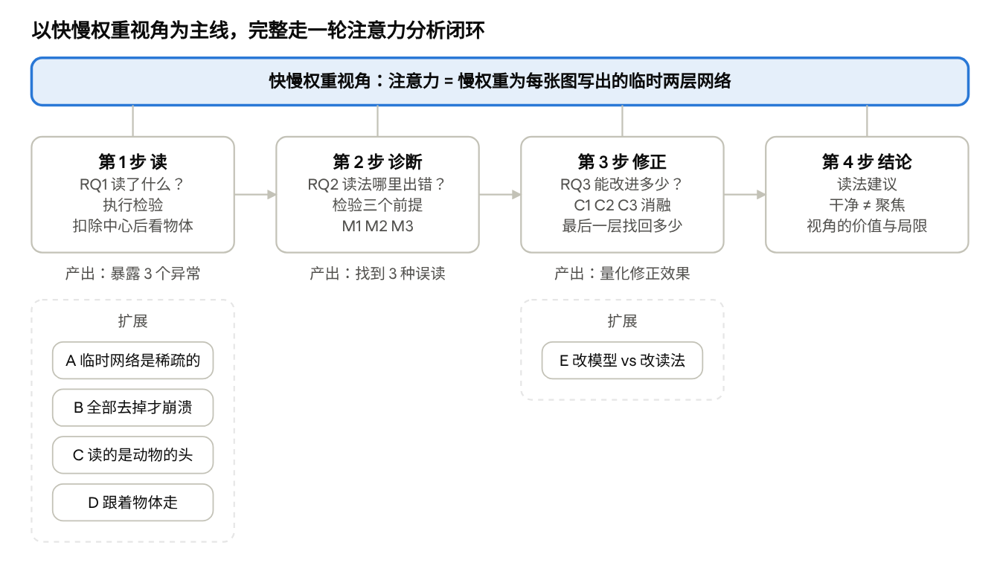

# 研究调整说明：用快慢权重视角完成一轮 ViT 注意力分析闭环

Nov 4, 2026 · @deng

## 这份文件是什么

研究方向调整为：**以快慢权重视角为主角，对预训练 ViT
的注意力完整走一轮“读 → 诊断 → 修正 → 结论”的分析闭环。** 本文件替代
docs/decisions.md 中 B21 的“定位 C”。

- **写给：** 负责本仓库全部实验的 Claude Code 代理。

- **性质：** 方向由作者确认。具体定义、判定数值和运行矩阵仍按
  AGENTS.md，先写入 docs/decisions.md 的“提议”，经作者确认后再正式运行。

- **不包含：** 时间安排。

与原论文（定位 C）相比的主要变化：

| 方面               | 原论文（定位 C）        | 新方向                                          |
|--------------------|-------------------------|-------------------------------------------------|
| 全文主角           | 可执行的 top-k 读取名单 | 快慢权重视角，以及用它完成的分析闭环            |
| 结构               | 5 个并列贡献            | 读 → 诊断 → 修正 → 结论，三个研究问题           |
| 快慢权重视角的作用 | 只用来推出读取名单      | 提出三个可检验的前提，并推出三种读法修正        |
| 附带发现           | 与主结果并列放在正文    | 选 5 个作为扩展挂在闭环上，其余放附录或移出主线 |

## 1. 为什么调整

原论文把五个发现并列，快慢权重视角只是装饰；而这门课看重完整的 research
story 和闭环，往年好案例都是“新视角 → 由视角推出的方法 → 完整实验 →
诚实结论”。

### 1.1 课程要求（docs/course/rubric.pdf）

- 目标是 workshop 级别的工作；正文 4 页，老师不一定读附录。

- 要“超越复现，提出新的见解和理解”；每个结论都要有引用、实验或推导支撑。

- 评分五个维度取平均：贡献、清晰度、深度、文献综述、格式。

### 1.2 往年好案例的共同结构

| 案例             | 新视角                          | 由视角推出的方法                       | 实验规模                                    |
|------------------|---------------------------------|----------------------------------------|---------------------------------------------|
| Sparse MoE       | 把 MoE 路由器重新看成贝叶斯组件 | 贝叶斯路由器 + 两个新指标（EAS、DARS） | CIFAR-10/100；主表 + 消融，用 RQ1、RQ2 组织 |
| Self-Consistency | 把多路径投票重新看成单层思维树  | 双分数验证 + 剪枝 + 提前停止           | 3 个模型 × 2 个数据集；主表 + 消融表        |
| World Model      | 把视线看成人类意图通道          | 视线 token 插入框架                    | 一个数据集，只有一张表                      |
| EEG2Image        | 拆成“对齐 + 一步生成”           | 多尺度编码器 + Mean Flow               | 结果接近随机，但诚实分析了失败原因          |

从中得出四条规律：

1.  **核心卖点是视角。**
    “把注意力重新看成快权重网络”与“把路由器重新看成贝叶斯组件”是同类写法。

2.  **方法要从视角里长出来**，并有一张框架图（图 1）和几个公式。

3.  **实验不求多，但要闭环**，最好用 RQ 组织，有主表和消融。

4.  **诚实比漂亮更重要。**

### 1.3 原论文的问题

原论文（paper/main.tex，以及作者手上加入了附录 C
的较新版本）实验扎实、流程严谨，但故事有四个结构问题：

1.  **标题和结论打架。** 标题主打可执行的 top-k 读取名单，但 B26
    的结论是“解释图用完整注意力，top-k 只做检验”。

2.  **贡献太散。** 正文 4 页列了 5
    个并列贡献，彼此没有“因为……所以……”的关系。

3.  **快慢权重视角只是装饰。**
    它只用来推出读取名单；之后的发现与它无关，去掉这个视角实验设计几乎不变。

4.  **多项发现已有人发表或部分发表**（见第 8 节）：register
    搬移汇聚点（Fesser 等）、角落平移（Kuang
    等）、中间层更好（Object-DINO）、深层失去空间对齐（Dense
    Degradation）、干净的图会误导（NeurIPS 2025）。

新方向保留全部实验，但让快慢权重视角成为主角，并用它把结果串成一条闭环。

## 2. 新的研究故事

我们把 ViT
的注意力重新看成“慢权重为每张图临时写出的快权重网络”，并用这个视角完整分析一遍注意力：先读出它在看什么，再找出这种读法的问题，最后用视角推出的修正去检验和改进。

**暂定标题：** *Attention as Fast Weights: A Read–Diagnose–Correct Lens
for Analyzing Vision Transformers*

### 2.1 快慢权重视角

- **慢权重**：训练后固定的参数（W_Q、W_K、W_V、W_O、FFN）。

- **快权重**：慢权重为每张图片写出的临时两层网络。键是第一层权重，值是第二层权重，softmax
  是激活函数，每个 token 是一个隐藏神经元（Schlag et al.
  2021；MiTA；test-time regression）。

- **读注意力图** =
  读这个临时网络的隐藏神经元激活，再按神经元对应的图块位置画出来。

### 2.2 三个研究问题

| 编号 | 闭环步骤 | 研究问题                                                                         |
|------|----------|----------------------------------------------------------------------------------|
| RQ1  | 读       | 预训练 ViT 的快权重网络读了什么？读出的神经元确实被模型使用吗？                  |
| RQ2  | 诊断     | 把注意力图当成“这张图的、位置准确的、按贡献排序的”读取，这三个前提在哪里不成立？ |
| RQ3  | 修正     | 按视角修正读法，能改进多少？与“改模型”（register、稀疏训练）相比如何？           |

### 2.3 三个贡献

1.  **一个视角：** 把预训练 ViT
    的注意力看成每张图写出的快权重网络，并用执行检验证明读出的神经元确实被模型使用。

2.  **一套由视角推出的分析方法：**
    读取名单与执行检验、三个前提的诊断、三种读法修正，配合扣除中心偏差的评估。

3.  **一轮完整的分析：** 在 DeiT-S、DeiT-B、DINO ViT-S
    上走完闭环，报告读到了什么、读法在哪里出错、修正读法与改模型各能做到什么。

### 2.4 不主张的东西

- 单个部件不是新的：读取名单的机制来自 MiTA；按贡献计分有 Kobayashi et
  al. 2020 和 SNNA；高范数 token 有 register
  系列工作。新意是**把快慢权重视角作为统一框架，对预训练 ViT
  注意力完整走一遍“读 → 诊断 → 修正”**。

- 不主张注意力读取比 GAE 更忠实；GAE 是参照上限。

- 不作因果结论，除非实验设计支持。

- 不主张改读法可以替代改模型。

### 2.5 写作规则：避免退回“并列的发现”

每一步的第一句话，都要说明上一步发现了什么、所以这一步问什么。例如 4.2
节开头：“第 1
步显示读取指向物体，但也暴露了几个异常，于是我们检验这种读法背后的三个前提。”

## 闭环总览

研究闭环 · 读、诊断、修正、结论，5 个扩展

快慢权重视角贯穿四步；每一步的产出引出下一步的问题，5 个扩展分别挂在第 1
步和第 3 步。

## 3. 闭环的四步

每一步回答上一步提出的问题；5 个扩展（A–E）分别挂在第 1 步和第 3
步。扩展的入选标准：能挂在闭环上、能用快慢权重解释、结果清楚、好讲。

### 3.1 第 1 步：读（RQ1）

**方法：** 16 个区域各用平均 query 取 top-16 个
key，形成读取名单；让模型 12
层只按名单计算（执行检验）。解释图用完整注意力的“收到的注意力”（B26
结论）。

**核心证据（已有）：**

- 执行检验：12 层全部限制后保留
  72%（DeiT-S）、62%（DINO）、83%（DeiT-B）；同样大小的随机名单
  9%、4%、30%；完全没有注意力 0.1–0.2%。

- 扣除中心偏差后，所有读取的同距离物体富集为正；ClickMe 图片特异
  Spearman 为正。

**扩展：**

| 编号 | 发现                               | 快慢权重解释                                | 证据                                                                                         | 注意                                                   |
|------|------------------------------------|---------------------------------------------|----------------------------------------------------------------------------------------------|--------------------------------------------------------|
| A    | 每个区域只用很少的神经元           | 临时网络是稀疏的                            | 16/197（约 8%）即保留大部分计算；top-k 图与完整注意力图逐图 Spearman 中位数 0.90             | 旧 k 扫描用的是第一代设置，正文需用主设置重跑          |
| B    | 单个临时网络可替换，全部去掉就崩溃 | 每层单独可替换（第 1 层除外），合起来不可缺 | 单层限制保留 92–96%，单层直接删注意力也保留 93–97%（第 1 层 69%）；全部去掉 0.1–0.2%         | 同时说明“只检验单层没有说服力”                         |
| C    | 模型读的是动物的头                 | 读取的语义细化                              | 删 4 个头部图块比删 4 个身体图块伤害更大，四足和两足动物 2–3.4 倍；三种读取和 GAE 都偏向头部 | 绝对效应小（DeiT-S +0.017 nats），倍数与绝对值一起报告 |
| D    | 物体移到角落，读取跟着走           | 读取不只是中心偏差                          | 平移 48 像素，读取物体占比比中心参照少降 0.021（DeiT-S）、0.053（DINO）、0.010（DeiT-B）     | 与 Kuang 等（ICML 2026）形式相近，需引用并区分         |

**引出第 2 步的异常：**

1.  一个固定的中心高斯与 ClickMe 的相关是
    0.41，高于所有注意力读取的原始相关。

2.  少数高范数 token 吸走大量深层注意力（DeiT-B 第 11 层：3% 的图块拿走
    43%）。

3.  有监督模型最后一层的读取变差：相对第 8–11 层最好值，ClickMe 图片特异
    Spearman 下降 0.086（DeiT-S）、0.116（DeiT-B），DINO 只降 0.032。

### 3.2 第 2 步：诊断（RQ2）

读注意力图默认三个前提；快慢权重视角让它们变得可检验。

| 编号 | 误读                               | 默认的前提                    | 检验                                  | 已有证据                                                                         |
|------|------------------------------------|-------------------------------|---------------------------------------|----------------------------------------------------------------------------------|
| M1   | 把与图片无关的成分当成这张图的反应 | 激活由这张图写出              | 模型平均读取图解释的方差比例          | 中心高斯 0.41（见上）                                                            |
| M2   | 把隐藏神经元当成原来的图块         | 第 j 个 token 代表第 j 个图块 | 逐层线性位置探针                      | DeiT-S 第 1 层 99.9% → 第 12 层 14.6%；DINO 第 12 层 25.4%；DeiT-B 22.1%         |
| M3   | 把激活当成贡献                     | 激活大 = 贡献大               | 高范数 token 的注意力占比与值向量长度 | 吸走最多一半深层注意力；值向量只有普通 token 的 0.2–0.3 倍；换成固定均值效果相同 |

**措辞注意：** M1
写成“与图片无关的成分（由慢权重作用在位置编码和偏置上产生）”，不要写成“慢权重读出的部分”。

**产出：**
一张“三个前提随深度变化”的图，说明每种误读出现在哪些层、哪些模型。

### 3.3 第 3 步：修正（RQ3）

每种误读对应一个由视角推出的读法修正：

| 编号 | 修正                 | 做法                                                  |
|------|----------------------|-------------------------------------------------------|
| C1   | 扣除与图片无关的成分 | 减去模型自己在留出图片上的平均读取图                  |
| C2   | 重新定位             | 用逐层位置探针，把 token 的分数分配到它现在代表的位置 |
| C3   | 按贡献计分           | 注意力权重乘以值向量经输出投影后的长度                |

**主结果：** 一张消融表（原始读取 / C1 / C2 / C3 / 三者合用），定义见第
6 节。

**次要结果：** 有监督模型最后一层的下降，修正后找回多少（描述性报告）。

**扩展 E：改模型 vs 改读法**

| 改模型的做法              | 已有结果                                                                                                               | 快慢权重解释                                                           |
|---------------------------|------------------------------------------------------------------------------------------------------------------------|------------------------------------------------------------------------|
| 测试时 register（DeiT-S） | 去掉 92% 高范数图块、精度不变；第 9 层释放的注意力流向 register +5.9 个百分点，流向物体只有 +0.5；物体富集只提高 0.006 | 每个查询的注意力总和固定为 1，去掉占位神经元只会把预算转到另一个占位处 |
| top-k 稀疏训练（MiTA）    | 扣除中心后的物体富集比 DeiT 低（Small −0.039，Tiny −0.020）                                                            | 让临时网络更稀疏，不等于让它更聚焦物体                                 |

必须如实报告的不一致：扣除高范数图块后，Tiny 尺寸 MiTA
反而更高（+0.037）；DeiT-B 的 register 只去掉 45%
高范数图块，未达到预设门槛。需引用 Fesser 等（2026）：register
是搬移而非消除汇聚点。

### 3.4 第 4 步：结论

- 注意力读取是有意义的（第 1 步），但读法有三种系统性误读（第 2 步）。

- 读法修正能找回多少（第 3 步）；改模型只会转移注意力预算。

- 给使用者的建议：读中后层；深层先检查位置；按贡献而非激活读；不要把“更干净的图”当成“更聚焦物体”的证据。

## 4. 论文的 4 页结构

正文按“视角 → 方法 → 三个 RQ → 结论”组织，扩展在正文中合计约 0.3–0.5
页，细节放附录。

| 节                 | 内容                                                                                       | 图表                                                                    | 篇幅（约） |
|--------------------|--------------------------------------------------------------------------------------------|-------------------------------------------------------------------------|------------|
| 1 引言             | 注意力图被广泛使用但难以验证；我们把注意力重新看成快权重网络；三个贡献                     | —                                                                       | 0.5 页     |
| 2 方法：快权重视角 | 读取名单与执行检验的公式；三个前提；三种修正的公式                                         | **图 1 框架图**：图片 → 慢权重写出快网络 → 读取 → 三个前提 → 三种修正   | 1.0 页     |
| 3 实验设置         | 3 个模型、ImageNet-S 和 ClickMe、指标（含扣除中心偏差的指标）、参照（GAE、中心高斯、随机） | —                                                                       | 0.3 页     |
| 4.1 RQ1 读         | 执行检验 + 物体聚焦；扩展 A 的 k 扫描小图；B、C、D 各一句话                                | **图 2**：执行检验随 k 的变化（含随机对照）+ 一个定性例子（可展示头部） | 0.7 页     |
| 4.2 RQ2 诊断       | 三个前提在哪些层不成立                                                                     | **图 3**：三个前提随深度变化                                            | 0.5 页     |
| 4.3 RQ3 修正       | 消融表；最后一层下降找回多少；扩展 E 一小段                                                | **表 1**：读法 × 指标 × 模型，加“+register”“top-k 训练”两行作对照       | 0.7 页     |
| 5 讨论与结论       | 建议；局限（单次训练、线性探针、只覆盖分类 ViT）；未来工作                                 | —                                                                       | 0.3 页     |
| 附录               | 扩展 A–E 的完整数字；与 Grad-CAM/IG/Rollout 的比较；距离匹配删除；预注册对账；实现细节     | —                                                                       | —          |

## 5. 现有实验的整理

现有实验分成四类：核心、扩展、只放附录、移出主线；一律不删除原始结果。

### 5.1 总原则

- **不删除原始结果。** 按 AGENTS.md，移出主线的先归档（docs/archive/
  或存档分支）。

- **挂得上闭环才进论文。** 每项都要能说出它属于哪一步、回答哪个 RQ。

- **附录不是垃圾桶。** 与闭环无关的东西，附录也不放。

### 5.2 核心（正文主体）

| 实验 / 结果                                                    | 位置                                                                                                                                                       | 闭环中的角色                                   |
|----------------------------------------------------------------|------------------------------------------------------------------------------------------------------------------------------------------------------------|------------------------------------------------|
| 执行检验（k = 16，12 层）                                      | 2026-10-26_rq2_imagenet、2026-10-27_rq1_colab_combined、2026-10-28_v2\_\*rq1\*、2026-10-28_v2\_\*rq2\*、2026-10-29_v3_deit_b_rq1、2026-10-29_v3_deit_b_rq2 | 第 1 步：读出的神经元确实被使用                |
| 中心对照与中心参照                                             | 2026-10-28_center_control；E4/E7 中的 centre                                                                                                               | 第 1 步测量工具；M1 证据                       |
| 完整注意力在 ImageNet-S、ClickMe 上的结果（合并层与逐层）      | 2026-10-31_s_e4_imagenet_s\_\*、2026-10-31_s_e7_clickme\_\*                                                                                                | 第 1 步物体聚焦与人类对齐；第 3 步原始读取基线 |
| GAE 参照                                                       | 2026-10-29_v3_e4_imagenet_s\_\*、2026-10-29_v3_e7_clickme\_\*                                                                                              | 第 3 步参照上限                                |
| E3 位置探针                                                    | 2026-10-29_v3_e3_identity\_\*、2026-10-29_v3_e3_identity.csv                                                                                               | 第 2 步 M2；C2 的实现基础                      |
| S3 读取中的高范数占比                                          | 2026-10-31_s_layers\_\*                                                                                                                                    | 第 2 步 M3                                     |
| 注意力预算研究中的值向量长度与均值替换（DeiT-S、DeiT-B、DINO） | 作者较新论文版本的附录 C；请确认运行和代码位置，不在主分支则补回                                                                                           | 第 2 步 M3                                     |
| 随机化健全性检验                                               | 2026-10-29_v3_sanity\_\*                                                                                                                                   | 新读法也要做                                   |

### 5.3 扩展（正文一句话或一个小图，细节放附录）

| 扩展                     | 对应实验                                                                               | 处理                                                        |
|--------------------------|----------------------------------------------------------------------------------------|-------------------------------------------------------------|
| A 临时网络是稀疏的       | k 扫描（2026-10-27_rq1_colab\*、\_k128）；S1 中 top-k 图与完整注意力图的逐图相关       | **用主设置重跑 k 扫描**后进正文图 2；旧扫描放附录并注明设置 |
| B 单层可替换、整体不可缺 | 单层执行与单层删除注意力的运行（旧论文图 1c 所用，请定位）                             | 正文一句话，图放附录                                        |
| C 读的是头               | \*\_e8_parts\_\*（v3 与 S1）                                                           | 正文一句话 + 定性图中的一个例子                             |
| D 跟着物体走             | 2026-10-29_v3_e5_shifted\_\*                                                           | 正文一句话                                                  |
| E 改模型 vs 改读法       | 注意力预算研究中的 register 条件（R0–R5）与 MiTA-DeiT-S/T 对比；2026-10-28_v2_mita\_\* | 表 1 加两行 + 一小段                                        |

### 5.4 只放附录

| 实验                                           | 理由                    |
|------------------------------------------------|-------------------------|
| 与 Grad-CAM、IG、Rollout、CLS 注意力的完整比较 | 不回答 RQ；正文只留 GAE |
| E6 距离匹配删除                                | 第 1 步的补充证据       |
| 预注册对账总表                                 | 体现严谨性；正文一句话  |
| 推理成本对比                                   | 一行带过                |

### 5.5 移出主线（论文不出现）

| 实验                                                                      | 理由                      |
|---------------------------------------------------------------------------|---------------------------|
| Pet、Hard ImageNet、ImageNet 子集上的 E4                                  | 重复主数据集结论          |
| top-k 名单作为解释图的各项比较                                            | 已由扩展 A 的一句话覆盖   |
| IG 未通过随机化检验                                                       | 与快慢权重无关            |
| 噪声底（\*\_noise\*）、Pet 上的早期高范数诊断（2026-10-26_rq3_diagnosis） | 已被后续实验取代          |
| 移出数据集的定性图库                                                      | 只留 ImageNet-S / ClickMe |

### 5.6 文档整理

- docs/decisions.md：新增用户确认的定位决定（建议 B27），说明本文件替代
  B21；第 6 节内容写成提议（B28 起）。

- README.md、docs/progress.md：更新一句话和主要结果。

- v3 报告、补充实验报告保持不变，开头加一行“已被新定位取代”。

## 6. 接下来要做的事

新工作只有三块：实现三种读法修正并跑一张消融表、补一个 M1
的诊断统计、用主设置重跑 k 扫描。

### 6.1 读取方式的定义

符号：第 ℓ 层、第 h 个头，a(ℓ,h,i,j) 是 query i（全部 197 个 token，含
CLS）对 key j（196 个图块）的 softmax 注意力。

**R0 原始读取**（即现有 attention_layer{l}）：

s^{\ell}\_j = \sum_h \sum_i a^{\ell h}\_{ij}

**C3 按贡献计分**（W_O^h 为 attn.proj 中对应第 h
个头的部分，偏置不计入）：

c^{\ell}\_j = \sum_h \sum_i a^{\ell h}\_{ij}\\\big\lVert W_O^{h}\\
v^{\ell h}\_j \big\rVert_2

**C2 重新定位**（P_ℓ 为第 ℓ 层线性位置探针的 196 类 softmax 概率）：

r^{\ell}\_p = \sum_j s^{\ell}\_j \\ P\_\ell(p \mid x^{\ell}\_j)

探针在第 ℓ 块的输入 token（产生第 ℓ
层键和值的表示）上、用与评估图片不相交的留出图片训练；norm1 前或后需与
identity.collect 核对并写入决策。

**C1 扣除与图片无关的成分**（平均图对每种读取方式分别计算）：

\tilde s^{\ell}\_j = s^{\ell}\_j - \bar s^{\ell}\_j,\qquad \bar
s^{\ell}\_j = \mathbb{E}\_{x \in
\text{held-out}}\big\[s^{\ell}\_j(x)\big\]

**R_all 合用**：顺序固定为 C3 → C2 →
C1；另一种顺序作为附录的稳健性检查。

### 6.2 消融表（表 1）

| 维度 | 取值                                                                            |
|------|---------------------------------------------------------------------------------|
| 行   | R0、C1、C2、C3、R_all；对照行“+register”（DeiT-S）、“top-k 训练”（MiTA-DeiT-S） |
| 列   | SRG 忠实度、同距离物体富集（ImageNet-S）、图片特异 Spearman（ClickMe）          |
| 模型 | DeiT-S、DeiT-B、DINO ViT-S                                                      |
| 层   | 主结果用 9–12 层合并；另列第 12 层                                              |
| 参照 | GAE、中心高斯、模型平均图、随机                                                 |

不做 12 层 × 5 种读法的完整逐层矩阵，以控制篇幅和算力。

### 6.3 第 2 步的诊断图（图 3）

逐层、逐模型画三条曲线：M1 比例 1 − Var(s −
s̄)/Var(s)（**新算**）、位置探针正确率（已有）、高范数 token
的读取占比（已有）。

### 6.4 k 扫描重跑（图 2）

用主设置（CLS 读自己的 top-k 名单），k ∈ {4, 8, 16, 32, 64, 128}，12
层执行，读取名单与同样大小的随机名单，至少 DeiT-S，最好 3 个模型。

### 6.5 预测草案（登记为提议前请细化）

判定界限建议沿用 B22：SRG 0.05；同距离富集与图片特异 Spearman 0.02；配对
bootstrap 按 B10。

| 编号 | 预测                                                                                             | 类型                       |
|------|--------------------------------------------------------------------------------------------------|----------------------------|
| P1   | 主设置下，执行一致率随 k 单调上升；每个 k 上读取名单都高于随机名单                               | 复核                       |
| P2   | M2 随深度加重；M3 集中在有监督模型中后层，DINO 接近 0；M1 逐层分布不预测方向                     | 复核 + 描述                |
| P3   | 9–12 层合并时，R_all 在有监督模型上的同距离富集和图片特异 Spearman 高于 R0；分别报告各修正的贡献 | 有方向                     |
| P4   | 阴性对照：C3 在 DINO 上几乎不改变结果；C2 在 1–4 层几乎不改变结果                                | 必须成立，否则查实现       |
| P5   | 有监督模型最后一层的下降，修正后找回的比例                                                       | 描述性                     |
| P6   | “+register”“top-k 训练”两行的物体富集提升不超过界限                                              | 已有结果，按原判定如实报告 |

### 6.6 必须新增的检查

- **单元测试**（改动 src/mita_probe/ 后先跑 pytest）：C2
  在恒等探针下返回原读取且保持总分数；C3 在值向量长度全相等时与 R0
  只差常数倍；C1 在留出集上平均为 0；R_all 顺序与定义一致。

- **随机化健全性检验**：新读法按 2026-10-29_v3_sanity\_\* 的流程检验。

- **复现检查**：新运行中的 R0 与 S1/S2 的完整注意力结果一致（写法同 B22
  (7)）。

## 7. 方法上必须注意的问题

最大的风险是数据泄漏、把构造上的不变性误读为“修正无效”，以及扩展结果的报告不一致。

1.  **留出集与评估集不相交。** 平均图和位置探针都在留出图片上估计；核对
    ClickMe 图片来源，确保不重叠。

2.  **检查每个指标对修正是否在构造上不变。**
    例如同距离富集在每个环内排序，若平均图接近径向对称，C1
    几乎不改变它。提前写明。

3.  **线性探针可能低估深层位置信息。**
    局限性中说明；如有余力，附录比较两层 MLP 探针（不进主判定）。

4.  **修正顺序会影响结果。** 主分析固定 C3 → C2 →
    C1，附录报告另一种顺序。

5.  **C2 与删除式忠实度的关系。** SRG 在输入层删除图块；C2
    把深层分数画到 token 现在代表的位置。写作时解释清楚。

6.  **扩展结果保持原判定。** 扩展 A–E
    都来自已登记的实验，按当时的预注册判定报告，包括不成立的部分（如
    MiTA Tiny、DeiT-B register 门槛）；不为了故事重新解释。

7.  **k 扫描设置要一致。** 正文图 2
    只用主设置的新结果；旧的第一代设置结果只能放附录并注明。

8.  **效应量同时报告绝对值和相对值。** 例如头部效应写“2–3.4 倍（DeiT-S
    绝对值 +0.017 nats）”。

9.  **不为结果改参数。** 预设参数、图片子集（seed 0）、随机对照（seed
    0–4）不变；一次只改一个因素。

10. **区分推导和测量。** “C2
    在恒等探针下不改变读取”是推导，不算发现；“C2
    在训练后模型深层改善了人类对齐”才是测量结论。

## 8. 必须处理的文献

以下条目来自作者与 AI
助手的检索，写进论文前请逐条核对原文（作者、年份、会议、具体结论）。

| 文献                                                                                                                                                                 | 在论文中的作用                                                                                         |
|----------------------------------------------------------------------------------------------------------------------------------------------------------------------|--------------------------------------------------------------------------------------------------------|
| Schlag, Irie & Schmidhuber 2021；Wang, Shi & Fox, test-time regression（JMLR 2026）；Irie & Gershman, fast weight programming primer；MiTA（Wen et al. 2026）        | 快慢权重视角的来源；读取名单机制                                                                       |
| [Kobayashi et al. 2020](https://arxiv.org/pdf/2004.10102)                                                                                                            | C3 的直接先例                                                                                          |
| [SNNA（arXiv 2407.06339）](https://arxiv.org/html/2407.06339v1)                                                                                                      | C3 在 ViT 上的先例                                                                                     |
| Darcet et al. 2024；[Jiang et al. 2025（test-time registers）](https://nips.cc/virtual/2025/poster/117199)                                                           | 扩展 E 的“改模型”路线；高范数 token 来源                                                               |
| [Fesser et al. 2026（arXiv 2606.08105）](https://arxiv.org/pdf/2606.08105)                                                                                           | M3 与扩展 E：register 搬移而非消除汇聚点                                                               |
| [NeurIPS 2025：register 与 \[CLS\] 导致局部与全局特征解耦](https://neurips.cc/virtual/2025/poster/118616)                                                            | “干净的图会误导”的支持                                                                                 |
| [Dense Degradation（arXiv 2605.23868）](https://www.alphaxiv.org/overview/2605.23868)                                                                                | M2 相关：深层失去空间对齐                                                                              |
| [Object-DINO（CVPR 2026）](https://cvpr.thecvf.com/virtual/2026/poster/38825)                                                                                        | 中层读取更好的已有证据                                                                                 |
| [Kuang et al.（ICML 2026）](https://icml.cc/virtual/2026/poster/63844)                                                                                               | 扩展 D 与 M1 定位：他们研究 CNN 的架构中心偏差                                                         |
| Fel et al. 2022（Harmonization）及其[补充材料](https://proceedings.nips.cc/paper_files/paper/2022/file/3d681cc4487b97c08e5aa67224dd74f2-Supplemental-Conference.pdf) | M1 动机：ViT rollout 与 ClickMe 相关约 0.38–0.39，与中心高斯 0.41 同量级（设置不同，写明不能直接比较） |
| PoWER-BERT、LTP                                                                                                                                                      | “收到的注意力”作为 token 重要性                                                                        |
| Jain & Wallace 2019；Wiegreffe & Pinter 2019；Abnar & Zuidema 2020；Chefer et al. 2021                                                                               | 注意力是否是解释的背景                                                                                 |

## 
